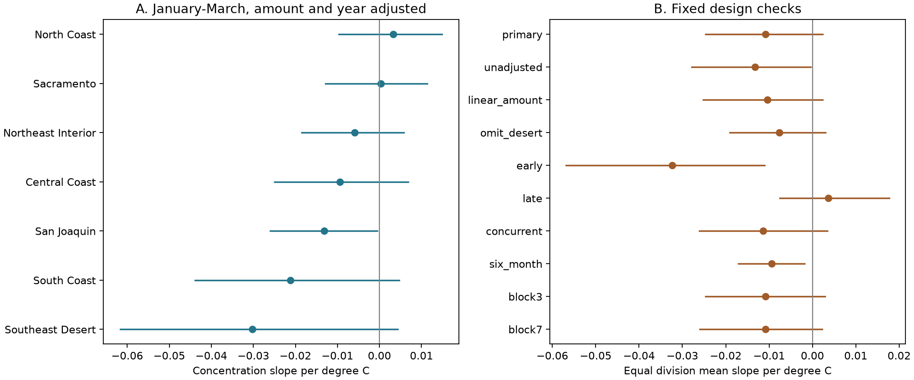

# Autumn ENSO gave no clear amount-adjusted link to January-March precipitation concentration in seven California divisions in 1951-2025

The equal division mean slope was **-0.01087 per degree C**, with a 95% five-year block interval of **-0.02464 to 0.00239**. The primary test gave no clear amount-adjusted link between autumn ocean temperature and January-March monthly concentration. The interval permits a decrease and a small increase. It does not prove no link.

Figure 1. Each line is a marginal 95% block interval. Panel A gives separate division estimates. Panel B gives the mean of the division slopes. Negative values mean a more even monthly distribution as Nino 3.4 rises. Early means 1951-1987; late means 1988-2025. The six-month check uses October-March concentration. It has a different endpoint and lower bound.

## Question and prior work

Does autumn ENSO have a link to the distribution of late-winter precipitation among months beyond its link to the seasonal amount? This distinction matters when seasonal rainfall guidance is used to reason about wet periods and storage. We measure monthly distribution only. We do not measure storage effects.

[Jong and colleagues (2016)](https://doi.org/10.1088/1748-9326/11/5/054021) report stronger ENSO rainfall links in late winter and southern California. [Cheng and colleagues (2021)](https://doi.org/10.1029/2020GL091465) examine precipitation frequency and total amount. [The weather-regime study (2024)](https://doi.org/10.1029/2024GL110326) examines differences among El Nino winters. These works motivate a test of time distribution. Our monthly data do not reproduce their daily event or atmospheric analyses. We reviewed public abstracts, indexed article text, and repository descriptions. We do not claim a new ENSO mechanism or a new concentration statistic.

Before the precise question was selected, we searched signed campaign results for earthquake, ocean, hydrology, ENSO, precipitation, and concentration. We read the [monthly concentration report](sci:sha256:dc441d1b19614e82fa2b17860a059a5a0cf5b7eb8fa01fd19849084641300267), the [autumn ENSO forecast report](sci:sha256:6e2cf7e493696445df9d65c74f49669698d3761300babdc963ef3d5a0dc7ee6e), and the [spring recovery report](sci:sha256:902e51ea2885b1cc9a775082fed5e09038db6d8303f9e0e78a75e76ac3fdfd04). The first tested period changes in concentration. The second tested rainfall forecast error. The third tested full recovery after dry starts. The present test links autumn ENSO to concentration with amount adjustment. We used published results, not private sibling files. The [local plan](files/analysis_plan.txt) preceded computation of the concentration outcomes. It is not an external registration.

## Data

We read two fixed shared files in place:

    /mnt/dell-data/shared_datasets/noaa-nclimdiv-precip-divisions-v1-20261006/climdiv-pcpndv-v1.0.0-20261006.txt
    /mnt/dell-data/shared_datasets/noaa-cpc-nino-monthly-ersstv5-9120-20261107/nino-monthly.ascii.txt

The first is NOAA nClimDiv v1.0.0, dated 20261006. Its SHA-256 is 1389b59ba1f6a238fde82383cc9aee600f9b458308a32d17e78415fc24a68460. It gives monthly precipitation in inches to 0.01 inch, including snow water equivalent. These are division means from gridded station estimates. We select state 04, divisions 01-07, element 01, years 1950-2025. We store those exact lines in california.txt. All selected monthly values are nonnegative. All required season totals are positive and all keys are unique.

The second is the NOAA CPC ERSSTv5 monthly regional table. Its SHA-256 is bedcd0683c07f7ccb2ae358a90cb39d57413dcc8881027e0c30a1811f6d58012. We use the last column: Nino 3.4 anomaly in degrees C with a fixed 1991-2020 reference. Nino 3.4 covers 5 S-5 N, 170 W-120 W. This is not an ONI event label. We store the full small table in nino.txt.

For each year y from 1951 to 2025, N is mean October-December Nino 3.4 in y-1. The precipitation outcome uses January-March of y. Thus, predictor and outcome months do not overlap in the primary test. There are 75 years and 525 division-years. These are retrospective reconstructions; we do not assume the final December data were available on January 1. This is not an operational forecast test.

[provenance.json](files/provenance.json) gives full hashes, subset hashes, exact paths, resolved object paths, source URLs, retrieval records, and metadata hashes. The source format document came from the verified concentration publication and is included. No shared data were changed. No new reusable download was needed.

## Method

Let p1, p2, p3 be monthly precipitation and T their sum. Define:

    H = (p1/T)^2 + (p2/T)^2 + (p3/T)^2
    H = a + b N + c z + d z^2 + e t + error
    z = log(T) - mean(log(T))
    t = (year - mean(year))/10
    primary estimate = mean of b across seven separate division fits

Uniform monthly fractions give H=1/3. One month with all the precipitation gives H=1. Higher H means a less even distribution. The statistic ignores month order, day counts, daily intensity, and dry-spell duration. We use ordinary least squares. Recentring z changes the other coefficients but does not change b in this full quadratic model.

The seven divisions receive equal weight. The result is not an area-weighted California average or water volume. Regions share weather. We retain that dependence with common year resamples rather than treating the 525 rows as independent.

We draw 5000 circular five-year block samples of complete annual vectors. Each sample has 75 years after trimming. All division regressions are refitted in each sample, including the amount and year terms. We use percentile limits at 2.5 and 97.5 percent. Seed is 478965. Three- and seven-year blocks use seeds 478963 and 478967. Samples retain the original year labels. These intervals assume that the fitted relation and residual dependence are sufficiently stable for block sampling. Circular wrapping joins record ends. A trend term cannot guarantee stable residuals or ENSO response. The intervals omit product uncertainty and very long climate cycles.

The fixed checks remove adjustment; retain only a linear log-total adjustment; omit the desert; split at 1988; use concurrent January-March Nino 3.4; or use October-March concentration with its own total. The last check has six months, with a minimum H of 1/6. Its predictor overlaps its precipitation window, so it is not a lead-only association. Each check uses 5000 refitted five-year samples. We also refit after deleting each individual year. All check and division intervals are marginal, with no multiple-comparison correction.

Adjustment for total is descriptive. Concentration and total come from the same monthly values. Conditioning on total can remove a real pathway or induce an association. The regression cannot identify a direct ocean effect.

## Results

| Case | Years | Mean slope per C | 95% interval |
| --- | ---: | ---: | --- |
| primary | 75 | -0.01087 | -0.02464 to 0.00239 |
| unadjusted | 75 | -0.01329 | -0.02787 to -0.00038 |
| linear_amount | 75 | -0.01036 | -0.02519 to 0.00235 |
| omit_desert | 75 | -0.00765 | -0.01910 to 0.00297 |
| early | 37 | -0.03233 | -0.05680 to -0.01110 |
| late | 38 | 0.00361 | -0.00753 to 0.01769 |
| concurrent | 75 | -0.01143 | -0.02608 to 0.00339 |
| six_month | 75 | -0.00937 | -0.01707 to -0.00185 |
| block3 | 75 | -0.01087 | -0.02469 to 0.00289 |
| block7 | 75 | -0.01087 | -0.02596 to 0.00223 |

The primary, three-year, and seven-year intervals all include zero. Omitting the desert also leaves an interval that includes zero. The point estimate remains negative after each single-year deletion. Its range is -0.01322 to -0.00638 per C. Deleting 1988 gives the lowest slope; deleting 1956 gives the highest. This check addresses single-year influence, not event or decade influence.

The unadjusted interval is below zero. With the planned amount and year adjustment, the primary interval includes zero. This does not prove that amount explains the association: the fits have different uncertainty, and conditioning on amount is not a causal experiment.

The early-period estimate is -0.03233 per C, with interval -0.05680 to -0.01110. The late-period estimate is 0.00361, with interval -0.00753 to 0.01769. These are descriptive checks. We did not test an interaction or select a change year from the data. An early significant estimate and a late uncertain estimate do not by themselves prove that the slopes differ.

The six-month estimate is -0.00937 per C, with interval -0.01707 to -0.00185. This secondary result is compatible with a broader seasonal distribution link. Its month window, outcome scale, and predictor overlap differ from the primary test. It cannot establish a January-March response. It also cannot distinguish a shift of the mean seasonal cycle from a change in storm frequency.

| Division | Primary slope per C | Marginal 95% interval |
| --- | ---: | --- |
| North Coast | 0.00329 | -0.00991 to 0.01501 |
| Sacramento | 0.00034 | -0.01307 to 0.01152 |
| Northeast Interior | -0.00586 | -0.01871 to 0.00604 |
| Central Coast | -0.00942 | -0.02516 to 0.00700 |
| San Joaquin | -0.01311 | -0.02615 to -0.00040 |
| South Coast | -0.02115 | -0.04401 to 0.00485 |
| Southeast Desert | -0.03021 | -0.06182 to 0.00451 |

San Joaquin has a nominal negative interval. It is one of seven regional checks and is not a corrected regional discovery. The figure and tables show all estimates, including those that include zero.

## Interpretation and limits

The tested explanation is that autumn ocean conditions are linked to a more even late-winter monthly precipitation distribution beyond their link to total amount. The primary result is uncertain. The stronger early and six-month estimates motivate tests with independent products, daily observations, and atmospheric circulation. They do not establish a stable or causal relation.

Only 75 years are available, with fewer independent ENSO episodes. The OLS slope is linear in Nino 3.4 and assumes common amount-response terms within each fit. It does not allow different warm and cold slopes. Model error, long climate variation, the chosen window, and measurement error could change the result. Gridded early observations and later product revisions add uncertainty. We use only one precipitation product and one ocean reconstruction. Equal division weighting gives small dry regions the same weight as large wet regions.

Monthly concentration is not a flood index. It does not measure daily rain, atmospheric rivers, snow storage, runoff, groundwater, reservoirs, demand, or available water. It cannot resolve the physical cause of an association. No forecast scores were computed and no operational skill claim is made. The result is a reproducible, scoped test with an uncertain primary estimate and fully reported secondary checks.

## Reproduction and validation

[REPRODUCE.md](files/REPRODUCE.md) gives commands and retrieval details. [analyze.py](files/analyze.py) computes all results from bundled source bytes. results/annual.csv gives all 525 seasonal rows. results/primary_indices.npy gives all 5000 primary year samples. The primary and check draw tables preserve the slope evidence. summary.json has all regional and aggregate results. The code also records its environment.

The independent [audit](files/results/audit.json) passed. It reparsed the source with Decimal arithmetic and used normal equations rather than the main least-squares solver. It checked all annual rows, all seven primary coefficients, every primary resample coefficient, and the primary interval. The largest coefficient difference was below 4.2e-15. This confirms numerical agreement, not physical assumptions. A separate repeat record is included.

## Campaign record

Job: sci-1107-syam2-earth-and-ocean-sciences-478960d46f55. Topic: earth-and-ocean-sciences. Campaign: 11_07_2026. Machine: syam2. Account: codex-myxtap. Model: gpt-6.1-sol with high reasoning effort, through the Codex harness in T3 Code. No agents were launched. Substantial calculations used campaign-compute with library threads at one. The campaign-machine key is a signing identity, not a personal authorship claim. Private keys are outside this package. No remote archive or index submission was made.

The SCI baseline license covers the text, derived results, figure, and code. NOAA sources retain their source status.
