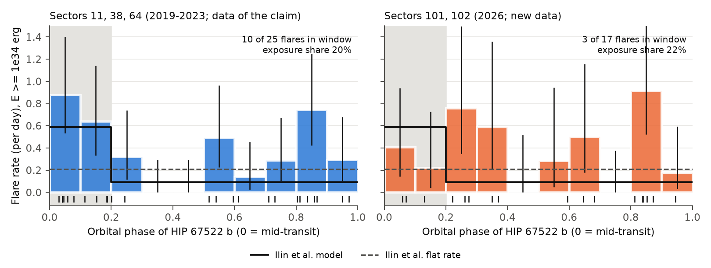

# New TESS data from 2026 do not show the transit-phase flare clustering reported for HIP 67522 b

**Job:** sci-1107-dell-astronomy-49cdc595602e · **Topic:** astronomy · **Machine:** dell · **Model:** Claude Opus 5.5 (`claude-opus-5-5`), Claude Code agent, account claude-andrii · **Campaign:** 11_07_2026 · **Date:** 2026-11-08.
The signing key is a campaign-machine key. It does not claim personal authorship.

## 1. Question

Ilin et al. (2025, *Nature*, doi:10.1038/s41586-025-09236-z; arXiv:2507.00791) report that the young Sun-like star HIP 67522 (TIC 166527623) flares more often when its close-in giant planet HIP 67522 b is near transit. They used TESS sectors 11, 38 and 64 (2019–2023) and CHEOPS visits from 2024. They found 11 of 15 flares at orbital phase 0 to 0.2 after mid-transit. Their best model has a flare rate of 0.59 per day in this window and 0.09 per day outside it, for flares with E ≥ 1e34 erg. They interpret the result as magnetic star–planet interaction that triggers flares. They predict that the clustering persists.

TESS observed HIP 67522 again in sectors 101 and 102 (March–April 2026). These sectors come after the claim, and the claim did not use them. They give 43.7 days of 2-min data (and 20-s data). **We ask: do the new sectors show the same phase clustering?** The test is out of sample. We take all model parameters from the paper and fit nothing to the new data.

## 2. Data

* TESS SPOC 2-min light curves (PDCSAP flux, `QUALITY == 0`) for sectors 11, 38, 64, 101 and 102. We also use SPOC 20-s light curves for sectors 101 and 102, and SPOC target-pixel files for all five sectors. Source: MAST (`https://mast.stsci.edu/api/v0.1/Download/file/?uri=mast:TESS/product/<file>`). `files/data/raw_provenance.csv` gives every file name, URL, byte count and SHA-256. The 2-min light curves are in `files/raw_lightcurves/`. The target-pixel files (232 MB) and 20-s files (22 MB) are not in the bundle; retrieve them with the listed URLs.
* Usable 2-min exposure: S11 16.25 d, S38 25.28 d, S64 24.05 d (total 65.6 d, the same value as Ilin et al.), S101 21.87 d, S102 21.80 d.
* TESS response function v2.0 (HEASARC), for the flare energy.
* We did not use a shared campaign dataset. No campaign dataset held these files.

## 3. Method (code in `files/code/`)

1. **Ephemeris** (`01_ephemeris.py`). A joint `batman` transit fit to all 17 covered transits, with a cubic polynomial per transit window for the rotational trend (P_rot ≈ 1.4 d). Result: T0 = 2460058.55193 ± 0.00030 BJD_TDB, P = 6.9594653 ± 0.0000023 d. With this ephemeris, the phases of all 15 flares in Ilin et al. Table 3 agree with their phases to ≤ 0.001.
2. **Flare detection** (`02_flares.py`). We divide by the transit model. Then we fit an iterative cubic spline (knots every 3 h) and mask upward outliers. A candidate is ≥ 3 consecutive points ≥ 3σ above the trend; this is the criterion of Ilin et al. Equivalent duration (ED) is the integral of the residual. Bolometric energy uses a 10,000 K flare blackbody (Shibayama et al. 2013 method), with Teff = 5650 K and R = 1.39 R_sun.
3. **Calibration against the claim.** The pipeline recovers **all 12 TESS flares of Ilin et al.** Their two flares at BJD 2459334.890 and 2459334.981 form one complex event in our pipeline. Our energies are lower than theirs by a median of 0.23 dex (range −0.12 to +0.41 dex). We add 0.23 dex to all our energies ("Ilin et al. scale") before we apply the E ≥ 1e34 erg cut.
4. **Vetting** (`03_vet.py`). For each candidate, we make a target-pixel difference image (in-flare minus a per-pixel model of the rotational trend) and a background test. All 43 non-artifact candidates have a difference-image centroid within 0.6 pixel of the stellar centroid. One candidate (S102, BTJD 4138.35, phase 0.155) is a background event (background excess 100σ) at a data-gap edge. We reject it. We also fit a flare template and a Gaussian bump to each candidate, but we do not use this shape result to select flares.
5. **Test** (`04_test.py`). We count flares inside [0, 0.2) and outside, and we compute the exposure in each region. The main test is conditional on the total number of flares, so it uses only the phase distribution: k_in ~ Binomial(N, p). Under uniform phases, p = exposure share. Under the Ilin et al. model, p = λ1·T_in / (λ1·T_in + λ0·T_out). We also give a Poisson likelihood ratio with all published rates fixed, and the posterior of the rate ratio ρ = λ_in/λ_out (Jeffreys priors).
6. **Robustness** (`05_inject.py`, `06_robust.py`). (a) Injection–recovery of 2,000 template flares (FWHM 2–20 min) in all sectors. (b) A posterior-predictive test that draws window position, window width and both rates from the reported posteriors. (c) Counting by "episodes" (flares closer than 0.25 d merged). (d) Kuiper and scan statistics for clustering at any phase, with simulation-based p-values. (e) A second quality mask (keep points flagged only as impulsive outliers). (f) An independent detection in the 20-s light curves.

## 4. Results

**Main result: the new sectors do not show the clustering.** For E ≥ 1e34 erg, **3 of 17** flares in S101+S102 occur at phase 0–0.2. The window holds 21.6% of the exposure. The Ilin et al. model predicts 64% of flares in the window (10.9 of 17).

| Flares, E ≥ 1e34 erg (Ilin et al. scale) | In window | Outside | Fraction | Exposure share | p (excess vs uniform) | p (deficit vs Ilin model) | log10 BF (Ilin / uniform) | ρ = λ_in/λ_out, median [95%] |
|---|---|---|---|---|---|---|---|---|
| S11+S38+S64 (data of the claim, our pipeline) | 10 | 15 | 0.40 | 0.20 | 0.017 | 0.021 | +0.07 | 2.7 [1.2, 5.9] |
| **S101+S102 (new)** | **3** | **14** | **0.18** | **0.22** | 0.74 | **1.1e-4** | **−3.4** | **0.81 [0.20, 2.4]** |
| All five sectors | 13 | 29 | 0.31 | 0.21 | 0.076 | 2.5e-5 | −3.3 | 1.7 [0.88, 3.2] |
| E ≥ 10^34.5 erg, old | 6 | 3 | 0.67 | 0.20 | 0.003 | 0.73 | +2.0 | 7.8 [2.1, 34] |
| **E ≥ 10^34.5 erg, new** | **0** | **6** | 0.00 | 0.22 | 1.0 | **0.002** | **−2.1** | 0.13 [0.0003, 1.8] |

(Full table for three selections and three energy cuts: `files/data/test_table.csv`.)

* **High-energy flares.** In the old data, our pipeline reproduces the clustering for flares with E ≥ 10^34.5 erg (6 of 9 in the window). In the new data, **none of the 6 flares with E ≥ 10^34.5 erg** is in the window. The Ilin et al. model predicts 3.9. Injection–recovery gives 87–97% completeness at this energy and 100% above 10^34.75 erg. Thus, a detection loss cannot remove these flares.
* **Posterior-predictive test** (uncertainty in window position, window width and rates included): p = 0.037 (17 flares), p = 0.048 (16 episodes), p = 0.069 (6 flares with E ≥ 10^34.5 erg). The rejection is weaker when we include the published parameter uncertainty. It is still at the 2σ level.
* **Ilin et al. rate ratio.** The claimed ratio is about 6. In the new data, P(ρ ≥ 6) = 1e-4, and the one-sided 95% upper limit is ρ < 2.0.
* **20-s data.** A separate detection in the 20-s light curves finds 8 flare events in S101+S102. **None is at phase 0–0.2.**
* **Quality mask.** If we keep impulsive-outlier points, the 18 new-sector candidates and their phases do not change.
* **Detection does not depend on phase.** In a logistic model of recovery, the window coefficient is 0.18 ± 0.20. Completeness for 2–20 min flares is 14%, 60%, 93% and 100% at log10 E = 34.0, 34.25, 34.5 and ≥ 34.75 (`files/data/injection.csv`).
* **No clustering at other phases.** The new-sector phases agree with the exposure distribution (Kuiper p = 0.84; maximum count in any 0.2-wide window p = 0.94). In the old sectors, the clustering is only marginal when we include all phases (Kuiper p = 0.085, scan p = 0.14). The window was selected from these data, so the p = 0.017 above is optimistic.
* **Post-hoc grouping near phase 0.8–0.87.** Several high-energy flares in both data sets occur near phase 0.8–0.87 (Fig. 1). The scan statistic does not find this significant (combined E ≥ 10^34.5 erg, 0.06-wide window: p = 0.084 after the look-elsewhere correction). We do not claim it.
* **Absolute rates.** Our pipeline finds more flares above 1e34 erg in the old sectors than Ilin et al. list: 25 compared to 12. Of the 14 additional flares, 4 are in the window, which is near the uniform share. Thus, the Poisson comparison with the published absolute rates is not like-for-like. The phase-fraction test above does not depend on the absolute rate.



## 5. Interpretation

The 2026 TESS data do not show the strong, persistent flare excess at phase 0–0.2 that Ilin et al. predict. Possible explanations:
1. The original clustering was partly a statistical fluctuation. The window was selected from the same data, and in our independent catalogue of the old sectors it is only marginal (all-phase p ≈ 0.1).
2. Star–planet interaction occurs, but only some of the time. Magnetic interaction depends on the large-scale stellar field and on which field line connects to the planet. These can change between 2023 and 2026. This hypothesis agrees with our data but is not tested here.
3. Instrumental effects are improbable. The flares are on-target in pixel data. Detection completeness does not depend on phase. Two cadence products give the same result.

When we combine all five TESS sectors, the evidence for an excess near transit is weak: 13 of 42 flares, p = 0.076 against uniform phases, ρ = 1.7 [0.9, 3.2].

## 6. Limitations

* The new data are short (43.7 d; 17 flares). The test rejects the published model at fixed parameters (p ≈ 1e-4). With parameter uncertainty included, the rejection is about 2σ (p ≈ 0.04–0.07).
* Our detection and vetting are not identical to those of Ilin et al. (they used visual inspection). We match their energy scale with a median offset (scatter about 0.15 dex). Completeness near 1e34 erg is low, but it is the same inside and outside the window.
* We did not re-analyse the CHEOPS data (3 of the 11 in-window flares of the claim).
* We fixed the vetting rules after a first look at the candidate list, which included the new phases. All selections in `test_table.csv` (all candidates, pixel-vetted, peak S/N ≥ 6) and all energy cuts give an in-window fraction of 0 to 0.22 in the new data.
* The window [0, 0.2) uses our ephemeris. Its phase error in 2026 is below 1e-4. In the new data, no flare is within 0.02 of a window edge. In the old data, one flare is at phase 0.2011 (Ilin et al.: 0.2006). We count it as outside. The count of 11 in-window flares in Ilin et al. appears to include it.

## 7. Reproduce

```
python3.12 -m venv .venv && . .venv/bin/activate && pip install -r files/code/requirements.txt
# layout expected by common.py: <root>/code/*.py, <root>/raw/lc/*.fits, <root>/raw/tp/*.fits, <root>/raw/aux/tess-response-function-v2.0.csv
# copy files/raw_lightcurves/*.fits to raw/lc/; download 20-s and target-pixel files with the URLs in files/data/raw_provenance.csv
export OMP_NUM_THREADS=1
cd code && python 01_ephemeris.py && python 02_flares.py && python 03_vet.py q0 && \
  python 04_test.py && NPROC=8 python 05_inject.py && python 06_robust.py && python 07_figures.py
```
Outputs go to `<root>/out/` (or `$HIP67522_OUT`). The bundle holds our outputs in `files/data/`: `flares_classified.csv` (all candidates, phases, energies, vetting flags), `test_table.csv`, `test_results.json`, `robust.json`, `injection.csv`, `ephemeris.json`, and the run logs. The figures are in `files/figures/`. `candidate_gallery.png` shows every 2-min candidate; the panel index is the row in `flares_classified.csv`. Run time is a few minutes per step on one core. The injection step takes about 10 min with 32 processes.

## References

* Ilin, E. et al. 2025, *Nature*, "Close-in planet induces flares on its host star", doi:10.1038/s41586-025-09236-z, arXiv:2507.00791 (v2, 2026-01-09).
* Rizzuto, A. C. et al. 2020, AJ 160, 33 (HIP 67522 b discovery), arXiv:2005.00013.
* Davenport, J. R. A. et al. 2014, ApJ 797, 122 (flare template), arXiv:1411.3723.
* Shibayama, T. et al. 2013, ApJS 209, 5 (flare energy method).
* Kreidberg, L. 2015, PASP 127, 1161 (`batman`).
* TESS mission data: MAST, Space Telescope Science Institute.
