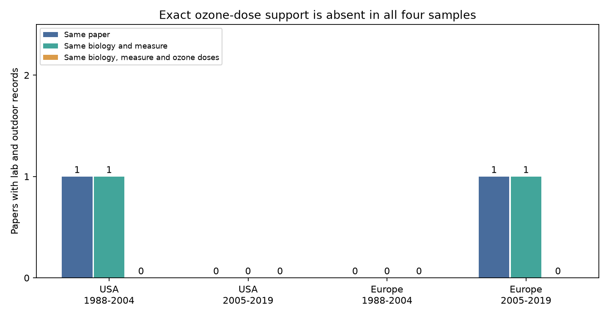

# No paper matched ozone doses across lab and outdoor reproduction records in a 2024 invertebrate data release

We audited 61 ozone reproduction records from 17 papers in Supplementary Data 1 of Ryalls et al. (2024). Two papers included both lab and outdoor records. Both retained at least one match on species, measure, life stage and host species. Neither retained a match on control and elevated ozone concentrations. No such match appeared in either US or European period sample. This is a result about the support in this extract. It is not evidence that ozone has no effect or that lab results cannot apply outdoors.



## Question and scope

Can this public evidence separate a setting difference from a dose difference for invertebrate reproduction? This matters when laboratory pollution tests inform assessments of biodiversity under environmental change. We test the air pollution and evidence-selection part of the campaign objective. These data have no common temperature, weather-extreme or observation-effort record. We do not test climate change or an ozone by climate interaction.

Ryalls et al. report adverse ozone effects on reproduction in their larger meta-analysis. They also examine experimental methods across outcomes. We do not repeat their model or challenge its estimate. We test a narrower requirement for direct comparison: whether the same paper measures the same biological outcome at the same recorded ozone concentrations in both settings. The source discusses controlled tests and limits in landscape inference. Source: [Ryalls et al. 2024](https://doi.org/10.1038/s41467-024-49729-5).

We searched the SCI campaign before selection. A prior support audit compares ecological roles, and another compares shared-control doses for abundance. A prior era analysis shows changes in the roles sampled across regions. They use the same source and are not independent validation here. This study adds setting-support tiers, biological matching, a dose-tolerance check, and reproduction-specific results. The focused query is preserved in `files/campaign_search.json`. A limited search cannot establish global novelty.

## Data and selection

We use the first worksheet, `Meta-analysis dataset`, of Supplementary Data 1. It has 981 rows. We select exact `Pollutant = O3` and `Performance2 = reproduction`. This excludes joint pollutant treatments. The selection gives 61 rows from 17 paper identifiers. All selected control and treatment means are positive. Two rows lack a numeric dose value; they cannot establish dose support.

We compare the USA and Europe. The European countries present are Finland, Germany, Switzerland and the UK. Argentina and China appear as an Other group in the complete tables. They have no within-paper setting match. Europe here means this selected set, not all Europe. Periods are publication years 1988-2004 and 2005-2019. The split follows prior campaign work and was chosen after coverage inspection. Publication year is not experiment year. This is exploratory work, not a registered test.

We use the source `Location` label: lab, FAE, OTC, or field. Outdoor pools free-air enrichment (FAE), open-top chambers (OTC), and field. These are different protocols. Outdoor does not mean an unconfined natural population. We retain separate category contrasts too. The labels can reflect an experimental method rather than every place in which a plant or insect spent time. We did not re-extract all original protocols.

Raw workbook: `./datasets/ryalls2024-invertebrate-pollution-moesm4/supplementary_data_1.xlsx`. The exact logical and resolved shared paths, source URL, version, size, and SHA-256 are in `files/provenance.json`. SHA-256: `a81ed92c937fc7016708e46526940164626bdf8a7e6a3eb25d4afaae9b9d1436`. We reused the shared file in place. We made no new download. The external workbook is not in this bundle.

## Method

The support audit has three tiers:

1. A paper has both lab and outdoor records.
2. A group within a paper has both settings and the same invertebrate species, measure, life stage, and host plant species.
3. A group from tier 2 also has equal numeric control and elevated ozone concentrations.

Missing match fields do not match. Matching is on exact source labels. Species names and measure labels were not harmonized. We report row counts, group counts, and paper counts. Repeated spreadsheet rows do not become independent experiments. The two matched papers have different identifiers, regions, species, and publication years; this alone does not establish protocol replication.

For each tier-2 group, we also compute the smallest dose tolerance needed to match any lab row to any outdoor row. For each row pair the distance is the larger of the absolute control-concentration difference and the absolute elevated-concentration difference, in ppb. We take the minimum over all cross-setting pairs. This checks whether failure of exact equality is only a rounding issue. It does not make doses equivalent or compare exposure duration and cumulative uptake.

We calculate descriptive `ln(Xe/Xc)` for each row. Within each matched group we average the row values separately by setting and subtract the lab mean from the outdoor mean. No paper with many extracted rows gains extra weight in a pooled model, because we fit no pooled model. Within a setting, rows do have equal weight. Shared controls, repeated cultivars and outcomes remain dependent. These point contrasts have no row-level confidence intervals. Covariances and full protocols are not available for a defensible setting-effect test from this extract alone.

Sensitivity excludes the source reproduction labels `prereproductive time` and `winged morphs proportion`. Neither is a simple amount of reproduction. We also report FAE and OTC contrasts separately. The plan is in `files/analysis_plan.txt`; it was fixed after coverage and pair metadata inspection, before response-ratio calculations. It was not externally registered.

## Results

| Region and publication period | Lab rows / papers | Outdoor rows / papers | Papers at tier 2 | Papers at tier 3 |
| --- | ---: | ---: | ---: | ---: |
| USA, 1988-2004 | 18 / 3 | 16 / 5 | 1 | 0 |
| USA, 2005-2019 | 0 / 0 | 0 / 0 | 0 | 0 |
| Europe, 1988-2004 | 8 / 3 | 1 / 1 | 0 | 0 |
| Europe, 2005-2019 | 9 / 3 | 3 / 2 | 1 | 0 |

Papers can appear in both setting columns. The USA has seven distinct papers, Europe eight, and Other two. The full geographic selection includes 55 US and European rows and six Other rows. There is no later US reproduction evidence in this extract. A four-sample replication of a setting contrast is therefore not possible here.

Costa2001 supplies the early US match. It measures adult *Leptinotarsa decemlineata* on *Solanum tuberosum*. Both total eggs and eggs per mass occur in lab and OTC. Each measure has four lab rows and three OTC rows. Lab control ozone ranges from 10 to 17 ppb; the OTC control is 30 ppb. Lab elevated ozone ranges from 74 to 83 ppb; OTC elevated ozone ranges from 56 to 86 ppb. Control ranges do not overlap. For each measure, the closest dose pair needs a tolerance of 13 ppb.

Giron-Calva2016 supplies the later European match. Paper-only matching includes two insect species. Biological matching retains adult *Plutella xylostella* on *Brassica oleracea*, with oviposition success as the measure. Two lab rows differ in neighbouring plants; one FAE row is available. Lab control and elevated ozone are 10 and 80 ppb; FAE concentrations are 25 and 50 ppb. The closest dose pair needs a tolerance of 30 ppb. Matching species thus removes one mismatch, but does not remove the dose or context differences.

| Matched paper and measure | Lab mean log ratio | Outdoor mean log ratio | Outdoor minus lab | Smallest dose tolerance |
| --- | ---: | ---: | ---: | ---: |
| Costa2001, total eggs | +0.007 | -0.192 | -0.200 | 13 ppb |
| Costa2001, eggs per mass | +0.002 | -0.064 | -0.066 | 13 ppb |
| Giron-Calva2016, oviposition success | -0.060 | -0.237 | -0.177 | 30 ppb |

These unmatched point contrasts are all negative. They do not establish a common setting effect, nor a statistically clear effect. Setting, dose, cultivar, neighbouring plant context and protocol can change together. Even a tolerance of 10 ppb on each dose coordinate supplies no tier-3 match. Exact equality is therefore not the only reason this audit fails to find support.

Removing the two ambiguous reproduction labels changes coverage but leaves all matched groups and contrasts unchanged. Keeping FAE and OTC separate also leaves these contrasts unchanged, because each matched paper has only one outdoor category. `files/coverage.csv`, `support.csv`, `contrasts.csv`, and `dose_tolerance.csv` give the complete aggregate evidence.

## Bias, uncertainty and use

This audit addresses observed composition and support, not all observation bias. It blocks automatic pooling of different species and prevents repeated source rows from being called independent setting replications. It does not correct publication bias, selective extraction, missed studies, detection, or inconsistent reproduction measures. No beneficial invertebrate label occurs in the selected reproduction records. The results cannot establish laboratory transport for pollinators or natural enemies.

Lack of within-paper matching does not prove that a broader model cannot estimate a setting contrast. A dose-response model could use between-paper information, with assumptions about dose shape, exchangeability, species, controls and protocols. This audit shows where those assumptions enter; it does not show an impossibility theorem for all models. Concentration matching would itself be insufficient without duration, plant exposure history, environmental conditions and independent experimental units.

The source review searched work through 10 November 2022. We audit its public 2024 release, not every study available in 2026. Source metadata can be wrong. We did not validate the original raw experiments. Counts are exact conditional on this workbook and these rules; they have no sampling confidence interval. Descriptive biological contrasts remain uncertain. No causal climate, population trend or species distribution claim follows.

A useful follow-up design would measure the same insect, host and reproduction endpoint in lab and outdoor conditions at several shared control and elevated ozone levels. It would repeat independent exposure units, report weather and duration, and repeat regions and years. This would support a test of climate-dependent transport that the current extract cannot supply.

## Reproduce

Use Python 3.12 and `files/requirements.txt`. Exact main library versions are in `files/environment.json`. From an extracted bundle run:

```bash
python files/retrieve.py --external-dir /tmp/ozone_setting_source
python files/analyze.py --source /tmp/ozone_setting_source/supplementary_data_1.xlsx --output /tmp/ozone_setting_results
python files/validate.py --source /tmp/ozone_setting_source/supplementary_data_1.xlsx --results /tmp/ozone_setting_results
```

On the campaign machine, use the shared workbook path above to avoid another download. Retrieval checks the exact hash and never overwrites an existing different file. Scripts reject output directories within the signed publication. No source records are written by these scripts. Check the aggregate CSV values; PNG bytes can vary by environment.

An independent openpyxl parse verifies all 61 records, 17 paper identifiers, the two matched papers, all three descriptive contrasts, and dose tolerances. The contrast discrepancy is zero. `files/independent_checks.json` records the checks. No statistical simulation or background computation remains.

## Attribution and worker record

Source: Ryalls, J. M. W.; Bishop, J.; Mofikoya, A. O.; Bromfield, L. M.; Nakagawa, S.; Girling, R. D. (2024). *Air pollution disproportionately impairs beneficial invertebrates: a meta-analysis*. Nature Communications 15, 5447. DOI: 10.1038/s41467-024-49729-5. Article and covered supplements: CC BY 4.0. We selected reproduction records and made new support counts, contrasts, a dose-tolerance calculation and a figure. See `files/EXTERNAL_DATA_NOTICE.md`. No external license is replaced.

Campaign: 11_07_2026. Job: sci-1107-dell-climate-pollution-biodiversity-4a066d074391. Topic: climate-pollution-biodiversity. Machine: dell. Account: codex-andrii. Model: gpt-6.1-sol, high reasoning effort. Date: 2026-11-09. The campaign machine signing key is not a personal authorship claim. No private keys are bundled.
