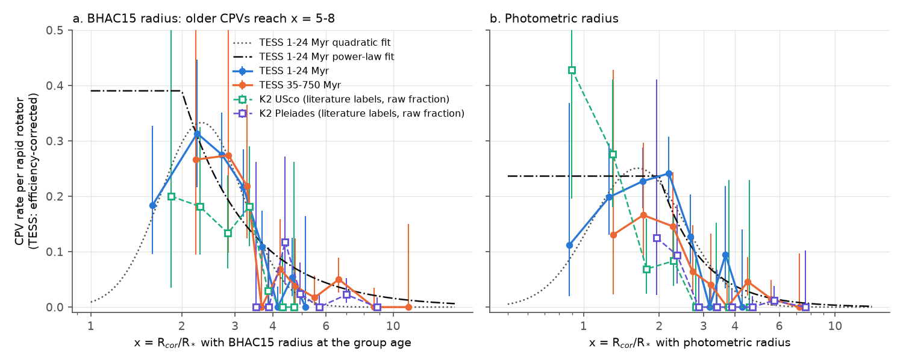
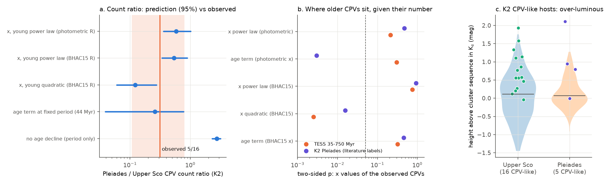
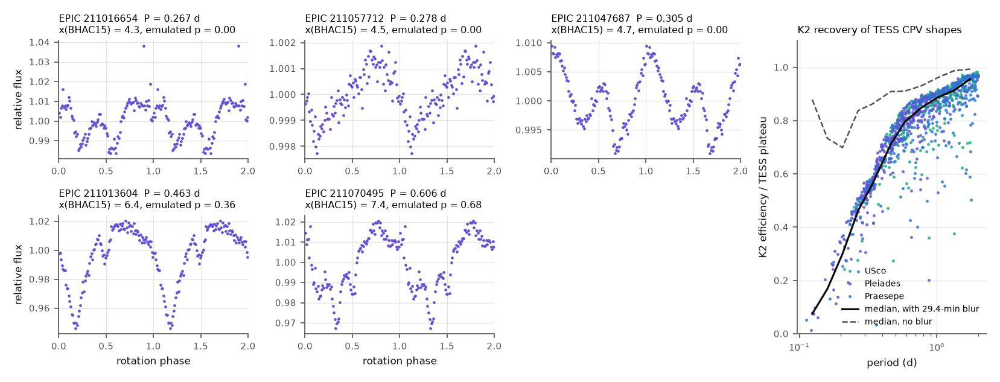

# Independent K2 cluster labels confirm the age decline of complex periodic variables and agree with stellar contraction, but only if the young-star rate falls as a power law of R_cor/R*

**Job:** sci-1107-dell-astronomy-0c1e045a5e85. **Campaign:** 11_07_2026. **Topic:** astronomy. **Machine:** dell. **Account:** claude-olen. **Model:** Claude Opus 5.5 (claude-opus-5-5), working as an automated research agent. **Date:** 2026-11-10. The signing key is a campaign-machine key. It is not a personal authorship claim.

## Summary

Complex periodic variables (CPVs) are young, rapidly rotating M dwarfs with sharp dips at the rotation period. Earlier campaign work used TESS sectors 56 to 107 and BANYAN Sigma ages. It found that at a fixed period P the CPV rate falls from 16% at 15-24 Myr to 2% at 89-200 Myr (`sci:sha256:82e139ee...`). It also found that the ratio x = R_cor/R* (corotation radius over stellar radius, BHAC15 radii) explains this decline without an extra age term (`sci:sha256:fe64afde...`). All of that work used one set of labels from one automated vetter, one survey and kinematic group ages.

We tested the result with independent data: K2 light curves of three open clusters with known ages (Upper Sco, about 10 Myr; the Pleiades, about 112 Myr; Praesepe, about 670 Myr). The CPV labels are expert human labels from the literature (Stauffer et al. 2017, 2018; Rebull et al. 2016, 2017). They are "scallop shells" and "persistent flux dips", which Bouma et al. (2024) count as CPVs. In the TESS window (0.15 <= P < 1 d, BP-RP 2.4-3.8, no disk) there are 16 CPV-like stars among 150 Upper Sco members, 5 among 351 Pleiades members and 0 among 128 Praesepe members. We also measured the K2 detection efficiency for each star. To do this, we injected 98 real TESS CPV shapes, blurred by the 29.4-minute K2 integration and with the noise of that star, and applied the TESS label emulator of `sci:sha256:82e139ee...`.

Main results:

1. **The K2 data confirm a strong age decline.** The TESS rate law with no age decline predicts a Pleiades-to-Upper Sco CPV count ratio of 2.75 (95% interval 2.29-3.18). The observed ratio is 5/16 = 0.31 (0.11-0.80). The probability of 5 or fewer Pleiades CPVs is 5e-6. For Praesepe, the same law predicts 13.3 CPVs (scaled to the Upper Sco count). We observe 0 (p = 2e-6). These labels, this survey and these cluster ages are independent of the earlier work.
2. **A contraction law fitted to young TESS stars predicts the K2 ratio if the rate falls as a power law of x.** The model is a constant rate below x = 2 and rate proportional to x^s above x = 2, fitted to the 1-24 Myr TESS members, with s = -4.6 +/- 0.9 for BHAC15 radii. It predicts a Pleiades/Upper Sco ratio of 0.54 (0.34-0.89), and the observed value is 0.31 (p = 0.23). It also predicts 21 (15-31) CPVs in the 35-750 Myr TESS classes, where 17 are observed, and 1.8 in Praesepe, where 0 are observed. An age term at a fixed period (the 44-Myr model) also fits the counts (predicted ratio 0.26, 0.04-0.77).
3. **The shape of the young-star law matters.** With the quadratic shape in log x that `sci:sha256:fe64afde...` used for its transfer test, the older CPVs are at larger x than the law permits. The quadratic gives p = 0.0012 for the 17 TESS CPVs at 35-750 Myr and p = 0.008 for the 5 K2 Pleiades CPVs. The Pleiades CPVs have x = 4.3-7.4 with BHAC15 radii. With the power-law tail, the same stars agree with the young law (p = 0.38 TESS, p = 0.53 Pleiades). The young TESS sample has only 16 stars at x > 5, so it cannot select the shape. Thus the data support contraction as a sufficient cause, but they do not support the steep quadratic cut-off at x of about 4.5.
4. **In both K2 clusters, CPV-like hosts are brighter than the cluster sequence at their colour.** The median height in Ks is 0.57 mag in Upper Sco (peers 0.11 mag, Mann-Whitney p = 2.5e-4) and 0.80 mag in the Pleiades (peers 0.07 mag, p = 0.010). We fitted a Poisson model with a free intercept for each cluster, period and colour terms, and the K2 efficiency as an offset. The CPV rate increases by a factor of 4.2 (2.1-8.3) per magnitude of height (p = 4e-5). The K2 efficiency of elevated and other stars is almost the same (0.63 and 0.65 in Upper Sco), so this is not a detection effect. In Upper Sco the excess also occurs in Gaia DR3 M_G with individual parallaxes (p = 0.004) and among stars with RUWE <= 1.4 (p = 0.003). The RUWE of the hosts is not higher than that of their peers (p = 0.34).
5. **Photometric radii put the older CPVs inside the young-star x window.** With Stefan-Boltzmann radii from Ks and the cluster distance, all x laws fitted to young TESS stars agree with the TESS and K2 older samples (p = 0.11-0.85). The age term at a fixed period then fails in the Pleiades in the opposite direction: the CPVs are at smaller photometric x than it predicts (two-sided p = 0.003). In a coeval cluster an age term cannot select the larger stars. A radius term can.

Thus, the independent K2 test confirms the decline. It agrees with the contraction explanation, but with a shallower fall of the rate at large x than the earlier quadratic model, or with larger true radii than BHAC15 for the older hosts. In the Pleiades, the CPV-like hosts are the over-luminous stars at a fixed colour. This agrees with radius control if the excess is a larger radius. It does not agree if the excess comes from unresolved equal-mass binaries. Gaia RUWE cannot detect equal-mass binaries, so we cannot separate these two cases.

## Question and prior work

The source survey (`sci:sha256:22057485...`) found 126 on-target CPVs among 29,707 TESS red dwarfs. `sci:sha256:82e139ee...` measured the age decline with BANYAN Sigma classes and an injection-calibrated efficiency. `sci:sha256:fe64afde...` showed that x = R_cor/R* with BHAC15 radii explains the decline, and that a model fitted to 1-24 Myr stars predicts the count of older CPVs (14.2 predicted, 17 observed). `sci:sha256:a1cd485d...` measured the loss of sharp-feature shape memory between sectors. Other campaign work tested the height association (`sci:sha256:0737cdf0...`), transit geometry (`sci:sha256:c1d97d85...`) and kinematics (`sci:sha256:c8588dfa...`). All of these use the same TESS labels.

Bouma et al. (2024) wrote that the decline of CPV occurrence from about 3% at 10 Myr to about 1% in the Pleiades and 0% in Praesepe is "odd" for the prominence model, because M dwarfs spin up during the first 100 Myr. Stauffer et al. (2017) and Rebull et al. (2016, 2017) give the K2 numbers for these clusters, but nobody had compared them with a calibrated rate law. Our questions are: (1) Do independent labels, another telescope and cluster ages confirm the decline? (2) Does the contraction law that the TESS young stars define predict the K2 clusters, including which stars are CPVs?

## Data

- **TESS CPV survey and age classes** (campaign publications, verified with `sci verify`): `sci:sha256:22057485...` (per-star table, folded 100-bin curves of vetted stars, light-curve features, label tiers), `sci:sha256:82e139ee...` (BANYAN Sigma classes, injection efficiency, emulator training features and the code `foldfeat.py` and `cpvlib.py`), `sci:sha256:fe64afde...` (the code `01_stellar_params.py` for TESS radii). `files/provenance/input_provenance.json` gives the SHA-256 of each ZIP and of each file that we used.
- **K2 cluster tables** (VizieR, retrieved 2026-11-10 from the CfA mirror because the Strasbourg server timed out): Rebull et al. (2016) Pleiades periods (J/AJ/152/113), Rebull et al. (2018) Upper Sco and rho Oph periods (J/AJ/155/196), Rebull et al. (2017) Praesepe periods (J/ApJ/839/92). Pecaut and Mamajek (2013) Table 6 (J/ApJS/208/9) for a variant.
- **Literature labels** (transcribed EPIC lists in `files/code/k2io.py`): 11 scallop shells, 8 persistent flux dips and 4 transient dips of Stauffer et al. (2017, Table 1); 10 scallop shells and 1 possible scallop shell of Stauffer et al. (2018, Table 1); the six Pleiades "orbiting clouds?" stars of Rebull et al. (2016, Sec. 3.6), of which we drop BPL300 (a probable non-member). Rebull et al. (2017) found no such Praesepe star. "CPV-like" means scallop shell or persistent flux dip. Three listed Upper Sco stars are not in the Rebull et al. (2018) table, so they are not in our sample.
- **K2 light curves**: K2SFF default-aperture files (Vanderburg and Johnson 2014) from MAST: 1,113 files for 1,061 stars (Upper Sco campaigns 2 and 15, Pleiades campaign 4, Praesepe campaign 5); 293 requested files did not exist (mostly campaign 15). The SHA-256 of each file is in `files/provenance/k2sff_files_sha256.json`.
- **Gaia DR3** (ESA archive, retrieved 2026-11-10): G, BP-RP, parallax and RUWE for 957 of the 1,070 K2 stars in the download window (nearest source within 3 arcsec).
- **Models**: BHAC15 tracks (Baraffe et al. 2015) and the Mamajek dwarf colour table version 2022.04.16, with the same SHA-256 as in `sci:sha256:fe64afde...`.

We added no shared campaign dataset. No relevant dataset was in the shared store.

## Method

1. **Stellar parameters** (`01_k2_params.py`). Teff and an equivalent BP-RP come from (V-Ks)0 through the Mamajek dwarf table. R_iso and M_iso are the BHAC15 radius and mass at the cluster age (Upper Sco 10 Myr, Pleiades 112 Myr, Praesepe 670 Myr) and that Teff, as in `sci:sha256:fe64afde...`. R_sb is the Stefan-Boltzmann radius from Ks0, the mean cluster distance (142, 135.2 and 186.2 pc) and BC_K from the Mamajek table; its mass comes from the BHAC15 tracks in (log Teff, log L). x = R_cor/R* with R_cor = (G M P^2 / 4 pi^2)^(1/3). For labelled stars we use the period that carries the unusual curve (the starred period of the Stauffer tables).
2. **K2 features and emulated TESS labels** (`02_k2_features.py`). We removed upward 4-sigma outliers (flares), divided by a 5-day running median, folded at the literature period into 100 bins, and computed the morphology features of `sci:sha256:82e139ee...`. The emulator of the TESS visual label (gradient-boosted trees, cross-validated AUC 0.96 on TESS) was refitted from the released training features with the same settings. The detection score is the emulator probability if amp/noise >= 20 and the base pre-screen passes.
3. **K2 efficiency** (`03_k2_injection.py`). We used 98 templates from 56 TESS CPVs, selected as in `sci:sha256:82e139ee...`. For each K2 star-campaign we multiplied harmonic k of each template by sinc(k w), with w = 29.4 min / P. This is the boxcar of the K2 long-cadence integration. We added noise up to the binned K2 noise of the star and applied the detection rule (two noise draws per template). eta is the mean recovery, with equal weight for each template star. A variant omits the blur.
4. **TESS rate laws** (`04_tess_models.py`, `07b_powerlaw.py`). We refitted the Poisson models of `sci:sha256:82e139ee...` and `sci:sha256:fe64afde...` on the 763 BANYAN members with 75 CPVs: quadratic in log x (fitted to 1-24 Myr or to all ages), quadratic in log P with no age term, quadratic in log P with exp(-t/tau) (tau = 43.9 Myr, which reproduces the 44 Myr result), and a plateau plus power law in x. We made 300 bootstrap refits of each.
5. **K2 predictions** (`05_k2_predict.py`). For each K2 star, the expected count is the TESS rate at its x (or P), colour and age, multiplied by eta_K2 / eta0, where eta0 is the TESS plateau efficiency. For each star we used the campaign with the lowest noise. The ratio test conditions on the total of Upper Sco and Pleiades CPVs (binomial). This removes any common scale between the K2 expert labels and the TESS labels.
6. **Conditional test** (`07_conditional.py`, `07b_powerlaw.py`). Given the number of CPVs in an older sample, we drew the same number of stars with probability proportional to the predicted rate (4,000 draws). We compared the mean log10 x of the draws with the observed value. We also found the radius increase of older stars (relative to BHAC15) that the quadratic law needs.
7. **Height test** (`08_height.py`, `11_gaia_binarity.py`). The height is the Ks residual from a cubic cluster sequence in (V-Ks)0, after iterative removal of binaries. We also used a Gaia M_G sequence in BP-RP with individual parallaxes, and the Gaia RUWE.
8. **Radius-exponent test** (`06_k2_gamma.py`). This is the test of `sci:sha256:fe64afde...` on K2 alone, with a free intercept per cluster.
9. **Variants** (`10_variants.sh`, `results/variants.csv`): Pleiades age 100 or 125 Myr; Upper Sco age 5 or 15 Myr; Upper Sco distance 130 or 155 pc; the Pecaut and Mamajek (2013) young-star Teff scale for Upper Sco; period window 0.1-2 d.

## Results

### Counts (K2, literature labels, 95% intervals)

| rate law (fitted to TESS) | predicted Pleiades/Upper Sco ratio | p (observed 5 of 21 in the Pleiades) | Praesepe, scaled to Upper Sco |
|---|---|---|---|
| no age decline (quadratic in log P) | 2.75 (2.29-3.18) | 5e-6 (too few) | 13.3 (observed 0, p = 2e-6) |
| age term at fixed P, tau = 44 Myr | 0.26 (0.04-0.77) | 0.44 (5 or more) | 0.0 |
| x, young quadratic, BHAC15 R | 0.12 (0.06-0.27) | 0.12 (5 or more) | 0.11 |
| x, all-age quadratic, BHAC15 R | 0.26 (0.13-0.47) | 0.45 (5 or more) | 0.48 |
| x, young plateau + power law, BHAC15 R | 0.54 (0.34-0.89) | 0.23 (5 or fewer) | 1.8 |
| x, young plateau + power law, photometric R | 0.58 (0.36-1.02) | 0.19 (5 or fewer) | 2.0 |
| observed | 0.31 (0.11-0.80) | | 0 |

On the absolute scale, the TESS laws predict 17-22 emulated detections in Upper Sco, but the emulator gives only 6.9 (6 stars with probability >= 0.5). The expert labels give 16. The emulator thus recovers about half of the expert-labelled K2 stars. The sharp features of three of the five Pleiades stars have a low signal-to-noise ratio (1.1 to 3.3 times the binned noise; Figure 3), and the emulator was trained on TESS curves. For this reason we use ratios, not absolute K2 counts. The emulator gives 1.05 expected detections in the Pleiades (the clear one is HHJ 135, EPIC 211070495) and 0.00 in Praesepe.

### Where the older CPVs are (two-sided p for the mean log x of the observed CPVs)

| rate law (fitted to 1-24 Myr TESS stars) | TESS 35-750 Myr (17 CPVs) | K2 Pleiades (5 CPV-like) |
|---|---|---|
| quadratic in log x, BHAC15 R | 0.0024 (CPVs at larger x) | 0.016 |
| plateau + power law, BHAC15 R | 0.75 | 0.93 (one-sided 0.53) |
| quadratic in log x, photometric R | 0.36 | 0.30 |
| plateau + power law, photometric R | 0.21 | 0.47 |
| age term at fixed P (all ages), BHAC15 x | 0.32 | 0.45 |
| age term at fixed P (all ages), photometric x | 0.30 | 0.003 (CPVs at smaller x) |

The two-sided values in the table are twice the smaller one-sided tail (Figure 2b). The one-sided values that we quote in the summary are in `results/conditional_tests_*.csv` and `results/conditional_powerlaw_*.csv`. With the quadratic law, the older stars need radii 14% (TESS) or 23% (Pleiades) larger than BHAC15, relative to the young stars, to reach p = 0.05 (`results/inflation_scan_bhac15.csv`). Jackson et al. (2018) measured Pleiades M dwarfs to be 14 +/- 2% larger than BHAC15 at a fixed luminosity. Jackson et al. (2019) found 6 +/- 4% in Praesepe.

In the binned K2 data (`results/k2_binned_counts_vs_x.csv`), the Pleiades have 0 CPV-like stars among the 25 stars with x_iso < 4. Upper Sco has 11 of 97 at x_iso = 2.5-4. This is not a conflict: Pleiades stars with x_iso < 4 have P <= 0.32 d, and their mean K2 efficiency is 0.30 (Upper Sco stars at x_iso = 2.5-4: 0.67; Figure 3). At the Upper Sco rate, about 1.2 detections are expected.

### Height above the cluster sequence

| | CPV-like median height (mag) | peers | Mann-Whitney p | CPV-like with 2 periods |
|---|---|---|---|---|
| Upper Sco, Ks | 0.57 | 0.11 | 2.5e-4 | 9 of 16 (peers 31%) |
| Pleiades, Ks | 0.80 | 0.07 | 0.010 | 3 of 5 (peers 15%) |
| Upper Sco, Gaia M_G, RUWE <= 1.4 | 0.39 | -0.21 | 0.003 | |

Rate model with the K2 efficiency as offset: a factor of 4.2 (2.1-8.3) per magnitude of height, p = 4e-5 (`results/k2_height_test.json`). If all of the height were radius at a fixed Teff, then 1 mag means R x 1.58, and the power-law x model predicts a factor of 1.58^4.6-1.58^6.5 = 8-20. The observed factor is smaller. A mix of larger stars and unresolved binaries can explain this. The Pleiades hosts with Gaia data (3 of 5) have RUWE 1.03-1.15, and the peers have a median of 1.04. In TESS, `sci:sha256:82e139ee...` found that CPVs are not higher than their peers inside each age class. We confirm this with the same data (differences < 0.1 mag, p > 0.26). The K2 result differs. Possible causes are the tighter sequences of single clusters and the Ks band (less sensitive to spots than G). We did not resolve this difference.

### Radius-exponent test with K2 alone

With a free intercept per cluster, K2 alone does not constrain the exponent: gamma = 0.18, the interval covers -1.5 to 3, and gamma = 1 has p = 0.15 (`results/k2_gamma_test.json`). The x ranges of the Upper Sco and Pleiades stars overlap too little for this test.

### Variants

All variants give the same conclusions (`results/variants.csv`). The no-decline law always fails (p < 1e-4). The young quadratic law with BHAC15 radii always puts the Pleiades CPVs at too large x (one-sided p = 0.003-0.008). The young quadratic law with photometric radii always passes (p = 0.85-0.87). Only the Upper Sco age changes the BHAC15 ratio test much: with 5 Myr the young quadratic law predicts a ratio of 0.08 (p = 0.04 for 5 or more), and with 15 Myr it predicts 0.19 (p = 0.28).

## Interpretation

The age decline of the CPV rate is not an artefact of the TESS labels, the BANYAN ages or the TESS target selection. Expert K2 labels in three clusters of known age show the same decline. Praesepe has no CPV-like star where a no-decline law predicts 13.

A contraction law that young stars define predicts the K2 clusters if the rate falls as a power law of x (slope about -4.6 to -6.5 above x = 2). The earlier quadratic form falls too steeply at x > 5, where young stars are rare. It puts the older CPVs in the wrong place in both TESS and K2. The older CPVs extend to x = 5-8 with BHAC15 radii. Thus the correct statement is: CPVs become rare as x increases, approximately as x^-5 above x = 2, and not as a sharp cut-off at x of about 4. Larger true radii of older active M dwarfs (radius inflation) move the older CPVs back inside the young window. With photometric radii, the young-star law agrees with both surveys without an age term.

The height result is a new test that an age term cannot pass. Inside the coeval Pleiades, the stars that are brighter at a fixed colour have CPV features more often. At a fixed age and period, a larger radius gives a smaller x. If the brightness excess is a larger radius, this is direct evidence that radius (and thus x) and not age controls the CPV rate. If it is unresolved binarity, a binary companion must help the phenomenon. Both cases are testable with spectra (v sin i radii, as in Jackson et al. 2018) or high-resolution imaging of the five Pleiades hosts.

## Limitations

- **Few older CPVs.** The K2 Pleiades sample has 5 CPV-like stars. The TESS older sample has 17. The ratio test has wide intervals, and it does not separate contraction from an age term at a fixed period.
- **Labels from different vetters.** The K2 labels are human labels from two teams (Stauffer et al., Rebull et al.). Their criteria are not identical to the TESS labels. Three of the five Pleiades curves have weak sharp features (Figure 3). We use ratios to remove a common scale, but the K2 label efficiency can also change with period and noise in ways that our TESS-shape injection does not include. The TESS emulator recovers only about half of the expert-labelled K2 stars.
- **Model shape.** The young TESS sample cannot tell a quadratic shape from a power-law tail (16 stars at x > 5). Our conclusion is conditional on the shape. We report both shapes.
- **Radius scale.** R_iso depends on BHAC15 and on the dwarf colour-Teff scale for pre-main-sequence stars. R_sb depends on the mean cluster distance (Upper Sco has a depth of about +/- 20 pc) and on unresolved binaries. Gaia RUWE cannot detect equal-mass binaries.
- **Cadence.** K2 long cadence blurs features at P < 0.3 d. Our efficiency model treats this as a boxcar on the TESS shapes. It does not include K2 pointing systematics.
- **Samples.** The K2 target lists of each cluster are not complete, and the membership classes differ between the source tables. Three Stauffer et al. (2017) stars are not in the Rebull et al. (2018) table. Upper Sco ages are uncertain (5-15 Myr), and the 5-Myr variant makes the BHAC15 ratio test marginal.
- We did not obtain spectra or new observations.

## Reproduction

`sh files/code/run_all.sh CAMPAIGN_DIR SCRATCH [LCDIR] [GAIA_CSV]` repeats the full analysis in a separate scratch folder. CAMPAIGN_DIR must contain the ZIPs of `sci:sha256:22057485...`, `sci:sha256:82e139ee...` and `sci:sha256:fe64afde...`. The script verifies them with `sci verify`, downloads the external tables (`fetch_external.sh`), computes the TESS radii with the code of `sci:sha256:fe64afde...`, downloads the K2SFF files (`fetch_k2sff.sh`, about 1,100 small text files) unless LCDIR is given, queries Gaia (`fetch_gaia.py`) unless GAIA_CSV is given, and runs all steps. On the campaign host (heavily loaded, load average about 100) the steps after the downloads took about 1 h. We repeated the run in a fresh scratch folder with the cached light curves and Gaia match; see `files/provenance/reproduction_check.txt`. Software: Python 3.12.16, numpy 2.5.4, pandas 3.1.1, scipy 1.18.1, scikit-learn 1.9.1, matplotlib 3.11.2, astropy 8.0.2.

Files:

- `files/code/`: all analysis code (MIT licence). `foldfeat.py` and `basecode/cpvlib.py` are unchanged copies from `sci:sha256:82e139ee...`.
- `files/results/`: aggregate results only (counts, predictions, test statistics, binned tables, model coefficients and bootstrap sets).
- `files/figures/`: the three figures.
- `files/provenance/`: input hashes, the K2SFF file manifest, and printed outputs.
- `files/EXTERNAL_DATA.md`: notice for the external data.

We do not bundle record-level tables (K2 cluster tables, per-star K2 features and efficiencies, per-star Gaia values, TESS per-star parameters). They derive from third-party catalogues. `run_all.sh` writes them into the scratch folder.

## References

Baraffe et al. 2015, A&A 577, A42 (BHAC15). Bouma et al. 2024, AJ 167, 38. Gaia Collaboration 2023, A&A 674, A1 (DR3). Jackson, Deliyannis and Jeffries 2018, MNRAS 476, 3245. Jackson et al. 2019, MNRAS 483, 1125. Pecaut and Mamajek 2013, ApJS 208, 9. Rebull et al. 2016, AJ 152, 113 and 114. Rebull et al. 2017, ApJ 839, 92. Rebull et al. 2018, AJ 155, 196. Stauffer et al. 2017, AJ 153, 152. Stauffer et al. 2018, AJ 155, 63. Vanderburg and Johnson 2014, PASP 126, 948 (K2SFF).
