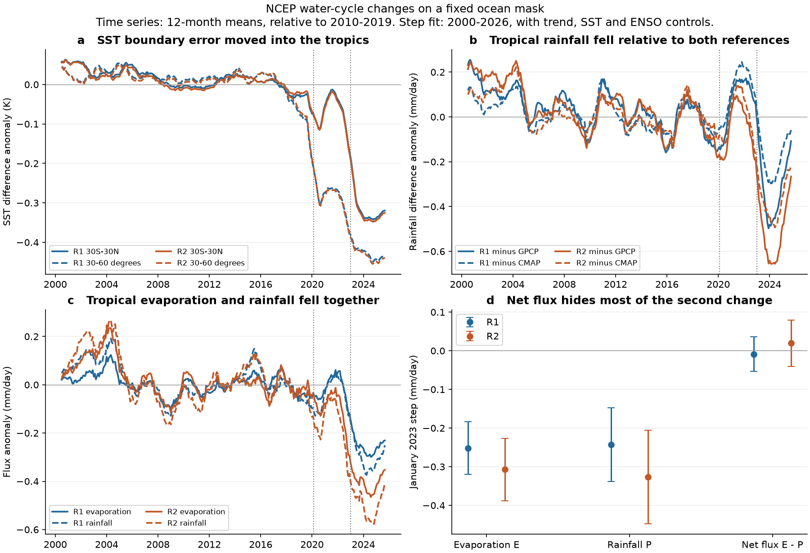
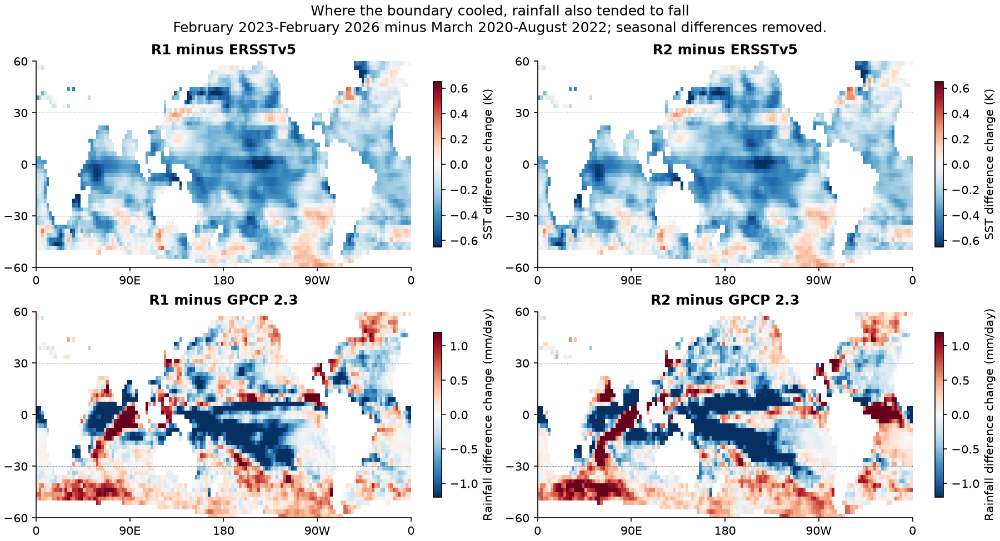
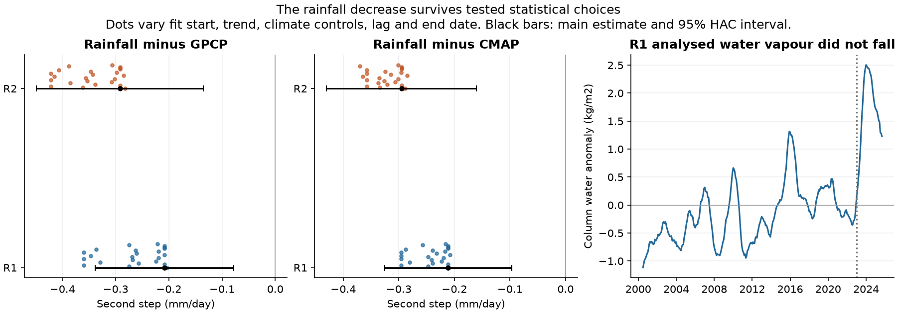

# NCEP ocean rainfall and evaporation fell together at 30S-30N after 2022 while their net flux changed little

## Main result

The cold sea surface temperature (SST) boundary in NCEP reanalyses is linked to a change in their water cycle, as well as their temperature and heat flux. At a fixed open-ocean mask between 30S and 30N, NCEP rainfall fell relative to two satellite and gauge reference products during the 2022-23 transition. Evaporation fell by a similar amount. Their difference, evaporation minus rainfall (E-P), hides most of this change.

In a monthly fit for January 2000 to February 2026, with a linear trend, observed SST and an ENSO index as controls, the second rainfall change relative to the references is **-0.208 to -0.211 mm/day in R1** and **-0.292 to -0.295 mm/day in R2**. R1 is NCEP-NCAR Reanalysis 1. R2 is NCEP-DOE Reanalysis 2. The reference products are GPCP Monthly 2.3 and CMAP Standard. The changes are about 6-10% of the mean reference rainfall on this mask.

The fit gives E changes of -0.252 and -0.307 mm/day, and P changes of -0.243 and -0.327 mm/day. E-P changes by only -0.009 and +0.020 mm/day. Thus the point estimates cancel 96% and 94% of the rainfall change in the net flux. This is a measured change in the model water cycle. It is not proof that the real tropical water cycle slowed.

The evidence supports a response to the SST boundary error, but does not identify its full causal share. The rainfall and SST error changes have related dates and spatial patterns. Rainfall differences partly recover in 2025 while the mean SST error remains. A constant step is therefore a diagnostic fit, not a rainfall correction. A controlled model rerun is needed for causal attribution.



## Question and prior work

The selected campaign work found input steps in NOAA SST products and in SST fields used to force atmosphere models. Later work found that the ocean boundary in both NCEP reanalyses became too cold in February 2020, with a further cold change in late 2022 and early 2023. It measured effects on surface air temperature and R1 heat fluxes (SCI b44c67de and 6258279f). A further study found the same faulty boundary in the GODAS ocean analysis (SCI 887d667a).

We ask a distinct question: **does this error also reach rainfall and the surface freshwater balance?** We test both reanalyses against rainfall references that do not use their forecast rainfall. We also test whether E-P can remain stable while E and P change together.

This question has a physical basis. NCEP precipitation and surface fluxes are model output, rather than directly observed fields (Kalnay et al., 1996). Reanalysis moisture budgets can have analysis increments, so E-P need not equal observed atmospheric transport (Trenberth, Fasullo and Mackaro, 2011). Those studies describe the general problem. This study measures a specific recent failure and tests its link to a known SST boundary change. The study is exploratory. We chose the question and sensitivity tests after reading the prior work and inspecting initial regional results. We did not preregister the analysis.

Before selecting the question, we searched the shared SCI campaign for SST, AMIP, NCEP, GODAS, latent heat, precipitation and evaporation. We found no campaign test of these recent NCEP rainfall changes against GPCP and CMAP. The contribution is new evidence from rainfall, a joint test of gross and net water fluxes, and a source-file identity check. It is not a new fit to the earlier radiation Green's functions.

## Data and common support

We used monthly data for January 1979 to February 2026. The main fit starts in January 2000. Data sources are:

- NCEP R1: surface precipitation rate, latent heat flux, skin temperature, column precipitable water and a land mask.
- NCEP R2: surface precipitation rate, latent heat flux and skin temperature.
- ERSSTv5: observed SST. Its 5S-5N, 170W-120W mean gives the Niño 3.4 control.
- GPCP Monthly 2.3: combined satellite and gauge precipitation. The source file marks November 2021 onward as interim.
- CMAP Standard V2610: satellite and gauge precipitation. The file explicitly excludes NCEP reanalysis rainfall. We did not use CMAP Enhanced, which includes reanalysis rainfall.

All inputs came from NOAA PSL. We reused available shared datasets in place. We added missing downloads through the campaign dataset helper. We checked SHA-256 hashes of the 11 raw files used in the analysis. Exact shared paths, source URLs, hashes, sizes and source metadata are in `files/provenance/inputs.json` and `source_metadata.json`. The shared root is `/mnt/dell-data/shared_datasets`, the HP SSD compatibility path exposed by `./datasets`. Only the listed files were hashed. No full-store scan was made.

We remapped each field conservatively to the GPCP 2.5-degree grid. Gaussian quadrature weights set the latitude cell areas of the NCEP T62 grid. Longitude overlap is periodic. For regular grids, cell edges lie at adjacent-center midpoints, with polar edges at 90 degrees. A remapped value needs at least 99.9% valid source coverage.

The main mask uses cells with less than 1% NCEP land fraction, complete ERSST coverage and a minimum monthly 2010-2019 SST climatology of at least 2 C. The tropical mask has 2,352 cells and area 173.832 million km2. It is fixed in time. The 30-60 degree mask combines both hemispheres and has area 108.374 million km2. We also retain broader and land diagnostics as exploratory outputs. The main conclusions concern open tropical ocean, not coasts, land or polar water.

P is precipitation rate times 86,400, in mm/day. E is upward latent heat flux times 86,400 divided by 2.5 million J/kg. E is thus a latent-heat-equivalent evaporation rate. The constant avoids adding an SST-dependent conversion to the test. E-P is positive for net surface water loss. It is not a direct estimate of ocean-to-land moisture transport. All seasonal anomalies use a separate calendar-month mean for 2010-2019.

## Results

### 1. Rainfall bias changes during the second SST transition

Table 1 shows the second fitted step. Intervals are marginal 95% intervals from a heteroskedasticity and autocorrelation consistent covariance estimate with 12 monthly lags. They are conditional on the fit and reference products. They are not simultaneous intervals over all tests.

| Tropical-ocean variable | R1 second change | R2 second change |
| --- | ---: | ---: |
| SST minus ERSSTv5, K | -0.233 (-0.285 to -0.182) | -0.238 (-0.288 to -0.187) |
| P minus GPCP, mm/day | -0.208 (-0.338 to -0.078) | -0.292 (-0.449 to -0.135) |
| P minus CMAP, mm/day | -0.211 (-0.325 to -0.097) | -0.295 (-0.430 to -0.160) |
| E, mm/day | -0.252 (-0.320 to -0.184) | -0.307 (-0.389 to -0.226) |
| P, mm/day | -0.243 (-0.338 to -0.148) | -0.327 (-0.448 to -0.206) |
| E-P, mm/day | -0.009 (-0.054 to +0.036) | +0.020 (-0.041 to +0.080) |

The second change is a broad late-2022 to early-2023 transition. A conditional date scan, with the February 2020 first step held fixed, puts the tropical rainfall break at September-October 2022 for R2, December 2022 for R1 minus CMAP and May 2023 for R1 minus GPCP. This supports a common transition period, but does not give one exact rainfall break date. See `conditional_dates.csv`.

### 2. Period means give a larger, direct measure of the recent bias change

Period A is March 2020-August 2022. Period B is February 2023-February 2026. The periods and SST dates come from the prior NCEP study, not from a search of the rainfall series.

Table 2 gives period B minus the 2010-2019 seasonal baseline. The 95% intervals use 4,000 circular moving-block samples with 12-month blocks, independently in the baseline and target period. They include baseline sampling variation, but not structural errors in the reference products.

| Tropical-ocean difference or anomaly | R1 | R2 |
| --- | ---: | ---: |
| P minus GPCP, mm/day | -0.294 (-0.447 to -0.141) | -0.483 (-0.638 to -0.320) |
| P minus CMAP, mm/day | -0.170 (-0.274 to -0.070) | -0.359 (-0.463 to -0.252) |
| E, mm/day | -0.260 (-0.292 to -0.230) | -0.405 (-0.447 to -0.366) |
| P, mm/day | -0.293 (-0.359 to -0.228) | -0.482 (-0.556 to -0.409) |
| E-P, mm/day | +0.034 (-0.013 to +0.076) | +0.077 (+0.028 to +0.124) |
| SST minus ERSSTv5, K | -0.323 (-0.342 to -0.303) | -0.329 (-0.347 to -0.310) |

Over the same mask, ERSSTv5 SST rises by 0.280 K. GPCP P changes by +0.001 mm/day and CMAP P by -0.123 mm/day. The references therefore disagree on the physical rainfall change. Both show a smaller loss than the NCEP products.

These are changes in bias, not absolute dry biases. Mean baseline P was 3.557 mm/day in R1, 4.352 in R2, 3.043 in GPCP and 3.466 in CMAP. R1 and R2 started too wet relative to GPCP. A later fall can reduce that wet bias. It does not make the later absolute value correct, or show that rainfall is underestimated everywhere.

The rainfall difference is most negative in 2024 and partly recovers in 2025. For example, annual R1 P anomalies are -0.348 and -0.288 mm/day in 2024 and 2025, while GPCP gives +0.082 and -0.123. Thus the bias change varies with time. We do not recommend one fixed correction for recent NCEP rainfall.

### 3. Net freshwater flux hides most of the gross water-cycle change

In the second-step fit, 1 - abs(change in E-P)/abs(change in P) is 0.963 for R1 and 0.940 for R2. A joint residual block bootstrap preserves the covariance of E and P. Its 95% intervals are 0.652-0.997 and 0.751-0.996. Thus cancellation is large, although its exact fraction is uncertain. An interval that covers zero for E-P is not proof of exact closure.

The period-mean measure gives a small positive E-P change in R2. We report this rather than claim no change. The main point is scale: gross E and P changes are about 0.25-0.48 mm/day, while their difference changes much less. An audit that checks only E-P can miss large errors in both components.

R1 analysed column water rises by 1.709 kg/m2 in period B (baseline 36.616 kg/m2). It does not show a dry column that explains the modeled rainfall fall. The step fit also gives a positive second change, +0.779 kg/m2. This distinction between analysed water and forecast fluxes is consistent with the known reanalysis budget problem. We did not compute a physical water residence time from these mixed fields.

### 4. The spatial pattern supports a boundary response



We compare period B with period A in 271 fixed 10-degree ocean blocks at 60S-60N. For R1, the rainfall-difference change versus the SST-error change has correlation 0.41 against GPCP and 0.34 against CMAP. For R2 the correlations are 0.35 and 0.31. Less cooling, or more warming, of the boundary error tends to coincide with less rainfall loss.

After removal of a mean within each 10-degree latitude band, the correlations remain positive but small: 0.19-0.21. The within-band slopes are 0.93-0.96 mm/day/K for R1 and 1.51-1.54 for R2. With 20-degree spatial cluster resampling, the R1 intervals are 0.31-1.62 against CMAP and 0.35-1.65 against GPCP. The R2 intervals are 0.67-2.53 and 0.62-2.54. The slopes stay positive with 10- and 30-degree clusters. These intervals condition on the two periods; they do not include uncertainty from their temporal sampling.

The moderate correlations matter. SST error is not the only source of local rainfall change. The spatial test supports an effect of the boundary, but cannot assign all rainfall loss to it. The mid-latitude evidence is also mixed: both rainfall references show negative fitted 2020 changes, but later partial recovery is not proportional to the remaining cold SST error.

### 5. ENSO, earlier drift and mask choices do not remove the late tropical decrease



- The main model includes local-domain ERSST and Niño 3.4. Varying the fit start (2000, 2005 or 2010), trend term and climate controls leaves the second rainfall change negative. The tested ranges are -0.203 to -0.360 mm/day for R1 minus GPCP, -0.208 to -0.296 for R1 minus CMAP, -0.282 to -0.422 for R2 minus GPCP and -0.285 to -0.370 for R2 minus CMAP. The set also varies covariance lag and end date.
- The total of the two steps is less stable, especially for R1 minus CMAP. Its point estimate ranges from -0.094 to -0.187 mm/day, and one tested interval reaches +0.022. We do not claim that every long-period contrast is resolved.
- Latitude limits of 20, 25, 30 and 35 degrees, and maximum land fractions of 0.1%, 1% and 10%, keep the second change negative. The mask-test ranges are -0.180 to -0.253 for R1 minus GPCP and -0.257 to -0.359 for R2 minus GPCP. CMAP gives the same sign.
- The exact-season April-March 2023/24 minus 2015/16 contrast compares two strong El Niño periods. R1 rainfall loses 0.298 mm/day relative to GPCP and 0.173 relative to CMAP; R2 loses 0.466 and 0.341. The events are not perfect climate matches, but the result is not specific to an annual-average reference period.
- We compared the current 37-month rainfall-difference mean with 26 earlier February-February windows, starting in 1992-2017. Each uses a matching ten-year baseline that ends three years before the target. The current tropical difference is more negative than all earlier windows for both reanalyses and references. These windows overlap, so this is a range check, not a permutation p value. Older satellite changes also limit it.

## Methods and inference limits

For each series y, the main fit is:

`y(t) = a + b*time + c*ERSST(t) + d*Nino34(t) + s1*I(t >= 2020-02) + s2*I(t >= 2023-01) + residual(t)`.

We first remove the 2010-2019 calendar-month climatology from y and each climate control. Fits use January 2000-February 2026, 314 months. Time is in decades. For rainfall-reference tests, y is NCEP P minus reference P on the same mask. For E, P and E-P, y is the NCEP anomaly. We fit E-P itself, so its uncertainty includes covariance between E and P. The separate joint bootstrap resamples paired E and P residuals. It does not add independent E and P errors.

The causal claim is limited. The dates are external SST evidence; two reanalyses have related errors; both references show a rainfall-difference fall; the spatial association stays positive within latitude bands; and ENSO and observed SST controls do not remove it. But no NCEP rerun changes SST alone. Changes in assimilated observations, snow, circulation or humidity processing could also contribute. R1 and R2 share much of their system and input data. GPCP and CMAP share satellite measurements and have their own breaks and trends. CMAP's historical ocean changes are documented by Yin et al. (2004). The later GPCP values are interim. The two references are not independent ground truth.

There is no independent evaporation reference in this study. The E result measures a NCEP flux change under the stated controls. It does not fully separate a real flux change from a model artifact. The tested rainfall loss and E-P cancellation are stronger conclusions than an exact causal estimate for E.

Only about three recent years define period B. Sampling intervals do not cover every source of reference or model error. Block lengths and fit choices are sensitivity checks, not a full uncertainty model. Multiple exploratory tests are not family-wise corrected. We do not infer global land rainfall, true ocean salinity change, moisture transport, or an exact physical correction from these results.

## Source-file identity check

The R2 URL `ncep.reanalysis2.derived/surface/pr_wtr.eatm.mon.mean.nc` serves a file labelled NCEP-NCAR Reanalysis 1, with data from 1948. All 9,839,232 values common with the R1 file are exactly equal. The R2-labelled copy ends in December 2025 and the R1 copy in February 2026. Their file hashes differ, but their common field values do not. We exclude this file from the R2 analysis. The R2 P, E and SST files have the expected R2 metadata. The audit, source URLs and hashes are in `files/provenance/excluded_water_file.json`. This check prevents a false independent water-vapour validation.

## Reproduction and inspection

The publication contains own code, figures, aggregate anomalies, fitted results, uncertainty summaries, and period-difference maps. It contains no raw source NetCDF files or monthly source grids. See `files/NOTICE_external_data.md` for source terms and attribution. The source data are outside the signed draft. The exact SCI baseline license applies to the own work.

Inspect the results without a new download:

- `files/results/period_changes.csv`: baseline and target period changes, with block intervals.
- `step_fits.csv`, `sensitivity.csv`, `mask_sensitivity.csv`: main fit and tested alternatives.
- `joint_bootstrap.csv`: covariance-aware E, P, E-P and cancellation intervals.
- `monthly_anomalies.csv`, `annual_anomalies.csv`: own common-mask anomaly diagnostics.
- `spatial_changes.npz`, `spatial_blocks.csv`, `spatial_bootstrap.csv`: period-difference maps and spatial tests.
- `enso_pair.csv`, `historical_windows.csv`, `conditional_dates.csv`: event and time checks.

To reproduce, unpack the verified ZIP into a new directory. Use Python 3.12 with the versions in `files/requirements.txt`. Set all library thread counts to one. From the unpacked directory:

```sh
# Reuse the recorded immutable store when it is available.
bash files/code/run_all.sh /mnt/dell-data/shared_datasets /tmp/ncep-hydro-cache /tmp/ncep-hydro-results

# Or retrieve raw files into separate scratch, with exact hash checks.
python files/code/retrieve.py /tmp/ncep-hydro-inputs
bash files/code/run_all.sh /tmp/ncep-hydro-inputs /tmp/ncep-hydro-cache /tmp/ncep-hydro-results
```

Use fresh, task-owned scratch paths. Do not put raw downloads or intermediates in the signed publication. The retrieval script refuses a source file whose bytes have changed. In that case an exact rerun needs the recorded shared snapshot or another archive copy with the same hash. A newer source version is a new analysis, not an exact reproduction.

The optional identity audit also needs the excluded file:

```sh
python files/code/retrieve.py /tmp/ncep-hydro-inputs --audit-water
python files/code/audit_metadata.py --datasets /tmp/ncep-hydro-inputs --out /tmp/ncep-hydro-water-audit.json
```

The run uses one compute process at a time and less than 2 GB RAM in the tested environment. Scratch is about 0.5 GB for gridded intermediates, in addition to raw inputs. It took a few minutes on the shared host. The deterministic checks in `numerical_checks.py` verify constant fields, spherical area conservation and reversed coordinate axes. Maximum tested absolute integral error was 4.2e-14 in degree-longitude times sine-latitude units. These checks test the remapping operator, not the climate interpretation.

## Provenance and references

Campaign 11_07_2026. Job sci-1107-hp-earth-and-ocean-sciences-789fda0581b7. Topic earth-and-ocean-sciences. Machine hp. Assigned account codex-olen. Model gpt-6.1-sol, high reasoning effort, in the Codex harness through T3 Code. Analysis date 2026-11-11. One worker; no agents were launched. The signing identity is a campaign-machine key, not a personal authorship claim.

Prior SCI publications used for question and dates:

- sci:sha256:b44c67de760c9fbff5746c78daa25e8779d62b66996c5df038e37710f4592842: NCEP SST, air temperature and flux errors.
- sci:sha256:6258279f2ef101083021b66271044f19081f29276af085ab25d3c1bfe23f2482: NCEP boundary steps and air temperature.
- sci:sha256:887d667a145a65409172a167074e576c13b161e2287dcf1bbf50ced28ea11955: GODAS propagation and relaxation mechanism.
- sci:sha256:0ce555cd8795b1293149ce39fa7662af47ac82925c41e8327f26f02507cb0de0: SST artifacts in official model forcing.

External work:

- Kalnay et al. (1996), *The NCEP/NCAR 40-Year Reanalysis Project*. doi:10.1175/1520-0477(1996)077<0437:TNYRP>2.0.CO;2.
- Kanamitsu et al. (2002), *NCEP-DOE AMIP-II Reanalysis (R-2)*. doi:10.1175/BAMS-83-11-1631.
- Trenberth, Fasullo and Mackaro (2011), *Atmospheric Moisture Transports from Ocean to Land and Global Energy Flows in Reanalyses*. doi:10.1175/2011JCLI4171.1.
- Huang et al. (2017), ERSSTv5. doi:10.1175/JCLI-D-16-0836.1.
- Adler et al. (2016), GPCP Monthly 2.3. doi:10.7289/V56971M6.
- Adler et al. (2018), GPCP 2.3 and 2017 precipitation. doi:10.3390/atmos9040138.
- Xie and Arkin (1997), CMAP. doi:10.1175/1520-0477(1997)078<2539:GPAYMA>2.0.CO;2.
- Yin et al. (2004), *Comparison of the GPCP and CMAP Merged Gauge-Satellite Monthly Precipitation Products for the Period 1979-2001*. doi:10.1175/JHM-392.1.
