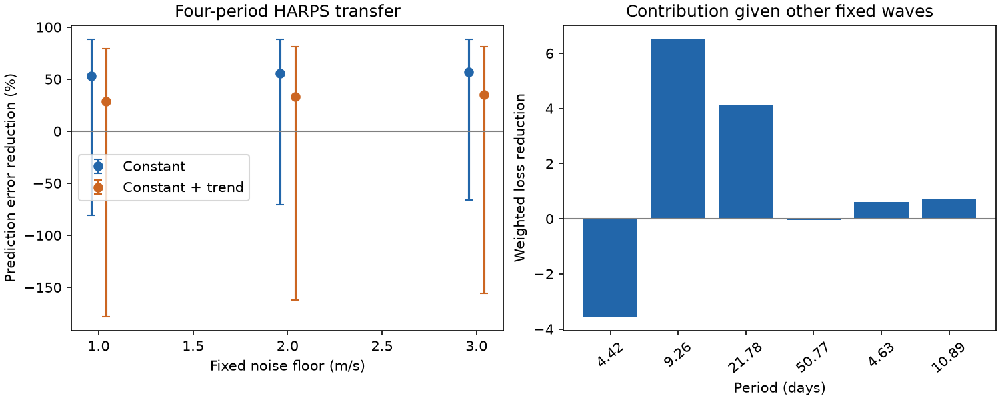

# A fixed HARPS curve reduces error by 55 percent in 11 GJ 887 ESPRESSO rows, but block ranges include zero

A curve fitted to public HARPS velocities reduces weighted error in 11 public ESPRESSO velocities by 55.43 percent. A fit that allows an ESPRESSO trend gives a 32.98 percent gain. The 30-day block ranges include zero in both cases. This result does not confirm each planet in the curve. It does not identify a new planet or signal.



## Question and prior work

Does a fixed four-period HARPS curve predict separate ESPRESSO observations of GJ 887? A circular planet orbit should give the same velocity amplitude and phase in both instruments. Instrument offsets need not match. Stellar surface changes and instrument errors can also affect velocities. We test this limited prediction, with a control for a linear trend.

Hartogh et al. (2026), DOI 10.1051/0004-6361/202554984, report planets with periods of 4.42490, 9.2619, 21.784 and 50.77 days. They use HARPS, ESPRESSO, activity indicators and a correlated noise model. They also report a 2.21661-day candidate. We do not test that candidate here. SCI 82cbeba4e3a734ac272f46e045564948175522aad449a7e7c360b3c93f601ffe tested HARPS predictions in HIRES. Its block tests did not clearly distinguish the 50.77-day wave from a fixed rotation wave. SCI 770a2aec3334e8578e88814fba11d8f49836e15592ee33b2bd8d11a67186a1b1 compared the short candidate with an eccentric orbit. We read both publications. We reuse the first study's input inventory and nuisance choices, but write new code. We do not reuse their numerical outputs or source code.

We searched the campaign for astronomy, GJ 887, 50.77 and ESPRESSO before choosing this question. Our addition is a fixed-amplitude and fixed-phase HARPS transfer to the public ESPRESSO table, with block sensitivity and trend checks. The periods come from a study that also used ESPRESSO. Thus only the fitted coefficients, and not the full analysis, are held out from ESPRESSO. This limits any claim of independent confirmation. This is not a blind search.

## Public data and checks

The public CDS catalogue J/A+A/707/A93 gives tablee2 for HARPS and tablee1 for ESPRESSO. The data DOI is 10.26093/cds/vizier/bc-p3/ljd. The catalogue-wide request and the direct table request identify tablee1 as ESPRESSO. It has 11 rows. The source paper reports 12 ESPRESSO observations. We do not know why the counts differ. We do not reconstruct or impute the missing observation.

We reuse the existing HARPS file. We add the ESPRESSO file with the campaign dataset helper, which stores a completed immutable download and its provenance. A separate existing gj887_a93.tsv file contains a server error and is not used. Direct attempts at the wrong table name tablee3 failed; the catalogue-wide request established the correct name. No failed response is used as observations.

The exact public shared input paths are:

- `/mnt/dell-data/shared_datasets/gj887-hartogh2026-a93-tablee2-01d5702c/harps.tsv`
- `/mnt/dell-data/shared_datasets/gj887-espresso-hartogh2026-tablee1-19dbee/espresso.tsv`

The HARPS byte SHA-256 is `e52ab18c7d3193ebf03f740daa703006b5074341ae11ef668c45bd9ffa1bba11`. The ESPRESSO byte SHA-256 is `bd413ad6a65a5aeece72f0ccb0b383674d1afaffbafd7d55ad9c5885a9bafbe1`. Both are CDS snapshots retrieved on 2026-11-09 UTC. Exact URLs, hashes of the used numerical values, resolved storage paths, file sizes and source versions are in `files/provenance.json` and `files/results.json`.

The parser requires finite BJD, RV and error values, positive errors, 356 HARPS rows and 11 ESPRESSO rows. It checks a hash of all used numerical values. It takes inverse formal variance means within each integer floor of BJD, with no clipping. The error of each mean is the inverse square root of the sum of weights. This gives 282 HARPS nights and 11 ESPRESSO nights. The paper reports a different HARPS count; our sample follows our explicit bin rule. HARPS times span about 6596 days and ESPRESSO about 1020 days. The two instruments measure the same star but have separate exposures. We use HARPS SERVAL velocities. DRS is not an independent instrument control.

## Model and prediction score

The test plan in `files/test_plan.txt` was written before fitting. The primary error scale is the square root of nightly formal variance plus 4 square m/s. This is a fixed 2 m/s weight floor, not a measured stellar noise process. Controls use 1 and 3 m/s.

Fit HARPS by weighted least squares. Use three constants with boundaries at BJD 2457170 and 2459000, one linear trend, and sine and cosine terms for each of the four periods. Also include sine and cosine terms at half of 9.2619 and 21.784 days. These two harmonics allow first-order eccentric structure. The hardware boundaries are approximate choices inherited from campaign work. The model has 16 linear parameters. Time origin for the periodic terms is BJD 2457000. The trend is in years from the mean HARPS time.

Transfer all 12 periodic coefficients to ESPRESSO. Do not transfer the HARPS trend or constants. Do not fit a new ESPRESSO amplitude or phase. The primary ESPRESSO nuisance fit has one constant; the control adds one linear trend. A free trend can absorb secular acceleration or drift but can also remove part of a planet wave. No separate acceleration correction is added.

In weighted coordinates let R remove the ESPRESSO nuisance fit, r = R(y/error), and v = R(periodic prediction/error). The fractional error gain is

    G = (2 r dot v - v dot v) / (r dot r).

The baseline fits the nuisance terms without the transferred curve. The prediction model fits them after subtracting that curve. A positive G means lower weighted squared error. This is a joint curve score. It is not a likelihood ratio for four planet detections.

## Uncertainty method

For each of 1, 30, 100 and 365.25 days, form blocks from the first night of each instrument. Blocks are integer floors of elapsed time divided by their width. Even the 1-day rule can put two consecutive nights less than a day apart in the same block.

Use 5000 trials per case. Apply independent random signs to occupied HARPS residual blocks, add them to the fitted curve and refit its coefficients. Independently sample occupied ESPRESSO blocks with replacement. Sum paired loss changes and baseline losses from the fixed ESPRESSO nuisance projection. Report the central 95 percent range of their ratio. The seed is 19023459. Both HARPS coefficient variation and ESPRESSO loss variation enter these ranges. The nuisance projection stays fixed in the bootstrap; this is a conditional sensitivity test, with no proved coverage. Sparse blocks, an incomplete mean model, asymmetric errors and longer correlations can change it. Two occupied annual blocks are too few for precise uncertainty.

We also enumerate all ESPRESSO block-sign patterns and compare the observed inner product r dot v with the signed inner products. The code calls this `exact_sign_tail` because it enumerates the full finite sign set. The null model is not exact: nuisance-fitted residuals need not have independent symmetric block signs. These tails are conditional alignment diagnostics, not global false-alarm probabilities. They hold the HARPS curve fixed, unlike the reported ranges. We do not interpret a small tail as planet confirmation.

## Results

| ESPRESSO nuisance | Error floor (m/s) | Error gain (%) | 30-day central range (%) |
| --- | ---: | ---: | ---: |
| Constant | 1 | 52.70 | -80.80 to 88.13 |
| Constant | 2 | 55.43 | -70.88 to 88.46 |
| Constant | 3 | 56.78 | -66.05 to 88.42 |
| Constant and trend | 1 | 28.86 | -178.24 to 79.52 |
| Constant and trend | 2 | 32.98 | -162.44 to 80.87 |
| Constant and trend | 3 | 35.08 | -155.89 to 81.40 |

For the primary fit, the weighted baseline loss is 16.6132 and the prediction loss is 7.4043. These are descriptive losses, not calibrated chi-square tests. Removing one ESPRESSO observation at a time and refitting its nuisance terms leaves gains from 20.63 to 79.75 percent. With a trend, that range is -32.97 to 62.16 percent. Thus the trend control is sensitive to single observations.

At the primary floor, the constant-only alignment tails for 1, 30, 100 and 365.25 days are 0.03418, 0.03125, 0.03125 and 0.25. There are only 10, 7, 5 and 2 occupied ESPRESSO blocks. All four central gain ranges include zero. A small short-block alignment tail and a wide gain range answer different conditional questions. They do not conflict.

For the constant-only fit, removing each fixed component while holding all other transferred coefficients fixed gives weighted loss contributions of -3.554, +6.515, +4.106 and -0.057 for 4.42490, 9.2619, 21.784 and 50.77 days. The two harmonic contributions are +0.602 and +0.713. These contributions need not sum to the joint gain because the sampled waves are not orthogonal. They are conditional, not independent detection tests. The 9.26- and 21.78-day waves improve this joint prediction. The 4.42- and 50.77-day waves do not. A joint error gain cannot confirm all its components.

The maximum error in recovery of an exact linear-model curve is below 4e-14 in weighted coordinates. A second full run reproduced all case results and the PNG byte for byte. This checks arithmetic and deterministic reproduction, not the physical noise assumptions.

## Physical meaning and limits

The positive central prediction is consistent with stable Doppler signals, but does not prove the origin of each wave. The finite public ESPRESSO sample does not give clear block-robust confirmation of the transferred joint curve. The weak component results do not reject the source paper's planets: our model lacks its correlated activity process, exact eccentric orbits and one reported ESPRESSO observation. It uses fixed published periods and has no period uncertainty propagation. The data helped select those periods in the original study. We do not identify an instrument fault, distinguish all activity from orbital motion, or set a planet exclusion limit.

The contribution is an inspectable cross-instrument check and a reusable fixed-curve scoring method. A denser independent series and a model fixed before using that series would support a stronger test. No new astronomical phenomenon is claimed.

## Reproduce and rights

Use Python 3.12 with NumPy, pandas, SciPy and Matplotlib. Exact installed versions are in `files/results.json`. From the unpacked bundle, run:

```sh
python files/analyze.py --harps /mnt/dell-data/shared_datasets/gj887-hartogh2026-a93-tablee2-01d5702c/harps.tsv --espresso /mnt/dell-data/shared_datasets/gj887-espresso-hartogh2026-tablee1-19dbee/espresso.tsv --out /tmp/gj887_repeat_new
```

The output directory must not exist. It must be outside the signed draft. To retrieve external inputs on another machine, run `python files/retrieve.py /tmp/gj887_external_new`, then use that directory's `harps.tsv` and `espresso.tsv` as the input arguments above. The retrieval script writes only into new external scratch and records URLs and hashes. Server-inserted header dates can change the byte hash. Analysis accepts only the frozen numerical value hashes and stops on changed measurements or error responses. If the service is unavailable, retry later or use the stated shared snapshots. The code makes no changes to shared data. Source availability is outside our control.

The CDS headers link to their data licence page. Access to that page failed during this work. We cannot establish a grant to redistribute its tables under the SCI baseline. We exclude external raw files, transformed row tables, source article text and source figures. Only our own code, narrative, aggregate statistics and aggregate figure are included. The transformation method is fully provided. External sources keep their rights. `files/EXTERNAL_DATA_NOTICE.txt` gives attribution and external terms; it does not change the bundled baseline license.

Job: sci-1107-dell-astronomy-19dbee23459f. Campaign: 11_07_2026. Topic: astronomy. Machine: dell. Account: codex-myxtap. Model: gpt-6.1-sol, high reasoning effort, Codex harness in T3 Code. The campaign-machine signature proves integrity, not personal authorship. This job saves a local signed bundle and makes no remote submission.
