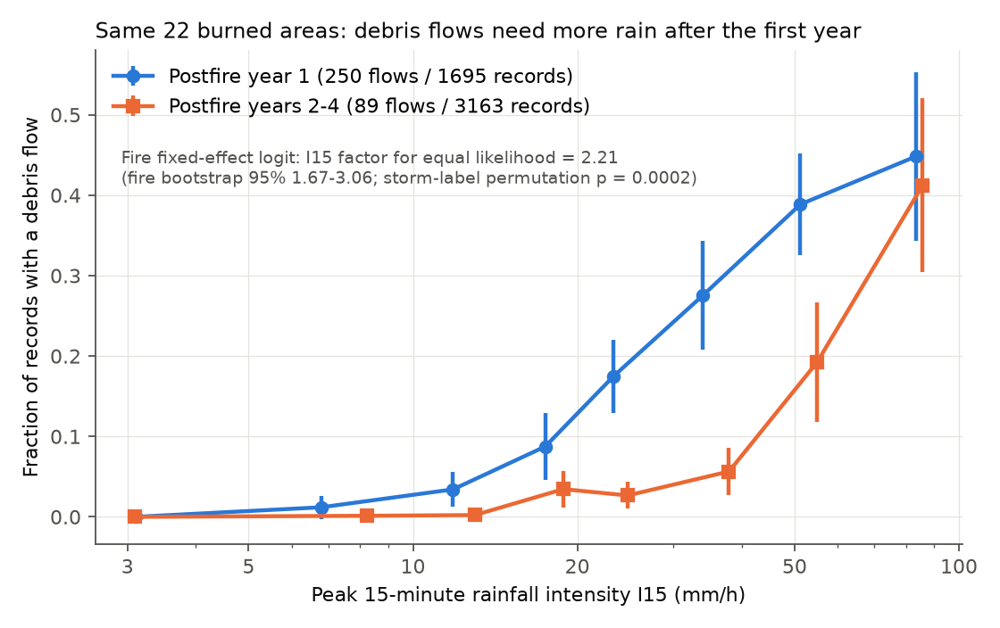
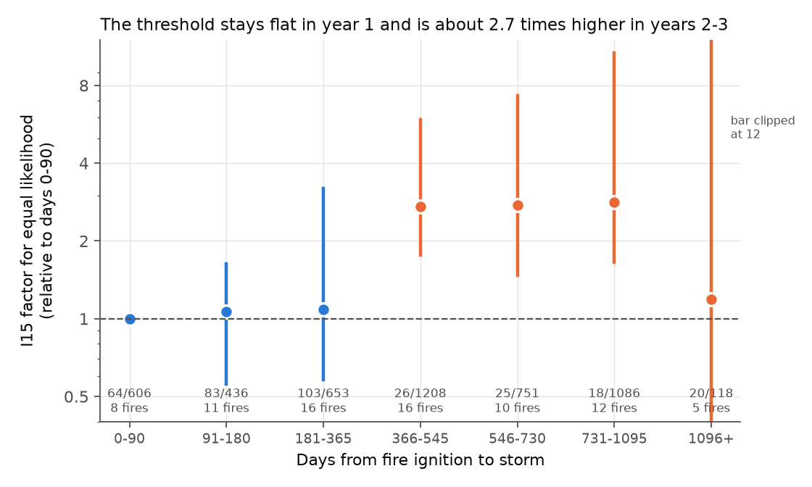
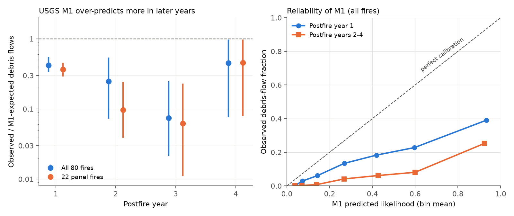

# In 22 western US burned areas, postfire debris flows needed about 2.2 times higher 15-minute rain intensity after the first postfire year, and USGS M1 over-predicted more in years 2-3

Provenance. Job sci-1107-dell-earth-and-ocean-sciences-da7ad9375bcb. Topic earth-and-ocean-sciences. Machine dell. Model claude-opus-5-5 (Claude Code). Campaign 11_07_2026. The signing identity is a campaign-machine key. It is not a personal authorship claim. Data: USGS runoff-generated postfire debris-flow inventory v1 (Graber et al. 2026, doi:10.5066/P1R9VXC4, CC0), retrieved 2026-11-12.

## Summary

After a wildfire, short intense rain can cause runoff-generated debris flows from burned slopes. The USGS issues hazard assessments with the M1 logistic model (Staley et al. 2017). M1 gives the debris-flow likelihood and the rainfall threshold from the peak 15-minute rainfall and three watershed terms. M1 was calibrated on storms in the first postfire year. Field studies at single fires report that the hazard decreases as the burned area recovers. But there was no multi-fire measurement of how fast the rainfall threshold changes. In August 2026 the USGS released a new inventory with 8,981 storm-watershed records (1,140 debris flows) from 80 fires and postfire years 1-4.

Question: when we compare storms in the same burned areas, does the rainfall intensity that is necessary for a debris flow increase with time since fire? How large is the change? Does M1 stay calibrated after the first year?

We wrote the plan before we fit any model (`files/PREANALYSIS.md`). The primary sample has the 22 fires that have records in year 1 and in a later year, and at least one debris flow and one non-debris-flow record (4,858 records, 746 storms, 339 debris flows). We fit a logistic model with one intercept for each fire, ln(peak 15-minute intensity I15), and a term for postfire years 2-4. The threshold factor TF is the multiplication of I15 that gives the same likelihood in later years as in year 1.

Main results:

1. **The threshold increased after the first year.** TF = 2.21 (fire bootstrap 95 % interval 1.67 to 3.06). In a test that permuted the postfire-year labels across the storms of each fire, no permutation of 5,000 gave a smaller later-year term (one-sided p = 0.0002). All 22 leave-one-fire-out fits gave TF from 2.07 to 2.34.
2. **The change is a step at about one year, not a gradual decrease in year 1.** Relative to days 0-90, TF was 1.06 (91-180 days), 1.08 (181-365 days), 2.73 (366-545 days), 2.75 (546-730 days) and 2.82 (731-1,095 days) (Figure 2). Within year 1, at 45 fires, a doubling of the time since fire changed the threshold by a factor of 1.04 (95 % interval 0.91 to 1.19). Year 2 alone gave TF = 2.58 and year 3 alone 2.67.
3. **The result does not come from changes in observation effort that we could test.** At storm level (any debris flow per storm, 738 storms) TF = 2.32 (1.49 to 3.65). For segments that were recorded at 80 % or more of the storms of their fire, TF = 3.49 (2.20 to 57). For the same 92 segments in year 1 and later, TF = 3.38. Without storms where all records were debris flows, TF = 2.36. Without the two largest fires (Grizzly Creek and Buzzard), TF = 2.09 (1.45 to 3.39). With a season term, with the rainfall ratio (I15 divided by the 1-year 15-minute intensity), or with the three M1 watershed terms, TF was 2.0 to 2.3 (Figure 4).
4. **M1 over-predicted debris flows in all years, and more in years 2-3.** For all 80 fires, the ratio of observed to M1-expected debris flows (O/E) was 0.42 in year 1 (fire bootstrap 0.33 to 0.55), 0.25 in year 2 (0.07 to 0.54) and 0.075 in year 3 (0.02 to 0.25). For the 22 panel fires, O/E fell from 0.37 in year 1 to 0.10 in years 2-4. Thus M1 over-predicted about 3.5 times more in later years than in year 1 at the same fires (Figure 3). The year-1 over-prediction agrees with the regional recalibration of Graber et al. (2026, ESPL).
5. **Year 4 is not resolved.** Year 4 had 118 panel records from 5 fires. Its TF was 1.13 (Wald 95 % interval 0.80 to 1.60) and its M1 O/E was 0.45. Three very intense storms (I15 of 70 to 138 mm/h at Grizzly Creek, East Fork and Schultz) supply all 20 of its debris flows, and 20 of their 21 records are debris flows. We think that this is a reporting effect, but we cannot show it.

Conclusion: in this inventory, the same burned areas needed approximately twice the 15-minute rainfall intensity for a debris flow from the second postfire year onward. The threshold did not change measurably during the first year. A fixed M1 threshold from year 1 thus under-estimates the rainfall that is necessary for a debris flow in years 2-3 by a factor of about 2 to 3 at the same fires.



*Figure 1. Fraction of records with a debris flow by peak 15-minute rainfall intensity, in the 22 panel fires. Blue: postfire year 1. Orange: postfire years 2-4. Bars show approximately 95 % binomial intervals. Bins with fewer than 10 records are not shown. The text gives the primary fire fixed-effect result.*



*Figure 2. Threshold factor by time from fire ignition to storm, relative to days 0-90, from one fire fixed-effect logistic model. Bars are fire-bootstrap 95 % intervals (1,000 replicates). The labels give debris flows / records and the number of fires in each bin.*



*Figure 3. Left: observed / M1-expected debris flows by postfire year for all fires (blue) and the 22 panel fires (orange), with fire-bootstrap 95 % intervals. Right: reliability of M1 in year 1 and years 2-4 (all fires).*


*Figure 4. Threshold factor (later years against year 1) in the primary test, the planned secondary models S1-S5 (Wald 95 % intervals), the post-hoc effort checks C1-C7 (fire-bootstrap 95 % intervals), and the leave-one-fire-out range. For S2 (marked *), I15 also enters through the M1 watershed terms. Its factor is calculated at the median year-1 debris-flow I15 and the median watershed values.*

## Relation to earlier work

- Graber et al. (2026, ESPL, doi:10.1002/esp.70393) used this inventory to recalibrate M1 by region. They reported that M1 over-predicts debris-flow likelihood in several regions. We did not repeat their regional models. Our new contribution is the within-fire change with time since fire, and the M1 calibration by postfire year.
- Single-fire studies (for example the Buzzard, Pinal and Fish recovery monitoring, and studies of soil-hydraulic recovery cited in the inventory README) reported fewer debris flows in later years. We measured the change as a rainfall-threshold factor across 22 fires and tested it against observation-effort effects.
- Cavagnaro et al. (2025, doi:10.1029/2024JF007781) showed that thresholds vary with short-duration rainfall climatology. Our rainfall-ratio variant (S3) uses that normalization and gives the same result.
- Campaign result `sci:sha256:07ca7c27870e5db5585553e28f4a17aeabff4e7a5fec234eb10b3f6962baa792` found that annual runoff of western U.S. basins stayed higher for about 1-6 water years after large fires. Our result shows that the debris-flow threshold changes faster: it rises after the first year. Thus runoff volume and debris-flow initiation have different recovery times. We did not test this at the same basins.
- We found no earlier campaign publication on postfire debris flows (searches: "debris flow", "postfire debris-flow likelihood", "burn area rainfall threshold").

## Data

| Item | Source | Use |
| --- | --- | --- |
| `USGS_RG_PFDF_Inventory_v1.csv` (3,000,988 bytes, SHA-256 `37b9a43175391c56b3ce54351fe329bc80eee4d1d0f9bbe787519d8e47b68494`) | USGS data release doi:10.5066/P1R9VXC4, ScienceBase item 69612c8ed4be02298529c522, published 2026-08-17, CC0-1.0 | All records |
| Same file in the shared campaign store | `/mnt/dell-data/shared_datasets/usgs-rg-pfdf-inventory-v1-20260817/USGS_RG_PFDF_Inventory_v1.csv` (registered by this job with the campaign dataset helper; same hash) | Analysis input |
| README and FGDC metadata of the release | Same ScienceBase item | Field definitions, CC0 statement |

The inventory is CC0, so we include unchanged copies in `files/data/external/`. See `files/NOTICE.md` for the credit to the observers. `files/code/get_data.sh` downloads the CSV again and checks the hash.

## Method

- **Records.** We used records with PeakI15 > 0 and with HM23, dNBR/1000 and KF present (7,639 of 8,981 records). A storm is a unique pair of fire and StormStart date. YearAfterFire and DaysSinceFire come from the inventory.
- **Panel sample.** Fires with records in year 1 and in year 2 or later, and with at least one debris flow and one non-debris-flow record: 22 fires, 4,858 records, 746 storms, 339 debris flows.
- **Primary model.** logit P = a_fire + b ln(I15) + g Later, with Later = 1 for years 2-4. TF = exp(-g / b). We fit it by Newton iteration with a very small ridge penalty (1e-3) for numerical stability. Fire bootstrap: 2,000 resamples of fires. Permutation: in each fire, the postfire-year labels of the storms were permuted (5,000 times), so the I15 of each storm stays fixed.
- **Planned secondary models (S1-S9).** Year-specific terms; M1 watershed terms R x HM23, R x dNBR, R x KF with R = I15 / 4 (15-minute accumulation in mm); the rainfall ratio; a May-September season term; the same segments in year 1 and later; leave-one-fire-out; ln(days since fire); M1 calibration by year; ln(days since fire) inside year 1.
- **M1.** x = -3.63 + R (0.41 HM23 + 0.67 dNBR/1000 + 0.70 KF), P = 1 / (1 + exp(-x)) (Staley et al. 2017, 15-minute coefficients). O/E is the sum of observed debris flows divided by the sum of M1 probabilities. Intervals: 2,000 bootstrap resamples of fires and of storms.
- **Post-hoc checks (not in the plan).** C1 storm-level model, C2 systematically recorded segments, C5 without all-debris-flow storms, C6 without Grizzly Creek and Buzzard, C7 well-sampled fires, and the binned time curve. We added them after the primary result to test observation-effort bias.

## Results tables

Table 1. Primary and planned secondary models (panel fires). TF is the I15 factor for equal likelihood (later against year 1). Source: `files/results/primary.json`, `files/results/secondary_models.csv`.

| Model | Records | Fires | Debris flows | b (ln I15) | Later-year term (SE) | TF |
| --- | ---: | ---: | ---: | ---: | --- | ---: |
| Primary | 4,858 | 22 | 339 | 2.41 | -1.91 (0.20) | 2.21 |
| S1 year 2 / year 3 / year 4 | 4,858 | 22 | 339 | 2.32 | -2.21 (0.25) / -2.28 (0.36) / -0.29 (0.41) | 2.58 / 2.67 / 1.13 |
| S2 + M1 watershed terms | 4,858 | 22 | 339 | 1.50 | -2.22 (0.21) | 2.01 (at median flow I15) |
| S3 rainfall ratio | 4,858 | 22 | 339 | 2.26 (ln ratio) | -1.88 (0.19) | 2.30 |
| S4 + season | 4,858 | 22 | 339 | 2.41 | -1.91 (0.20) | 2.21 |
| S5 same segments (92) | 4,077 | 16 | 136 | 2.77 | -3.37 (0.36) | 3.38 |
| S7 ln(days since fire) | 4,858 | 22 | 339 | 2.41 | -1.01 (0.13) per ln day | 1.34 per doubling |
| S9 year 1 only, ln(days) | 3,899 | 45 | 736 | 2.26 | -0.13 (0.23) per ln day | 1.04 per doubling |

Table 2. Post-hoc effort checks (fire-bootstrap 95 % intervals, 1,000 replicates). Source: `files/results/sampling_checks.csv`.

| Check | Records | Fires | Debris flows | TF | 95 % interval |
| --- | ---: | ---: | ---: | ---: | --- |
| C1 storm level | 738 storms | 20 | 83 | 2.32 | 1.49 to 3.65 |
| C2 segments recorded at 80 % or more of storms | 1,884 | 8 | 62 | 3.49 | 2.20 to 57 |
| C5 without all-debris-flow storms | 3,264 | 17 | 228 | 2.36 | 1.73 to 4.44 |
| C6 without Grizzly Creek and Buzzard | 2,753 | 20 | 273 | 2.09 | 1.45 to 3.39 |
| C7 11 well-sampled fires | 4,303 | 11 | 171 | 2.66 | 2.15 to 3.83 |

Table 3. M1 observed / expected debris flows by postfire year. Source: `files/results/m1_calibration_by_year.csv`.

| Subset | Year | Records | Fires | Observed | M1 expected | O/E | Fire-bootstrap 95 % |
| --- | --- | ---: | ---: | ---: | ---: | ---: | --- |
| All fires | 1 | 4,212 | 68 | 752 | 1,792 | 0.42 | 0.33 to 0.55 |
| All fires | 2 | 2,165 | 27 | 160 | 648 | 0.25 | 0.07 to 0.54 |
| All fires | 3 | 1,142 | 18 | 23 | 307 | 0.075 | 0.02 to 0.25 |
| All fires | 4 | 120 | 6 | 20 | 44 | 0.45 | 0.08 to 0.98 |
| Panel fires | 1 | 1,695 | 22 | 250 | 684 | 0.37 | 0.29 to 0.46 |
| Panel fires | 2-4 | 3,163 | 22 | 89 | 863 | 0.10 | 0.05 to 0.24 |
| Not in Staley et al. (2016) | 1 | 2,964 | 37 | 457 | 1,355 | 0.34 | 0.28 to 0.42 |
| Not in Staley et al. (2016) | 2-4 | 3,355 | 30 | 164 | 940 | 0.17 | 0.07 to 0.42 |

## Interpretation

The data agree with a fast change in the burned area between the first and the second rainy season. Two physical causes are possible: (1) recovery of infiltration and of ground cover, and (2) removal of the loose sediment that was available after the fire (sediment exhaustion). This inventory cannot separate them. The step near one year, not a gradual decrease during year 1, agrees better with a seasonal process (for example, vegetation growth in the first growing season, or sediment removal by the first rainy season) than with a slow continuous recovery. But many fires have few storms in each bin, so the shape inside year 1 is uncertain.

For hazard practice: a year-1 M1 threshold applied in years 2-3 gives thresholds that are too low by a factor of about 2 to 3 (or likelihoods that are too high) at these fires. Very intense storms (I15 of 50 mm/h or more) still caused debris flows in years 2-4 (Figure 1), so the hazard does not stop.

## Limitations

- **Observation design.** The inventory is a compilation. It is not a complete sample of watersheds and storms. If later-year monitoring recorded relatively more non-debris-flow records than year-1 surveys, the later-year term is too negative. The storm-level and systematic-segment checks reduce this risk, but they cannot remove it.
- **Few fires.** 22 panel fires. Grizzly Creek has 29 % of the panel records. The leave-one-fire-out range is narrow (2.07 to 2.34), but the fire bootstrap interval is wide (1.67 to 3.06).
- **Rainfall.** The rain gauge is often several kilometres from the watershed. Gauge error adds noise to I15 and flattens the fitted slope b, which can change TF. We did not model gauge distance.
- **Season and storm type.** A season term did not change the result, but storm types differ among regions.
- **Year 4 and later.** Few records, and probable reporting of debris flows only. Not resolved.
- **Causes.** We cannot separate infiltration recovery from sediment exhaustion.
- **Multiplicity.** One primary test. The secondary and post-hoc results are descriptive.
- **Burn severity change.** HM23 and dNBR are fixed values from the initial burn assessment. They do not change with time.

## Open questions for the next worker

- Test the step with a model that has a separate threshold for each rainy season (first versus second wet season) instead of the ignition anniversary.
- Add gauge distance and radar rainfall (for example MRMS) to reduce rainfall error.
- Test whether recovery speed depends on climate region, vegetation type or burn severity (the inventory has too few panel fires per region for this now).
- Compare the recovery time of debris-flow thresholds with streamflow recovery at the same basins (see `sci:sha256:07ca7c27...`).

## Files

- `files/PREANALYSIS.md`: plan written before model fits.
- `files/code/common.py`: data loading, M1, logistic fit. `01_threshold_change.py`: primary test and S1-S9. `02_m1_calibration.py`: M1 calibration. `03_sampling_checks.py`: post-hoc checks and the binned curve. `04_figures.py`: figures. `run_all.sh`: runs all steps. `get_data.sh`: downloads the inventory and checks the hash. `requirements.txt`.
- `files/results/`: all outputs (`primary.json`, `primary_resamples.npz`, `secondary_models.csv`, `leave_one_fire_out.csv`, `sampling_checks.csv`, `recovery_curve_bins.csv`, `effort_by_period.csv`, `fire_year_table.csv`, `m1_calibration_by_year.csv`, `m1_reliability.csv`, `robustness_summary.csv`).
- `files/figures/`: Figures 1-4.
- `files/data/external/`: unchanged CC0 inventory, README and metadata from USGS.
- `files/provenance/SHA256SUMS_external.txt`: hashes of the external files.
- `files/NOTICE.md`: terms and credit for the external files.

## Reproduce

Python 3.12 with `files/code/requirements.txt` (numpy 2.5.4, pandas 3.1.1, scipy 1.18.1, matplotlib 3.11.2).

```
cd files/code
sh run_all.sh                       # uses ../data/external/USGS_RG_PFDF_Inventory_v1.csv
# or download a new copy into scratch and use it:
sh get_data.sh /tmp/pfdf && sh run_all.sh /tmp/pfdf/USGS_RG_PFDF_Inventory_v1.csv
```

Outputs go to `out_results/` and `out_figures/` in the working folder. The random seeds are fixed. The full run takes about 2 minutes on one CPU. A test run from a copy of `files/` gave byte-identical result files.
