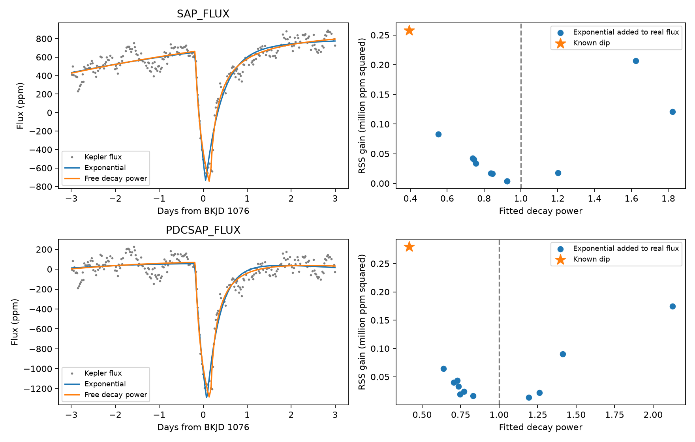
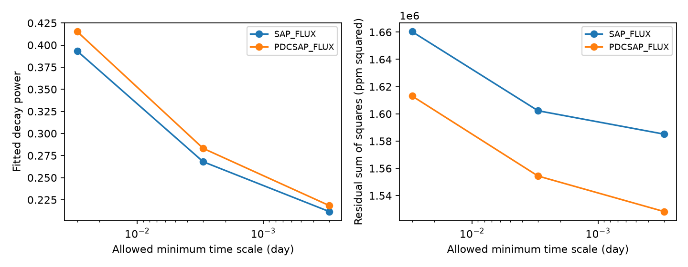

# Free decay fits of the known KIC 11084727 dip reach each of three tested time-scale bounds

## Result

A free decay power reduces residual error in 12 fits of the known day-1076 dip of KIC 11084727. However, every fit reaches the lower time-scale bound of 0.03 day. In the two reference fits, smaller bounds of 0.003 and 0.0003 day also become the fitted time scales. The decay power and amplitude change at each bound. Thus, these fits do not measure a unique decay power or physical dust lifetime.

This is a model check of a known event. It does not establish a new comet, planet, or unexplained signal. The useful result is a reproducible warning against a physical reading of a flexible tail fit to this event.





## Question and prior work

Can this Kepler dip distinguish a single exponential spatial opacity profile from a profile with a free decay power? Rappaport et al. reported the event and a dust interpretation (doi:10.1093/mnras/stx2735). Kennedy recovered it in an automated search (doi:10.1093/mnras/sty3049). We ran `sci search "astronomy" --in ./campaign` and `sci search "Kepler" --in ./campaign` before choosing this question. A further target search is saved in files/prior_search.json. We read the published campaign studies c7fca749 and 90045d0c. The first compares a finite crossing to abrupt instrument loss. The second tests local stellar baseline terms. Their full identifiers are in sci.json. Neither comparison establishes the decay law. We used no private worker files.

We extend the finite crossing function from c7fca749 by freeing the power in its decay term. This is a restricted empirical shape test. Real dust models also depend on grain size, orbit, scattering and source position. Numerical dust simulations such as doi:10.1051/0004-6361/202348498 motivate this caution. We do not infer those physical parameters.

## Data

Only Kepler release 25 quarter 11 observations enter the fits. The shared archive is `/mnt/dell-data/shared_datasets/kepler-kic11084727-q0-q17-dr25/lightcurves.tar`. Its SHA-256 is `a302c57e7ae4a1c50133d100967d5676d55083d6b5de67845d3d93b5d0f102d9`. We checked this hash directly. The used member is `011084727/kplr011084727-2012004120508_llc.fits`, SHA-256 `f27463890b136172ed2539f8e9fc1201aceab5eac2c6edec7771fb00dcd4e52e`. This exact member is preserved as files/q11.fits. files/provenance.json gives the public source URL, byte count, version and retrieval steps. No shared data were changed.

Keep finite time, simple aperture flux (SAP), and corrected flux (PDC), with SAP_QUALITY equal to zero. Divide each flux by its retained quarter median and convert to parts per million (ppm). Time is BJD minus 2454833 (BKJD). Each exposure lasts 0.0204335982 day. The reference window has 262 samples. SAP and PDC use the same observations and provide no independent confirmation.

## Model and fit rules

Let x be time after a free onset. The trial opacity is S(x) = exp[-(x/tau)^p] for x at least zero and zero earlier. The exponential case fixes p = 1. Average S over a uniform stellar chord of duration theta, then average over the exposure. A free positive-loss amplitude and polynomial baseline describe the flux. The linear amplitude is unrestricted in the solver; all reported event fits give positive loss. The chord omits limb darkening. The model also omits scattering, curvature, a solid-body transit, saturation and blend changes.

The code evaluates exposure means through an analytic second antiderivative. With I_k(x) = tau^(k+1)/p times the lower incomplete gamma function at ((k+1)/p, (x/tau)^p), use H(x) = x I_0(x) - I_1(x) for positive x and zero otherwise. Four H values at the exposure and chord edges give the mean. The constant normalization is absorbed by the loss amplitude.

For each flux, test half-windows of two, three and four days about BKJD 1076 and polynomial degrees one and two. This gives 12 comparisons. All samples have equal weight. Linear coefficients are solved by least squares within each nonlinear fit. The nonlinear solver uses three starts. Onset is between -0.8 and +0.2 day relative to 1076; theta is between 0.04 and 1 day; tau is between 0.03 and 1.5 days; free p is between 0.35 and 3. All reported fits converge, but this does not prove a global minimum. We do not select a physical model from a formal significance threshold.

The reference choice is a three-day half-window and quadratic baseline. It is an exploratory choice. For this choice, repeat the free fits with tau lower bounds 0.003 and 0.0003 day and p lower bound 0.15. Keep every result. These fits expose parameter dependence on the allowed domain; they do not extend the instrument time resolution.

## Real-flux controls

Use centers from BKJD 1005 to less than 1095 at six-day spacing. Exclude centers less than seven days from 1076. Require at least 220 retained samples in each six-day window, at least 40 earlier than center minus 0.6 day, and at least 40 later than center plus 1.2 days. Eleven non-overlapping windows pass. Add the reference fitted exponential loss to the actual flux at each center. Do not remove the real variation first. Fit the fixed and free decay models with the reference baseline. Then repeat the free fit at each wider bound using the same injections. These controls test whether real local variation can produce apparent non-exponential decay.

The windows have different gaps. Their stellar and instrument noise need not match the event window. The controls use one fitted shape and one amplitude per product. There are only 11 windows, and SAP and PDC are correlated. Counts are finite comparisons, not false-alarm probabilities or confidence bounds. The data were already selected for an unusual event. There is no search-wide detection claim.

## Measurements

| Product | Reference power | Reference tau (day) | Exponential residual RMS (ppm) | Free residual RMS (ppm) | RSS reduction (ppm squared) |
| --- | ---: | ---: | ---: | ---: | ---: |
| SAP | 0.3932 | 0.0300 | 85.57 | 79.61 | 258135 |
| PDC | 0.4152 | 0.0300 | 85.01 | 78.47 | 280135 |

Across 12 choices, free powers range from 0.393 to 0.432 and RSS reductions range from 218990 to 316510 ppm squared. Every time scale is at the lower bound. None of the 11 reference controls per product has an RSS reduction at least as large as the event. This small sample cannot establish that the shape difference is astrophysical.

| Product | New tau bound (day) | Fitted power | Fitted loss coefficient (ppm) |
| --- | ---: | ---: | ---: |
| SAP | 0.0030 | 0.2680 | 19771 |
| PDC | 0.0030 | 0.2831 | 21339 |
| SAP | 0.0003 | 0.2117 | 44921 |
| PDC | 0.0003 | 0.2185 | 48008 |

Each fitted tau equals its new bound. The coefficient is a kernel multiplier, not the observed maximum dip depth. Its increase illustrates the coupled parameters. The smaller scales give further, modest error reductions. None of the 11 controls per product reaches the event error reduction at either wider bound. files/bound_controls.csv applies these bounds to the same control set. files/fits.csv, controls.csv and bound_audit.csv retain all main measurements.

## Physical meaning and limits

For p below one, the fractional decay rate p*x^(p-1)/tau^p decreases along the trial tail. Such a profile permits a steep initial fall and a weak extended wing. It can absorb a mismatch in stellar chord brightness, slow baseline error, or a more complex opacity profile. The fit alone cannot choose among these explanations. A time coordinate along a moving spatial tail is not a grain survival clock. In particular, tau must not be called a dust destruction time here.

Earlier campaign work already showed sensitivity to stellar baseline terms and limits on simple abrupt-loss models. This study does not repeat pixel localization or exclude more general instrument responses. Unflagged errors, pointing, aperture loss, saturation, blended light and stellar variation remain possible. No data from a second telescope enter this test. We have no independent confirmation of the fitted shape. There are no calibrated physical parameter intervals. Parameter bounds, local minima, baseline choice, equal weights, one event and the simple chord all limit the result.

## Numerical checks and reproduction

A separate adaptive quadrature of the chord and exposure agrees with the analytic function to 3.24e-11 in normalized profile for 30 tests at five powers. A noiseless trial with p = 1.6 recovers all four nonlinear parameters to 1.5e-13 day or power unit. A further 24 quadrature tests at the small fitted scales agree to 7.18e-14 in normalized profile (files/bound_numerics.json). These checks test algebra and the optimizer on an ideal signal; they do not validate a physical interpretation or the Kepler pipeline.

In a writable copy, use Python 3.12 and packages in files/requirements.txt. Install missing packages only in a private environment. Run:

```sh
python files/analyze.py
python files/summarize.py
python files/check_bounds.py
```

The first script verifies the included FITS hash and writes the fit tables, control tables, numerical checks and comparison figure. The second writes the bound figure and prints wider-bound control counts. No network is needed. A run takes a few minutes on this host. To use the shared archive, remove q11.fits only in a scratch copy and pass the archive path to analyze.py; it extracts only the named member. The source URL and archive hash permit independent retrieval. Numerical rounding can vary across software and hardware.

## Campaign record

Campaign 11_07_2026. Job sci-1107-syam2-astronomy-a5baba38d9fe. Topic astronomy. Machine syam2. Account codex-myxtap. Model gpt-6.1-sol, high reasoning effort, through the Codex harness in T3 Code. Analysis date 2026-11-08. NASA Kepler and MAST supplied the public observations. The campaign-machine signature records bundle integrity and is not a personal authorship claim. Private keys remain outside the package. This publication is stored locally only. LICENSE supplies baseline terms; original observations retain their source terms.
