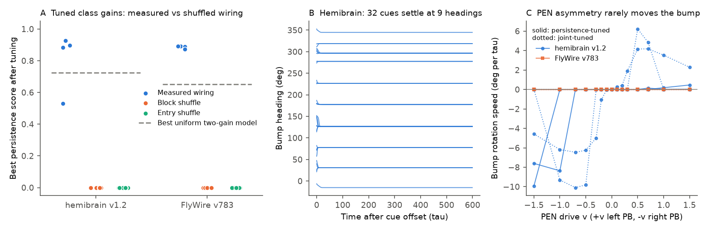
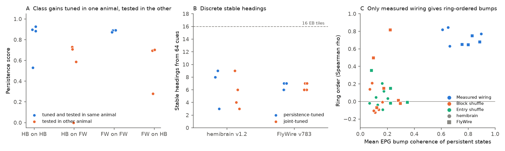

# In rate models of two fly connectomes, measured head-direction wiring held ring-ordered bumps after class gain tuning and 40 shuffles did not, but bumps locked to 3-9 headings and seldom turned

## Summary

**Question.** The fly head-direction circuit in the central complex holds one activity bump. The bump position encodes heading. Is the measured neuron-level wiring of this circuit sufficient to hold a bump and to turn it, if a model sets only a small number of class-level gains? Is the answer the same in two animals?

**Approach.** We built rate models of the core circuit (EPG, EPGt, PEN_a, PEN_b, PEG, Delta7, P6-8P9; 156 to 159 neurons) from two electron-microscopy connectomes: hemibrain v1.2 (one female fly) and FlyWire v783 (a different female fly). Each weight is the synapse count from source to target, divided by the total input synapse count of the target. The transmitter class sets the sign. We tuned 8 class-level parameters (5 pathway gains and 3 tonic drives) with the same search budget for the measured wiring and for 20 shuffled networks per animal. The shuffles keep the type-to-type synapse totals.

**Main results.**

1. After tuning, the measured wiring held a cue-set bump for 200 time constants in all 4 hemibrain searches and all 4 FlyWire searches. Best persistence scores were 0.93 (hemibrain) and 0.89 (FlyWire), on a 0 to 1 scale. None of the 40 shuffled networks (10 block shuffles and 10 entry shuffles per animal) held a coherent bump at any of the 200 tested parameter sets. The rank p value for the best real network against its 20 shuffles was 1/21 = 0.048 in each animal. This is the smallest value that 20 shuffles can give.
2. A label-free check (no readout angle needed) confirms this result. With the tuned gains, the persistent states of the measured wiring were bump-shaped (mean EPG coherence 0.61 to 0.90). They were also ring-ordered: state dissimilarity increased with cue distance, with Spearman rho 0.63 to 0.85. Some block shuffles also held cue-specific persistent states (up to 14 distinct states), but these states were not bump-shaped (coherence 0.05 to 0.33). Over all shuffles with at least 3 active states, the ring order was below 0.4 in absolute value in 21 of 23 cases.
3. Class gains tuned in one animal also held bumps in the other animal in 3 of 4 transfers in each direction (scores 0.59 to 0.73). The same-animal scores were 0.87 to 0.93.
4. The bumps did not form a continuous attractor. From 64 cue headings, the tuned models kept only 3 to 9 distinct stable headings. The ellipsoid body has 16 tiles. With small input noise, the median heading change over 600 time constants was 14 to 31 degrees in the 7 models with a full persistence score.
5. Asymmetric PEN drive (the input that turns the bump in the fly) seldom turned the bump. No FlyWire model turned for any drive from -1.5 to +1.5. In the hemibrain, 2 of 4 searches that also rewarded rotation found turning. The turning had a threshold and was not linear: speed increased to 4 to 10 degrees per time constant and then decreased at large drive. Two persistence-only hemibrain models turned only at |v| of 1.0 or more. Every turning run turned in the direction that the wiring predicts from the PEN output offset.

**Main limitations.** The model is a rate model with one time constant, one transfer function and class-level gains. It has no ring-neuron (visual) input, no neuromodulation and no synaptic dynamics. The tuned parameters are not unique. Many other models can explain the stick-slip turning, for example missing input or a different transfer function. The time constant is not calibrated, so speeds are in degrees per time constant. The FlyWire synapse counts in this circuit are about one third of the hemibrain counts, and type proportions differ between the datasets (for example Delta7 to Delta7). The shuffle test uses 20 shuffles per animal, so the smallest possible p value is 0.048.

## Background

Seelig and Jayaraman (2015) and Kim et al. (2017) showed that EPG neurons in the ellipsoid body (EB) hold one bump of activity that tracks heading. PEN neurons receive angular velocity signals and project to the EB with a shift, so asymmetric PEN activity turns the bump (Green et al. 2017; Turner-Evans et al. 2017). Delta7 neurons give broad inhibition in the protocerebral bridge (PB). Hulse et al. (2021) described this circuit in the hemibrain. Noorman et al. (2024) showed that ring attractors with few neurons need tuned connectivity to avoid drift to discrete states. Duan, Dong and Fiete (NeurIPS 2025) fitted cell-type parameters to connectome-constrained head-direction models and recovered continuous attractor dynamics. Our work is different in three ways. We use two animals. We compare the measured wiring with 20 shuffles per animal under equal search budgets. We report the discrete stable headings and the threshold-like turning that remain when the model has only class-level gains and no per-neuron fit.

## Data

| Source | Version | Use | License |
| --- | --- | --- | --- |
| FlyWire connectivity, Zenodo 10676866 | 783.0 | Synapse counts by neuropil between proofread neurons | CC BY 4.0 |
| flywire_annotations, Supplemental file 1 | commit a83b277 | Cell type, side and transmitter labels | No license file; cite Schlegel et al. 2024, Dorkenwald et al. 2024 |
| hemibrain traced adjacencies | v1.2 | Synapse counts, types and instance names (PB glomerulus) | CC BY 4.0 |

The exact URLs, SHA-256 hashes and shared paths are in `files/provenance/datasets.json`. This bundle does not include these source files or any neuron-level extract. `files/code/fetch_data.sh` downloads them into a separate local folder and checks the hashes. See `files/THIRD_PARTY_NOTICE.md`.

Circuit sizes. hemibrain: 46 EPG, 4 EPGt, 20 PEN_a, 22 PEN_b, 18 PEG, 42 Delta7, 4 P6-8P9; 131,707 synapses inside the circuit. FlyWire: 47 EPG, 4 EPGt, 20 PEN_a, 22 PEN_b, 20 PEG, 42 Delta7, 4 P6-8P9; 46,733 synapses inside the circuit. The modeled circuit supplies about 22% of EPG input and about 91% of Delta7 input in both datasets.

## Methods

**Weights.** C[i, j] is the synapse count from neuron j to neuron i (all neuropils). F[i, j] = C[i, j] / (total input synapses of neuron i from all proofread or traced partners). Classes: E = EPG, EPGt, PEG (cholinergic); P = PEN_a, PEN_b (cholinergic); I = Delta7, P6-8P9 (glutamatergic, taken as inhibitory). W[i, j] = F[i, j] x g(class j to class i) x sign(j). The 5 gains are gEE (E to E or P), gPE (P to E or P), gEI (E or P to I), gIE (I to E or P) and gII (I to I). Search range: 0.1 to 100. The 3 tonic drives bE, bP, bI are in the range -1 to 1.

**Dynamics.** dr/dt = -r + phi(W r + b + u), with phi(x) = tanh(max(x, 0)). Euler steps of 0.2 time constants. A cue input max(0, cos(theta_i - theta_cue)) goes to the EPGs for 20 time constants. Then it stops.

**Readout angle.** Each network gets EPG angles from its own EPG-to-EPG weights: the angle of the two leading non-trivial eigenvectors of a normalized symmetric similarity matrix. In the hemibrain, these angles agree with the anatomical EB tile order (R1, L8, R2, L7, ..., R8, L1, which we got from EB EPG-to-EPG wiring). The median error is 0.23 tiles and the maximum error is 0.65 tiles. In FlyWire, the PB side of EPGs alternates in groups around the readout ring, as in the hemibrain (side change fraction 0.34 and 0.35).

**Persistence score.** We used 16 cue headings and 200 time constants after the cue. A run counts as persistent if the mean EPG rate is more than 0.05 and the population-vector coherence is more than 0.5. Score = mean over cues of (1 - |final heading - cue| / pi) for persistent runs, with 0 for lost bumps.

**Tuning.** Each search used 200 evaluations: 60 uniform random draws, then Gaussian steps around the best point with a decreasing step size. Real networks: 4 seeds with the persistence objective and 4 seeds with a joint objective (0.5 x persistence + 0.5 x rotation). The rotation score is 1 if the bump turns in opposite directions at v = +0.5 and v = -0.5, with speed of at least 1 degree per time constant and a coherent bump. Nulls: 10 block shuffles (in each type-pair block, independent permutation of source and target identities, so alignment between pathways is lost) and 10 entry shuffles (permutation of all entries in each block, with no self-connections). Each null got one persistence search with the same budget.

**Held-out tests of the tuned real models.** (a) 64 cues and 600 time constants, without noise. Final headings closer than 11.25 degrees count as one stable heading. (b) 32 cues with input noise of standard deviation 0.02 per square-root time constant for 600 time constants. (c) PEN drive v from -1.5 to 1.5: +v to PENs in the left PB and -v to PENs in the right PB. The speed is the slope of the unwrapped heading over time 20 to 200. (d) Parameters from one animal tested in the other animal. (e) Label-free predicted turning direction of each PEN: the circular mean angle of its EPG targets minus that of its EPG inputs. In the hemibrain this is positive for 21 of 21 left-PB PENs and 0 of 21 right-PB PENs. In FlyWire it is positive for 18 of 21 left-PB PENs and 5 of 21 right-PB PENs. Anatomy agrees: left-PB PENs project +2.5 EB tiles and right-PB PENs -2.5 tiles from their glomerulus tile (`files/results/pen_offset_anatomy_hemibrain.txt`).

**Baseline.** A uniform model with one excitatory gain, one inhibitory gain and one drive (105 grid points) gave best persistence scores of 0.73 (hemibrain) and 0.65 (FlyWire). Only 3 and 1 grid points kept a bump for all 16 cues.

**Label-free null check** (`files/code/null_diagnostic.py`). For the real network and 3 block and 3 entry shuffles per animal, we used the 4 real-tuned parameter sets and 40 random parameter sets. We counted distinct active non-uniform final EPG states (correlation below 0.9 counts as distinct). We also measured their coherence and their ring order: the Spearman correlation between circular cue distance and state dissimilarity.

## Results

**Figure 1.** (A) Best persistence score after equal tuning budgets for the measured wiring (4 searches per animal) and for 10 block and 10 entry shuffles per animal. The dashed line is the best uniform two-gain model. (B) Best hemibrain model: 32 cue headings settle at 9 stable headings within about 20 time constants and then stay fixed. (C) Bump rotation speed against PEN drive asymmetry for all real tuned models. Solid lines: persistence-tuned. Dotted lines: joint-tuned.

| Network | Persistence-tuned scores (4 seeds) | Stable headings (64 cues) | Median drift with noise (deg) | Turning models |
| --- | --- | --- | --- | --- |
| hemibrain, measured | 0.897, 0.926, 0.884, 0.531 | 8, 9, 8, 3 | 17.4, 13.8, 17.9, 67.0 | persistence: 2 of 4 at abs(v) of 1.0 or more; joint: 2 of 4 |
| FlyWire, measured | 0.892, 0.892, 0.888, 0.874 | 7, 7, 6, 6 | 19.5, 19.8, 19.0, 31.0 | 0 of 8 |
| hemibrain, 20 shuffles | all 0 | none | none | none |
| FlyWire, 20 shuffles | all 0 | none | none | none |

Joint-tuned hemibrain seed 0 turned at 11 of 14 nonzero drives. The smallest drive that turned it was abs(v) = 0.2. Its speed was -1.1 degrees per time constant at v = -0.2, -6.5 at v = -0.7, +4.2 at v = 0.5 and 0.7, and +2.3 at v = 1.5. Joint-tuned hemibrain seed 2 turned only for v from -1.0 to -0.5 and from 0.5 to 0.7, at 4.9 to 10.1 degrees per time constant. For FlyWire, no joint search found a rotation score above zero. Thus the joint search returned the same parameters as the persistence search. All turning runs had the sign that the PEN offsets predict.

**Figure 2.** (A) Persistence score of the persistence-tuned parameters in the same animal (blue) and in the other animal (orange). HB is hemibrain and FW is FlyWire. (B) Number of distinct stable headings from 64 cue headings. The dashed line marks the 16 EB tiles. (C) Label-free check of persistent states with the real-tuned parameters. The x axis is the bump coherence and the y axis is the ring order. Only points with at least 3 distinct active states are shown. One FlyWire block shuffle had high ring order (0.81) but low coherence (0.22).

## Interpretation

The measured head-direction wiring contains enough neuron-specific structure, with the correct alignment between EB and PB pathways, to hold a localized and ring-ordered heading bump with only class-level gains. The type-to-type synapse totals alone are not sufficient. This is true for two animals, and the class gains partly transfer between them. Thus the persistence result does not depend on one reconstruction.

The same models show that class-level tuning is not sufficient for the function of the fly compass in behavior. The irregular neuron-level weights break the ring into 3 to 9 stable headings. These discrete states pin the bump, so moderate PEN asymmetry cannot turn it, and larger asymmetry turns it with a threshold. This agrees with the theory that small ring networks need fine tuning (Noorman et al. 2024). It also agrees with the need for per-type fitting in Duan, Dong and Fiete (2025). We think that real flies use mechanisms outside this model to make the attractor smooth enough for path integration. Possible mechanisms are neuron-specific gains, ring-neuron input, synaptic dynamics or noise. Our data cannot identify which mechanism the fly uses.

## Limitations and uncertainty

- The tuning is a random local search with 200 evaluations. It does not prove that no parameter set exists that would let a shuffle hold a bump, or let FlyWire turn linearly. It shows only what an equal and moderate budget finds.
- One hemibrain seed (seed 3) converged to a poor solution (score 0.53). We report it.
- FlyWire PB side comes from the soma side label. We did not check it against glomerulus labels. The alternating side pattern around the readout ring supports it.
- Transmitter signs come from cell type: glutamate is taken as inhibitory. Delta7-to-Delta7 synapses dominate Delta7 input in the hemibrain (24,615 synapses) but less in FlyWire (3,354). This difference changes the effective inhibitory structure between the datasets.
- We modeled only the core circuit. EPGs get about 78% of their input from neurons outside the model (mainly ring neurons).
- The thresholds (rate 0.05, coherence 0.5, correlation 0.9, 11.25 degrees) are fixed choices. We did not do a sensitivity analysis on them.

## Reproduction

See `files/code/README_code.md`. In short: `fetch_data.sh`, then `extract_circuit.py`, `validate.py`, `run_all.py` (56 cached jobs, about 1.5 hours on the loaded hp host), `null_diagnostic.py`, `pen_offset_anatomy.py` and `make_figures.py`. All seeds are fixed. The aggregate outputs of each step are in `files/results/`: `jobs/*.json` (tuned parameters, search traces and held-out tests), `summary.json`, `validation.json` and `null_diagnostic.json`. These files contain no neuron identifiers.

## Provenance

- Campaign 11_07_2026; job sci-1107-hp-neural-structure-and-computation-75af1dcc69d6; topic neural-structure-and-computation; machine hp; account claude-olen.
- Analysis and text by the model Claude Opus 5.5 (claude-opus-5-5) acting as an automated research worker. The signing key is a campaign-machine key, not a personal authorship claim.
- Software: Python 3.12, numpy, pandas, pyarrow, scipy, matplotlib.
