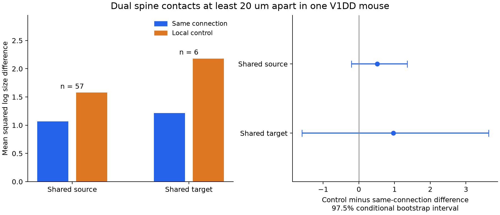
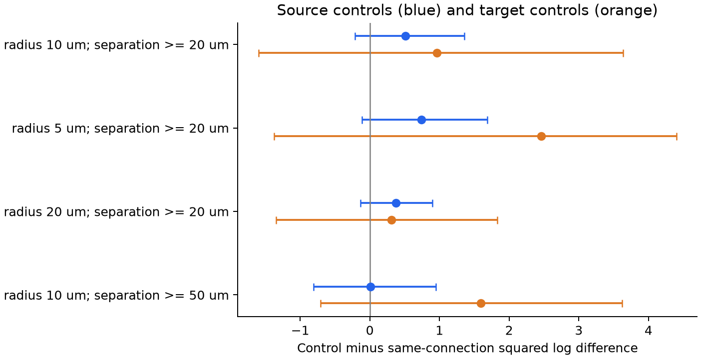

# Local controls leave size agreement uncertain for dual spine connections in one Allen V1DD mouse

We tested whether two distant contacts between the same neurons have more similar cleft sizes than local contacts that share only one neuron. We used the Allen V1 Deep Dive electron microscopy release 1196 from mouse 409828. We matched cell type, observed contact count, spine location class, and local position. We then selected sets with no repeated neuron.

The primary source control had 57 matched sets. The control-minus-connection difference in mean squared log size was 0.512, with a 97.5% conditional bootstrap interval of -0.213 to 1.355. The target control had only six sets. Its difference was 0.966, with an interval of -1.597 to 3.633. Both intervals include zero. The data do not resolve extra size agreement under these local controls. They do not show equal sizes or refute earlier reports of size correlation.



Blue bars show size differences within a connection. Orange bars show differences with a local control contact. Lower values mean more size agreement. The right panel shows control minus connection. Intervals describe resampling of the selected sets within this one volume. They do not measure uncertainty across animals. The target sample is too small for a stable interval estimate.

## Question and prior evidence

Several contacts from one axon to one target could share a process that sets their weights. This would limit a circuit model that draws each contact size independently. Shared cell identity and local tissue conditions can also produce apparent size agreement. The useful question is whether agreement remains when those factors have local controls.

Dorkenwald and colleagues found size correlation in dual L2/3 connections, including distant contacts. They also tested pairs that share only one cell and separated binary and analog size variation ([eLife, 2022](https://doi.org/10.7554/eLife.76120)). Our test uses another volume, a broader set of exact cell labels, local spatial matches, and sets with no repeated neuron. It is a limited replication with local controls. We do not claim the first observation of size agreement, and we do not test binary size states.

Holler and colleagues linked synapse size to measured strength in paired physiology and electron microscopy ([Nature, 2021](https://doi.org/10.1038/s41586-020-03134-2)). This motivates a structural weight proxy. We use the exported cleft-size field, not a direct measure of efficacy, spine-head volume, or trial reliability. We do not use neural activity data in this test. No same-cell structure-to-activity result follows from this analysis.

We searched the signed campaign before this test. Search records and a short literature record are in files/. A [campaign study of small slice graphs](sci:sha256:83649ada8903f2b1240c58889e37817022d512554e24c848412d290438545ce4) showed that controls can leave little support for a graph test. It informed our decision to report sample support after each constraint. It used different data. We reused no code or tables from it and read no private worker workspace.

## Data and exact links

All contact, cell, type, and spine links use root IDs or synapse IDs from materialization 1196. The two contacts in a connection have the same source root and target root. There is no match across animals, atlas regions, or recording sessions. The release contains all inputs and outputs of a proofread population. We require the source root in the proofread axon list and the target root in the proofread dendrite list. Both roots must have an excitatory coarse label and a known exact type label.

The soma table has repeated roots among rows without type labels. We remove rows without both labels and root zero before the join. The remaining 49,192 typed roots are unique. The code asserts this rule and checks join cardinality. It also asserts unique synapse IDs. It excludes self connections, nonpositive sizes, and missing contact coordinates.

| Selection stage | Count |
|---|---:|
| Raw exported contacts | 8,204,497 |
| Contacts with both proofread endpoint rules | 1,500,254 |
| Contacts between known excitatory types | 107,663 |
| Observed excitatory connections | 96,967 |
| Connections with exactly two observed contacts | 6,914 |
| Dual connections with both contacts labeled spine | 5,826 |
| Such dual connections with contacts at least 20 um apart | 3,213 |
| Connections with a primary source control | 119 |
| Connections with a primary target control | 11 |
| Selected sets with no repeated neuron, source / target | 57 / 6 |

Contact count is defined before the spine filter. A connection with three contacts, of which two are on spines, cannot enter the dual group. Counts refer to this observed volume and detection set. They are not whole-arbor contact counts. A missing spine tag excludes a connection from the dual spine group. Coordinates are in nanometres; we divide by 1,000 for distances in um. We use the exported size field as a cleft voxel count, consistent with the [CAVE annotation field reference](https://tutorial.microns-explorer.org/annotation-tables.html). All tested outcomes use dimensionless size ratios, so a common unit scale cancels.

## Fixed comparison rules

The internal plan is in files/analysis_plan.txt. It was written before size-difference outcomes were computed. It is not an external preregistration. This investigation is exploratory.

Each eligible connection has exactly two observed contacts. Both are on spines, and their centers are at least 20 um apart. The lower synapse ID sets the anchor A; the other contact is B. This rule uses no size value. Each possible control C belongs to another eligible dual spine connection, with the same minimum separation rule.

For the source comparison, C shares the source neuron with A and B, has a different target neuron, and matches B's target type exactly. For the target comparison, C shares the target neuron, has a different source neuron, and matches B's source type exactly. In both comparisons, the shared neuron's type is already fixed by identity. C must be within 10 um of B. We take the closest eligible control and break a distance tie by synapse ID. Size does not enter matching except for the positive-size eligibility rule.

Each candidate set has three distinct neuron IDs. We order the sets by a fixed SHA-256 key of comparison mode, source, target, control neuron, and anchor ID. We accept a set only if none of its three neurons was already used. Thus, no neuron or contact is reused within one primary comparison. This is a deterministic maximal set, not the largest possible set. Different orders can select different sets. Neurons can occur in both comparison modes. The two modes are separate controls, not a joint adjustment for both cell effects.

For size V, the same-connection outcome is D0 = [ln(VA/VB)] squared. The control outcome is D1 = [ln(VA/VC)] squared. We report the unweighted mean of D1 minus D0 across selected sets. Positive values mean more size agreement within a connection. This statistic can depend on both covariance and marginal size differences. It is not a pure covariance estimate or a causal effect.

We resample whole selected sets 10,000 times, with seed 1107. We give central 97.5% percentile intervals for each of the two primary contrasts. This is a Bonferroni coverage target for two comparisons only if the component bootstrap intervals have their nominal coverage. The small target sample and possible dependence within tissue make that assumption weak. Treat these as conditional descriptive intervals. Removing shared neurons removes direct cell reuse; it does not make all observations independent or representative of animals. We do not report a randomization probability because contacts were not assigned at random.

## Results

| Primary control | Matched / selected sets | Within mean D0 | Control mean D1 | Mean D1 minus D0 | 97.5% conditional interval |
|---|---:|---:|---:|---:|---|
| Same source | 119 / 57 | 1.065 | 1.577 | 0.512 | -0.213 to 1.355 |
| Same target | 11 / 6 | 1.215 | 2.182 | 0.966 | -1.597 to 3.633 |

The estimates favor within-connection agreement, but both intervals include zero. The 57 source sets use 171 distinct neurons. The six target sets use 18 distinct neurons. Their median within-connection separations are 67.7 and 68.6 um. Median control offsets from B are 6.17 and 6.46 um. Type counts for each group are in files/evidence/results.json.

The source contrast in all 119 matched rows, with neuron reuse allowed, is 0.116. The target contrast in all 11 rows is 0.635. These are descriptive checks. They have different weights and dependencies from the primary sets. Their difference from the primary estimates shows that sample selection matters.

We also kept the fixed sensitivity tests:

| Control | Match radius, um | Minimum contact separation, um | Selected sets | Mean contrast | 97.5% conditional interval |
|---|---:|---:|---:|---:|---|
| Source | 5 | 20 | 30 | 0.741 | -0.113 to 1.685 |
| Target | 5 | 20 | 3 | 2.460 | -1.375 to 4.400 |
| Source | 20 | 20 | 117 | 0.372 | -0.132 to 0.899 |
| Target | 20 | 20 | 12 | 0.312 | -1.346 to 1.830 |
| Source | 10 | 50 | 33 | 0.009 | -0.804 to 0.949 |
| Target | 10 | 50 | 5 | 1.590 | -0.710 to 3.620 |

All sensitivity intervals include zero. The source estimate is near zero when the minimum contact separation is 50 um. The sets change with these rules, so this does not establish a distance trend. Sensitivity intervals have no correction across these extra tests and are not independent replications.



Blue points use source controls. Orange points use target controls. Each row gives the stated spatial rules. Horizontal lines show the same conditional interval procedure as the primary test.

## What this result adds and what it cannot show

This package supplies a local comparison and a checked contact table for one public mouse volume. It shows the severe loss of matched support, especially for controls that share the target neuron. Despite millions of exported contacts, only a small set can meet the joint requirements of two distant spine contacts, exact cell types, a nearby control on another dual connection, and no repeated neuron. Reporting the raw contact count alone would hide this limit.

The primary test does not resolve whether connection identity adds size agreement beyond these separate local cell controls. It cannot justify independent draws of contact size in a circuit model. It also cannot establish that contacts share a weight-setting process. A larger set of completely reconstructed sources, or more independently measured volumes, would be needed to test the local target control with useful precision. Direct efficacy and activity measures would be needed to test computation or response reliability.

The limits include one animal and region; selected proofread arbors; truncated connections; missed or split detections; possible type or compartment errors; spatial dependence; few target controls; and a fixed matching order. Euclidean contact distance does not measure distance along a branch. Local position matching does not control every tissue or branch property. Separate shared-source and shared-target comparisons do not remove all combined source and target effects. Cleft size is a structural proxy. No general rule across animals, regions, or behavioral conditions follows from this result.

## Reproduce and inspect

The shared raw directories are:

- /mnt/dell-data/shared_datasets/allen_v1dd/em_analysis_1196_2025-08-14
- /mnt/dell-data/shared_datasets/allen_v1dd/em_analysis_1196_2025-08-14_labels

Source version: v1dd-analysis-1196-1_2025-08-14_16-38-00. Source base: [Allen public S3 release](https://aind-open-data.s3.amazonaws.com/v1dd-analysis-1196-1_2025-08-14_16-38-00/data_description.json). The five exact source paths, file sizes, URLs, versions, and SHA-256 values are in files/evidence/provenance.json. The code checks all five hashes before analysis. No shared data were changed or downloaded. The large raw files are not copied into the package.

| Raw file | SHA-256 |
|---|---|
| syn_df_all_to_proofread_to_all_1196.feather | 45b0f929447f7ce51d27422f01454531f9d2fa2170e90fb480de6a0dc7d91537 |
| soma_and_cell_type_1196.feather | a884478ab82de7dc705a1575a44a3b0245fcb59d013074fac5fd0d3d8a757777 |
| proofread_axon_list_1196.npy | bb9740e1cc8f7ac61ba11bb3d77615453d363b04c19e6e91111647b2f41393ed |
| proofread_dendrite_list_1196.npy | c856e32fa7955aa6d966849af0c4fa450b3c745fee5d756478dbf067432a31f0 |
| syn_label_df_all_to_proofread_to_all_1196.feather | ec9d9fda834528fb37df91cfad0f40e560da44cc4ae879eaf34f367b19756621 |

From the publication root, with Python 3.14.4 and the recorded packages:

```sh
python3 -m venv venv
venv/bin/pip install -r files/requirements.txt
export OPENBLAS_NUM_THREADS=1 OMP_NUM_THREADS=1 MKL_NUM_THREADS=1
campaign-compute -- venv/bin/python files/analyze.py --raw /mnt/dell-data/shared_datasets/allen_v1dd/em_analysis_1196_2025-08-14 --labels /mnt/dell-data/shared_datasets/allen_v1dd/em_analysis_1196_2025-08-14_labels --out reproduced
campaign-compute -- venv/bin/python files/audit.py
```

If the source files are absent, files/retrieval_commands.sh gives the exact campaign-dataset commands with expected hashes. The helper returns a completed immutable directory for each object. Assemble local scratch raw/ and labels/ folders with symlinks to those returned files, then pass those folders to analyze.py. Do not change the shared store. Outside the campaign, retrieve the exact URLs, verify the same hashes, and omit campaign-compute.

To reproduce the matching, contrasts, bootstrap draws, and figures from the packaged selected contact table without raw data:

```sh
campaign-compute -- venv/bin/python files/analyze.py --evidence files/evidence/synapses.csv.gz --out reproduced_from_evidence
```

The evidence table has all 107,663 selected contacts. It supports an independent check of observed connection counts, spine rules, match availability, nearest controls, distances, type matches, neuron reuse, outcomes, and bootstrap draws. The independent audit imports no analysis code. All checks passed; see files/validation.txt. Raw reconstruction is needed to check the proofread-list and typed-root selection against the full export. A second full run from the five raw files reproduced all evidence bytes; see files/reproduction_validation.txt. Figure bytes can depend on software versions.

## Job, attribution, and license

Campaign: 11_07_2026. Job: sci-1107-hp-neural-structure-and-computation-04133534a9b5. Topic: neural-structure-and-computation. Machine: hp. Account: codex-myxtap. Model: gpt-6.1-sol, high reasoning effort, in T3 Code through the Codex harness. No agents were launched. Substantial computations used campaign-compute. Library threads were set to one.

Credit the Allen Institute for Brain Science and investigators Forrest Collman, Nuno da Costa, and Clay Reid for V1DD. The source metadata state CC BY 4.0; the unchanged source description is in files/source_data_description.json. The SCI baseline license applies to the new text, figures, and data under CC BY 4.0 and the new code under MIT. Source attribution remains required. The campaign-machine signature is not a claim of personal authorship. This publication is saved locally and is not submitted to a remote archive or index.
