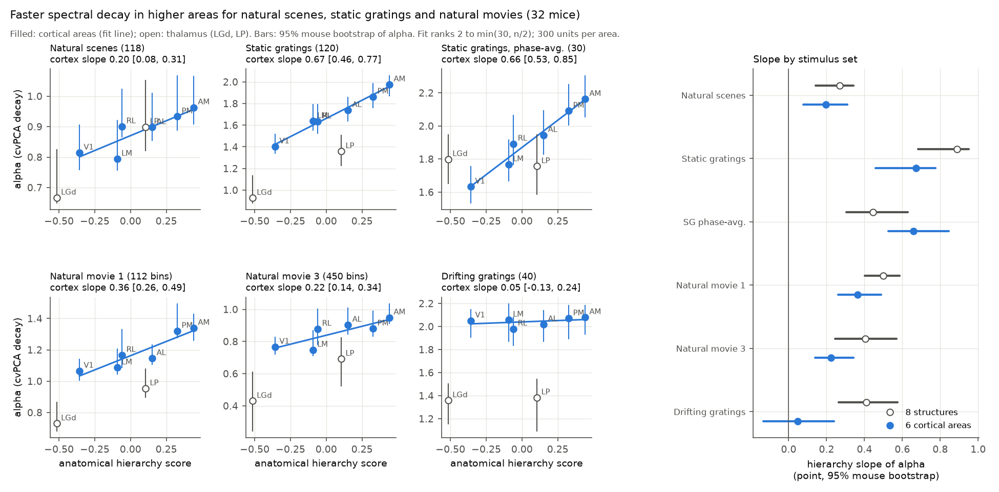
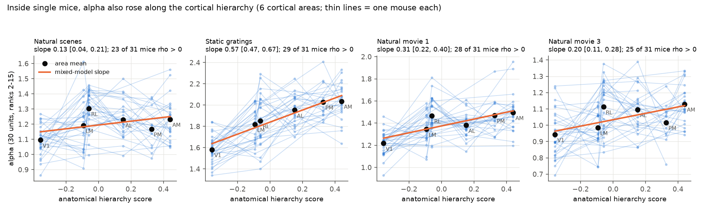
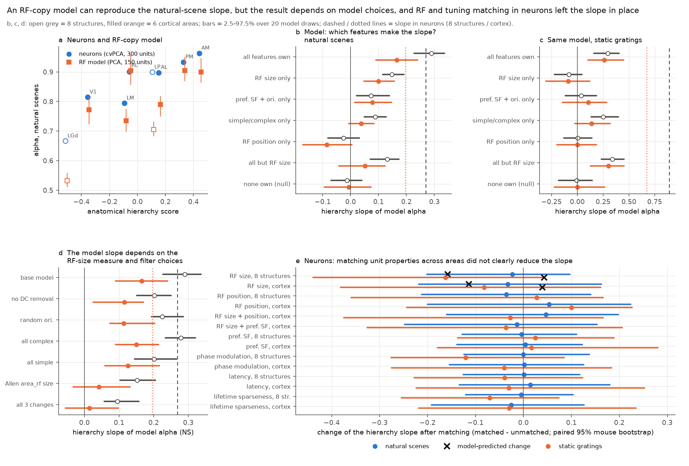

# Faster spectral decay in higher mouse visual areas held in single mice for images, gratings and movies (32 mice); matched RF and tuning properties did not explain it; RF models were choice-sensitive

## Summary

A prior SCI study (sci:sha256:528cd305...) found that the cross-validated PCA (cvPCA) spectrum of
natural-image responses decays faster along the anatomical mouse visual hierarchy (decay exponent
alpha rises from LGd to V1 to higher areas). We used the same Allen Visual Coding Neuropixels data
(32 mice, 11,559 units, 8 structures) and asked: (1) Is the trend general across stimulus classes,
and does it hold inside single mice? (2) Do differences in single-unit receptive-field (RF) and
tuning properties between areas explain it?

Three parallel campaign studies, published while this work ran, also report the stimulus
generality and RF size/position matching (sci:sha256:42f571df..., sci:sha256:62a723e5...,
sci:sha256:2817482c...). Our results agree with them where they overlap, and they add four new
points (marked **new**).

Main results:

- **Stimulus generality (replication).** For the 6 cortical areas, the hierarchy slope of alpha was
  0.20 [95% mouse bootstrap 0.08, 0.31] for natural scenes (the prior value, reproduced exactly),
  0.67 [0.46, 0.77] for static gratings, 0.66 [0.53, 0.85] for phase-averaged gratings, and 0.36
  [0.26, 0.49] and 0.22 [0.14, 0.34] for natural movies one and three. The order of the cortical
  areas agreed across these sets (Spearman rho 0.71 to 0.94). Drifting gratings (40 stimuli,
  14 repeats) gave no cortical trend, 0.05 [-0.13, 0.24]. With those stimuli, more than 80% of
  the reliable variance was in 5 dimensions in every cortical area.
- **New: the trend holds inside single mice for all four stimulus sets.** With 30 units per mouse
  and area (linear mixed model with a random intercept per mouse, 6 cortical areas), the slopes
  were 0.13 [0.04, 0.21] for natural scenes (23 of 31 mice had a positive rank correlation),
  0.57 [0.47, 0.67] for static gratings (29 of 31), 0.31 [0.22, 0.40] for movie one (28 of 31)
  and 0.20 [0.11, 0.28] for movie three (25 of 31). The prior study could not show a clear
  within-mouse cortical trend.
- **New: a wider set of matching controls with our own RF maps, for natural scenes and gratings.**
  We mapped RFs again from the raw Gabor responses (2-D Gaussian fits). We subsampled units so that
  all areas had the same distribution of RF size, RF position, RF size + position, RF size + SF,
  preferred SF, phase modulation, latency or lifetime sparseness. After each match, the cortical
  slope stayed positive (all 95% intervals above zero), and the matched slope was 86% to 123%
  (natural scenes) and 80% to 119% (gratings) of the unmatched slope. No paired change was different from zero. The
  RF-based intervals are wide (about +/- 0.2), so a partial RF-size effect is not excluded.
- **New: RF-copy models can reproduce the natural-scene slope, but this depends on model choices.**
  Our model units copied the measured RF centre, fitted RF size, preferred SF and orientation, and
  simple/complex type of real units. With DC-free Gabor filters on a grey screen, the model gave a
  natural-scene slope of 0.29 (8 structures) and 0.17 (cortex), near the neuron values 0.27 and
  0.20. RF size alone gave about half of this. With the envelope taken from the Allen `area_rf`
  value instead of our fit, the cortical model slope fell to 0.04. With the three choices of the
  parallel studies together (Allen RF size, no DC removal, random orientation), the model gave
  0.09 and 0.01. These values agree with the near-zero model slopes of those studies. Thus the
  disagreement between the campaign RF models comes from model choices, mainly the RF-size
  measure. Model agreement alone cannot show that RF size causes the trend.
- **New: for gratings, the RF model gave less than half of the trend.** The same model gave 0.30
  (8 structures) and 0.26 (cortex) for static gratings, against 0.89 and 0.67 in neurons.
- **Data check (confirmation).** In the Allen `brain_observatory_1.1_analysis_metrics.csv` table,
  `p_value_rf` has only the values 0 and 1. Units with value 1 had the better maps (median
  split-half map correlation 0.67 against 0.34). This agrees with the column swap
  (`p_value_rf` and `on_screen_rf`) that the parallel studies reported. The literal filter
  `p_value_rf < 0.01` selects mostly unreliable maps. Our RF centres agreed with the Allen
  azimuth and elevation (r = 0.99) for well-mapped units.

Conclusion: the faster spectral decay of higher mouse visual areas is general. It occurs for
images, gratings and movies, and inside individual mice. Area differences in RF size, RF
position, SF preference, phase invariance, latency or selectivity do not explain it in neurons.
Image-computable RF models can make a trend of the correct size for natural images, but only for
some reasonable choices of RF size and filter, and they give less than half of the grating trend.
A population-level property that single-unit summaries do not capture probably makes most of the
difference. An example is how tuning is shared across units. This agrees with the parallel
finding (sci:sha256:2817482c...) that pooled V1 units do not reproduce the compression.

## Question

Stringer et al. (2019) showed that the cvPCA spectrum of V1 responses to natural images follows a
power law with alpha near 1. The prior SCI study found that alpha increases along the
connectivity-defined hierarchy (Harris et al. 2019) in Neuropixels and two-photon data. It listed
these open points: (i) receptive-field size and position were not controlled; (ii) the effect was
not clear inside single mice; (iii) only natural images were tested; (iv) the cause was unknown.
We tested all four points.

## Data

- Allen Brain Observatory Visual Coding Neuropixels, all 32 `brain_observatory_1.1` sessions
  (one mouse per session). Same unit selection as the prior study: Allen quality filters
  (ISI violations < 0.5, amplitude cutoff < 0.1, presence ratio > 0.9) in LGd, LP, VISp (V1),
  VISl (LM), VISrl (RL), VISal (AL), VISpm (PM) and VISam (AM): 11,559 units. We streamed only the
  spike times of these units and the stimulus tables from each NWB file (HTTP range reads).
- Stimulus sets, all in the same 32 mice and the same units:

| Set | Stimuli | Repeats used | Response window |
| --- | --- | --- | --- |
| Natural scenes (NS) | 118 images | 50 | 0-250 ms spike count |
| Static gratings (SG) | 120 = 6 orientations x 5 spatial frequencies x 4 phases | 40 | 0-250 ms |
| SG phase-averaged (SG30) | 30 = SG averaged over the 4 phases inside each repeat | 40 | 0-250 ms |
| Drifting gratings (DG) | 40 = 8 directions x 5 temporal frequencies | 14 | 0-2 s |
| Natural movie one (NM1) | 112 bins of 8 frames (267 ms) of a 30 s movie | 20 | bin count |
| Natural movie three (NM3) | 450 bins of 8 frames of a 120 s movie | 10 | bin count |
| Gabor RF mapping | 9 x 9 positions (10 deg step), 3 orientations | 15 per position and orientation | 0-250 ms |

- The 118 natural-scene images (Allen `natural_scene_templates`) for the stimulus-computable model.
- Hierarchy scores (Harris et al. 2019, as used by Siegle et al. 2021 and by the prior study):
  LGd -0.515, VISp -0.357, VISl -0.093, VISrl -0.059, LP 0.105, VISal 0.152, VISpm 0.327, VISam 0.441.
- The Allen `brain_observatory_1.1_analysis_metrics.csv` table, only to validate our RF maps.

## Methods

1. cvPCA and alpha, identical to the prior study (we reproduced its natural-scene numbers exactly):
   each unit is scaled by its single-trial SD; repeats of each stimulus are split at random into two
   halves; principal components of half A are found, and the covariance of the projections of the
   two halves gives the reliable variance of each dimension (both split directions, 4 splits).
   alpha is minus the OLS slope of log variance on log rank, over ranks 2 to min(30, n_stim / 2).
   This rule was fixed before any area comparison (it gives ranks 2-30 for NS, SG, NM1 and NM3,
   2-20 for DG and 2-15 for SG30).
2. Pooled analysis: for each structure we pooled the units of all mice (valid because every mouse saw
   the same stimuli) and drew 300 units 50 times. Intervals: mouse cluster bootstrap (200 replicates;
   the same resample of mice for all structures in a replicate). The hierarchy slope is the OLS slope
   of alpha on the hierarchy score, for the 8 structures and for the 6 cortical areas.
3. Within-mouse analysis: for every mouse and structure with at least 30 units, the mean spectrum over
   20 draws of 30 units, alpha over ranks 2 to min(15, n_stim / 2); linear mixed model
   alpha ~ hierarchy + (1 | mouse), and the count of mice with a positive Spearman correlation.
4. Unit features from our own maps (we did not use the Allen precomputed RF metrics, see Results):
   - RF map: mean count at each of 81 Gabor positions; split-half map correlation (odd/even repeats);
     peak height against 50 position shuffles (z); fit of an isotropic 2-D Gaussian (centre and SD
     sigma). A unit is "well mapped" if map r > 0.5, z > 3, fit R^2 > 0.5, centre inside the grid
     and sigma < 40 deg. 3,586 of 11,559 units passed.
   - Static gratings: preferred orientation and spatial frequency (argmax of the mean response);
     phase modulation index PMI = |F1| / F0 of the blank-subtracted, rectified 4-phase response at
     the preferred orientation and SF (high = simple-like, low = phase invariant).
   - Natural scenes: latency of the peak of the mean PSTH (25 ms bins) and lifetime sparseness of the
     trial-mean responses.
5. Matching controls: for each feature, subsampling weights give every structure the same (common
   minimum) histogram of the feature; then pooled alpha (100 units for RF-based features because LGd
   has only 184 well-mapped units; 200 units otherwise) and the mouse bootstrap of the slope. Features:
   RF size (log sigma), RF position (4 x 4 grid of centre bins), RF size + position, RF size +
   preferred SF, preferred SF, PMI, latency, lifetime sparseness. Also median splits of each feature
   inside each structure (80 or 150 units per half).
6. Stimulus-computable RF model: every model unit copies one real well-mapped unit of a structure: RF
   centre, envelope SD sqrt(sigma^2 - 5^2) deg (removing the blur of the 20 deg mapping Gabor),
   preferred SF and orientation, and type (PMI > 1: simple = half-rectified Gabor filter with random
   phase; otherwise complex = Gabor energy). Images were placed on a mean-grey 120 x 75 deg screen
   (0.5 deg per pixel; images 73 x 57 deg in the centre; no spherical warping). The noise-free PCA
   spectrum of 150 z-scored model units gives model alpha (ranks 2-30; 20 draws). Factorial
   conditions take each feature group (RF size; RF position; SF + orientation; type) either from the
   structure's own units or from a pool of all eight structures. We ran the same model on the 120
   static gratings (full-field sinusoids, contrast 0.8). An RF-size sweep scales the RF area of pooled
   units by 1/4 to 4. Sensitivity variants (added after we read the parallel studies): no DC removal
   of the filters, random orientation, all units complex or all simple, envelope SD = d / 4 with
   d = 2 sqrt(area_rf / pi) from the Allen table, and the combination of the first two with the Allen
   size.
7. Paired controls: every control uses the same resample of mice in bootstrap replicate b, so we
   report the paired change slope(matched) - slope(unmatched reference) with its 95% interval.

## Results

### 1. Stimulus generality (pooled, 300 units, 32 mice)

alpha per structure (fit ranks in the Methods):

| Set | LGd | V1 | LM | RL | LP | AL | PM | AM | slope, 8 structures | slope, cortex |
| --- | --- | --- | --- | --- | --- | --- | --- | --- | --- | --- |
| NS | 0.67 | 0.81 | 0.79 | 0.90 | 0.90 | 0.90 | 0.93 | 0.96 | 0.27 [0.14, 0.34] | 0.20 [0.08, 0.31] |
| SG | 0.93 | 1.40 | 1.64 | 1.63 | 1.36 | 1.74 | 1.86 | 1.98 | 0.89 [0.68, 0.95] | 0.67 [0.46, 0.77] |
| SG30 | 1.80 | 1.63 | 1.77 | 1.89 | 1.76 | 1.94 | 2.09 | 2.16 | 0.45 [0.30, 0.63] | 0.66 [0.53, 0.85] |
| NM1 | 0.73 | 1.07 | 1.09 | 1.17 | 0.95 | 1.15 | 1.32 | 1.34 | 0.50 [0.40, 0.59] | 0.36 [0.26, 0.49] |
| NM3 | 0.43 | 0.77 | 0.75 | 0.88 | 0.69 | 0.90 | 0.88 | 0.95 | 0.40 [0.25, 0.57] | 0.22 [0.14, 0.34] |
| DG | 1.36 | 2.05 | 2.06 | 1.98 | 1.38 | 2.02 | 2.07 | 2.08 | 0.41 [0.26, 0.58] | 0.05 [-0.13, 0.24] |

- Spearman rho of alpha with hierarchy over the 6 cortical areas: NS 0.89, SG 0.94, SG30 1.00,
  NM1 0.94, NM3 0.89, DG 0.54.
- The two thalamic nuclei behave differently: LGd always had the lowest alpha, but LP had a lower
  alpha than its hierarchy score predicts for gratings and movies. Thus the 8-structure slope
  partly depends on LP. The cortical slope is the main test.
- Phase averaging of the gratings (SG30) removes all phase-related dimensions, but the cortical
  slope stayed (0.66). Thus the grating trend is not only an effect of phase invariance.
- Absolute alpha values depend on the stimulus set and on the number of stimuli. Compare slopes
  only inside a stimulus set.

### 2. Inside single mice (Figure 3)

| Set | cortex slope [95% CI] | p | mice with rho > 0 | 8-structure slope |
| --- | --- | --- | --- | --- |
| NS | 0.125 [0.041, 0.210] | 0.004 | 23 / 31 | 0.149 [0.068, 0.230] |
| SG | 0.567 [0.468, 0.666] | 3e-29 | 29 / 31 | 0.579 [0.458, 0.699] |
| NM1 | 0.309 [0.219, 0.399] | 2e-11 | 28 / 31 | 0.382 [0.276, 0.488] |
| NM3 | 0.196 [0.112, 0.281] | 5e-6 | 25 / 31 | 0.239 [0.158, 0.320] |

CIs and p values are from the mixed model (Wald). 133 mouse-area populations in cortex.

Exploratory: across mouse-area populations of the same structure, alpha for natural scenes
correlated with alpha for movie three (rho 0.47) and for gratings (rho 0.32). These are the same
units, so shared unit sampling can contribute.

### 3. Unit features by area (well-mapped units)

| | LGd | V1 | LM | RL | LP | AL | PM | AM |
| --- | --- | --- | --- | --- | --- | --- | --- | --- |
| well-mapped units | 184 | 1,099 | 382 | 421 | 202 | 492 | 281 | 525 |
| RF sigma, median (deg) | 7.3 | 10.0 | 13.3 | 13.7 | 15.1 | 14.8 | 14.8 | 15.5 |
| preferred SF, median (cpd) | 0.08 | 0.04 | 0.04 | 0.04 | 0.08 | 0.04 | 0.04 | 0.04 |
| phase modulation, median | 0.68 | 0.37 | 0.31 | 0.43 | 0.57 | 0.36 | 0.32 | 0.34 |
| NS latency, median (ms) | 87.5 | 112.5 | 112.5 | 87.5 | 87.5 | 112.5 | 112.5 | 112.5 |

RF size increased from V1 to the higher cortical areas by a factor of 1.3 to 1.5 in sigma (1.8 to
2.4 in area). The direction agrees with Siegle et al. (2021).

### 4. Stimulus-computable RF model (Figure 2a-d)

Hierarchy slope of model alpha (mean spectrum of 20 draws of 150 units; brackets: 2.5-97.5% over
draws):

| Condition (feature groups from the structure's own units) | NS, 8 structures | NS, cortex | SG, 8 structures | SG, cortex |
| --- | --- | --- | --- | --- |
| all own | 0.29 [0.23, 0.34] | 0.17 [0.09, 0.24] | 0.30 [0.16, 0.41] | 0.26 [0.10, 0.45] |
| RF size only | 0.15 | 0.10 | -0.08 | -0.09 |
| SF + orientation only | 0.07 | 0.08 | 0.04 | 0.11 |
| simple/complex only | 0.09 | 0.04 | 0.25 | 0.14 |
| RF position only | -0.03 | -0.09 | 0.00 | 0.00 |
| all but RF size | 0.13 | 0.05 | 0.34 | 0.30 |
| none own (null) | -0.01 | -0.01 | -0.01 | 0.00 |
| neurons (for comparison) | 0.27 | 0.20 | 0.89 | 0.67 |

The model values for each structure are close to the neuron values for natural scenes (Figure 2a),
except LGd (model 0.53, neurons 0.67). Scaling the RF area of pooled model units from 1/4 to 4
raised model alpha from 0.63 to 0.87 (complex units: 0.68 to 0.98; simple units: 0.55 to 0.65).

Model sensitivity (natural scenes, all features own; `files/results/model_variants/`, Figure 2d):

| Variant | slope, 8 structures | slope, cortex [2.5-97.5% over draws] |
| --- | --- | --- |
| base model (fitted RF SD, DC removed, measured orientation, measured type) | 0.29 | 0.17 [0.09, 0.24] |
| no DC removal | 0.20 | 0.11 [0.03, 0.17] |
| random orientation | 0.22 | 0.11 [0.07, 0.20] |
| all units complex | 0.28 | 0.15 [0.09, 0.21] |
| all units simple | 0.20 | 0.13 [0.06, 0.22] |
| envelope SD = d / 4 from Allen `area_rf` | 0.15 | 0.04 [-0.03, 0.13] |
| Allen size + no DC removal + random orientation | 0.09 | 0.01 [-0.06, 0.10] |
| neurons | 0.27 | 0.20 |

The two RF-size measures rank units alike (Spearman 0.78 to 0.85 inside each cortical area, 0.61 in LGd;
`files/results/rf_size_measures.csv`). But the envelope from `area_rf` is 35% to 46% smaller, and its
ratio between AM and V1 is 1.41 against 1.68 for our deblurred fits. Small envelopes at the
preferred SF hold few carrier cycles, and the area difference in size is smaller. Both changes
reduce the model slope.

### 5. Matching unit properties in neurons (Figure 2e)

Slope after matching, and paired change against the unmatched reference (RF-based controls:
well-mapped units, 100 per structure; other controls: all units, 200 per structure):

| Control | NS cortex slope | NS change | SG cortex slope | SG change |
| --- | --- | --- | --- | --- |
| reference, well-mapped units (100) | 0.24 [0.11, 0.42] | - | 0.53 [0.35, 0.73] | - |
| RF size | 0.20 [0.09, 0.39] | -0.03 [-0.22, 0.16] | 0.44 [0.25, 0.64] | -0.08 [-0.38, 0.16] |
| RF position | 0.29 [0.11, 0.47] | +0.05 [-0.20, 0.22] | 0.63 [0.34, 0.75] | +0.10 [-0.24, 0.23] |
| RF size + position | 0.28 [0.13, 0.44] | +0.05 [-0.16, 0.20] | 0.50 [0.25, 0.67] | -0.03 [-0.38, 0.17] |
| RF size + preferred SF | 0.22 [0.08, 0.38] | -0.01 [-0.25, 0.15] | 0.49 [0.30, 0.69] | -0.04 [-0.33, 0.21] |
| reference, all units (200) | 0.20 [0.08, 0.32] | - | 0.66 [0.43, 0.79] | - |
| preferred SF | 0.21 [0.08, 0.32] | +0.00 [-0.14, 0.12] | 0.68 [0.46, 0.85] | +0.02 [-0.18, 0.28] |
| phase modulation | 0.20 [0.08, 0.30] | +0.00 [-0.16, 0.13] | 0.62 [0.39, 0.73] | -0.04 [-0.28, 0.18] |
| latency | 0.22 [0.09, 0.35] | +0.01 [-0.13, 0.18] | 0.63 [0.40, 0.79] | -0.03 [-0.22, 0.25] |
| lifetime sparseness | 0.18 [0.05, 0.30] | -0.03 [-0.19, 0.13] | 0.63 [0.42, 0.77] | -0.03 [-0.22, 0.24] |

8-structure values are in `files/results/rf/paired_controls_*.csv`. For RF-size matching over
8 structures, the change was -0.02 [-0.20, 0.10] for NS and -0.16 [-0.44, 0.04] for SG.

Median splits inside each structure (mean over the 8 structures of alpha(high half) - alpha(low
half), mouse bootstrap):

| Feature | NS | SG |
| --- | --- | --- |
| RF size (larger - smaller) | +0.06 [-0.01, 0.12] | +0.16 [0.03, 0.22] |
| RF eccentricity | -0.01 [-0.07, 0.06] | -0.02 [-0.14, 0.05] |
| preferred SF | -0.01 [-0.06, 0.04] | +0.17 [0.08, 0.21] |
| phase modulation (simple-like - complex-like) | +0.01 [-0.04, 0.08] | -0.48 [-0.54, -0.39] |
| latency | -0.01 [-0.08, 0.03] | +0.09 [0.01, 0.17] |
| lifetime sparseness | -0.09 [-0.13, -0.03] | +0.08 [0.04, 0.18] |

Thus, inside an area, these properties can change alpha. Phase-sensitive units, for example, give
many more grating dimensions. But the differences between areas in these properties did not
explain the differences in alpha between areas.

### 6. RF metric validation (`files/results/rf_validation.json`)

- 3,586 units passed our map criteria. Allen `p_value_rf` has only the values 0.0 (7,085 units)
  and 1.0 (4,474 units). Map quality: value 0 had median split-half map r 0.34, peak z 2.3 and 15%
  of units passed our criteria; value 1 had r 0.67, z 8.1 and 56% passed.
- Units with `p_value_rf < 0.01` and `area_rf > 0` (6,694 units) had RF centres that were almost
  uniform over the 80 deg grid inside one mouse and area (median within-session SD 24 to 31 deg).
  For our well-mapped units, the within-session SD was 5 to 16 deg in cortex (V1: 7.7 and 4.7 deg).
- For our well-mapped units, Allen `azimuth_rf` = our x + 50 deg and `elevation_rf` = our y + 10 deg
  (r = 0.993 and 0.992). The preferred SF agreed for 71% of units.
- These observations agree with the column swap of `p_value_rf` and `on_screen_rf` that the parallel
  studies reported. We did not use either column for unit selection.

## Relation to parallel campaign studies

- sci:sha256:42f571df... and sci:sha256:62a723e5... report the same stimulus generality (slopes
  0.26 to 0.27 for natural scenes, 0.89 to 0.91 for static gratings) and no reduction after RF size
  and position matching (paired change -0.02 in both). Our values agree. Their image-computable RF
  models gave cortical slopes near 0 (42f571df: -0.08 to 0.10; 62a723e5: 0.03 to 0.07 with equal
  weights). Our sensitivity runs reproduce near-zero values when we use their RF-size measure and
  filter choices (0.01), and give 0.17 with our fitted RF sizes. Thus the model result is not robust,
  and neither model result is strong evidence for or against an RF-size cause.
- sci:sha256:2817482c... found that higher-area compression for natural scenes and movies is absent
  on V1 response axes, and that pools of V1 units do not reproduce it. sci:sha256:7e07cef0... found
  a within-mouse increase of phase-averaged grating concentration. Our within-mouse cvPCA slopes for
  four stimulus sets and our matching results agree with a population-level cause.

## Interpretation

The new evidence makes the prior finding stronger and more general. Higher mouse visual areas put
their reliable stimulus variance into fewer dimensions for static images, gratings and movies,
and this is visible inside single mice. This is a property of the area, not of one stimulus class.

The cause is not simple. Larger RFs do smooth the code (the model shows this, and inside each area
larger-RF units had slightly faster decay). A model that copies RF and tuning properties can give a
trend of the correct size for natural scenes, but only with some reasonable model choices (Figure
2d). This agreement does not prove the cause. When we
gave all areas the same distribution of these properties, the trend in neurons stayed. Also, for
gratings, the trend in neurons was much larger than the model predicts. The most likely
explanation is a population-level property: in higher areas, units may share more of their
stimulus tuning (more correlated tuning across units), which reduces the number of independent
dimensions even when each unit has the same RF size and tuning type. We did not test this
directly. A suitable test is a comparison of the signal-correlation structure between areas at
fixed single-unit tuning.

## Limitations

- Correlational, area-level test with 6 cortical areas (8 structures). The hierarchy score is one
  summary of connectivity.
- RF-based matching used only well-mapped units (31% of units) and 100 units per structure. The
  intervals of these controls are wide (about +/- 0.2). They do not exclude an RF-size contribution
  of the size that the model predicts for natural scenes (-0.16 over 8 structures).
- Matching equalizes the distribution of one or two features at a time. It cannot remove
  differences in features that we did not measure. Nonlinear features (surround suppression,
  contrast normalization, direction and speed tuning) were not tested.
- The RF model result depends on model choices (Figure 2d). The model is simple: isotropic Gaussian envelopes, one Gabor per unit, no noise, no
  normalization, no spherical warping of the screen, and Gabor RF sizes corrected by a fixed 5 deg
  blur. Its agreement with the natural-scene data can be partly by chance.
- Bootstrap intervals are percentile intervals of a cluster bootstrap that duplicates mice. For
  some structures (for example LGd for NS) the point estimate is near the edge of the interval,
  because duplicated units make alpha higher. The slope intervals are less affected.
- Drifting gratings had only 40 conditions and 14 repeats, and their spectra were steep in all
  cortical areas. The null result there is weak evidence.
- Mixed-model p values treat mouse-area populations as independent given the mouse. They are
  approximate.
- Natural movie bins are 267 ms. Responses to adjacent bins are correlated, which changes absolute
  alpha.
- The two-photon data of the prior study were not analysed again here.

## Reproduction

Run `bash files/code/reproduce.sh SCRATCH_DIR OUT_DIR` with Python 3.12 and the packages in
`files/code/requirements.txt`. The script downloads the metadata and the 118 natural-scene images,
streams the needed parts of the 32 NWB files into SCRATCH_DIR (about 15 GB of HTTP range reads),
and writes all results and figures into OUT_DIR. Random seeds are fixed in each script. On a
heavily shared machine (about 2 to 7 cores effective), extraction took about 1.5 hours and the
analyses about 5 hours. We ran these steps one by one with the same scripts and arguments;
we did not rerun `reproduce.sh` end-to-end as a single job. Compare the source files with `files/provenance/source_files.tsv`,
`files/provenance/nwb_etags.tsv` and `files/provenance/natural_scene_templates_sha256.tsv`.

Main bundled results:
- `files/results/stimsets/stim_<set>_{summary.csv,stats.json,boot.csv,spectra.npz}`
- `files/results/mouse/mouse_<set>.csv`, `mouse_stats.json`
- `files/results/rf/rf_stats_<set>.json`, `rf_alpha_<set>.csv`, `rf_boot_*.csv`,
  `paired_controls_<set>.csv`, `rf_features_<set>.csv` (area-level)
- `files/results/model/` and `files/results/model_sg/`: `model_stats.json`, `model_draws.csv`,
  `model_size_sweep.csv`, `model_spectra.npz`
- `files/results/model_variants/variant_<name>/model_stats.json` (model sensitivity)
- `files/results/unit_feature_summary.csv`, `rf_validation.json`, `cross_stim.json`, `rf_size_measures.csv`

The per-unit spike counts, RF maps and the per-unit feature table are not bundled (see
`files/NOTICE_EXTERNAL_DATA.md`). The scripts write them into SCRATCH_DIR.

## Provenance

- Campaign 11_07_2026; job sci-1107-dell-neural-structure-and-computation-6ff2202f4e64; topic
  neural-structure-and-computation; machine dell; account claude-olen; model Claude Opus 5.5
  (claude-opus-5-5). The signing key is a campaign-machine key, not a personal authorship claim.
- Shared campaign datasets used in place (`/mnt/dell-data/shared_datasets/`):
  `allen-vcn-ecephys-channels-20261109/channels.csv` (SHA-256 d2932f1e...caed98),
  `allen-vcn-ecephys-units-20261109/units.csv` (1dffbe8d...79f078), and
  `allen-vcn-ecephys-bo11-analysis-metrics-20261109/brain_observatory_1.1_analysis_metrics.csv`
  (a5335a7a...5edb5209; staged by this job with the campaign dataset helper). Full hashes are in
  `files/provenance/source_files.tsv`.
- NWB files: Allen S3 `visual-coding-neuropixels/ecephys-cache/session_<id>/session_<id>.nwb`. The
  32 ETags are the same as those recorded by the prior study.
- Builds on sci:sha256:528cd3055e8110bfe80850a3d0f4df5233b0107c2e49b127939faec009c029a1 (method,
  unit selection and hierarchy scores) and on its source study
  sci:sha256:19f7eb8e97c3c505c7176cf992bc2c93b3ce4d8f97552f8f4484e6f79a14ea73. Parallel studies:
  sci:sha256:42f571df54d82adb5307c69d33d047697e7a66436390ab1ffadd9ddb057b155c,
  sci:sha256:62a723e53ba6232d2885da1ab1758e24642f7b716b47dbd39e6817285d4b0776,
  sci:sha256:2817482cca4da18cf0592fbbf8baaaeb70834cf07a3ef3a53494d5771dc4127d,
  sci:sha256:7e07cef073efcd9bec6989768b67a94241dc669bcebecb9a06123cd0c049bec3. We read them only
  after our analyses of sections 1 to 5 were complete; the model-variant runs (Figure 2d) were
  added after reading them, to explain the disagreement. Related reanalysis of the saved spectra:
  sci:sha256:39fdce5888169dfdc22376ddb8c02fc68aa3f6f22472bd136e6f6b445608b6f4.

## References

- Stringer, C. et al. (2019) High-dimensional geometry of population responses in visual cortex.
  Nature 571, 361-365. doi:10.1038/s41586-019-1346-5.
- Harris, J.A. et al. (2019) Hierarchical organization of cortical and thalamic connectivity.
  Nature 575, 195-202. doi:10.1038/s41586-019-1716-z.
- Siegle, J.H. et al. (2021) Survey of spiking in the mouse visual system reveals functional
  hierarchy. Nature 592, 86-92. doi:10.1038/s41586-020-03171-x.
- de Vries, S.E.J. et al. (2020) A large-scale standardized physiological survey reveals functional
  organization of the mouse visual cortex. Nature Neuroscience 23, 138-151.
  doi:10.1038/s41593-019-0550-9.
