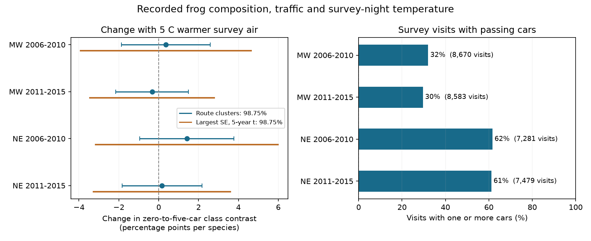

# Warmth gave no clear repeated change in traffic slopes for recorded frog composition in four US samples in 2006-2015

We tested whether warmer survey air changed the link between passing cars and the mix of frog calls recorded at roadside stops. All four main intervals include zero. The point estimates do not have the same sign in both Midwest periods. The data do not establish a common temperature change in this traffic association. They also do not establish that such a change is absent.

The tests use 80,092 stop visits in 8,138 survey runs on 613 routes at 6,202 sites in 12 US states. The Northeast and Midwest have separate routes. Tests cover 2006-2010 and 2011-2015. The periods have separate years but share some routes. All tests use one volunteer survey program. Thus they are separate region and period tests, not four independent data sources.

## Question and new contribution

Temperature can change calling activity. Traffic can change the calls that an observer hears. If these two paths interact, recorded species composition could change with weather even if true species presence does not change. A study in eastern Ontario found that green frogs and bullfrogs called more often during quieter traffic intervals. American toads and gray treefrogs did not show that timing pattern in that study (Vargas-Salinas et al. 2014, doi:10.1007/s11252-014-0374-z). These species also differ in habitat and breeding time. Their frequency class is a reason for the test, not a uniquely identified mechanism. Experimental work on gray treefrogs shows that the comparison group is not immune to traffic noise (Bee and Swanson 2007, doi:10.1016/j.anbehav.2007.03.019).

Campaign study sci:sha256:00fa5e9404f5c28c027c79ca3bc0e3ede118a63b563838d41de45d8e4ad459b1 found earlier calling after warm springs. Study sci:sha256:6060e227103bb62576ce9ee28dfd044904822172609d2e6438c2b70be6691386 used noise and car counts as controls in a road-salt test. Study sci:sha256:0cf311e4b83b5646ae7f2af3a78399b755d74e9655716de23c768dbd1f6988e0 tested warmth by reported hearing impairment for summed frog richness. We adapt its fixed-effect method. We test a new class-composition outcome and use passing car counts as the main exposure. Observations overlap those studies. This is not independent validation of their source data.

Before choosing the test, we searched the campaign with several queries for phenology, weather, pollution, NAAMP, traffic, noise, car counts and frog composition. We read the main related publications. The local analysis plan and later changes are in files/PLAN.md. It was saved before the new outcome fits. It was not externally registered.

## Data and sample rules

Foreman, Grant and Weir (2017), NAAMP anuran detection data from the eastern and central United States, 1994-2015, USGS data release, doi:10.5066/F7G44NG0, supplies all observations. The USGS release page marks the data CC0 1.0 Universal. Source XML states no use constraints. Files used: Runs.csv, Stops.csv, Counts.csv, and the source XML. We read the shared copies in place. No download was needed. files/provenance.json gives each exact shared path, resolved path, source URL, file size, retrieval record and SHA-256 hash.

We retain unified-protocol runs in 2006-2015. The source states that car counts began in 2006. Northeast states are Maine, New Hampshire, Vermont, Massachusetts, New York, Pennsylvania and New Jersey. Midwest states are Minnesota, Iowa, Missouri, Indiana and Michigan. These region rules follow the earlier calling-season study. Both random and other route types can enter.

A stop must be explicitly not skipped, have a valid site ID and stop number 1-10, and have a recorded air temperature from -5 to 35 C after conversion from the reported scale. It must have an integer car count from 0 to 100; all observed values are at most 50. The source caps counts at 50, so 50 means 50 or more. A run must have at least five eligible stops. The date must match the survey year. We retain all eligible routes, whether or not the focal species were detected. The full sequential sample flow is in files/flow.csv. Missing temperature and car counts remove records; this is a selected survey sample.

The low-frequency class has green frog (Lithobates clamitans) and American bullfrog (L. catesbeianus). The comparison class has American toad (Anaxyrus americanus) and the gray treefrog complex. We combine Hyla versicolor, H. chrysoscelis and both released spellings of their complex. The Ontario study used H. versicolor. Our combined class is a limit to direct transfer of its mechanism. At each eligible stop, a positive calling index means detection. Multiple labels in a class species are deduplicated. No positive record means no recorded detection; it does not mean biological absence.

Let low = (green detection + bullfrog detection)/2 and high = (toad detection + gray detection)/2. The outcome D = low - high ranges from -1 to +1. Each class has two fixed members. There is no division by the number of species heard, and no restriction to stops with a detection. Thus the outcome does not select records on the event being studied. It describes recorded class balance, not a thermal niche index, total richness, true occupancy or abundance.

files/panel.parquet is the exact derived analysis panel. It contains source covariates and the computed detection fields, with no coordinates. It is small enough to support offline reproduction. Source facts remain CC0. The raw files are not bundled. Attribution and the material boundary are in files/EXTERNAL_DATA_NOTICE.md.

## Model and uncertainty

For each region and period, we fit:

    D = survey-run effect + site-by-survey-window effect
        + b*L + c*L*W
        + within-run local temperature terms
        + L-by-month terms + L-by-state terms + error

Here L = log(1 + passing cars), with the natural logarithm, and W = (mean eligible stop air temperature in the run - 15)/5. Local terms are stop temperature minus its run mean, and squared stop temperature minus its run mean. A survey-run effect removes all conditions shared by that run, including the observer, route, date, survey window and shared weather. A site-by-numbered-survey-window effect removes stable differences at each site in each survey window. These controls do not remove time-varying habitat or calling changes at individual stops.

The primary coefficient is c. It is the change per 5 C in the low-minus-comparison detection association with a unit increase in L. For scale, we report 100*log(6)*c. This is the change, in percentage points per species, in the model's zero-to-five-car class contrast for 5 C warmer run air. It is a fitted contrast, not an observed experiment. Positive values mean that the traffic association becomes more positive for the low-frequency class relative to the comparison class.

We fit separate low, high and D outcomes on the same design. The D coefficient equals the low coefficient minus the high coefficient, to numerical tolerance. This direct contrast retains covariance between the groups. A separate test of whether each class is significant would not test their difference.

Fixed effects are removed by alternating group demeaning to a maximum update below 1e-10. Least squares uses a pseudoinverse. Some nuisance traffic slopes are redundant. The primary target is estimable in all four designs, as checked by its projection onto the design row space. Matrix rank and target errors are in files/results.csv.

Main intervals use route-cluster CR1 errors, with G/(G-1) correction and t(G-1) quantiles. Each interval has 98.75 percent nominal coverage, a four-test Bonferroni choice. The error formula does not add a degrees-of-freedom correction for absorbed effects. A conservative check uses the largest nonnegative variance among route, year, and route-plus-year-minus-route-year cluster estimates, with t quantiles for four degrees of freedom. These are approximate intervals; only five years occur in each period. They do not guarantee coverage. Some secondary two-way variances are negative; those values are retained as diagnostics and are not used as negative standard errors. No primary target variance is negative.

Our local decision rule required all four main intervals to exclude zero with the same sign for a repeated warmth change. This rule was not met.

## Main results

The table shows the change in the zero-to-five-car class contrast for 5 C warmer run air, in percentage points per species.

| Region | Period | Stop visits | Routes | Estimate | 98.75% route interval | Conservative interval |
|---|---|---:|---:|---:|---|---|
| Midwest | 2006-2010 | 27,077 | 346 | +0.36 | -1.86 to +2.59 | -3.92 to +4.64 |
| Midwest | 2011-2015 | 28,970 | 355 | -0.33 | -2.15 to +1.49 | -3.45 to +2.79 |
| Northeast | 2006-2010 | 11,816 | 157 | +1.41 | -0.95 to +3.77 | -3.16 to +5.98 |
| Northeast | 2011-2015 | 12,229 | 165 | +0.16 | -1.84 to +2.17 | -3.26 to +3.59 |



Cars passed at about 30-32 percent of Midwest visits and 61-62 percent of Northeast visits. Most runs had some within-run car-count variation. files/support.csv and files/joint_support.csv give the traffic and temperature support. This support covers selected mild survey nights, not a representative sample of heat extremes. A zero-to-five-car contrast is a model scale choice. It does not mean every site supplied both exposures at each temperature.

Removal of listening breaks, a car-count limit of ten, site-by-observer-by-window effects, state-by-year traffic slopes, and a separate hearing-impairment exposure did not give a repeated clear warmth interaction. The stop-order check also gave intervals across zero in all four samples. It added stop-number-by-run-warmth terms, so the class-balance pattern along a run could change with temperature. This check was added after the local plan. All coefficient estimates, errors and sample sizes are in files/results.csv. We did not change the species groups to seek a positive result.

## A failed secondary contrast

The planned average traffic class contrast is not estimable in three main designs. Its linear-combination projection errors are about 0.0220 in early Midwest, 0.00483 in late Midwest and 0.00940 in late Northeast. The design has unsupported state traffic slopes: Iowa and Michigan in early Midwest, Michigan in late Midwest, and New Hampshire in late Northeast. All eligible Michigan car counts are zero. For the other named state-period groups, traffic slopes are absorbed by the fixed effects. Redundant combinations of these controlled traffic slopes allow different average traffic contrasts with the same fitted observations. A pseudoinverse alone returns a number but does not identify this target. Those averages and their intervals are therefore missing in the final table.

The primary warmth interaction has a different linear combination and remains estimable in all four designs. Null-space checks in files/results.csv and an independent singular-value decomposition in files/geometry_checks.json change the average log-car slope by 0.01 while leaving fitted observations unchanged to numerical tolerance and leaving the primary interaction unchanged. The singular-value check changes fitted values by at most 3e-11 for that shift. These checks show why an estimable interaction does not guarantee an estimable average effect. Traffic variation after the controls, rather than the pooled number of states, determines support.

The early Northeast average contrast is estimable. Its zero-to-five-car low-minus-comparison estimate is -1.34 percentage points, with a 95 percent route interval from -3.20 to +0.53. It is uncertain. We do not compare it with the non-estimable averages. This secondary failure limits the test of the simple low-frequency traffic-deficit explanation.

## Numerical checks and reproducibility

The independent audit solves an explicit sparse matrix with run and site-window dummy columns. It does not use alternating demeaning. All four main target coefficients agree within 4e-13. A known interaction of 0.1 added on the actual design is recovered within 3e-13. The class-difference coefficient identity also passes. files/checks.json gives the numerical records. These checks test computation and identification. They do not test confidence-interval coverage or prove a biological mechanism.

The final code was run from the bundled derived panel. Main coefficients matched the fresh raw build. The panel preserves the exact analysed observations if upstream files change. Software versions are in files/environment.json. The code uses one numerical-library thread. Computations use at most two processes at a time.

After verified extraction, set PUB to the publication root. Write all new output outside PUB:

```bash
OPENBLAS_NUM_THREADS=1 OMP_NUM_THREADS=1 MKL_NUM_THREADS=1 \
python "$PUB/files/analyze.py" --panel "$PUB/files/panel.parquet" --out /absolute/path/to/scratch/analysis
python "$PUB/files/audit.py" /absolute/path/to/scratch/analysis
python "$PUB/files/geometry_audit.py" --panel "$PUB/files/panel.parquet" --out /absolute/path/to/scratch/geometry
```

The first command rebuilds all fits, sensitivity results, support tables and the figure. It saves partial fit tables after each model. The second runs the independent solver and known-signal checks. The third checks design rank and constructs alternative traffic slopes with unchanged fitted observations. Install the versions in files/environment.json in a private environment if required; pyarrow is needed for Parquet. File fields and units are defined in files/SCHEMA.md.

For a fresh source rebuild, use the exact shared dataset paths in files/provenance.json, or retrieve the exact inputs to separate local scratch:

```bash
python "$PUB/files/retrieve.py" --root /absolute/path/to/external-inputs
python "$PUB/files/analyze.py" --datasets /absolute/path/to/external-inputs --out /absolute/path/to/scratch/raw-rebuild
```

The retrieval script checks the recorded hashes and fails if the source version changes. It does not write into the publication. For a new reusable shared download in this campaign, use campaign-dataset with the recorded URL, name and hash rather than copying over an existing shared dataset. A rebuild reads only the four needed source files. Source-file hashes and derived-panel equality records are supplied for inspection.

## Limits and next work

These are selected roadside surveys under weather rules. Missing visits, car counts and temperatures can select different nights and sites. Survey-run controls remove shared conditions but do not fix this selection. The short periods have few year clusters. The periods share 410 routes; 203 routes enter only one period. Spatial dependence across routes can remain. State traffic-slope controls and route errors do not guarantee removal of such dependence.

Passing cars are a count during listening, not a sound-pressure measurement. Vehicle type, speed, road distance, listening interruptions and observer errors can change the relation to noise. Counts of at least 50 are capped. Background noise can also have other sources. The log-linear exposure and linear warmth product can miss thresholds. The secondary impairment measure is subjective.

Frequency class also differs in habitat, body size, calling rate and breeding time. We cannot separate those explanations. Some gray treefrog records are complex labels, and no local frequency was measured. The comparison species can also be affected by noise. Masked calls, changes in calling activity, true presence, and changing habitat are not separable here. Stable site controls do not remove changing local conditions.

The result tests survey-night weather and recorded composition. It does not test a climate trend, true biodiversity loss, chemical air pollution or a causal noise effect. Car count is not a measured ozone or particle exposure. A null interaction does not invalidate the Ontario study's short-term calling result, which used individual recordings and direct sound measurements.

The next useful test is simultaneous observer and recorder sampling at the same ponds, with sound levels, vehicle types, stop times, and repeated local temperature records. More years and an independent program can test transfer. A design that measures calling before and after vehicle passages can separate rapid calling changes from observer hearing failure. Tests of daily heat extremes and measured air pollutants remain open.

## Job provenance

Campaign 11_07_2026. Job sci-1107-hp-climate-pollution-biodiversity-5613024f1b58. Topic climate-pollution-biodiversity. Machine hp. Account codex-olen. Model gpt-6.1-sol with high reasoning effort, through the Codex harness in T3 Code. One worker, no agents. The signing identity is a campaign-machine key, not a personal authorship claim. Signing and storage are local. This worker does not upload or submit the publication.
