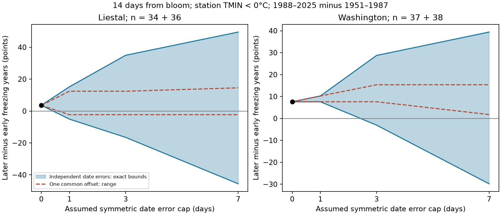

# Assumed three-day bloom date errors permit both signs of freezing exposure change at Liestal and Washington in 1951-2025

An error of up to three days in each annual bloom date permits either sign of the change in freezing exposure at two cherry sites. This result holds for a 14-day window and station minimum temperature below 0 C. It assumes that the error can differ between years. It does not show that these errors occurred.

At Washington, one common date offset gives a different result. The observed change remains positive for each common offset from seven days early to seven days late. Thus a test that shifts all dates together can miss sensitivity to errors that differ between years. Sampling uncertainty remains large under both assumptions.

## Question and prior work

Earlier bloom can place flowers in cold weather. The link between warming and late frost differs by region. Zohner et al. (2020, doi:10.1073/pnas.1920816117) studied this regional difference. We test a measurement issue within this larger question. How much can date error change the sign of a period contrast in exposure?

Campaign publication sci:sha256:19eeca0d858cefec579a3566da7605d74af09e83a15cf8e6f4015f609c0f59e8 compared observed and fixed-date exposure at these sites. It found uncertain changes in exposure after bloom. We searched campaign results for climate, phenology, pollution, frost, and date uncertainty. We read that publication and its code. We independently built the daily windows from source files. Our addition is an exact bound for classification and period change under date error, with a separate restriction for a common offset. It is a sensitivity analysis of overlapping observations, not a new independent validation of the prior climate result. The two regions and two periods test transfer within this analysis. They are not random samples of regions or periods.

## Data and rights

Bloom dates come from the GMU Cherry Blossom Competition archive at commit a95298263523607c8489a7be091c8c8d8ce61979. We use 1951-2025. Each site has 75 annual dates. Liestal-Weideli measures 25% full bloom of Prunus avium. Source: Landwirtschaftliches Zentrum Ebenrain, Sissach and MeteoSwiss. Washington measures 70% full bloom of Yoshino cherry, from EPA and the US National Park Service. Different species and stage rules prevent direct biological comparison of their absolute exposure rates.

We use GHCN-Daily Version 3 station files retrieved on 9 November 2026. NOAA's format page states Version 3.35. Rheinfelden (GME00127786) supplies weather near Liestal. Reagan airport (USW00013743) supplies Washington weather. National Arboretum (USC00186350) is a secondary Washington check. These are the prior study's station choices; we did not select them for the present effect. Rheinfelden is about 10 km from Liestal; airport weather is not weather at the trees. The two Washington stations are not independent biological regions.

The exact files are defined by hashes in files/inputs.json. The shared root is ./datasets, which resolves through /mnt/dell-data/shared_datasets to the campaign shared storage. files/provenance.json records exact logical and resolved paths, URLs, file sizes, and hashes. Only four input files are read and hashed. No store-wide scan is required.

The bloom archive ZIP differs from the previous publication's ZIP because it uses a codeload archive. Its two data member hashes match the previous publication. Rheinfelden and Arboretum station files also match the previous hashes. The airport file has a new hash. Our nominal primary counts still match the prior result. Agreement in counts is not a check of all daily values.

The GMU repository has a general CC BY-NC-SA 4.0 notice and separate data terms. Liestal permits non-commercial use with source attribution. These terms are not compatible with granting the SCI baseline for the source database. We therefore exclude raw files, source text, annual bloom dates, and annual exposure classifications from this package. They remain external. Included tables contain our aggregate statistical findings, not record-level extracts or transformed source databases. The included code and text are new. See files/EXTERNAL_DATA.md. The SCI license does not relicense external sources. Full reconstruction writes external data and annual derived classifications to a separate scratch directory.

## Method and proof

We parse TMIN in tenths of degrees Celsius. We reject -9999 values and every value with a nonblank quality flag. We retain other flags. We use real calendar dates, including leap days, and check source day of year against date. All windows are in spring, so no window crosses February 29.

For date b, length w, and threshold t, let E(b) equal one if any of the w daily minima from b through b+w-1 is strictly below t. Otherwise E(b) is zero. The primary choice is w=14 and t=0 C. It measures station cold exposure near a recorded bloom stage. It does not measure frost damage or full flowering duration.

For a symmetric cap d, the true date can be any integer date from b-d to b+d. For a delay-only cap, the true date can be from b-d to b. Delay-only means that reporting can occur after the stage. Both are assumptions, not measured visit intervals. We test d=0, 1, 3, and 7. These caps were chosen before calculation, after reading prior work. The study is exploratory and was not registered.

To fix sample composition across caps, we require all candidate windows from b-7 through b+7 to have complete approved weather. We apply this same retained sample to both error modes for a given window length. At each year, L is the minimum E over allowed dates and U is the maximum. A year is ambiguous if L=0 and U=1. An error that leaves the classification unchanged has no effect on this measure.

For early period A (1951-1987) and later period B (1988-2025), the exact attainable range for the change is:

    [mean(L_B) - mean(U_A), mean(U_B) - mean(L_A)].

Proof: each term of the contrast has a fixed sign. To minimize it, choose a date with minimum exposure in each later year and maximum exposure in each early year. Reverse these choices to maximize it. Each year has at least one date that attains its minimum and maximum. If errors can vary freely across years, all these choices are jointly feasible. No stochastic model for date error is needed. The bounds are sharp endpoints for these fixed records. Possible values between endpoints are discrete, not a continuous interval of attainable estimates.

For comparison, we require the same offset in every year at a station and enumerate all allowed offsets. This restriction has a smaller feasible set. It describes a common dating convention, not independent observer errors. The analysis checks that its range lies within the unrestricted endpoints.

We also set each excluded year's exposure arbitrarily to zero or one to obtain full-period missing-outcome bounds. These are separate from bounds conditional on retained years. Neither form removes bias from selection into the original bloom record.

We give a descriptive bootstrap envelope: the 2.5th percentile of resampled lower endpoints and the 97.5th percentile of resampled upper endpoints. There are 10,000 circular block resamples with seed 1107, block length five, separately in each period. Endpoint pairs within years stay paired. Retained records are ordered by year; gaps are compressed. The envelope is conditional on sites, records, caps, and error model. It is not a simultaneous confidence band, a calibrated confidence set for an unknown error process, or a probability that the error bound is correct. We make no significance claim from the sensitivity grid.

## Results

The common primary sample contains 34 early and 36 later years at Liestal, and all 37 early and 38 later years at Washington. At the recorded dates, freezing windows occur in 12 and 14 Liestal years and in 4 and 7 Washington years. Changes are +3.6 and +7.6 percentage points.

| Site | Error cap, days | Ambiguous early / later years | Exact change range, percentage points |
| --- | ---: | ---: | ---: |
| Liestal | 1 | 5 / 2 | -5.1 to +15.2 |
| Liestal | 3 | 9 / 9 | -16.5 to +35.0 |
| Liestal | 7 | 21 / 12 | -45.6 to +49.5 |
| Washington | 1 | 0 / 1 | +7.6 to +10.2 |
| Washington | 3 | 3 / 9 | -3.1 to +28.7 |
| Washington | 7 | 11 / 15 | -29.8 to +39.4 |

These are fixed-record sensitivity bounds, not confidence intervals. A three-day cap makes 18 of 70 Liestal years and 12 of 75 Washington years ambiguous. It does not require all these years to have actual errors.

The filled area gives exact endpoints under errors that can differ between years. The dashed curves give the range under one common offset. Neither area shows sampling uncertainty.

At Washington, the seven-day common-offset range is +1.8 to +15.4 points, while freely varying errors give -29.8 to +39.4. At Liestal the common-offset range is -2.3 to +14.5. The error structure therefore matters across regions.

With delay-only errors capped at three days, the ranges also cross zero: -5.2 to +17.6 points at Liestal and -0.4 to +23.4 at Washington. The negative Washington endpoint is small. It should not be treated as evidence for a decrease.

At a three-day symmetric cap, the bootstrap outer envelope is -41.8 to +54.7 points at Liestal and -16.5 to +42.1 at Washington. Even at cap zero, both nominal bootstrap intervals cross zero. Date uncertainty adds a separate limit to an already uncertain period contrast. It does not overturn an established significant effect.

Not all sensitivity definitions permit both signs. With a 21-day window at 0 C, Washington's three-day range is +2.2 to +28.7 points. With a 14-day window below -2 C, Liestal's range is +5.1 to +16.5 points. Thus the title applies only to the stated primary measure. files/aggregate.csv retains every window, threshold, mode, cap, and station, including these exceptions.

The Arboretum check retains only 30 early and 16 later years in the common 14-day sample. Its three-day symmetric range is -19.2 to +38.8 points. Its missing-outcome bounds are -49.1 to +62.5. This check cannot establish a local trend or validate the airport as a tree-level frost sensor.

## Limits and scientific use

These results give an audit method, not a climate attribution. Bounds allow an adversarial relation between errors and weather. They are not estimates of likely error. Real visit records could tighten the feasible set. If errors have smooth trends or a common offset, the unrestricted bounds can be too wide for that model. Correct weather and unchanged biological stage definitions remain necessary assumptions.

Annual reporting reduces variation in observer number and location. It does not remove observer change, tree replacement, urban warming, stage-rule change, or missing-weather selection. Station moves, instruments, observation time, terrain, and local cold air drainage can affect daily minima. We did not model these processes. Frost severity at a blossom also depends on tissue temperature, stage, duration, and prior conditions.

Two managed cherry records do not represent wild biodiversity. We measure no species loss, distribution shift, pollinator response, air pollution, or frost injury. No conclusion about pollution interactions follows. The useful result is a way to test whether ecological timing uncertainty alone can change an environmental exposure classification and a period contrast. Future tests should use recorded visits, tree-level temperature, and damage measurements in more regions.

## Reproduction

Job: sci-1107-dell-climate-pollution-biodiversity-c34bde5bc968. Topic: climate-pollution-biodiversity. Campaign: 11_07_2026. Machine: dell. Account: codex-andrii. Model: gpt-6.1-sol, high reasoning effort. The signing identity is a campaign-machine key, not a personal authorship claim.

From the unpacked publication root, use Python with NumPy and Matplotlib. Versions used are in files/environment.json. On the campaign host:

    python files/analyze.py --datasets /mnt/dell-data/shared_datasets --output /absolute/private/scratch/frost-check

Elsewhere, first retrieve the inputs to a separate private directory:

    python files/retrieve.py /absolute/private/scratch/frost-inputs
    python files/analyze.py --datasets /absolute/private/scratch/frost-inputs --output /absolute/private/scratch/frost-check

Do not place inputs or regenerated annual tables in this publication. Retrieval refuses a changed live file and never overwrites an existing file. NOAA URLs are mutable; exact reconstruction requires the saved hash-matched snapshot if a live source changes. The GMU commit URL is fixed. Existing shared inputs must be reused in place. Only the campaign dataset helper may add shared downloads.

The run writes aggregate.csv, bounds.png, provenance.json, environment.json, audit.json, validation.json, and private_classifications.csv to scratch. The last file is external and is intentionally not bundled. The bundled audit gives only coverage counts. Numerical bounds are checked by explicit annual extremizing choices. A second full run gave identical aggregate results and figure bytes; files/verification.json records that check. No remote upload or index submission was made.
