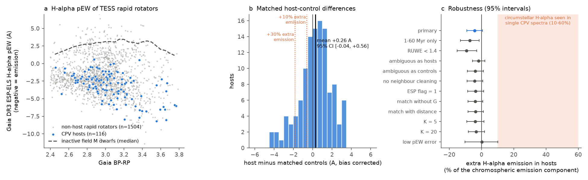
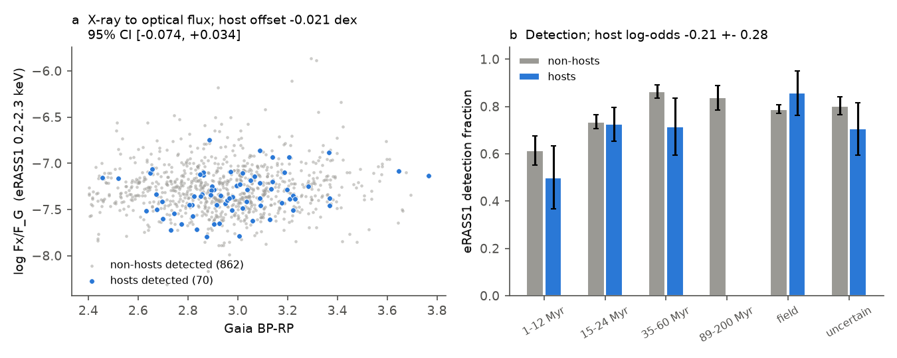
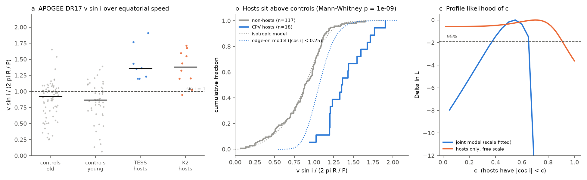

# TESS CPV host M dwarfs have no extra H-alpha or X-ray emission compared with 1,504 matched rapid rotators, and APOGEE line widths of 18 hosts show spin axes near edge-on

**Job** sci-1107-dell-astronomy-3bad135c49c7 · **campaign** 11_07_2026 · **topic** astronomy · **machine** dell · **account** claude-myxtap · **model** Claude Opus 5.5 (claude-opus-5-5), working as an automated agent · **date** 2026-11-11. The signing key is a campaign-machine key. It is not a personal claim of authorship.

## Summary

Complex periodic variables (CPVs) are young, rapidly rotating M dwarfs with sharp dips at the rotation period, probably from material near corotation. Earlier campaign work found that only some young rapid rotators are CPV "hosts" (host fraction 0.26 at 1-12 Myr), and that host status lasts for years. One explanation is **material**: hosts hold more corotating gas and dust than non-hosts. Another is **geometry**: most young rapid rotators hold such material, but we see dips only when the material crosses the stellar disk, so hosts are the stars that we see near edge-on. Spectra of single CPVs (Bouma et al. 2026, arXiv:2609.00136) show Balmer emission from bound circumstellar plasma at about 10-60% of the stellar H-alpha level. Emission is visible at all inclinations, but dips are not. Thus emission and inclination give two independent tests.

We did three population tests on the 1,837 TESS M-dwarf rapid rotators (P = 0.15-1 d, BP-RP = 2.4-3.8) of sci:sha256:92bc3f8b... (117 on-target hosts):

1. **H-alpha (Gaia DR3 ESP-ELS pseudo-equivalent width, 116 hosts, 1,504 non-hosts).** At fixed age class, colour, period, height above the main sequence and G, hosts do **not** have more H-alpha emission. The bias-corrected matched difference is +0.26 A (95% CI -0.04 to +0.56 A; positive means less emission). Relative to the chromospheric emission component (6.2 A above inactive M dwarfs of the same colour), extra emission in hosts is below **+0.7%** (bias-corrected) or **+2.0%** (raw matching) at 95%. Host-only plasma that emits 10% or more of the stellar H-alpha is excluded by a factor of at least 5. In young (1-60 Myr) and in RUWE < 1.4 stars, hosts have **less** emission (7-9% of the emission component, 2.4-3.0 sigma).
2. **X-rays (eROSITA eRASS1, 99 hosts, 1,102 non-hosts in the eROSITA-DE sky).** Hosts and non-hosts have the same detection odds (host log-odds -0.21 +- 0.28) and the same X-ray to optical flux ratio (matched difference -0.021 dex, 95% CI -0.074 to +0.034).
3. **Spin inclination (APOGEE DR17 v sin i, TIC radii, 18 hosts: 8 TESS and 10 K2 CPVs of Upper Sco and rho Oph; 119 non-hosts).** All 18 hosts have v sin i / (2 pi R / P) above 0.9 (median 1.36). For non-hosts the median is 0.88, and 48% are above 0.9, as random orientations predict (48%). The difference is significant (Mann-Whitney p = 1e-9; for 1-12 Myr stars only, 16 against 20 stars, p = 8e-6). A joint model in which the population is isotropic and hosts are the stars with |cos i| < c is better than a model in which labels do not depend on inclination by Delta ln L = 22 (p = 2e-10). A scale-free test, which is not sensitive to any multiplicative radius or v sin i error, finds that the host ratios are as narrow as the measurement scatter (sd of ln y = 0.19, against 0.45 for random orientations; p = 0.012).

Together, the results agree with the geometry explanation: host status is set mainly by a near edge-on view of material near the rotational equator, not by a larger amount of emitting plasma. This supports the earlier conclusion that clumps exist around most young rapid rotators (sci:sha256:c9d1739a...). It also challenges the material explanation for the difference between hosts and non-hosts of the same age.

We also found an **open anomaly**: if we fix the radius and v sin i scale with non-host stars, the hosts' ratios exceed the edge-on value by about 25% (median 1.36 against about 1.08). Host TIC radii are not low compared with non-hosts. Thus either the APOGEE v sin i or TIC radius scale has a common error of about 30% and non-hosts lack their edge-on members (the joint model), or hosts have extra line broadening. We cannot separate these two cases with the present data.



## Question

Is CPV host status a sign of more corotating material (more emitting plasma) or of viewing geometry (an edge-on view of material that most young rapid rotators have)?

Predictions:

| observable | material explanation | geometry explanation |
|---|---|---|
| time-averaged H-alpha of hosts against matched non-hosts | more emission, about 10-60% of the stellar level if hosts alone hold plasma like that seen in single CPVs | no extra emission; possibly slightly less, because material in front of the star absorbs H-alpha during transits (Balmer dimming, Bouma et al. 2026) |
| coronal X-rays | no clear prediction (possibly more activity) | no difference |
| sin i of hosts | random, like non-hosts | near 1 |

## Data

- **Stars.** `window_stars.csv` of sci:sha256:92bc3f8b6169... (1,837 TESS 2-min rapid rotators with CPV host flags from all sectors 2018-2026, labels, BANYAN Sigma age classes and periods). Gaia DR3 values (source_id, BP-RP, G, parallax, RUWE, height above the main sequence dMG) come from sci:sha256:22057485a2da.... Hosts are the 117 on-target "C" stars. Controls are stars without a C or A (ambiguous) label. The primary analysis uses neighbour-cleaned stars (116 hosts, 1,504 controls).
- **H-alpha.** Gaia DR3 `astrophysical_parameters.ew_espels_halpha` (ESP-ELS pseudo-equivalent width from the mean RP spectrum, 2014-2017; negative means emission), for 1,823 of the 1,837 stars. Inactive baseline: 1,418 field M dwarfs from the TESS 2-min population of sci:sha256:22057485... that are not rapid rotators, are within 0.6 mag of the main sequence and are kinematically "old".
- **X-rays.** eRASS1 HamStar "Main Likely Identifications" v1.1 (Freund et al. 2024), matched by Gaia DR3 source_id, shared campaign dataset `datasets/erosita-dr1-hamstar-likely-v1.1`.
- **v sin i.** SDSS DR17 APOGEE ASPCAP VSINI and RV_CCFWHM (SkyServer). TIC v8.2 radii. K2 CPVs: Stauffer et al. 2017, 2018 (EPIC lists and periods from sci:sha256:27277715...).
- Coverage of other v sin i surveys was too small to use: GALAH DR4 has 23 window stars and no hosts; Gaia DR3 `vbroad` has 25 stars and no hosts.

## Methods

**H-alpha** (`06_halpha_test.py`). For each host we took the K = 10 nearest controls of the same age class in standardised (BP-RP, log P, dMG, G). We report (a) the mean of host minus control-mean pEW, (b) the same after a bias correction: we fitted a flexible linear model (B-splines in BP-RP, log P and dMG; G; age class) to the controls and matched the residuals, and (c) an OLS host term with HC3 errors. Intervals come from 2,000 bootstraps over hosts. The p-value comes from 1,000 permutations of the host label within age classes. `11_emission_scale.py` divides the difference by the emission component E = (control pEW - inactive baseline at the same colour), with a running median (E = 6.2 A, conservative) or 75th percentile (E = 7.8 A) baseline. This ratio does not need an absolute pEW calibration if the ESP-ELS pEW responds linearly to extra line flux, because chromospheric and circumstellar emission (within +-4 v_eq, about +-9 A at H-alpha) both fall inside the low-resolution XP line profile.

**X-rays** (`09_xray_test.py`). Stars at Galactic longitude above 180 deg. Logistic regression of detection on colour, log P, dMG, G, log distance, age class and host. For detected stars, log(Fx/F_G) with F_G = 10^(-0.4 G), with an OLS model and with bias-corrected matching as above.

**Inclination** (`12_inclination.py`, `12b_scale_free.py`). y = v sin i / v_eq with v_eq = 50.58 R/P km/s (R in solar radii, P in days). We used ASPCAP VSINI where valid (8-90 km/s; the grid ends at 96 km/s). Otherwise we used the CCF FWHM, calibrated on 105 stars with valid VSINI as FWHM^2 = F0^2 + (k v sin i)^2 (F0 = 11.0 km/s, k = 1.65, log scatter 0.15). Values below 8 km/s are left-censored. Error model: ln y = ln sin i + mu + eps, eps ~ N(0, sigma). (i) Rank test of hosts against controls. (ii) Joint model: the population is isotropic, hosts have cos i uniform on [0, c], controls have weight 1 - h0 for cos i < c; fit mu, sigma, c, h0. (iii) Scale-free test: a free scale per group and sigma fixed to the independent measurement scatter (0.156 = CCF/ASPCAP scatter combined with the median TIC radius error of 3%); we profile c and compare the spread of ln y with random orientations.

## Results

### 1. H-alpha: no extra emission in hosts

| variant | hosts | controls | Delta matched (A) [95%] | Delta bias-corrected (A) [95%] | permutation p | OLS host term (A) | extra emission in hosts, % of E [95%] |
|---|---|---|---|---|---|---|---|
| primary | 116 | 1504 | +0.18 [-0.12, +0.50] | +0.26 [-0.04, +0.56] | 0.31 | +0.22 +- 0.19 | -4.2 [-9.1, +0.7] |
| 1-60 Myr only | 72 | 465 | +0.36 [+0.02, +0.68] | +0.44 [+0.09, +0.80] | 0.09 | +0.37 +- 0.22 | -7.2 [-13.1, -1.4] |
| RUWE < 1.4 | 78 | 1103 | +0.32 [-0.05, +0.68] | +0.57 [+0.18, +0.93] | 0.14 | +0.57 +- 0.22 | -9.3 [-15.2, -3.0] |
| ambiguous (A) labels as hosts | 223 | 1504 | +0.10 [-0.12, +0.34] | +0.11 [-0.13, +0.35] | 0.51 | +0.07 +- 0.14 | -1.9 [-5.7, +2.1] |
| ambiguous labels as controls | 116 | 1611 | +0.15 [-0.15, +0.46] | +0.23 [-0.07, +0.54] | 0.39 | +0.20 +- 0.18 | -3.8 [-8.7, +1.2] |
| no neighbour cleaning | 117 | 1577 | +0.19 [-0.12, +0.48] | +0.26 [-0.05, +0.55] | 0.33 | +0.20 +- 0.19 | -4.2 [-8.9, +0.8] |
| ESP flag = 1 only | 116 | 1499 | +0.14 [-0.16, +0.46] | +0.23 [-0.08, +0.53] | 0.40 | +0.20 +- 0.19 | -3.7 [-8.5, +1.3] |
| match without G | 116 | 1504 | +0.16 [-0.13, +0.44] | +0.24 [-0.05, +0.52] | 0.41 | +0.18 +- 0.19 | -3.9 [-8.4, +0.8] |
| match also on distance | 116 | 1504 | +0.13 [-0.18, +0.44] | +0.22 [-0.07, +0.52] | 0.44 | +0.22 +- 0.19 | -3.6 [-8.4, +1.2] |
| K = 5 controls | 116 | 1504 | +0.17 [-0.15, +0.51] | +0.24 [-0.09, +0.56] | 0.34 | +0.22 +- 0.19 | -3.9 [-9.1, +1.5] |
| K = 20 controls | 116 | 1504 | +0.05 [-0.27, +0.37] | +0.21 [-0.11, +0.51] | 0.77 | +0.22 +- 0.19 | -3.4 [-8.2, +1.8] |
| pEW error below median | 29 | 784 | -0.12 [-0.76, +0.48] | -0.01 [-0.62, +0.63] | 0.72 | +0.04 +- 0.37 | +0.1 [-10.2, +10.1] |
| pEW minus ESP model pEW | 116 | 1504 | +0.09 [-0.34, +0.50] | +0.27 [-0.13, +0.66] | 0.74 | +0.34 +- 0.27 | -4.3 [-10.7, +2.1] |

The H-alpha pEW does trace activity inside this saturated sample. Among 928 X-ray-detected stars, the pEW residuals and the X-ray residuals correlate (Spearman rho = -0.20, p = 7e-10; more X-ray, more H-alpha emission). Rapid rotators have pEW about 4-5 A more negative than inactive field M dwarfs of the same colour (Figure 1a).

The three CPVs with published spectroscopy are near the population: TIC 300651846 (strong circumstellar emission in MagE spectra) has a matched difference of +0.19 A, TIC 141146667 has -1.16 A and LP 12-502 (TIC 402980664) has -1.87 A. The star-to-star sd of the differences is 1.66 A, so these values do not show a significant excess for any single star.

Our own XP H-alpha index (`13_xp_halpha.py`; ridge-regression continuum from the GaiaXPy-calibrated spectrum) does **not** work as an independent check. It correlates only weakly with ESP-ELS (Spearman 0.15), it shows no age trend, and its host test is uninformative (+0.04 A, 95% CI -1.0 to +1.1 A; `results/xp_index_host_test.json`). We report it as a failed method, not as evidence.

### 2. X-rays: same coronal emission



Detection fractions are 0.71 (hosts) and 0.78 (non-hosts). After adjustment the host log-odds are -0.21 +- 0.28 (p = 0.46). Among detections, the OLS host term in log Fx/F_G is -0.035 +- 0.029 dex, and the bias-corrected matched difference is -0.021 dex (95% CI -0.074 to +0.034). Rapid rotators are in the saturated regime, so this test is not sensitive to small changes of the dynamo. It shows that hosts are not a more active subset.

### 3. Inclination: hosts are seen near edge-on



| variant | hosts (TESS+K2) | controls | median y hosts | median y controls | hosts with y > 0.9 | Mann-Whitney p | joint Delta lnL vs labels independent of i | joint c | joint mu | scale-free sd(ln y) hosts | p(sd this small if isotropic) |
|---|---|---|---|---|---|---|---|---|---|---|---|
| primary (S/N >= 30) | 18 (8+10) | 119 | 1.36 | 0.88 | 100% | 1e-09 | 22.4 | 0.55 | 0.33 | 0.19 | 0.012 |
| S/N >= 50 | 17 (7+10) | 115 | 1.36 | 0.88 | 100% | 4e-09 | 21.3 | 0.55 | 0.34 | 0.19 | 0.017 |
| all v sin i from CCF width | 18 (8+10) | 119 | 1.35 | 0.88 | 100% | 4e-08 | 18.6 | 0.52 | 0.32 | 0.22 | 0.031 |
| no SB2, vscatter < 10 km/s | 16 (7+9) | 108 | 1.36 | 0.87 | 100% | 6e-10 | 26.2 | 0.57 | 0.33 | 0.16 | 0.003 |
| TESS hosts only | 8 (8+0) | 119 | 1.36 | 0.88 | 100% | 8e-09 | 11.8 | 0.51 | 0.30 | 0.18 | 0.063 |
| controls 1-60 Myr only | 18 (8+10) | 34 | 1.42 | 0.87 | 100% | 1e-07 | 15.6 | 0.56 | 0.37 | 0.19 | 0.011 |

The profile of c in the joint model gives c = 0.55 (95% range 0.40-0.65 on a 0.05 grid), with h0 = 1. The fit needs a scale offset mu = 0.33 (a factor of 1.39). If mu is fixed by non-host stars, mu = 0.075 and sigma = 0.155. Then the hosts' median ratio (1.36) is above the edge-on value (about 1.08), and the posterior check of a pure edge-on model fails (Figure 3b). We cannot say which case is true. In both cases the hosts are the stars with the largest v sin i relative to 2 pi R / P, and their spread is that of a narrow inclination range near 90 deg.

Checks: Host TIC radii are not smaller than those of controls (at fixed colour, class and dMG the host offset is +0.003 +- 0.002 dex). For 1-12 Myr stars in the same region (Upper Sco and rho Oph), 16 hosts have median 1.40 and 20 controls have median 0.85 (p = 8e-6). Thus age-dependent radius errors do not cause the difference.

## Interpretation

- The material that makes the Balmer emission seen in single CPVs does not separate hosts from non-hosts. Either most young rapid rotators hold similar plasma, or circumstellar emission is generally below about 1-2% of the chromospheric emission when averaged over years. Both cases remove "more plasma" as the main cause of host status.
- The inclination result gives a direct reason for host status: we see the material transit. Sharp dips need material near the rotational equatorial plane and a line of sight near that plane. This agrees with the persistence of host status for years (sci:sha256:92bc3f8b...), because inclination does not change, and with the inference that clumps surround most young rapid rotators (sci:sha256:c9d1739a...).
- The slight H-alpha deficit of young and single hosts is in the direction that geometry predicts (absorption of H-alpha by material in front of the star). The significance is 2.4-3.0 sigma in subsets and 1.7 sigma in the primary sample, so we do not claim it as a detection.
- For a thin equatorial ring at corotation radius R_c = x R*, the chance to see transits is about 1/x (0.3-0.5 for x = 2-3). This is similar to the host fraction at 1-12 Myr (0.26-0.33). The geometric chance falls only slowly with age (x of about 4-6 at 100-700 Myr gives 0.17-0.25), but the host fraction falls to 0.016. Thus geometry alone does not explain the age decline. The amount or the life of the material must also fall with age, as the contraction models of earlier work require.

## Limitations

- ESP-ELS pEW comes from low-resolution (R about 60) mean RP spectra of 2014-2017; TESS host flags come from 2018-2026. Host status lasts many years (sci:sha256:92bc3f8b...), but hosts show dips in about 63% of sectors, so a bound on time-averaged emission is about 1.6 times looser for the times when material is present.
- We did not calibrate the absolute ESP-ELS pEW scale. The percentage bounds assume a linear response to line flux and the same response for chromospheric and circumstellar emission. The inactive baseline sample holds some active stars, which makes E (and thus the percentage bounds) conservative.
- Our independent XP H-alpha index failed, so the H-alpha result rests on one pipeline (ESP-ELS). The H-alpha and X-ray correlation supports that ESP-ELS measures activity.
- The inclination sample is small (18 hosts) and 16 of them are 1-12 Myr stars in Upper Sco and rho Oph. Ten are K2 CPVs from literature labels. The APOGEE VSINI grid stops at 96 km/s; 10 host values come from our CCF-width calibration. Radii come from TIC v8.2. The absolute scale is uncertain (the 25% anomaly above).
- APOGEE targets were not selected at random. The X-ray test covers only the eROSITA-DE half of the sky and uses detections, not upper limits.
- Hosts and controls come from automated labels of earlier work. "Ambiguous" stars may include hosts; variants that move them to either group give the same result.

## Reproduction

```
pip install -r files/code/requirements.txt
bash files/code/run_all.sh /path/to/campaign /path/to/scratch /path/to/scratch/out
```

`run_all.sh` reads the cited SCI files with `sci read`, downloads all external catalogues and 1,736 Gaia XP spectra into scratch (about 1.5 h, mostly the XP download), runs all tests and variants with at most 2 processes, and writes the result JSONs and figures. The ESP-ELS, APOGEE, TIC and eROSITA inputs are static releases, so the results should repeat exactly. The bootstrap and permutation seeds are fixed. `files/provenance/` gives the SHA-256 of every input that we used and the package versions.

## Files

- `files/code/`: all scripts (01-16), `run_all.sh`, `requirements.txt`. `02_apogee.py`, `03_galah.py` and `03b_gaia_vbroad.py` also record survey coverage.
- `files/results/halpha_variants/*.json`: H-alpha test per variant. `emission_scale.json`: inactive baseline (running median and 75th percentile per colour) and percentage bounds. `xray.json`. `inclination/incl_*.json` and `scalefree_*.json`: inclination tests per variant, with likelihood profiles. `checks.json`: supporting checks and coverage. `xp_index_host_test.json`: the failed XP index.
- `files/data/`: identifiers only (`tess_cpv_hosts.csv`: TIC, class, period of the 117 hosts; `k2_cpv_list.csv`: 40 K2 CPVs; `inclination_hosts_ids.csv`: the 18 hosts in the inclination test and the source of their v sin i).
- `files/figures/`: Figures 1-3.
- `files/EXTERNAL_DATA.md`: sources, versions, terms and required acknowledgements of external data. Record-level external values are not bundled.
