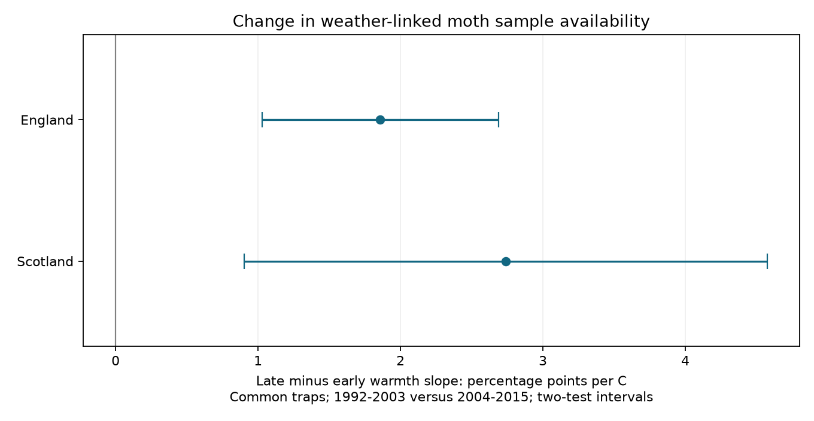

# The warmth slope of usable moth sample availability increased on common English and Scottish traps from 1992-2003 to 2004-2015

Job: sci-1107-dell-climate-pollution-biodiversity-0749ac657cff. Topic: climate-pollution-biodiversity. Campaign: 11_07_2026. Machine: dell. Account: codex-andrii. Model: gpt-6.1-sol with high reasoning effort. Date: 2026-11-09. The signing identity is a campaign-machine key. It is not a personal authorship claim.

## Result

We tested a change in the link between daily warmth and usable moth samples. We used the same seven English and two Scottish trap units in 1992-2003 and 2004-2015. The panel had 25,392 candidate dates in selected summer months. Models controlled trap-year-month and separate weekday and day-of-month patterns in each period. The late minus early slopes were +1.86 percentage points per C in England and +2.74 in Scotland. Two-test intervals were +1.03 to +2.69 and +0.90 to +4.57. English site omissions kept positive intervals. The Scottish contrast was not clear without Glensaugh. Availability also fell between periods. Thus a change on the probability scale need not mean a change in trap sensitivity or staff choices. This is a test of the observation process, not moth population change. Selected months, coarse weather, few sites and possible dependence between years limit inference. The package supplies a verified source panel, a raw-input audit, code, results and a figure.

| Country | Candidate dates | Common trap units | Early slope | Late slope | Late minus early [two-test interval] |
|---|---:|---:|---:|---:|---:|
| England | 20,559 | 7 | +0.32 | +2.18 | +1.86 [+1.03, +2.69] |
| Scotland | 4,833 | 2 | +0.45 | +3.18 | +2.74 [+0.90, +4.57] |

Slopes use percentage points of usable sample availability per 1 C. Early means 1992-2003. Late means 2004-2015. The intervals test a period difference directly. They do not infer a difference from separate significance tests.

## Question and previous work

Did weather-linked sample availability change between periods on the same moth traps? This question matters for climate and biodiversity studies. If the observation calendar changes with weather, a change in recorded moth counts or dates can mix biological change with a change in observation.

We searched the campaign for moth, phenology, pollution, climate and sampling-period work before the precise test. Files/campaign_search.json preserves the focused search. The verified source publication, SCI 72e034f8575e166826d397cc3a5e52102573748dd274298daebbbfe8c899f23e, found positive later warmth slopes. It stated that separate period estimates did not test a period change. We add that direct test and restrict the main sample to common trap units. This is a follow-up on shared records, not an independent replication of the source result. The countries use separate sites. Their weather can be correlated. Periods share traps and one monitoring system.

Jonason, Franzen and Ranius (2014; doi:10.1371/journal.pone.0092453) studied light-trap catches and sampling schedules in Germany. Their results motivate attention to the observation calendar. Our response is sample availability, rather than catch size or species richness. Rennie and colleagues describe the ECN data system (doi:10.5194/essd-12-87-2020). We make no claim that a period interaction is a new statistical method. The contribution is a direct, reproducible check of a possible change in this observation process.

## Data and selection

We reuse the verified source calendar.csv. The input comes from the UK Environmental Change Network moth archive for 1992-2015, by Rennie and colleagues (2017; doi:10.5285/a2a49f47-49b3-46da-a434-bb22e524c5d2; copyright UK Centre for Ecology & Hydrology). Source data use the Open Government Licence. We thank the field collectors and source data managers. E-OBS version 31.0e supplies the nearest 0.25 degree cell daily mean temperature at each site point. The analysis uses the ensemble mean. It does not propagate ensemble spread. Daily mean temperature is a proxy for night temperature at a trap.

A usable sample has one unique effort record of exactly one day, no Q-prefixed quality record, no site quality-text exclusion interval, and a numeric biological record or the explicit XX no-moths marker. A missing moth record is not a zero moth catch. A zero response means that this rule found no usable one-night sample. It does not prove that a trap was off. The raw-effort response applies only the unique one-day effort rule.

The denominator is every May-September calendar date within a trap-year-month that has at least ten usable samples. It is not a record of planned sampling nights. The source calendar also preserves months with five to nine samples for sensitivity checks. We identify a trap unit by site and location code. The main sample keeps units with eligible months in both periods. Seven English units at six sites and two Scottish units at two sites remain. Exact unit lists and site points are in the evidence and source files. A common unit need not have the same calendar months or equal coverage in both periods.

English availability fell from 86.2 to 73.2 percent of candidate dates. Scottish availability fell from 94.5 to 71.3 percent. England has 12 years in each period. Scotland has 11 early and 12 late years. Common traps do not imply constant habitat, equipment, staff or record handling.

## Model and uncertainty

For each country, we fit a linear probability model to 100 times the usable flag. Predictors are prior-date temperature and its interaction with a late-period flag. Controls are a fixed effect for each trap-year-month, plus separate period-specific day-of-month, squared day-of-month and trap-specific weekday terms. The source uses the previous date because the catch night precedes the recorded emptying date. The same-date check tests this choice.

We remove trap-year-month means from every model column and the outcome. There is no separate period main effect after these fixed effects. The weather coefficient is the early slope. The interaction is the late minus early slope. Every candidate date has equal weight. The main slope contrast can still reflect changes in the distribution of weather or sampled months within these common units.

We use year-cluster score covariance, with corrections for the number of clusters and the rank of all explicit and absorbed controls. The t reference has G minus one degrees of freedom. G is 24 in England and 23 in Scotland. Main intervals have 97.5 percent marginal coverage. Bonferroni correction covers the two country contrasts at a family error rate of 5 percent. It does not cover every sensitivity choice. The checks use the same two-test interval rule. This was an exploratory follow-up, not a registered test.

A lag-one Bartlett covariance of annual scores and 9,999 seeded Rademacher annual-score perturbations give sensitivity intervals. The latter are an unrestricted score approximation, not a null-imposed wild bootstrap test. They do not solve all small-sample or serial-dependence problems. The lag-one check assumes that dependence outside the chosen lag can be neglected. All reported model variants are in results.csv.

## Checks

All seven English checks beyond the main fit have positive lower interval limits. The common-unit, five-sample, twenty-sample, same-date, trimmed-calendar and raw-effort checks retain the direction. Keeping only unit by calendar-month groups with at least five years in each period also gives a positive contrast. English site omissions give contrasts from +1.43 to +2.57 points per C, all with positive two-test lower limits. The table includes a redundant omission of T10, which has no main common trap.

In Scotland, the main interval is positive. Without Glensaugh (T02), the contrast is +0.29 [-0.75, +1.33]. Without Sourhope (T07), it is +3.36 [+0.66, +6.07]. The twenty-sample and balanced-month Scottish checks each retain one trap. They are not evidence for transfer across Scottish sites. Annual-score sensitivity intervals stay positive in both main country fits.

We independently rebuild the source usable and raw-effort flags from the shared raw ECN files. All 30,446 source-calendar dates agree. We also check the three raw file hashes against the inherited provenance. Files/input_audit.json records this audit. The raw weather hash check pins the input file but does not independently validate interpolation or the source cell extraction.

The analysis compares NumPy least squares and a direct score sandwich against Statsmodels coefficients and clustered covariance. Files/validation.csv records numeric errors and design ranks. We choose an independent nuisance basis and scale nuisance columns to avoid unstable covariance calculations from zero or redundant weekday columns. The two exposure columns remain unchanged. No duplicate unit-date keys or missing main exposure values occur.

## Interpretation and limits

These records support an increase in the absolute probability-scale warmth association on common traps in both country samples. The English evidence is less dependent on one site. The Scottish evidence mainly reflects Glensaugh. We do not test a country difference.

Availability is bounded between zero and one. Near-complete early coverage leaves less room for an absolute warmth gradient. A constant effect on an odds scale can produce different probability slopes at different baseline availability. Thus this result does not establish a change in weather sensitivity, deliberate weather selection or staff behaviour. A formal period contrast addresses a gap in the source paper, but does not identify a mechanism.

Selected months can induce associations because selection depends on usable samples. Weather can correlate with rain, wind, equipment failure, holidays and staff schedules. These are not controlled. Prior-date temperature is not randomized. Changes in weather distributions, omitted weather or missing months can alter the fitted linear slopes. The period boundary follows the source study and has no proven biological or operational meaning. We do not identify a change point.

This is an observation-process result. It does not estimate moth abundance, species distributions, ecological timing, air pollution effects or a causal climate-change effect. Two countries and two time periods within one programme do not establish global transfer. A next study needs planned operating logs and local night weather. Analyses of biological change should check the observation calendar in each period before they assume stable weather coverage.

## Reproduction and rights

Run `python files/analyze.py` after extracting this package to rebuild fits, checks and the figure from the bundled calendar. Optional thread settings can improve speed on a busy host. No raw download is needed for this check. Package versions are in files/environment.json. The source panel hash and the verified publication ID are in files/panel_source.json.

For the raw audit on this machine, run `python files/audit_inputs.py /absolute/path/to/worktree`. The root must contain datasets/. It reads only the three named source inputs in place. Exact shared paths, URLs, source versions and hashes are in files/provenance.json and files/input_audit.json. The historic workspace paths in inherited provenance identify the source run; they are not read by our code.

For a complete raw rebuild, run `python files/build_panel.py /absolute/path/to/worktree`, then the analysis. The build code and retrieval code are reused from the verified source under its MIT code terms. DEIMS snapshots preserve site points. Elsewhere, first run `python files/retrieve.py /new/private/input_root`, then build with that root. Retrieval checks source hashes and stops on revised content. It must not target the shared immutable dataset store. Source revision or restricted access can prevent an exact download. The bundled derived panel still permits every reported model check.

The original report, code and derived evidence use the SCI baseline license. Raw source material retains its source terms and attribution. The bundle is saved and signed locally. It is not uploaded or submitted to a remote archive or index.
