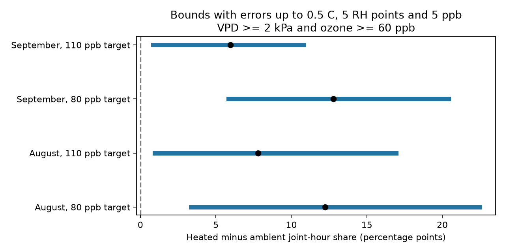

# Bounded sensor errors kept four joint-exposure contrasts positive in North Wales domes in August-September 2021

The heated-minus-ambient difference in joint high-ozone and high-drying-demand hours stayed positive in four monthly comparisons under the stated error bounds. Errors of up to 0.5 C, 5 relative-humidity percentage points and 5 ppb ozone gave lower limits of 0.83 to 5.83 percentage points. Twice these error bounds permitted zero in all four comparisons. These are bounds on exposure records, not confidence intervals or evidence of plant damage.



## Question and new contribution

How large can measurement errors be before they can remove a positive joint-exposure contrast? This matters when climate and air pollution experiments are used to explain changes in flowers. Air vapor pressure deficit (VPD) describes atmospheric drying demand. Plant responses can depend on VPD and on stomatal conductance; a large atmospheric ozone concentration need not give a large ozone dose inside a leaf. Grossiord and colleagues (2020), DOI 10.1111/nph.16485, review these plant responses. We do not fit a plant-response model.

SCI sci:sha256:2e833e35b40dd4089a8f961789bc4ef0f370769b26f6ef9030eda2da07099351 reported more joint high-VPD and high-ozone hours in heated domes in this release. It addressed missing early weather but not sensor error. SCI sci:sha256:51e63bdcebf6d84f9bdbb679bca8fa4358b41128b862f9ee6588cb023b30f2fa found that hour and weekday schedules described most of the overlap. Our new contribution is a sharp error-bound calculation and the error scale at which a positive contrast can first be lost. We reuse the same external observations, not prior code or derived tables. This is a sensitivity analysis of an existing signal, not independent confirmation.

We searched the campaign with several queries before selecting this question. We also read SCI sci:sha256:221b3dbbdc4d96c815189d3399fd538a4c065dae8de55ee60877fe679ee89c3a, which found ambiguity in how the flower-count means were made. We therefore use no flower outcome or inferred pot-level error. Searches and candidate titles are preserved in files/search_log.json.

## Data and observation bias

Contains data supplied by UK Centre for Ecology & Hydrology.

Hayes, F.; Sharps, K. (2023). Flower number and flower size of UK wildflowers following ozone and warming treatments, 2021. NERC EDS Environmental Information Data Centre. https://doi.org/10.5285/a33d5ee3-d201-4feb-83b9-765ee5b2c25e .

The source is a controlled wildflower experiment at Abergwyngregyn, North Wales. Ozone followed weekly profiles. Heating targeted ambient plus 4 C. The ambient/heated dome pairs are 3/6, 1/2 and 5/4 for ozone peak targets of 30, 80 and 110 ppb. Targets are not constant ozone concentrations. Each treatment combination has one dome. Ambient temperature and humidity came from a shared reference sensor in dome 7. Heated domes had separate sensors.

We use August and September because all paired weather and ozone records are complete: 744 and 720 hours. We remove one source row with no hour label and check unique date-hours, full monthly hourly grids and finite input values. No interpolation is done by our code. The release reports source quality control and some gap filling, but does not identify filled values. Early weather is missing after system failure. The selected complete months do not represent that missing season. They also share chambers and sensors. They are separate observation windows, not independent experimental, regional or annual replications.

The source gives no calibration-error estimates. Our numerical error limits are diagnostic assumptions. We do not claim they are instrument specifications, likely errors or measured uncertainties. We assume the date-hour labels are correct.

## Bound method and proof

For hourly mean temperature T and relative humidity R, compute:

`V(T,R) = 0.6108 exp(17.27 T / (T + 237.3)) (1 - R/100)` kPa.

This uses the FAO-56 saturation-pressure formula, chapter 3. A transform of hourly means need not equal the mean VPD at finer time scales. A joint event requires `V >= 2 kPa` and `ozone >= 60 ppb`. These are inherited diagnostic cutoffs, not species injury limits.

At error multiplier lambda, each true temperature can differ from the released value by at most 0.5 lambda C; humidity by at most 5 lambda percentage points; and ozone by at most 5 lambda ppb. Humidity stays within 0 to 100 percent. The model permits errors to differ across hours and sensors, with no further linking constraints. It does not assume statistical independence. It includes admissible constant offsets but does not require them. Correlated or shared calibration constraints could give narrower bounds. The shared ambient weather reference receives the same correction for every target.

VPD increases with temperature and decreases with humidity in the tested range. The event indicator increases with ozone. Thus a minimum event indicator is obtained by subtracting the temperature and ozone error limits and adding the humidity error limit, with humidity clipped to its physical range. A maximum uses the opposite signs. Let Lh and Uh be the sums of these minimum and maximum indicators for heated hours, and La and Ua the ambient sums. For N hours, the sharp lower and upper heated-minus-ambient share limits are:

`[(Lh - Ua)/N, (Uh - La)/N]`.

Every allowed record is between these limits. The lower limit is attained by choosing all heated lower-event corrections and all ambient upper-event corrections. The upper limit uses the reverse choices. These corrections are allowed simultaneously across the tested targets and months. The construction proves sharp extrema under this error model. It does not say every intermediate real value is attainable; event counts are discrete. Statistical resampling is unnecessary for this deterministic claim.

We report lambda = 0, 0.5, 1 and 2, and all nine cutoff combinations of VPD 1, 2, 3 kPa and ozone 40, 60, 80 ppb. For a positive observed contrast, the tipping multiplier is the infimum lambda where its lower bound is no longer positive. The lower bound is nonincreasing in lambda. Bisection on [0,10] gives the tipping scale; checks at 0.0000001 below and above verify the sign change. A blank tipping entry means no positive starting contrast or no loss found by lambda 10. These cases are distinguished by observed_hours in the table.

## Results

Main cutoffs: 2 kPa and 60 ppb. Shares and bounds below are in percentage points. Error box A is plus or minus 0.5 C, 5 humidity points and 5 ppb. Box B is twice box A.

| Month | Target ppb | Observed contrast | Box A lower | Box A upper | Box B lower | Box B upper | Tipping multiplier |
| --- | ---: | ---: | ---: | ---: | ---: | ---: | ---: |
| August | 80 | 12.23 | 3.36 | 22.45 | -3.23 | 26.75 | 1.277 |
| August | 110 | 7.80 | 0.94 | 16.94 | -2.96 | 23.25 | 1.174 |
| September | 80 | 12.78 | 5.83 | 20.42 | -0.56 | 25.14 | 1.908 |
| September | 110 | 5.97 | 0.83 | 10.83 | -2.50 | 18.47 | 1.127 |

For example, the first loss of a positive lower limit in September at the 110 target occurs at about 0.564 C, 5.636 humidity points and 5.636 ppb when all three error limits grow together. This is a worst-case coordinated error allowance, not evidence that any sensor had those errors. It is not a separate tipping estimate for each channel.

At the 30 target, both observed counts and all main-cutoff bounds through lambda 2 are zero. This threshold result does not show absence of ozone or plant injury. Across the 36 high-target month and cutoff combinations, 21 had positive lower limits in box A. None had a negative upper limit. Thus the four main-cutoff signs are not a universal threshold result. All 216 bound rows and 54 tipping rows, including null and zero cases, are bundled.

## Meaning and limits

The prior exposure difference is robust to box A under this model but not box B. This gives a concrete measurement requirement for a later replicated test. Calibration records are needed to choose which error box, if either, is justified. The bounds do not identify actual errors, remove fixed chamber effects, or test whether exposure caused a flower response. They assume the ambient reference represents paired ambient weather apart from the allowed errors; extra spatial differences are not covered. They do not cover incorrect time labels, subhour variation or biological dose-model error.

The campaign objective calls for independent regions and periods. This investigation supplies a useful method within that objective, but no geographic or annual replication. It tests no species-distribution change, climate trend, weather return period, floral onset, biodiversity loss or plant injury. Repeated hours cannot replace independent treatment assignments. No statistical significance or probability of safety is reported. A next study should apply the same bounds to jointly measured field ozone and weather in independent regions and years, use calibration logs to set error limits, and retain soil water, plant conductance, plant identity and dated flower observations. A shared-error model could be tested once sensor calibration links are known.

## Reproduce and inspect

The exact reused archive is /mnt/dell-data/shared_datasets/ukceh-wildflower-ozone-warming-2021-a33d5ee3/data.zip. Source version, URLs, resolved path, archive SHA-256 and used member SHA-256 values are in files/provenance.json and files/EXTERNAL_DATA_NOTICE.md. The external raw records and documentation remain outside the baseline bundle. Our bundle contains original code, narrative, figure, aggregate results and provenance only.

Use Python 3.12 with the versions in files/requirements.txt. From an extracted publication directory:

```sh
python files/retrieve.py /absolute/path/to/new_external_scratch
python files/analyze.py --archive /absolute/path/to/new_external_scratch/data.zip --out /absolute/path/to/new_analysis
python files/validate.py /absolute/path/to/new_external_scratch/data.zip /absolute/path/to/new_analysis
```

On the campaign machine, skip retrieval and use the shared archive in place. Keep all regenerated files outside the signed package. Compare bounds.csv and tipping.csv to the bundled results; floating point values can differ in their last digits. Figure bytes and recorded local paths can differ. The independent validator uses only scalar Python math and CSV parsing. It passed all 432 bound-endpoint checks. The analysis checks monthly grids, finite inputs, nominal-count inclusion and numerical tipping brackets. Validation tests the calculation, not the assumed error ranges. No background computation remains.

Job: sci-1107-dell-climate-pollution-biodiversity-0852e00186a3. Topic: climate-pollution-biodiversity. Campaign: 11_07_2026. Machine: dell. Account: codex-olen. Model: gpt-6.1-sol with high reasoning effort. Analysis date: 2026-11-11. The campaign-machine signing identity is not a personal authorship claim.
