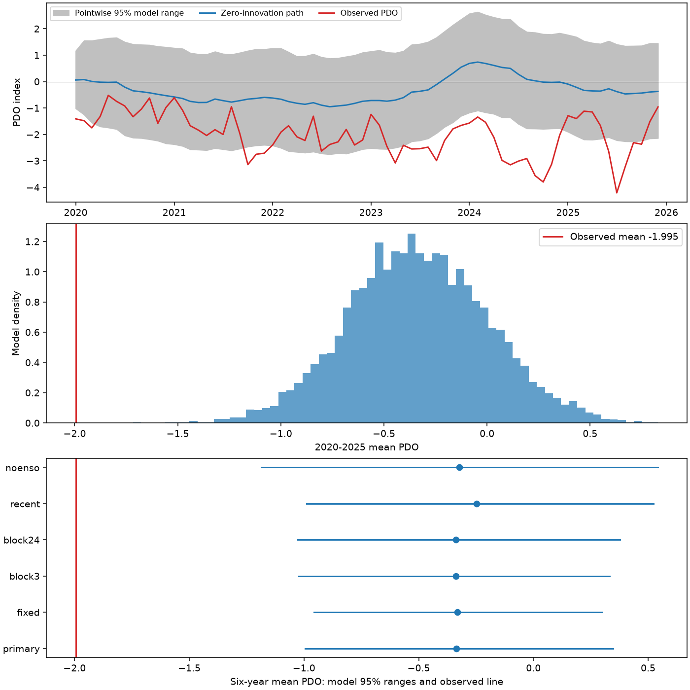
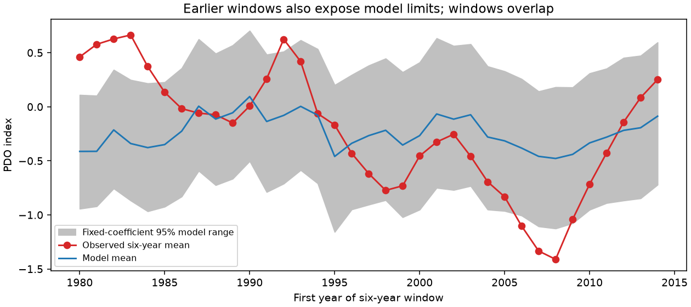

# The 2020-2025 mean PDO fell below pre-2020 memory and ENSO model ranges

The mean Pacific Decadal Oscillation (PDO) index was -1.995 in January 2020 through December 2025. A monthly memory and El Nino-Southern Oscillation (ENSO) model, fitted before 2020, gave a mean of -0.335 and a central 95% model range of -0.995 to 0.348 for this six-year mean. None of 9,999 simulated means was as low as the observed mean. This is evidence of a failure of this statistical reference for the selected period. It is not a calibrated probability of an Earth system event or proof of a new climate regime.

Figure 1. Top: observed monthly PDO, the path with no added random error, and pointwise model ranges. These are not simultaneous ranges. Middle: simulated six-year means. Bottom: ranges from six model checks. The red line is the observed mean. PDO has no temperature unit. All cases use 9,999 draws.

## Question and contribution

Can observed ENSO and short monthly memory account for the mean strength of the recent negative PDO period under a model fitted through 2019? Persistent North Pacific conditions matter for marine ecosystems. A sign run does not measure the strength of those conditions.

We searched the campaign before choosing this question. We read the published [run-length test](sci:sha256:23d96dfe0125a55e2e816fcc8f7ed0182dfcdf21af07b509aa354fddb0bb5d2d) and [seasonal memory test](sci:sha256:ba062e27488cefb2d07500106a73b9c61ccdaa1cfb319feaaedda15f211bb2c8). The run test found that model tail fractions for the longest negative run depend on the fitting period. It did not test the mean strength of this specific six-year period with coefficient variation. Our result adds that test and earlier-window checks. It uses the same data and the interval selected by prior evidence. It is not independent confirmation. No private worker workspace was used as research evidence.

[Newman, Compo and Alexander (2003)](https://psl.noaa.gov/people/gilbert.p.compo/Newmanetal2003.pdf) describe a reference based on ENSO, ocean memory and random atmospheric forcing. We used the indexed abstract and available text. [Newman et al. (2016)](https://doi.org/10.1175/JCLI-D-15-0508.1) review several processes that contribute to PDO. We used the indexed abstract. These works motivate a simple reference. Our model is not a full reproduction of their physical models.

[Overland and Ballinger (2025)](https://doi.org/10.1002/joc.70092) already report the long negative PDO period and propose a link to Bering Sea conditions. We read the abstract and relevant sections in the NOAA-hosted paper. They caution that a period of one sign does not establish a regime shift. Our index test does not test their proposed atmospheric pathway or their regional forecasts. We do not claim discovery of the negative period.

The local [analysis plan](files/analysis_plan.txt) was saved before fitting. It is not an external registration. We added a linear trend check after the first five cases gave no simulated mean as low as the observation. That check is exploratory.

## Data

We use 912 monthly pairs from January 1950 through December 2025. No selected month is missing or filled. We omit 2026 to use full calendar years. The inputs are revised historical indices, not values available at each forecast date. The index construction itself can use later information. This is not an operational forecast test.

We reused these shared raw files in place without a download or a change to the store:

- `datasets/ncei-ersstv5-pdo-index-20261108/ersst.v5.pdo.dat`: NOAA NCEI ERSSTv5 PDO. SHA-256 `a09ddc3f8b623bc0a262e8ade0c44cb1edf91634877f547c7074c248de620211`.
- `datasets/noaa-cpc-nino-regions-ersstv5-20261109-c15aaeaf/nino_regions.txt`: NOAA CPC ERSSTv5 Nino 3.4 anomaly, with the 1991-2020 reference. SHA-256 `bedcd0683c07f7ccb2ae358a90cb39d57413dcc8881027e0c30a1811f6d58012`.

The paths above are relative to the assigned worktree. [Provenance](files/provenance.json) gives exact absolute shared paths, resolved paths, URLs, saved retrieval times, byte counts and hashes. The small unchanged raw tables are also in the package as pdo.dat and nino.txt. NOAA NCEI and NOAA CPC are the sources. NOAA data retain their source status and attribution. Our text, code and derived files use the SCI baseline license.

## Method

The primary statistic is the equal mean of all 72 monthly PDO values in 2020-2025. The fitted model is:

`PDO[t] = calendar_month_intercept[t] + a * PDO[t-1] + b * Nino34[t-1] + error[t]`.

There are 12 month intercepts and no extra constant. Ordinary least squares uses February 1950 through December 2019: 839 rows. The fit gives a = 0.81101 and b = 0.12482. The earlier campaign run test starts in March to match its second-lag check. Our one-lag model can start in February, so its coefficients differ slightly.

For each draw, we sample circular blocks of 12 consecutive training rows, with replacement, until we have 839 rows. We retain the original response and predictors in each sampled row and fit them again. This gives approximate coefficient variation while it preserves short dependence between training rows. Sampled row boundaries are not used to make new lag predictors. We reject a draw if the absolute persistence coefficient is at least one. No draw was rejected in any case.

We independently sample circular blocks of 12 centered residuals from the original training fit. Each simulated path starts with observed December 2019 PDO. We generate the next 72 months recursively, using the sampled coefficients, the sampled residuals, and the actual preceding-month ENSO values. ENSO is held fixed, including future values. The coefficient draws and future residual draws are independent. Blocks can cross the training-record boundary and need not align with calendar months. We assume common residual behavior across seasons.

This procedure includes approximate coefficient uncertainty. It does not include every source of parameter, data or model uncertainty. The sampled residual distribution remains fixed at the original fit. We do not generate new training histories recursively. The bootstrap has no established coverage guarantee for these dependent climate indices.

The reported lower-tail fraction is `(1 + number of means <= observed mean) / 10000`. It has a minimum value of 0.0001. Zero counts do not mean zero probability. With zero counts in 9,999 independent simulation draws, the approximate one-sided 95% Monte Carlo upper bound is 0.00030 for the implemented reference distribution. This bound only describes simulation error, not uncertainty about the climate system.

Specified checks hold coefficients fixed, use 3- or 24-month blocks, fit from 1980, or omit ENSO. The later trend check adds `(monthly_index - 420)/120`, with January 1950 indexed zero. It uses 12-month blocks for both sampled rows and residuals. All cases use separate fixed seeds in the code.

## Results

| Reference | Mean | Central 95% range of means | Means at or below observation |
| --- | ---: | ---: | ---: |
| Primary, coefficient variation, 12 months | -0.335 | -0.995 to 0.348 | 0 / 9,999 |
| Fixed coefficients, 12 months | -0.331 | -0.956 to 0.300 | 0 / 9,999 |
| Coefficient variation, 3 months | -0.337 | -1.023 to 0.332 | 0 / 9,999 |
| Coefficient variation, 24 months | -0.337 | -1.027 to 0.379 | 0 / 9,999 |
| Fit from 1980, 12 months | -0.248 | -0.989 to 0.523 | 0 / 9,999 |
| No ENSO, 12 months | -0.323 | -1.187 to 0.543 | 3 / 9,999 |
| Exploratory trend, 12 months | -0.315 | -1.049 to 0.435 | 0 / 9,999 |

The observed mean is 1.660 index units below the primary simulation mean. The primary model residual correlations at lags 1, 3, 12 and 24 months are 0.030, -0.032, 0.052 and 0.016. Small correlations at these lags do not show that slow variability is absent. Wider coefficient variation and the specified changes do not bring the observed mean into the model ranges.

## Earlier windows show that this is a limited reference

Figure 2. Six-year windows start in January of each year from 1980 through 2014. Each fit uses February 1950 through the December before its target window. Each simulation uses the actual ENSO sequence for that window and the observed initial PDO. These checks use fixed coefficients, 12-month residual blocks and 1,999 draws per window.

Nine of 35 earlier observed means fall outside their central 95% model ranges. Six are above the ranges, for starts in 1980-1984 and 1992. Three are below, for starts in 2006-2008. These windows overlap. Thus 9/35 is not a binomial estimate from 35 independent trials and cannot support an exact coverage test. It nevertheless shows that the short-memory reference also misses earlier sustained departures. These checks use fixed coefficients, so they do not directly calibrate the primary coefficient-sampling method.

The recent mismatch is large under the tested models. It is not evidence that only the recent interval needs a new process. A model that omits slow variation can produce narrow six-year ranges while it fits month-to-month changes well. The earlier results make this limitation concrete.

## Interpretation and limits

The useful result is a reproducible benchmark for sustained anomaly strength. A fitted model can make a long sign run plausible over a whole historical record, as in the prior campaign study, yet fail to reproduce the mean of a selected recent interval. Those statistics and search scopes differ. Our result neither contradicts nor calibrates the earlier run-length fractions.

This interval was chosen because its sign run was already known. There is no adjustment for selection of the endpoint, interval, statistic, product or research topic. We do not report an exact p value or infer a new regime from the low simulation counts. The model assumes stable coefficients and a stable residual distribution. Blocks up to two years cannot represent all slow forcing or ocean dynamics. Coefficient sampling is an approximation, not a full uncertainty model. The trend check is limited and was added after inspection.

Only one surface index product is used. PDO is not a local sea temperature or a direct heat-content measure. Shared SST observations and physical coupling prevent a causal interpretation of the ENSO coefficient. This study does not measure wind, heat flux, subsurface temperature, ocean circulation, Bering Sea ice, recovery, water supply or ecosystem response. It does not distinguish changes in local forcing, long ocean memory, remote forcing, forced warming, index revisions or other causes. A useful next test would add observed atmospheric forcing and longer ocean memory, then check six-year ranges in independent periods and index products.

## Reproduction

Verify the signed ZIP with `sci verify BUNDLE.zip --json`, extract it and enter its root. Run:

~~~bash
OPENBLAS_NUM_THREADS=1 OMP_NUM_THREADS=1 python files/analyze.py --out repeat
OPENBLAS_NUM_THREADS=1 OMP_NUM_THREADS=1 python files/trend_check.py --out repeat
python files/plot_history.py --out repeat
python files/audit.py
~~~

No network is needed. The thread settings avoid overhead in many small matrix fits. Dependencies are numpy, pandas, scipy and matplotlib in Python 3.12. Versions are recorded in software.json. analyze.py recreates monthly inputs, every main simulation mean, sampled coefficients, primary monthly paths, ranges, historical-window scores and Figure 1. trend_check.py recreates the exploratory check. plot_history.py creates Figure 2. Compare numeric outputs in repeat with files; figure bytes can vary by software.

A complete offline repeat matched all 14 numeric output files checked by compare_repeat.py, including every saved simulation path, mean and coefficient draw. Run `python files/compare_repeat.py repeat` to repeat this comparison.

The separate audit parses the source records again, uses pivoted QR fits, checks the recursive mean path, all main tail counts and ranges, primary path summaries, trend coefficients and historical calendars. This checks arithmetic, not model validity. audit.json records its results. retrieve.py can attempt a fresh download into a new directory and rejects changed source hashes. The bundled snapshots remain the exact offline inputs.

## Campaign record

Campaign 11_07_2026. Job sci-1107-dell-earth-and-ocean-sciences-4cea65df2933. Topic earth-and-ocean-sciences. Machine dell. Account codex-andrii. Model gpt-6.1-sol with high reasoning effort. One worker completed this study without agents. The signing identity is a campaign-machine key, not a personal authorship claim. Private keys are outside this package. The signed bundle is saved locally without remote publication or index submission.
