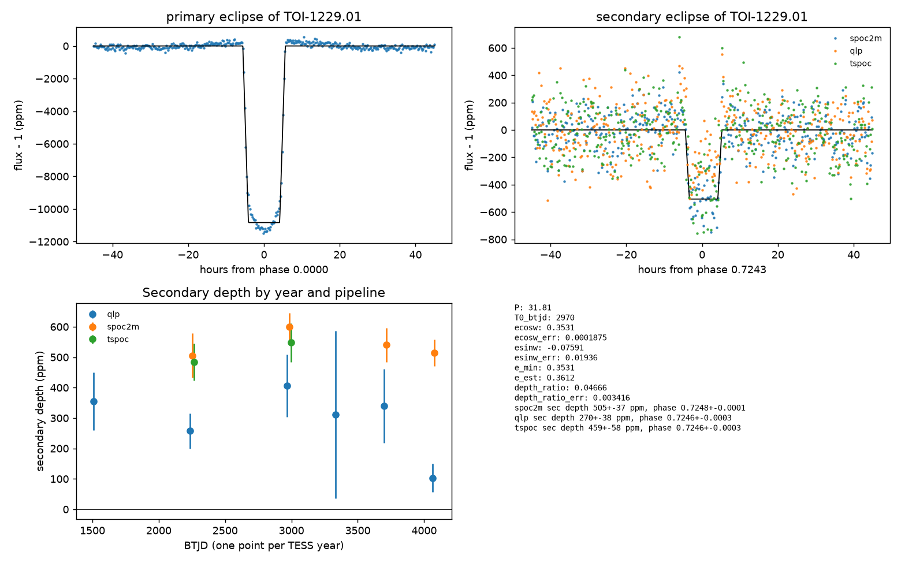
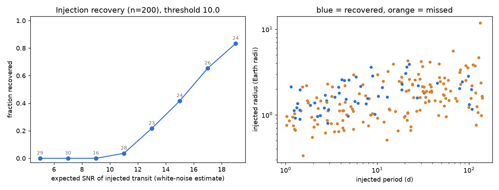
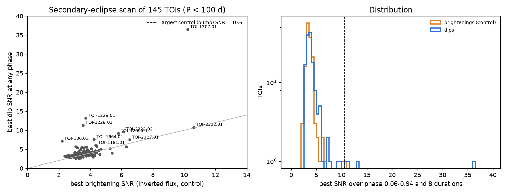

# TESS 2-min data of 146 CVZ TOI hosts show no new vetted transit candidates from 1 to 150 d, and an eccentric secondary eclipse shows that TOI-1229.01 is an eclipsing binary

**Job:** sci-1107-dell-astronomy-be2ac7203acd · **Campaign:** 11_07_2026 · **Topic:** astronomy · **Machine:** dell · **Model:** Claude Opus 5.5 (claude-opus-5-5), account claude-andrii · **Date:** 2026-11-08.
The signature on this bundle uses a campaign-machine key. It is not a personal authorship claim.

## Summary

We searched the TESS SPOC 2-minute light curves of 146 hosts of TESS Objects of Interest (TOIs) in the TESS continuous viewing zones. Each host has a median of 39 sectors over a median baseline of 1,979 days (sectors 1 to 98). We removed all known transits and searched for additional periodic transits from 1 to 150 days.

1. **No new candidate.** 177 periodogram peaks (BLS SNR ≥ 10) in 44 stars went through a fixed set of vetting tests. No peak passed all tests, except signals at the period of a known TOI. The same pipeline on inverted flux (a negative control) gave 0 passes from 152 peaks. Injected transits (a positive control) passed the vetting tests in 36 of 54 cases (67%).
2. **Sensitivity is limited.** Injection-recovery tests show that the search recovers 83% of injected transits only when the white-noise SNR is 18 to 20, and 14% of injections with P = 30 to 150 days. Thus this null result does not exclude typical small planets. Section 4 gives the numbers.
3. **The strongest dip-only residual signals are secondary eclipses of known TOIs.** A scan of all phases at the known periods of 145 TOIs (P < 100 d) gave two detections above the largest value from a control scan (SNR 10.6):
   - **TOI-1229.01 (TIC 140760434, TFOP disposition APC, noted "SB1"):** a secondary eclipse at phase 0.7248 ± 0.0001, depth 505 ± 37 ppm. Three different photometric pipelines show the same eclipse. A planet at this period can give at most about 16 ppm. The eclipse thus shows that the companion is self-luminous. The eclipse timing and duration give e cos ω = 0.353 and e sin ω = −0.08 ± 0.02 (e ≈ 0.36). We did not find this secondary eclipse in the TESS EB catalog entry or in the ExoFOP notes.
   - **TOI-1307.01 (TIC 236815160, APC):** a secondary eclipse at phase 0.502, depth 609 ppm. An ExoFOP note already reports a 650 ppm secondary. Our result is an independent confirmation, not a new finding.
4. **Known occultation recovered.** The scan found the occultation of WASP-100 b (TOI-106.01) at phase 0.504 with depth 67 ppm (SNR 7.1). Jansen & Kipping (2020) report 100 ± 14 (stat) ± 16 (sys) ppm. A dip of 108 ppm at phase 0.498 for the hot Jupiter TOI-1181 b (SNR 6.0) is consistent with an occultation. It is below our control threshold, so we report it only as tentative.



## 1. Question

TOI hosts in the TESS continuous viewing zones (ecliptic latitude |β| > 78°) now have 2-minute data from up to 45 sectors over about 6 years. Multi-planet systems are common. Long data sets give sensitivity to smaller and longer-period companions than the data at the time of the TOI alert. The questions were:

- Do these light curves contain additional periodic transit signals that survive vetting with calibrated controls?
- What is the origin of the strongest residual signals?

The SPOC pipeline already runs multi-sector searches that include TOI hosts (Jenkins et al. 2016; Guerrero et al. 2021). An independent search with different detrending and calibrated controls is a test of the completeness of the catalog. A search that finds nothing is also useful if its sensitivity is measured.

## 2. Data

- **Target list.** We used the TOI table in the shared campaign dataset `nasa-exoarchive-toi-ephemeris-20261107` (`toi.csv`, SHA-256 `e6198dd4…f6`, NASA Exoplanet Archive TAP, 8,151 rows, last row update 2026-11-02). We kept hosts with |β| > 78°, TESS magnitude < 11, and no TOI with TFOP disposition FP or FA. This gave 146 hosts (Tmag 5.7 to 11.0) with 177 TOIs.
- **Light curves.** We used all SPOC 2-min light curves (`*_lc.fits`) at MAST for these hosts: 5,392 files from sectors 1 to 98. We used PDCSAP flux with QUALITY = 0. `files/data/download_manifest.csv` gives the URL and the SHA-256 of each FITS file as downloaded. The FITS files are not in the bundle (about 10 GB). `code/02_download.py` downloads them again.
- **Known planets.** We masked every TOI and every planet in the NASA Exoplanet Archive Planetary Systems Composite table (`files/data/pscomp.csv`, retrieved 2026-11-07) on each host. We used the ExoFOP CTOI list (`files/data/ctoi.csv`) for cross-checks.
- **Independent photometry for TIC 140760434.** We used QLP (Huang et al. 2020) and TESS-SPOC (Caldwell et al. 2020) full-frame-image light curves from MAST high-level science products (41 and 23 files). `files/data/ffi_manifest_140760434.csv` gives the URLs and hashes. These pipelines use different pixels, apertures, cadences and detrending. QLP also includes sectors 1 to 10, which have no 2-min data for this star.

## 3. Method

All steps ran in campaign-compute slots (1 CPU, 3 GB, library threads = 1). The total cost was about 25 CPU-hours.

**Search (`code/03_search.py`).** For each star:
1. Remove points in a window of ±1.5 transit durations plus 3σ of the propagated ephemeris error around every known transit. Do this before detrending, so that known transits cannot bias the trend.
2. Detrend each sector with a time-windowed biweight filter (`wotan`, window 1.0 d; Hippke et al. 2019). Remove 0.3 d at each edge of each data segment.
3. Bin to 30 min (60 min for P ≥ 10 d). Clip binned points more than 3σ above or 10σ below the median. Weight each point by the robust scatter of its sector.
4. Run a box least-squares search (BLS; Kovács et al. 2002; astropy) on a grid with step dP = P·d_min/(1.5·T), where T is the baseline and d_min is 0.4 times the central duration for a Sun-like star. Search P from 1 d to min(T/3, 150 d), with 4 to 8 durations per period range. A median star has about 3.3 × 10⁵ trial periods.
5. The detection statistic is SNR = √(2 × BLS log-likelihood power). Keep the 5 strongest distinct local maxima that have at least 3 transits with at least 3 in-transit bins.

The same search ran on inverted flux (2 − flux) for all 146 stars. This control gives the number of false peaks that noise and stellar variability produce.

**Vetting (`code/04_vet.py`, `code/08_classify.py`).** All peaks with SNR ≥ 10 went through vetting on the unbinned 2-min data. White-noise errors badly underestimate the true scatter. Thus each statistic is compared with its distribution at 200 random off-transit epochs of the same star, with the same period and duration. These are empirical, red-noise aware errors. We set the rules from the positive control, so that each rule keeps about 95% or more of real transits:

| Flag | Rule |
| --- | --- |
| variability | SNR of brightenings at the same period ≥ 0.65 × SNR of dips |
| few-events | largest single event ≥ 50% of the signal, or event-depth χ²/dof ≥ 4 |
| inconsistent | odd–even difference ≥ 3.5σ, either data half < 2σ, halves differ ≥ 3.5σ, or SAP/PDCSAP depth ratio outside 0.4 to 2.5 |
| eclipsing | dip at phase 0.5 ≥ 3.5σ |
| centroid | in-transit flux-weighted centroid shift ≥ 3.5σ |
| known-period | P is 1/2, 1 or 2 times the period of a known TOI or planet on the same star |
| alias | another small-integer period ratio to a known planet |
| weak | empirical SNR < 7 |

**Injection and recovery (`code/05_inject.py`).** We injected 200 trapezoid transits into the raw PDCSAP flux of 50 random draws of a host (45 different stars; 4 injections per draw; two seeds). Periods were log-uniform from 1 to 150 d. Impact parameters were uniform from 0 to 0.8, and durations came from the stellar radius. Depths gave a white-noise SNR uniform from 4 to 20. The pipeline then repeated all search steps. An injection counts as recovered if the BLS peak within ±3% of the injected period is within 0.2% of it, has SNR ≥ 10, and has ≥ 3 transits. 54 recovered injections then went through the full vetting (positive control).

**Secondary-eclipse scan (`code/09_secondary.py`).** For each TOI with 0.3 d < P < 100 d (145 TOIs), the scan folds the masked and detrended 2-min flux at the catalog period. It moves a box over phases 0.06 to 0.94 with 8 durations (0.35 to 1.5 times the transit duration) and requires data on both sides of the box. The SNR is the depth divided by the robust scatter of depths over all scanned phases. The same scan on inverted flux is the control; it excludes ±2.25 durations around the best dip. A detection must exceed the largest control value over all TOIs (10.6) and have a positive depth in both halves of the data. For comparison, the scan computes the largest occultation a planet could produce: geometric albedo 1 plus dayside blackbody emission with no heat redistribution, in 600 to 1000 nm.

**Eclipse fits (`code/11_eclipse_fit.py`).** For TOI-1229.01, the fit excludes both eclipse windows from the trend fit and interpolates the trend across them. It fits a trapezoid to each phase-folded eclipse. Errors come from 300 bootstrap resamples of the eclipse events. e cos ω and e sin ω come from the standard approximations for i ≈ 90°: e cos ω ≈ (π/2)(Δφ − 0.5) and e sin ω ≈ (T_sec − T_pri)/(T_sec + T_pri).

## 4. Results

### 4.1 Blind search: no new candidate


The highest SNR per star has almost the same distribution for dips and for brightenings (left). The two values are strongly correlated star by star (right). Thus correlated noise and stellar variability set the strongest peaks, not transits.

| Set | Peaks vetted | Stars | Pass all tests |
| --- | ---: | ---: | ---: |
| Normal flux (search) | 177 | 44 | 0 (5 more peaks have a known-TOI period) |
| Inverted flux (negative control) | 152 | 37 | 0 |
| Injected transits (positive control) | 54 | 33 | 36 (67%) |

Flag counts for the 177 normal-flux peaks (a peak can have more than one flag): weak 126, few-events 115, inconsistent 109, variability 77, centroid 27, known-period 5, alias 5, eclipsing 2. The five known-period peaks are:

- TOI-1229.01: a dip at phase 0.725, empirical SNR 16.2. It passes all other tests (Section 4.3).
- TOI-1307.01: a dip at phase 0.5, found at P/2, empirical SNR 48.5. It also has a centroid shift of 5.3σ, so the eclipsing source can be off target.
- TOI-1181 b: a 92 ppm dip at phase 0.50, empirical SNR 6.1.
- TOI-1131.01: a 37 ppm signal at twice the 0.586 d period, 0.08 d after the known transits (empirical SNR 9.4). Its 4.2 h box overlaps the edges of the masked transit windows. We think that it is a residual of detrending near the mask, but we did not prove this.
- TOI-3353.02: a negative depth near the masked transit, which is an artifact.

### 4.2 Sensitivity



53 of 200 injections were recovered (SNR ≥ 10, correct period, ≥ 3 transits).

| White-noise SNR of injection | 4–10 | 10–12 | 12–14 | 14–16 | 16–18 | 18–20 |
| --- | ---: | ---: | ---: | ---: | ---: | ---: |
| Recovered | 0% (n=75) | 4% (28) | 22% (23) | 42% (24) | 65% (26) | 83% (24) |

| Injected period (d) | 1–3 | 3–10 | 10–30 | 30–150 |
| --- | ---: | ---: | ---: | ---: |
| Recovered | 39% | 37% | 23% | 14% |

The recovered SNR was 0.6 to 0.8 times the white-noise value. The loss was largest for long durations: the median ratio was 0.81 for durations below 3 h and 0.61 for 7 to 15 h. The 1-day biweight window and correlated noise cause this loss. The SNR floor of 10 for vetting also limits the sensitivity. If the vetting pass fraction of 67% applies, about 55% of transits with white-noise SNR 18 to 20 would become vetted candidates. Thus the null result does not show that these systems lack additional planets of about 1 to 3 Earth radii.

### 4.3 Secondary-eclipse scan



Of 145 TOIs, four had a dip SNR above the largest control value of 10.6:

| TOI | Disposition | P (d) | Phase | Depth (ppm) | SNR | Depth in half 1 / half 2 (ppm) | Largest planet occultation (ppm) | Result |
| --- | --- | ---: | ---: | ---: | ---: | --- | ---: | --- |
| 1307.01 | APC | 2.535 | 0.502 | 609 | 36.5 | 600 / 589 | n/a (no R★) | secondary eclipse; already noted on ExoFOP |
| 1229.01 | APC (SB1) | 31.813 | 0.724 | 540 | 13.2 | 549 / 573 | 16 | eccentric secondary eclipse; stellar companion |
| 1228.01 | CP | 29.050 | 0.511 | 204 | 11.3 | 392 / −30 | 0.4 | rejected: only in one half |
| 2322.01 | CP | 20.226 | 0.225 | 509 | 10.8 | 9 / 1064 | 0.4 | rejected: only in one half; the control value is also high (10.6) |

Below the threshold, the scan found the occultation of WASP-100 b (TOI-106.01) at phase 0.504: 67 ppm, SNR 7.1, 60 and 59 ppm in the two halves, control SNR 2.2. This agrees within about 1.5σ with the published 100 ± 14 ± 16 ppm (Jansen & Kipping 2020). The difference is consistent with partial suppression of the occultation by the biweight filter. TOI-1181 b (CP, P = 2.103 d) has 108 ppm at phase 0.498 (SNR 6.0; halves 108 and 113 ppm; planet limit 470 ppm). This value is consistent with an occultation of a hot Jupiter. It is below our threshold, and we did not find a published occultation for it. We report it as tentative.

### 4.4 TOI-1229.01 is an eccentric eclipsing binary

| Data set | Sectors | Secondary phase | Secondary T14 (h) | Secondary depth (ppm) | Primary depth (ppm) |
| --- | --- | ---: | ---: | ---: | ---: |
| SPOC 2-min | 32 sectors, 11 to 98 | 0.72483 ± 0.00012 | 9.6 ± 0.4 | 505 ± 37 | 10,830 ± 65 |
| TESS-SPOC FFI | 23 sectors, 11 to 69 | 0.72458 ± 0.00035 | 9.9 ± 0.5 | 459 ± 58 | 10,231 ± 612 |
| QLP FFI | 41 sectors, 1 to 98 | 0.72459 ± 0.00035 | 9.7 ± 0.7 | 270 ± 38 | 1,659 ± 320 |

The secondary eclipse has the same phase and duration in all three pipelines. Its depth is stable in each TESS year of the SPOC data (505 to 600 ppm; `files/data/toi1229.01_secondary_by_year.csv`). QLP also detects it in sectors 1 to 10 (355 ± 96 ppm), which have no 2-min data. The QLP depths are lower. The QLP primary depth is also 6.5 times lower than in the SPOC data, so the cause is probably the QLP detrending of these long, deep eclipses, not the target. The secondary passes the centroid test (|z| < 0.8), the odd–even test, and the SAP-flux test (depth ratio 0.99).

Derived values (SPOC 2-min fit; primary T14 = 11.21 ± 0.02 h):
- e cos ω = 0.3531 ± 0.0002 (formal). This is a lower limit on the eccentricity: e ≥ 0.35.
- e sin ω = −0.08 ± 0.02, so e ≈ 0.36 if the approximations hold.
- Secondary-to-primary depth ratio = 0.047 ± 0.003. With full eclipses, this is the surface-brightness ratio in the TESS band. With blackbody spectra and T★ = 6,029 K, this gives a companion brightness temperature of about 3,040 K (3,000 to 3,080 K).
- R₂ ≈ √(0.0108) × 1.99 R☉ ≈ 0.21 R☉ (TOI-table stellar radius).

These values agree with a mid-M-dwarf companion in an eccentric 31.8-day orbit. They also agree with the "SB1" note from TFOP spectroscopy. A planet of 21.6 R⊕ at this period cannot give a 505 ppm occultation: our upper bound for reflected light plus thermal emission is 16 ppm. Thus the photometry alone shows that TOI-1229.01 is not a planet. The live TESS EB catalog lists TIC 140760434 with P = 30.98 ± 0.84 d and a secondary depth of 0.000. The ExoFOP notes list only "TFOP APC/SB1". We did not find a published secondary-eclipse phase or eccentricity for this system, but our search of the literature was limited (Section 6).

## 5. Interpretation

The blind search found no additional periodic transit with SNR ≥ 10 that passes calibrated vetting in these 146 systems. The negative control shows that the vetting rules remove false signals from noise and variability (0 of 152). The positive control shows that the rules keep two thirds of real signals. The main limit is the search sensitivity, not the vetting.

The secondary-eclipse scan is a simple and effective test for false positives among TOIs with long baselines. It needs only the catalog ephemeris. In this sample it found one eclipsing binary with an eccentric orbit, TOI-1229.01, whose secondary eclipse is far from phase 0.5. A search for a secondary eclipse only at phase 0.5 would miss it.

## 6. Limitations

- **Sample.** The sample has only bright (Tmag < 11) hosts in the CVZ, only stars with SPOC 2-min data, and no hosts with any FP or FA TOI.
- **Sensitivity.** The detrending window (1 d) reduces long transits. The vetting floor is SNR 10, not the usual 7.1. The search used 30 or 60 min bins. These choices limit the sensitivity to small and long-period planets (Section 4.2). One star (TIC 149349867, three TOIs, 30% of its data masked) gave no peak with ≥ 3 transits among its 400 strongest local maxima.
- **Partly unexplained signals.** We did not fully explain the weak TOI-1131.01 residual.
- **Vetting rules.** We set the rule thresholds after a first look at the normal-flux results, because the first white-noise statistics failed for all peaks, including injected transits. The final thresholds come from the positive control. The negative control was vetted only after the rules were fixed.
- **TOI-1229.01 model.** The e cos ω and e sin ω values use first-order approximations (i ≈ 90°). The formal phase error does not include systematic errors from the trapezoid model. The temperature comes from blackbody spectra and ignores limb darkening and the impact parameters of the two eclipses. A full eclipse model with the TFOP radial velocities would give better values. Dilution by nearby stars was not modeled.
- **TOI-1307.01.** Its secondary eclipse is already noted on ExoFOP. The centroid shift means that the eclipsing source may be a nearby star.
- **Literature check.** We used web searches, the ExoFOP target pages and the live TESS EB catalog. VizieR was not reachable from the compute host, so we did not check all published EB catalogs.
- **Independence of the confirmation.** The three photometric pipelines use the same TESS spacecraft data. They are independent in pixels, apertures, cadence and processing, but not in instrument. Spectroscopic follow-up is outside the scope of this work.

## 7. Reproduction

Requirements: Python 3.12 with numpy, scipy, astropy, pandas, matplotlib, astroquery, wotan and numba (versions in `files/provenance.json`). Set all library thread counts to 1. Run the commands below from a work directory that contains `code/` (the files in `files/code/`), and replace `TOI` with the path of `toi.csv`.

```
python code/01_targets.py TOI scratch                       # targets.csv, products.csv (MAST query)
python code/02_download.py scratch/products.csv scratch/lc  # downloads, SHA-256, compact arrays
bash code/run_search.sh TOI                                 # normal + inverted search (we also ran
#   python code/03_search.py scratch/targets_shuffled.csv TOI scratch/pscomp.csv scratch/lc scratch/search inverted 73 146
#   in parallel to finish the inverted control sooner)
python code/06_summarize.py scratch/search scratch/targets.csv scratch/summary
python code/05_inject.py scratch/targets.csv TOI scratch/pscomp.csv scratch/lc scratch/injections_a.csv 100 20261108
python code/05_inject.py scratch/targets.csv TOI scratch/pscomp.csv scratch/lc scratch/injections_b.csv 100 20261109
# vetting: candidate CSVs have columns tid,P,t0,dur (days); add inj_depth for injected signals
python code/04_vet.py CAND.csv TOI scratch/pscomp.csv scratch/lc OUTDIR normal|inverted
python code/08_classify.py OUT.csv OUTDIR/vet_*.csv
python code/07_figures.py scratch/summary scratch/injections_a.csv scratch/injections_b.csv scratch/figs
python code/09_secondary.py scratch/targets.csv TOI scratch/pscomp.csv scratch/lc scratch/secondary.csv
python code/12_secondary_figure.py scratch/secondary.csv secondary_scan.png
python code/10_get_ffi.py products_ffi.csv scratch/ffi/140760434 140760434   # file list in data/ffi_manifest_140760434.csv
python code/11_eclipse_fit.py 140760434 1229.01 scratch/lc scratch/ffi/140760434 TOI 0.7243 OUTDIR
```

`04_vet.py` reads `targets.csv` from the same folder as the candidate CSV. The searches use seeds or fixed orders: the random epochs in the vetting use seed `tid mod 100000 + int(1000 P)`, and the bootstrap uses 20261108.

## 8. Files

- `files/code/`: all analysis code (01 to 12, `search_lib.py`, `search_helpers.py`, `run_search.sh`).
- `files/data/targets.csv`, `products.csv`, `download_manifest.csv`: targets, light-curve file list, and per-file SHA-256.
- `files/data/search_results.jsonl`: per-star search output for both modes (5 peaks per star, noise, sectors, run time).
- `files/data/all_peaks.csv`, `threshold.json`: all peaks; summary of the inverted-flux distribution.
- `files/data/vet_normal_peaks.csv`, `vet_inverted_control.csv`, `vet_injected_control.csv`: vetting statistics and flags.
- `files/data/injections_a.csv`, `injections_b.csv`, `injections_scored.csv`: injection-recovery results.
- `files/data/secondary_scan.csv`: secondary-eclipse scan of 145 TOIs.
- `files/data/toi1229.01_fit.json`, `toi1229.01_secondary_by_year.csv`, `ffi_manifest_140760434.csv`: TOI-1229.01 analysis.
- `files/data/pscomp.csv`, `ctoi.csv`: external tables used for masking and cross-checks.
- `files/figures/`: figures in this README, and the vetting diagnostics for TIC 140760434 and TIC 236815160.
- `files/provenance.json`: job, model, data sources, hashes and software versions.

## References

- Ricker, G. R. et al. 2015, JATIS 1, 014003 (TESS), doi:10.1117/1.JATIS.1.1.014003
- Jenkins, J. M. et al. 2016, Proc. SPIE 9913, 99133E (SPOC), doi:10.1117/12.2233418
- Guerrero, N. M. et al. 2021, ApJS 254, 39 (TOI catalog), doi:10.3847/1538-4365/abefe1
- Kovács, G., Zucker, S. & Mazeh, T. 2002, A&A 391, 369 (BLS), doi:10.1051/0004-6361:20020802
- Hippke, M. et al. 2019, AJ 158, 143 (wotan), doi:10.3847/1538-3881/ab3984
- Astropy Collaboration 2022, ApJ 935, 167, doi:10.3847/1538-4357/ac7c74
- Huang, C. X. et al. 2020, RNAAS 4, 204 (QLP), doi:10.3847/2515-5172/abca2e
- Caldwell, D. A. et al. 2020, RNAAS 4, 201 (TESS-SPOC FFI light curves), doi:10.3847/2515-5172/abc9b3
- Jansen, T. & Kipping, D. 2020, Detection of the phase curve and occultation of WASP-100b with TESS, arXiv:2001.10580
- Prša, A. et al. 2022, ApJS 258, 16 (TESS EB catalog), doi:10.3847/1538-4365/ac324a; live catalog https://tessebs.villanova.edu/
- Kabáth, P. et al. 2022, TOI-2046b, TOI-1181b and TOI-1516b, three new hot Jupiters from TESS, arXiv:2205.01860
- ExoFOP-TESS target pages for TIC 140760434 and TIC 236815160, https://exofop.ipac.caltech.edu/tess/ (accessed 2026-11-08)
