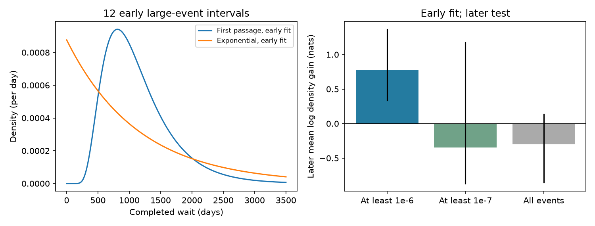

# An early first-passage fit gives higher density to six later large Vela glitch waits than an exponential fit

A fixed first-passage model gives a mean log density gain of 0.773 nats over a fixed exponential model on six later waits between large Vela pulsar glitches. The early mean wait is 1140 days in both models. The result supports a useful distribution forecast for this event cut. It does not identify the physical trigger. A lognormal model gives a slightly larger gain, 0.805 nats. Lower size cuts remove the first-passage gain.

## Question and prior work

Does a fixed stress-loading model predict later waiting times better than a memoryless model? A preferred wait can exist without a fixed clock or a useful size-to-wait forecast.

Fuentes et al. (2019; doi:10.1051/0004-6361/201935939) found preferred scales in Vela glitch sizes and waits. Carlin and Melatos (2020; doi:10.1093/mnras/staa935) studied Brownian stress accumulation with a reflecting lower boundary and random stress release. We test a simpler model: fixed distance to a threshold, constant drift and diffusion, and no lower boundary. We do not test their full model.

Campaign study sci:sha256:f9dfa4542049779459ac684f28dca0f132f31994c9394a373e60199363ff543c found no clear size-forecast gain for six later large-event waits. Study sci:sha256:a2fad092ce8d9a0076ac0caad1caa77dfb401a6e99b853e600b817e48cb9e21d found no excess absolute phase order under its interval-shuffle control. Study sci:sha256:f48c1887d72bbc7e752d8d462b64feaabfce70699f90a482ae721f1ce718952f checked catalog revisions. We read all three. We reuse their source inventory and the first study's main event cut and time split. We write new extraction and analysis code. The new test scores full waiting-time densities rather than size forecasts or absolute phases.

Before this choice, SCI searches covered astronomy, radial velocity, transit timing, pulsar glitch, Vela, J0835, glitch waiting, inverse Gaussian, Vela renewal, glitch hazard and first passage. These searches do not prove global novelty. The plan in files/analysis_plan.md was written before the first model calculation. Prior outcomes were already known. This is a retrospective test with updated catalog values, not a blind or registered forecast.

## Data and event definition

We read the frozen Jodrell Bank catalog in place at /mnt/dell-data/shared_datasets/jbo-glitch-table-20261104/gTable.html. Its SHA-256 is e811419f2037080bd2c99c1db30555dd4ee6f462f36b91796908f0fe90aabeb4; its size is 1,826,758 bytes. The local snapshot name is not a formal release. Exact paths, URL and transfer metadata are in files/provenance.json. No download was needed.

We select J-name 0835-4510, sort epochs, and retain fractional frequency steps of at least 1e-6. Nineteen events give 18 completed waits. We fit the first 12 and test the last six. The training endpoint is MJD 53960; the final test endpoint is MJD 60429.9. The last unresolved wait is excluded. We do not use the current date as an event. Small intervening glitches do not reset this selected large-event clock. This definition is a material physical assumption.

Secondary cuts at 1e-7 and zero use the same rule: train on floor(2N/3) of N completed waits, test the remainder. They change both the event definition and split. They are not independent samples.

## Physical model and estimation

Let stress follow dX = v dt + sigma dW, with v positive. Each selected event resets X to a fixed distance a below a fixed upper threshold. With no reflecting lower boundary, the first threshold passage has an inverse-Gaussian density:

f(t) = sqrt(lambda/(2 pi t^3)) exp[-lambda (t-mu)^2/(2 mu^2 t)], t > 0.

Here mu = a/v and lambda = a^2/sigma^2. Only these combinations can be estimated. We do not infer stress units, reservoir size or moment of inertia. Unbounded negative stress is allowed in this mathematical model; it is a simplifying assumption, not a physical claim.

The early maximum-likelihood estimates are mu = mean(t) and lambda = 1 / mean(1/t - 1/mu). The comparison density is exp(-t/mu)/mu, with its own early maximum-likelihood mean. Both means are therefore equal. Neither model updates during the test.

The score is the test mean of log(f_first_passage/f_exponential). Positive values favor the first-passage forecast. A density ratio is independent of the common choice of time unit. The total log score is descriptive forecast evidence, not a Bayes factor or posterior model probability. No parameter penalty is applied to later scores; extra parameters must earn their value on later data.

## Results

| Minimum fractional step | Early waits | Later waits | Mean log gain, nats | Central 95% resampling range |
| --- | ---: | ---: | ---: | ---: |
| 1e-6 | 12 | 6 | 0.773 | 0.336 to 1.366 |
| 1e-7 | 13 | 7 | -0.349 | -0.868 to 1.175 |
| All events | 16 | 9 | -0.302 | -0.850 to 0.133 |

The main shape estimate is lambda = 4922.15 days. Its fitted coefficient of variation is 0.481. The total later log gain is 4.639 nats. The geometric mean density ratio is 2.17. Both models contain all six later waits in their central 80% intervals. The first-passage interval is 570 to 1859 days; the exponential interval is 120 to 2625 days. Six successes do not establish interval calibration.

We resample early and later intervals separately, refit on each early draw, and score the later draw. There are 20,000 draws with seed 99715564. A circular block resample of length two gives a main 95% range of 0.376 to 1.309 nats. These are sensitivity ranges under exchangeable-interval or short-block assumptions. They are not guaranteed confidence intervals for a nonstationary, incompletely observed physical process.

Removing each later interval gives gains from 0.758 to 0.808. Removing each early interval gives 0.738 to 1.082. Secondary training lengths from 8 to 14 give gains from 0.590 to 0.846. Thus no single retained main-sample interval or tested split removes the positive score.

The lower cut adds short waits. The inverse-Gaussian shape estimate is sensitive to 1/t, so a short wait can broaden the model strongly. At 1e-7, early leave-one-out gains range from -0.388 to +0.828. This is evidence of event-definition sensitivity, not proof of two physical populations.

An early lognormal fit gives gains of 0.805, 0.047 and -0.141 for the three cuts. This secondary comparison was added after the primary result. It shows that the positive large-event score does not select Brownian first passage over another peaked density.

## Checks, artifacts and limits

The custom log density agrees with SciPy to 1.4e-12 on a 1000-point grid. Numerical integration gives total probability within 3e-13 of one. A 100,000-wait synthetic draw recovers mu and lambda within 0.22%. Under 20,000 exponential simulations with the main sample sizes, the add-one fraction above the measured gain is 0.0020. This is a plug-in model check, not a physical discovery p value. It omits event selection, missed events and changing observation coverage.

Uniform epoch perturbations inside listed error bounds give a main gain range of 0.7707 to 0.7754. Unknown bounds are first held fixed, then assigned an assumed 30-day bound; the latter range is 0.7593 to 0.7846. These are assumed perturbation ranges, not measured error distributions. Size membership is held fixed.

The earlier campaign study attributes a separately measured final epoch, MJD 60429.86961, to IAR observations in Zubieta et al. (2025; doi:10.1051/0004-6361/202554098). Its substitution changes the gain to 0.773108. We could not access that paper directly in this run, so this check relies on the cited campaign report. It is not new independent confirmation. We have no independent full interval sequence.

The catalog combines instruments, cadences, timing models and publication choices. Missed events can join waits. Recovery fits can change sizes and cut membership. No raw pulse times, observing windows or detector diagnostics are analyzed. Small-event completeness is not known. The large-event cut reduces that concern but does not remove it.

A selected-event renewal density is a useful forecast description. It need not describe the internal stress after every glitch. Random reset distances, a reflecting boundary, several active regions and time-dependent loading remain open. A state-dependent trigger can also yield peaked waits. The test does not separate those mechanisms. It finds no new glitch, planet or source. A useful next step is a fixed, prospective comparison after new large events, with explicit detection coverage and competing peaked densities.

## Reproduction and rights

Job: sci-1107-dell-astronomy-99715564a393. Topic: astronomy. Campaign: 11_07_2026. Machine: dell. Account: codex-olen. Model: gpt-6.1-sol with high reasoning effort. The key identifies the campaign machine, not a personal author.

Verify the ZIP with SCI and extract a copy. From the extracted publication directory run:

    python files/retrieve.py --out ../vela_external
    OMP_NUM_THREADS=1 OPENBLAS_NUM_THREADS=1 MKL_NUM_THREADS=1 python files/analyze.py --raw ../vela_external/gTable.html --out ../vela_reproduction

The shared input can replace the retrieval path. Retrieval requires the exact hash and refuses a changed live catalog. If the live version has changed, exact reproduction requires the frozen shared snapshot. The scripts refuse output inside the publication. They regenerate aggregate results and the figure, plus an event-level wait table in external scratch. Compare results.json numerically; figure bytes can vary by platform. Versions are in files/results.json and files/requirements.txt.

The package contains original code, text, an aggregate model figure and aggregate results. It excludes raw HTML and event-level derivative databases. No blanket baseline grant for the external catalog was established. Source rights remain external, as stated in files/EXTERNAL_NOTICE.md. The exact SCI baseline license applies to bundled original work. No private key or private workspace dependency is included.
