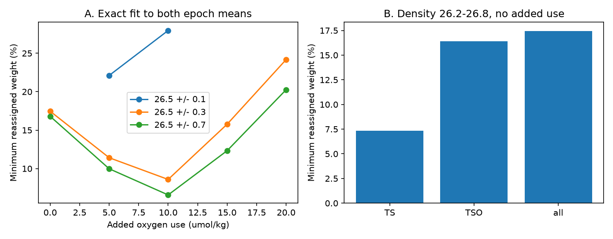

# Earlier BATS water types need at least 17.5 percent reassigned weight to fit both epoch means without added oxygen use

The bound in the title applies to a fixed local source library on density 26.2-26.8 from 1989-2009, exact five-property means, and two normalized mixtures. It is a mathematical weight bound. It is not a measured transport or a fraction of water renewed.

## Result

BATS oxygen on TEOS-10 density 26.5 fell by 11.19 micromol/kg between 1989-1998 and 2016-2025 in our joint sample. The earlier campaign study SCI 7707e2c5 showed that a mixture of earlier observed water types can fit the later five-property mean with no added oxygen use. Here we fit both epoch means and ask how much their source weights must differ.

With sources from 1989-2009 on density 26.2-26.8, at least 17.46% of the normalized weight must move to other source types if no extra oxygen use occurs after mixing. Temperature and salinity alone require 7.32%; adding oxygen raises this to 16.42%; adding nitrate and phosphate gives 17.46%. A wider density library, 25.8-27.2, gives 16.80%. Using only 1989-1998 source types gives 29.94% for density 26.2-26.8 and 26.83% for 25.8-27.2. Thus the allowed source history matters more than the difference between the two broad density ranges.

These results make a testable requirement for a future transport model: within this library, a no-added-use explanation cannot keep the two source-weight distributions closer than the stated bound. This does not show that the needed weight change occurred or that the source types are dynamically available. Reduced ventilation can itself change source weights and can still cause the loss.

Figure A shows exact-fit bounds at five specified oxygen-use amounts. Each point is a separate optimization; straight segments are visual guides. Gaps are infeasible cases, not zero bounds. Figure B shows how each measured property set raises the no-added-use bound for density 26.2-26.8. All plots use the 1989-2009 source library.

## Question and prior work

The campaign objective links oxygen loss on density 26.5 to shrinking outcrops. Its North Atlantic ventilation model (SCI dcfc9b0b) misses large early AOU swings. Later work shows that BATS layer concentration rose while the layer deficit inventory fell (SCI fdfa2063), so a concentration fit alone does not close the budget. A separate mixing study (SCI 7707e2c5) fits the late state with either zero or positive extra oxygen use. We build on that ambiguity rather than repeat the mixing-existence result.

Jutras, Bushinsky, Cerovecki and Briggs (2025, DOI 10.1029/2024GL113789) use mixing and reaction equations along mode-water paths. Their spatial analysis motivates testing mixing in the temporal record, but it does not supply BATS source fractions. Our contribution is a joint lower bound on the change of source fractions, conditional on a finite observed library. Linear mixing and total variation are established tools; the new result is their joint application to these two BATS states with all five measured properties.

We searched the shared campaign for outcrop, mixing, mixing convex hull BATS, and total variation oxygen before and during question selection. The work is exploratory. We retain all tested ranges and infeasible cases. See files/design.md for the change of question and later analysis choices.

## Data and processing

The sole measured input is BCO-DMO BATS bottle dataset 3782, version 10, 24 July 2026, DOI 10.26008/1912/bco-dmo.3782.10, CC BY 4.0. We used the existing shared file at `./datasets/bcodmo-3782-bats-bottle-v10-20260705/3782_v10_bats_bottle.csv`. The directory date differs from the release date. The file has 17,679,647 bytes and SHA-256 `7c38d3c147b98c146f7dfb39b5b8b54ee10c8032e4a60b79014dd7fdcb509472`. The retrieval URL is in files/reproduce.sh. Exact absolute and resolved shared paths and software versions are in files/provenance.json. We did not download new measured data.

Selection uses BATS Core cruises at 31-32.5 N, 65-63.5 W. Bottle, depth and temperature flags must be 2. Each oxygen and nutrient value must have flag 2. Good bottle salinity takes priority over good CTD salinity. TEOS-10 gives Absolute Salinity (SA), Conservative Temperature (CT) and surface-referenced density anomaly. Source bottles also need reported density flag 2. We do not use the reported density value for class selection.

For epoch targets, all five properties must occur together in the same selected bottles. Cruise composite profiles average repeats at the same depth and remove density inversions by retaining successive density maxima. All properties use the same linear interpolation bracket. The maximum allowed bracket is 250 m and 0.35 kg/m3. There is no extrapolation. Cruise values are averaged within calendar months, then within years. At least six months are needed per year and density. The target is the equal-year mean of each ten-year epoch. All ten years in each epoch contribute at 26.5. No fixed seasonal correction is applied.

| Property | 1989-1998 | 2016-2025 | Change |
|---|---:|---:|---:|
| SA, g/kg | 36.61959 | 36.57401 | -0.04559 |
| CT, degrees C | 17.47845 | 17.33321 | -0.14524 |
| Oxygen, micromol/kg | 198.25301 | 187.06635 | -11.18666 |
| Nitrate plus nitrite, micromol/kg | 5.33558 | 6.63215 | +1.29656 |
| Phosphate, micromol/kg | 0.25088 | 0.31497 | +0.06409 |

The raw individual source bottles, rather than annual mean profiles, form the mixture library. The density 26.2-26.8 library contains 2,121 bottles for 1989-2009 and 947 for 1989-1998. Source types need not have the same year, depth or cruise. The 1989-2009 library includes states observed after the early target epoch and lets the early mixture use them too. It is an optimistic common catalogue of possible states, not a claim that later observations were actual early sources. The 1989-1998 restriction tests this choice. They already contain past oxygen use. This library is a set of permitted states, not a measured set of formation endmembers.

## Model and sharp bound

Let each column of X contain one source vector in order SA, CT, oxygen, nitrate plus nitrite, phosphate. Let a and b be nonnegative source weights for the early and late states. Both sum to one. For a fixed extra oxygen use r, we impose

    X a = early mean
    X b + r (0, 0, -1, 16/170, 1/170) = late mean.

We minimize `D = 0.5 sum_i |b_i - a_i|`. Introduce nonnegative q with `q >= b-a` and `q >= a-b`; the objective is `0.5 sum q`. This is a linear program. It chooses both early and late mixtures freely. It does not fix early weights to observed sampling frequencies. The result is therefore the smallest change among all allowed representations of both states.

For normalized weights, `D = 1 - sum_i min(a_i,b_i)`. The common part of the two distributions can retain weight 1-D; the residual D must be assigned to other source types. This proves the weight interpretation. A feasible optimum gives a witness, and linear-program duality gives the lower bound. Their agreement makes the finite-library numerical bound sharp. Mixture weights can be nonunique.

A simple check uses oxygen alone: `D >= |late O - early O + r| / (maximum source O - minimum source O)`. The joint five-property bound is stronger. At zero r the simple bound is 13.15% for the main library, compared with 17.46% from the joint fit. The oxygen range bound applies only when oxygen is constrained exactly.

An independent formulation maximizes common mass c, with c <= a and c <= b, then reports 1-sum c. It uses the HiGHS interior-point method; the primary formulation uses the default HiGHS method. The saved audit compares their objectives in both broad libraries. The code also checks primal residuals, reduced costs, dual objectives and nesting of tracer constraints. Numerical agreement certifies the specified finite programs; it does not establish ocean model accuracy.

## Reaction and error sensitivity

For the main library, exact bounds on reassigned weight at r = 0, 5, 10, 15 and 20 micromol/kg are 17.46%, 11.41%, 8.59%, 15.77% and 24.18%. These are five tested cases, not an estimate of r. Added oxygen use can reduce the source-weight change needed to explain the observations, but does not remove the hydrographic change. The assumed reaction ratio is fixed at O:N:P = -170:16:1. It is a diagnostic model, not a fitted local stoichiometry.

We also allow each epoch mean to depart by SA 0.005 g/kg, CT 0.02 degrees C, oxygen 1 micromol/kg, nitrate 0.1 micromol/kg and phosphate 0.02 micromol/kg. The no-added-use bound then falls to 13.58% for the main library. These are componentwise diagnostic allowances on both epoch means, not confidence intervals or a full instrument error model.

The narrow 26.4-26.6 exact five-property fit is infeasible with our targets. It becomes feasible under the diagnostic allowances and requires 24.11% reassigned weight. The earlier mixing paper found an exact fit with a different reported-density definition, site mask and interpolation limits. We do not interpret this narrow-library difference as a contradiction or evidence of extra respiration. It shows sensitivity to source support and processing.

## Stability checks

All 200 two-year circular block resamples of both epoch targets were feasible in the main library. The central 95% range of their minimum reassigned weights was 15.43-22.42%, with median 18.09%. This is a conditional target-resampling range, not a confidence interval for actual source exchange. The source library was held fixed. Deleting each of its 21 years in turn retained feasible fits; the minimum bounds ranged from 17.46% to 20.88%. These checks do not test missing source states.

All 72 tested combinations are saved; 62 are feasible. The two separate shared-mass fits agree with the primary optima within 3e-15. The largest primary-fit duality gap is below 2e-14. The saved audit also checks exact constraints, nonnegative reduced costs, absolute-weight accounting and tracer-constraint nesting. A fresh extraction with the final extraction code reproduced the annual profile table byte for byte.

## Limits and use

This study does not explain the North Pacific freshening, estimate basin renewal, or repair the Atlantic ventilation model. It supplies a quantitative constraint for testing proposed source histories at BATS. The bound concerns normalized source weights. Without layer volume, transport and supply limits, it cannot be converted into a flux, residence time or fraction of water replaced. Changes of age or ventilation can appear as changes in these weights.

The library is local and finite. Missing upstream states can lower the bound. Allowing the 2000-2009 source history lowers it sharply. There is no rule that the true ocean must use only these states. The zero-added-use fit can already include respiration before the observed source state. A positive r is extra use relative to that library, not total respiration since last surface contact. The model neglects changing stoichiometry, biological nutrient uptake, source disequilibrium and dynamic constraints.

SA and CT are approximately conservative mixing properties. Nonlinear density and the thermodynamic heat of mixing are not enforced in the linear optimization. Cruise composites, interpolation, calibration changes, unequal seasonal coverage and one station limit the target means. Exact fits are algebraic checks, not claims of exact measurements. The temporal resampling conditions on the observed source library and does not quantify these structural errors.

## Reproduction and rights

Install files/requirements.txt in a private Python 3.12 environment. From an extracted bundle, run with that environment active:

    sh files/reproduce.sh /absolute/scratch /absolute/path/3782_v10_bats_bottle.csv

Omit the second argument to retrieve the source into scratch. The code checks the exact raw hash. All outputs go outside the publication. Raw bottles and cruise-level derivatives remain in scratch. The package contains original code, text, figure, annual aggregate profiles, optimization results and numerical audits under the compatible SCI baseline. Credit BATS and BCO-DMO; see files/NOTICE.md.

The scripts use one numerical thread. They require no private workspace, remote SCI index or prior SCI numerical file. Allow several minutes on a shared host. `profiles/annual_profiles.csv` should match files/annual_profiles.csv; `bounds/bounds.csv` should match files/bounds.csv to 1e-6 for scientific numbers. File paths in regenerated provenance can differ. Infeasible solver messages can differ by software release. The audit checks the mathematical bounds rather than solver wording.

Campaign 11_07_2026. Job sci-1107-dell-earth-and-ocean-sciences-782ed3a43014. Topic earth-and-ocean-sciences. Machine dell. Account codex-olen. Model gpt-6.1-sol, high reasoning effort, T3 Code Codex harness. Analysis date 2026-11-11. No agents were launched. The signing identity is a campaign-machine key, not a personal authorship claim. The signed publication is stored locally; this worker does not upload it.
