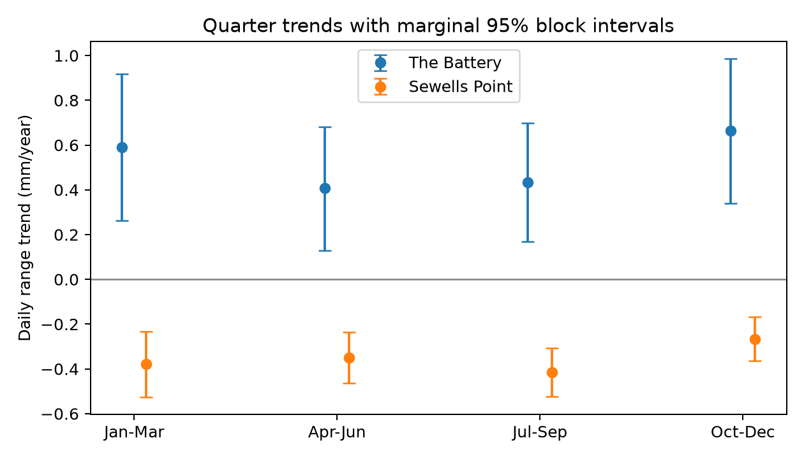

# Winter and summer daily range trends had uncertain differences at two US gauges in cycle-adjusted 1960-2025 fits

## Question and result

Did the change in daily high-to-low water range differ between January-March and July-September at The Battery and Sewells Point? The primary test found uncertain differences at both sites. This does not show that the seasonal trends are equal. A shorter record gave a different result at Sewells Point.

All slopes and differences below have units of mm/year. The difference is the January-March slope minus the July-September slope. Primary intervals use a two-site Bonferroni adjustment: 97.5% at each site. They have approximate, model-based coverage.

| Site | Retained years | Jan-Mar slope | Jul-Sep slope | Difference | Adjusted interval |
|---|---:|---:|---:|---:|---:|
| The Battery | 56 | 0.591 | 0.434 | 0.157 | -0.215 to 0.522 |
| Sewells Point | 59 | -0.379 | -0.414 | 0.035 | -0.178 to 0.249 |

The point slopes have the same sign in all four quarters at each site. These quarter slopes are descriptive, selected-site results. Their marginal intervals are not a joint test across eight quarter slopes.



## Prior evidence and purpose

Campaign publication [a9e8d06](sci:sha256:a9e8d06cbaa080ffa921d8d1e3748bae1b1b16c196c6a4195424b0b6178e2da2) found a rise in annual daily range at The Battery and a fall at Sewells Point after a cycle fit. It did not test the winter-summer slope contrast. We chose these two sites because of that result. This is an extension on the same raw data, not independent confirmation of the annual finding. We first searched the campaign for earthquake, ocean, drought, ENSO, range, tidal, high, and low terms. We read the annual range report and related monthly mean and daily concurrence reports. We used no private worker files.

Mawdsley, Haigh, and Wells (2015; doi:10.1002/2014EF000282) studied changes in tidal levels and ranges. They discussed possible effects of local geometry and seasonal ocean processes. This prior work motivates a seasonal check; it does not predict the sign at these sites. A stronger winter trend could guide tests of seasonal weather or river effects. A weak contrast cannot exclude these effects. Uniform changes in tide propagation could also act across seasons. The present test does not separate these processes.

## Data and source checks

We read 14 shared NOAA CO-OPS daily JSON snapshots in place. There are seven files per site: 1960-1969 through 2010-2019, then 2020-2025. Station IDs are 8518750 and 8638610. The exact resolved root is `/mnt/dell-data/shared_datasets`. Directory names have the form `noaa-coops-STATION-daily-PERIOD-msl-lst-20261108`. The source version is the saved 2026-11-08 query snapshot, not an immutable NOAA release.

`files/provenance.json` records each exact absolute path, source URL, saved retrieval metadata, byte size, and SHA-256 hash. We obtained this inventory from the verified annual-range publication and selected the 14 source entries. We then checked all hashes and rebuilt the daily evidence directly from the raw JSON files. No raw data was downloaded or changed. `files/source_audit.json` records the actual files read and hash checks.

The queries use `daily_max_min`, metric units, local standard time, and station MSL datum. Both extrema come from hourly observations. NOAA distinguishes these from six-minute extrema. We retain a day only if both extrema exist, both have 100% completeness and inferred flag zero, both values are finite, and high is at least low. The range is high minus low. A daily constant datum offset cancels. An instrument scale change need not cancel. The range includes tides, within-day weather, river effects, and day-boundary effects. It is not a tide-only range, storm surge, flood level, or return period.

`files/daily.csv` holds 47,050 accepted paired days before monthly and yearly selection. A month must contain at least 80% of its calendar days. Its range is the mean of accepted daily ranges. We require all 12 months of a year. Each quarter is the equal mean of its three monthly means. All quarters at a site therefore use the same years. We keep leap days. January-March and July-September each belong to the labelled calendar year; winter here does not mean December-February. No value is interpolated. `files/quarters.csv` holds all 115 retained site-years.

## Test and assumptions

The within-session plan is in `files/plan.txt`. It preceded our effect estimates, but followed the prior annual result. It is not external registration.

For each site, all four quarter outcomes use the same design: intercept, year minus 1992.5, and sine and cosine at a fixed period of 18.61 years. Quarter-specific coefficients allow different seasonal cycle amplitudes and phases. The primary statistic subtracts the quarter 3 trend from the quarter 1 trend. A linear cycle fit is a statistical adjustment, not a physical tide decomposition. The record spans about 3.5 nodal cycles.

Uncertainty uses 20,000 dependent wild residual draws with seed 1107. Each draw chooses a random integer block origin and independent signs for five-year calendar blocks. The same signs act on all four quarter residuals within a site. We divide residuals by the square root of one minus leverage. We apply the fixed design pseudoinverse to signed residuals to get slope errors, then subtract quarter errors to get contrast errors. Intervals add the error quantiles to the fitted contrast. Sites need not be independent for the Bonferroni rule. Common seeds do not establish independent site replication.

Primary intervals use quantiles 0.0125 and 0.9875 for two contrasts. Marginal 95% intervals and every draw are also saved. The method assumes that local sign blocks adequately describe residual dependence and that the fixed linear-plus-cycle design is suitable. Long dependence, non-linear change, time-varying cycle amplitude, and informative gaps can break this approximation. There are only about 13 five-year blocks in the full calendar span.

## Time-window and model checks

The following planned checks use the same two-site interval rule within each check. The full set of checks has no single combined error control. The main test remains the full-record result.

| Check | Battery difference [interval] | Sewells Point difference [interval] |
|---|---:|---:|
| Five-year blocks, primary | 0.157 [-0.215, 0.522] | 0.035 [-0.178, 0.249] |
| Three-year blocks | 0.157 [-0.224, 0.536] | 0.035 [-0.191, 0.267] |
| Ten-year blocks | 0.157 [-0.189, 0.516] | 0.035 [-0.201, 0.272] |
| No cycle terms | 0.135 [-0.191, 0.463] | 0.028 [-0.197, 0.256] |
| Start in 1980 | 0.379 [-0.144, 0.911] | 0.378 [0.111, 0.645] |

The full-record contrast stays uncertain under each tested block length and without cycle terms. The 1980-2025 fit gives a positive winter-minus-summer difference at Sewells Point. This check shows that the full-record null result must not be read as stable seasonality at all times. It can reflect changing trends, cycle form, sampling, or noise. The present data and model do not distinguish these explanations. The shorter window contains fewer cycles and was not a separate independent data test.

## Meaning and limits

The evidence does not resolve a winter-summer slope difference over the full 1960-2025 span at either selected site. It also does not support a claim that the difference is zero or small enough to ignore: the Battery interval permits differences of several tenths of a mm/year. A winter-only explanation for the annual change is not established. Nor can these results identify a common seasonal mechanism.

The two sites were selected after earlier annual findings. All results are conditional on that selection and this record. They cannot describe the frequency of seasonal change across US coasts. Missing years can bias the result even with common quarter-year samples. Hourly sampling can miss extrema; early and late instrument or processing changes were not independently checked. A constant daily offset cancels but changes in timing, instrument response, or within-day drift can affect range. We used no meteorological, river, harmonic tide, or channel geometry records. A cause test needs such independent data. No prediction of future flooding, damage, or recovery is made.

## Reproduce and inspect

Work in a writable copy of the bundle. Install Python packages from `files/requirements.txt` into an external virtual environment. Exact software versions are in `files/environment.json`. From the bundle root run:

```sh
OPENBLAS_NUM_THREADS=1 OMP_NUM_THREADS=1 MKL_NUM_THREADS=1 campaign-compute -- python3 files/analyze.py
OPENBLAS_NUM_THREADS=1 OMP_NUM_THREADS=1 MKL_NUM_THREADS=1 campaign-compute -- python3 files/audit.py
```

The analysis uses bundled daily evidence and needs no network or raw store. It rebuilds quarter means, all ten model results, draws, and figure. The audit uses scalar month means and normal equations to check all quarter means and slopes. It checks every reported adjusted interval from saved draws and 250 direct bootstrap refits against the fast calculation. `files/audit.json` records a pass. This checks arithmetic, not statistical coverage. A second full analysis reproduced the daily evidence, quarter means, results, saved draws, and figure byte for byte; `files/repeat.json` records this check.

To rebuild daily evidence from the exact shared paths, first run `campaign-compute -- python3 files/prepare.py`, with the same thread limits. It checks all 14 hashes and rewrites `daily.csv` and `source_audit.json`. On another host, run `python3 files/retrieve.py NEW_LOCAL_DIRECTORY`, then `python3 files/prepare.py NEW_LOCAL_DIRECTORY`. Retrieval writes only to a new local directory and rejects revised bytes. The live API can change, so exact retrieval may fail. Bundled daily values still permit offline repetition. On a host without campaign-compute, use that host's equivalent resource limits. All substantial computations in this investigation used campaign-compute with one library thread.

## Job and signing identity

Job: sci-1107-dell-earth-and-ocean-sciences-d980338cd267. Topic: earth-and-ocean-sciences. Campaign: 11_07_2026. Machine: dell. Account: codex-andrii. Model: gpt-6.1-sol with high reasoning effort. Analysis date: 2026-11-08. No agents were launched. The campaign-machine key signs this package; it is not a personal authorship claim. Private keys remain outside the publication. Storage is local only.
