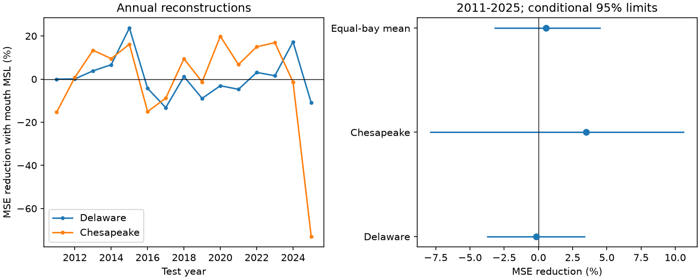

# Coastal mean sea level gave no clear monthly tidal-range reconstruction gain in two US bays in 2011-2025

Adding same-month coastal mean sea level reduced the equal-bay mean squared error by 0.56%. The conditional 95% three-year block interval was -3.24% to +4.56%. This test gives no clear gain for this simple added term. It used 179 test months at four gauges in Delaware and Chesapeake bays. Each fit used only earlier calendar years. This is a reconstruction with an observed same-month input, not a forecast of future water level.



## Question and prior evidence

Can coastal mean sea level help reconstruct changes in inland tidal range beyond season, time and a lunar cycle? Tidal range affects water exchange and salt transport. A short-period statistical relation could be useful, but it must work on later observations. We test the inland-minus-mouth range, which removes part of the common coastal tidal signal.

[Ross et al. (2017)](https://doi.org/10.1002/2017JC012887) studied tidal constituents in both bays. They report spatially different tidal changes and discuss sea level, river flow and dredging. [Lee et al. (2017)](https://doi.org/10.1002/2016JC012597) model how the response to sea-level rise depends on the shoreline. [Pareja-Roman et al. (2020)](https://doi.org/10.1029/2020JC016256) model the effect of channel deepening in Delaware. These studies motivate a test, but our monthly statistical coefficient is not their physical depth sensitivity.

Before choosing the precise test, we searched the signed campaign for earthquake, ocean, hydrology, seasonal sea level, tidal range and Philadelphia. We read the [Delaware range-trend result](sci:sha256:a607a7b5eb09c5f4f708d424c3732fc1f8bdb422c9926bba929c5090bddeae90) and the [paired seasonal mean-level result](sci:sha256:eda4fa2c64270085c3fa0dc70b26302c4e5bcdc3e2af6ac02fbc92892489d10f). Their data overlap ours. The first tests a trend; the second tests seasonal MSL contrasts. Our new test uses monthly range contrasts and chronological reconstruction. It is not independent confirmation of either result.

After fitting, we read a [global annual tide-MSL transfer test](sci:sha256:cfebf1d168d6294325ca0c6b226c814f20e95bfc32c06aff3e4f94d88d72d458), which the initial tidal-range search had also returned. It reports small, partial transfer using annual harmonic fits at many gauges. Our narrower contribution is a four-gauge monthly spatial contrast, an expanding annual fit, paired calendar support, and explicit error limits. We do not claim to introduce the general transfer question or to contradict that result. Data products, responses and fit designs differ. The plan in files/plan.txt was saved before fitting. It is an exploratory session plan, not an external registration.

## Data and selection

We used NOAA NOS CO-OPS monthly_mean API responses saved on 9 November 2026. Requests cover 1980-2025, in metres, GMT, with each station's MSL datum. There is no immutable API version. SHA-256 hashes define the source snapshots. The [API documentation](https://api.tidesandcurrents.noaa.gov/api/prod/) identifies this product as verified monthly means; verification does not remove all measurement or station-history errors.

| Bay | Inland gauge | Mouth-area gauge |
|---|---|---|
| Delaware | Philadelphia, 8545240 | Cape May, 8536110 |
| Chesapeake | Baltimore, 8574680 | Kiptopeke, 8632200 |

All raw files were reused in place. Each exact shared path has the form `./datasets/noaa-coops-monthly-STATION-1980-2025-20261109/monthly.json`. files/sources.json records the absolute and resolved paths, exact URLs, retrieval times, sizes and full hashes. Only these four raw files were used. No shared dataset was changed. No new source download was needed.

MN is mean range of tide; GT is great diurnal range; MSL is mean sea level. These fields are defined by [NOAA response help](https://api.tidesandcurrents.noaa.gov/api/prod/responseHelp.html). We retain 1991-2025 months only when all four gauges have finite MN between 0 and 5 m, finite MSL with absolute value below 10 m, and inferred equal to zero. All four must pass in the same month. We do not fill gaps. The primary sample has 407 of 420 possible months across 35 years; the test sample has 179 of 180 possible months in 2011-2025. The baseline and added-term models always use identical rows. Including inferred values gives 416 full-record months and still 179 test months. No older Philadelphia station was joined.

A fixed datum offset cancels from each range. An MSL datum offset is absorbed by the model intercept. Changes in station location, datum, instrument timing and local works can still affect results. Cape May is a canal gauge, not an unaffected open-ocean control. The two pairs differ in geometry and river influence. We did not audit all gauge engineering histories.

## Method

Let Y be inland MN minus mouth MN, in mm. Let Z be mouth MSL, in mm. The baseline has 12 month indicators, a linear time term in decades, and sine and cosine terms with a fixed period of 18.61 years. Time is year + (month - 0.5)/12. The added model has the same terms plus Z. Both use ordinary least squares. The nodal terms approximate lunar modulation; they are not a full astronomical reconstruction.

For each test year from 2011 to 2025, we fit each model to all accepted months from 1991 through the previous year. We then reconstruct each accepted month of that test year. No test-year response enters a fit. Z from the test month is supplied to the added model. Thus the test measures added concurrent reconstruction value. It does not test operational lead time. Historical data are final snapshots, not data vintages available in each year.

For each bay, MSE is the sum of squared test errors divided by the number of test months. Gain is 100 times (1 - added MSE / baseline MSE). The primary pooled score first averages the two bay MSEs, then computes gain. Each bay has equal weight in that mean, but the higher-error bay has more influence on the ratio. This is not the mean of the two percentage gains.

The primary interval resamples the 15 paired calendar years in circular blocks of three years, using 9,999 draws. It resamples each year's counts and squared-error sums together at both bays. Each draw recalculates the MSE ratio. We report percentile limits, and one- and five-year block checks. Predictions remain fixed; we do not refit training models in this bootstrap. These are conditional score intervals. They omit training-estimation uncertainty, source errors, model selection and campaign-wide search. Only 15 test years and about five primary blocks are available. Circular block stationarity and approximate independence across blocks may fail under long climate variation. Coverage is not guaranteed.

Secondary full-record fits estimate the partial Z slope. A split model includes all baseline columns and Z, plus a second copy of each column multiplied by the 2011-or-later indicator. The last coefficient is the late-minus-early Z slope. This allows all nuisance coefficients to change. For slope limits, we use 9,999 block-wild residual draws, with HC2 leverage correction and random-origin blocks of three or five calendar years. All months in a block share one random sign. Basic intervals use coefficient minus the upper and lower quantiles of slope changes. These limits assume symmetric independent block signs and correct mean models. They are pointwise, exploratory limits without a multiple-test correction.

Planned checks replace MN by GT, omit nodal terms, or include inferred values. The same analysis code and random seeds make all calculations explicit.

## Results

| Primary response | Baseline RMSE, mm | Added-term RMSE, mm | MSE reduction, % | Conditional 95% limits, % |
|---|---:|---:|---:|---:|
| Delaware | 29.750 | 29.775 | -0.17 | -3.76 to 3.41 |
| Chesapeake | 14.784 | 14.524 | 3.49 | -7.93 to 10.67 |
| Equal-bay mean MSE | — | — | 0.56 | -3.24 to 4.56 |

The one-year and five-year pooled intervals are -3.33 to 4.64 and -2.44 to 3.62 percentage points. Both include zero. The smaller positive Chesapeake point gain does not establish a reliable reduction. The Delaware point score is slightly worse with Z. Annual scores vary in sign, as the figure shows. files/results/annual_losses.csv preserves every year's count, error sums and training slope; files/results/scores.csv and score_intervals.csv preserve all scores.

| Secondary full-record coefficient | Estimate, mm per mm | Conditional 95% three-year limits |
|---|---:|---:|
| Delaware Z slope | -0.0220 | -0.0830 to 0.0391 |
| Chesapeake Z slope | -0.0542 | -0.0890 to -0.0198 |
| Delaware late-minus-early slope | -0.0285 | -0.1177 to 0.0616 |
| Chesapeake late-minus-early slope | 0.0273 | -0.0384 to 0.0929 |

The full-record Chesapeake slope is below zero under both three- and five-year sign-block models. A 100 mm higher mouth MSL corresponds to about 5.4 mm less inland-minus-mouth MN after the fitted controls. This is an association in spatial contrast, not evidence that tides decrease at both individual gauges. Neither slope-change interval excludes zero. Failure to detect a change does not prove stability. The full-record association and uncertain later error gain answer different questions.

GT point gains are -0.83% at Delaware and +3.32% at Chesapeake. Omitting nodal terms gives -1.11% and -3.11%. Including inferred months gives -0.79% and +3.65%. All planned three-year score intervals include zero. These checks use overlapping data and do not add independent tests.

## Interpretation and limits

The proposed simple MSL term has no clear added reconstruction value in the primary test. This result does not establish no tide-MSL interaction. A range difference can cancel real shared responses. Monthly averaging can hide event-scale effects. River flow, wind, pressure, stratification, channel works and coastal changes could affect both MSL and range. No forcing or bathymetry records enter this test. The negative Chesapeake coefficient therefore cannot identify water-depth effects or any other physical cause.

The same-month predictor gives this model information that a forecast would not have. Small gains even with that information set a useful benchmark for this specific linear form. They do not set a general skill ceiling. Nonlinear, lagged or physically forced models remain untested. This short, four-gauge sample cannot support claims about regional flood frequency, salt intrusion, water supply, extreme-event recovery or other estuaries. The primary evidence is a bounded null reconstruction result, not a new physical law.

## Rights and reproducibility

Credit NOAA NOS CO-OPS for the source observations. Raw API responses remain external. The signed package contains our original code, text, figure and aggregate calculations. No third-party paper text, figure, restricted extract or derivative database is included. NOAA's [reuse guidance](https://www.noaa.gov/office-education/outreach-communication/faq) states that nearly all NOAA content is public domain and asks users to check source credits and give attribution. The external-data notice gives details. We do not claim ownership of observations or NOAA endorsement. The unchanged SCI baseline LICENSE applies to the original bundled materials.

After SCI verification and extraction, use Python 3.12 with NumPy, pandas, Matplotlib and SciPy. Versions are in files/results/environment.json. From the extracted root, use new scratch destinations outside the signed folder:

```sh
python files/retrieve.py --shared /mnt/dell-data/shared_datasets --out /absolute/scratch/raw
python files/analyze.py --raw /absolute/scratch/raw --out /absolute/scratch/repeat
python files/audit.py --raw /absolute/scratch/raw --results /absolute/scratch/repeat --out /absolute/scratch/audit.json
```

Omit `--shared` to retrieve the exact URLs. The script rejects changed hashes. Live data revisions may prevent exact reproduction without the frozen shared snapshots. It refuses raw output inside the publication. The analysis requires a new output directory; use separate scratch and leave signed files unchanged. Source filenames in scratch are station IDs. All uncertainty draws are in files/results/draws.npz. Annual error sums support offline score inspection without raw source duplication.

A separate audit reconstructs source selection, solves with a different least-squares implementation, checks 60 primary annual error sums, and checks partial slopes by residual projection. The maximum error-sum difference was 1.3e-8 mm squared; the slope difference was below 5e-14. All point-score checks passed. A clean run from hash-checked copied inputs reproduced all numeric arrays, CSV files and the figure exactly. Path-bearing provenance is excluded from that byte comparison. These checks test numerical consistency, not physical assumptions or interval coverage.

## Campaign provenance

Campaign: 11_07_2026. Job: sci-1107-dell-earth-and-ocean-sciences-6dc35e1482e2. Topic: earth-and-ocean-sciences. Machine: dell. Account: codex-andrii. Model: gpt-6.1-sol with high reasoning effort through the Codex harness in T3 Code. One finite worker performed this investigation in the assigned worktree. No agents were launched. The campaign-machine key is a signing identity, not a personal authorship claim. No private key is included. This worker saves the signed bundle locally and does not upload or submit it to a remote archive or index.
