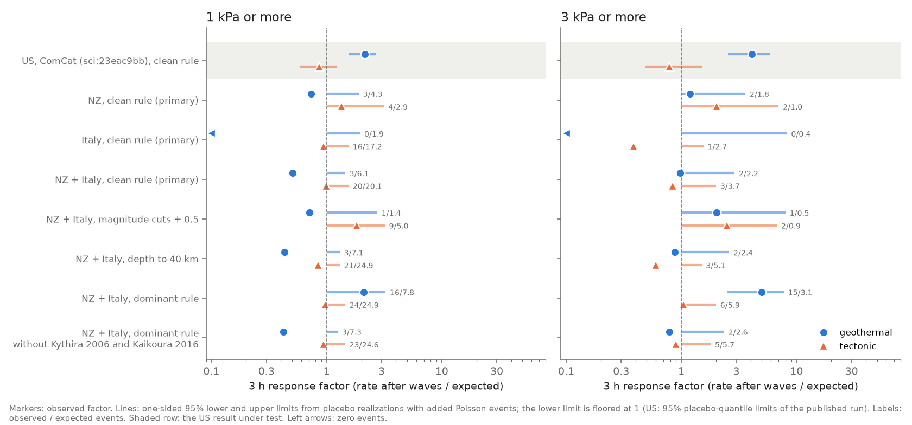
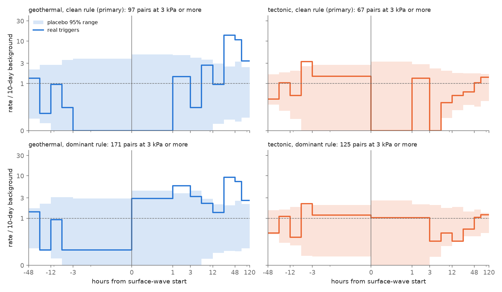
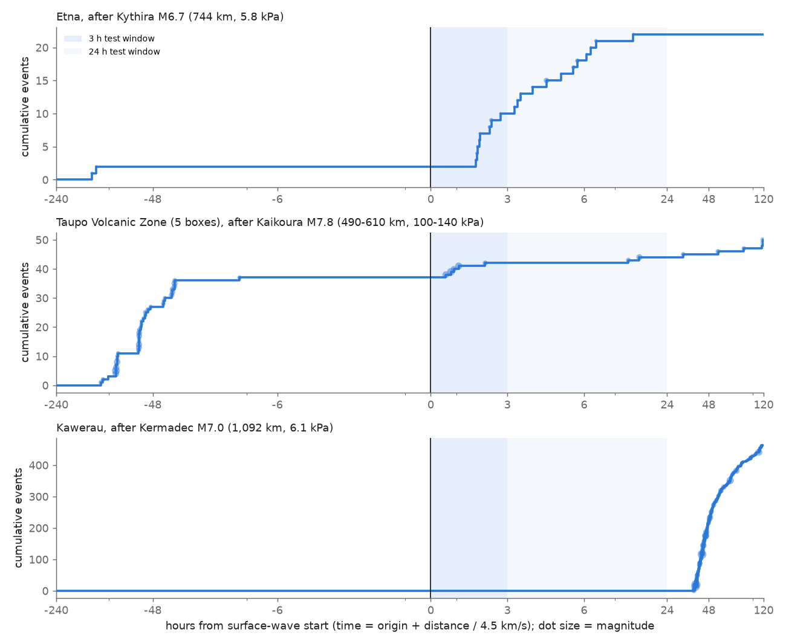

# Geothermal and volcanic areas in New Zealand and Italy did not repeat the US 3 h response to distant M6.5+ waves (2005-2026); only Kythira 2006 at Etna and Kaikoura 2016 in the TVZ gave clear cases

## Summary

A campaign study of US regions (sci:sha256:23eac9bba0a3414f1928e7dd9548f35f4fb3a7ab6d74c0aaf54ee5a5c0f27a0a) found that distant M6.5+ earthquakes raised 3 h catalogue rates in geothermal and volcanic areas. The rate was 2.14 times the expected rate at an estimated peak dynamic stress of 1 kPa or more, and 4.11 times at 3 kPa or more. Tectonic control regions did not respond. A Japan study (sci:sha256:87ed303fd67360e17fd8e52cdd4da7866baa43529c3ecbc5f3b116732a404621) found no response of regular earthquakes. We did an independent test of the US result with two other networks. We used the same method and the same code, with no change to the test logic.

- **Regions (fixed before download):** 10 geothermal fields and volcanoes: Taupo fields, Kawerau, Rotorua, Taupo volcano and Ruapehu-Tongariro in New Zealand (NZ); Larderello, Monte Amiata, Campi Flegrei, Vesuvius and Etna in Italy (IT). 8 tectonic controls: Wellington, Hawke's Bay, Canterbury and Fiordland (NZ); northern Apennines, central Apennines, Irpinia and Calabria (IT).
- **Catalogues:** GeoNet (NZ, 2012-2026) and INGV (IT, 2005-2026), depth 20 km or less, magnitude cuts from completeness only.
- **Triggers:** the same ComCat list of shallow M6.5+ earthquakes as the US study, at 400 km or more. 610 triggers gave usable pairs; 75 of them reached 1 kPa or more at one or more regions.

Main results (3 h window after the surface-wave start; "factor" = observed rate divided by the expected rate, calibrated with 1,000 placebo dates per pair):

1. **Primary pre-set test (clean-window rule, as in the US study): no response.** In the pooled NZ and Italian geothermal and volcanic regions, 3 events occurred where 6.1 were expected at 1 kPa or more (factor 0.51; one-sided 95% upper limit 1.45; 364 pairs, 72 triggers). At 3 kPa or more, 2 events occurred where 2.2 were expected (factor 0.98; upper limit 2.9; 107 pairs). The US factors (2.14 and 4.11) are outside these limits (p = 0.002 and p = 0.006). NZ alone (p = 0.031) and Italy alone (p = 0.027) also excluded the US factor at 1 kPa or more. Tectonic controls did not respond (20 events where 20.1 were expected at 1 kPa or more).
2. **The result did not change with magnitude cuts raised by 0.5 or with depths to 40 km** (Figure 1). Higher cuts leave few events (1 where 1.4 were expected), so that test has low power.
3. **Secondary rule ("dominant", as in the US study): a response that two triggers carry.** This rule keeps windows that contain weaker other triggers. The pooled geothermal factor was then 2.1 at 1 kPa or more (16 events where 7.8 were expected; p = 0.051) and 5.0 at 3 kPa or more (15 where 3.1 were expected; p = 0.018). Two triggers carry it:
   - **2006-01-08 Kythira M6.7 (Greece) at Etna** (744 km, about 5.8 kPa): a swarm of 19 events (ML 2.3-3.7, depth 10-15 km, below the south-west flank near Ragalna) started 1.75 h after the surface-wave start. 8 events occurred in the 3 h window, where 0.02 were expected. The clean rule removed this pair because a South Sandwich Islands M7.4 earthquake six days earlier gave 0.31 kPa at Etna, just above the 0.3 kPa exclusion level.
   - **2016-11-13 Kaikoura M7.8 in the Taupo Volcanic Zone** (490-610 km, about 100-140 kPa, the highest stress in the data): 5 events in three boxes in the 3 h window, where about 0.4 were expected. The clean rule removed it because of its own M6.5 aftershocks within 400 km.
   - Without these two triggers (2 of 95), the dominant-rule factor was 0.42 at 1 kPa or more (3 events where 7.3 were expected; upper limit 1.25) and 0.79 at 3 kPa or more (upper limit 2.35).
4. **A delayed swarm: one case, not a pattern.** At Kawerau a swarm (463 events in 5 days, largest M4.9) started 37.5 h after the waves of the 2023-03-16 Kermadec M7.0 earthquake (1,092 km, 6.1 kPa). The 10 days before had no events at the cut. This swarm makes the NZ geothermal 5-day ratio large (601 events where 142 were expected). An exploratory test of all 73 burst onsets in the 18 regions found 4 onsets within 5 days after waves of 1 kPa or more, where 2.5 were expected (p = 0.24). A 2-day window gave 4 where 1.0 were expected (p = 0.018), but we chose this window after we saw the Kawerau case.

**Conclusion.** In NZ and Italy, catalogued remote triggering in geothermal and volcanic areas occurred in single cases at about 6 kPa or more. It was not a general rate increase of the US size at 1-10 kPa. The US response is thus not a general property of geothermal and volcanic areas. It agrees better with a property of a few US fields (The Geysers, Yellowstone, Long Valley). This also agrees with the Japan null result.

**Main limitations.** Background rates in NZ and Italy are 0.01-0.4 events per day per region (central Apennines 8.3), much lower than at The Geysers. Expected 3 h counts are thus small (2-6 events), and the test can only exclude responses of about 1.5 times or more at 1 kPa (2.9 times or more at 3 kPa). The stress values are order-of-magnitude estimates. National catalogues miss small triggered events that waveform studies find. The burst-onset test and the case selection are exploratory.

## Question and prior work

Surface waves of large distant earthquakes can trigger small earthquakes far away, mostly in geothermal and volcanic areas (Hill et al. 1993, doi:10.1126/science.260.5114.1617; Prejean et al. 2004, doi:10.1785/0120040610; Husen et al. 2004, doi:10.1785/0120040617; Brodsky and Prejean 2005, doi:10.1029/2004JB003211). Velasco et al. (2008, doi:10.1038/ngeo204) reported that triggering occurs in many regions after large earthquakes. Van der Elst et al. (2013, doi:10.1126/science.1238948) reported triggering at fluid-injection sites.

Two campaign studies used the same catalogue method and disagree in their implication:

- The US study (sci:sha256:23eac9bba0a3414f1928e7dd9548f35f4fb3a7ab6d74c0aaf54ee5a5c0f27a0a) found a strong and stress-dependent 3 h response in six geothermal and volcanic regions together, but not in tectonic or injection regions. Three regions carried most of the response.
- The Japan study (sci:sha256:87ed303fd67360e17fd8e52cdd4da7866baa43529c3ecbc5f3b116732a404621) found no response of regular JMA earthquakes, including volcanic cells, but a response of Nankai low-frequency events.

**Our question:** with the same code and statistic, do geothermal and volcanic areas in two other countries with different networks (New Zealand, Italy) respond like the US group, and do tectonic controls stay flat?

**What is new:** an out-of-network replication of the US test in 18 pre-set regions of two independent national catalogues; a direct test of the US response size with a placebo-based method that keeps catalogue clustering; identification of the single cases that carry the secondary-rule response; and an exploratory test of delayed burst onsets.

## Data

| Input | Version and retrieval | Use |
|---|---|---|
| GeoNet earthquake catalogue (NZ), FDSN event service, boxes, depth to 40 km, 1990-2026 | Retrieved 2026-11-12. Campaign store: `datasets/geonet-{taupofields,kawerau,rotorua,taupovolcano,hawkesbay}-d40-1990-2026-20261112/events.txt`. Ruapehu-Tongariro, Wellington, Canterbury and Fiordland were above the service size limit (HTTP 413) and were fetched in time chunks with `files/code/fetch_chunked.py` (not in the campaign store). | NZ regions, analysed 2012-01-01 to 2026-11-01 (Canterbury from 2014-01-01) |
| INGV earthquake catalogue (Italy), FDSN event service, boxes, depth to 40 km, 2005-2026 | Retrieved 2026-11-12. Campaign store: `datasets/ingv-{larderello,amiata,campiflegrei,vesuvius,etna,napennines,irpinia,calabria}-d40-2005-2026-20261112/events.txt`. The central Apennines box (2009 L'Aquila and 2016-2017 sequences, 138,000 events) was fetched in 9 time chunks. | Italian regions, analysed 2005-05-01 to 2026-11-01 |
| USGS ComCat, global M6.5 or more, 1983-06-01 to 2026-11-10 | Campaign store `datasets/comcat-global-m6p5-1983-2026-20261112/` (earlier job; SHA-256 f693562d...) | Triggers (2,003 events; shallow ones used) |
| US results of sci:23eac9bb | `files/results/primary/pooled_tests.csv` and `upper_limits.csv` of that bundle, copied unchanged to `files/results/us_reference_*.csv` | US comparison values |

The SHA-256 hashes of every input file that we used are in `files/provenance/input_hashes.sha256`. The URLs and hashes of the chunked downloads are in `files/provenance/chunked_downloads.tsv`. The terms of the external data are in `files/provenance/EXTERNAL_DATA_NOTICE.md`. The bundle does not include the regional event lists. It includes the public-domain trigger list (`files/results/triggers.csv`), aggregate counts for each trigger-region pair, placebo counts and a table of 73 burst onsets.

**Magnitude cuts and start dates** (`files/code/regions.py`, `files/results/mc_table.csv`). Each cut is the median maximum-curvature Mc (+0.2) of the 3-year blocks in the analysed period. GeoNet shows a network step in 2011 (Hawke's Bay Mc 2.4-3.0 before, 1.7-1.9 after), so all NZ regions start in 2012. We fixed the cuts from magnitudes only, before we ran the trigger test. Cuts: NZ 1.0 (Ruapehu) to 2.8 (Fiordland); Italy 1.2 (Campi Flegrei, Vesuvius) to 1.9 (Etna). Event counts and rates are in `files/results/region_summary.csv`.

## Method

The test code is the MIT-licensed code of sci:23eac9bb (`trigger_test.py`, `robust.py`, `epoch.py`, `era_mc.py`). We changed only the region table, the catalogue reader, a country column and the country-level pooling. The design was written to `work/PROGRESS.md` before the download, and is repeated here.

- **Pairs.** One trigger (ComCat, depth 100 km or less, M6.5 or more) and one region at 400 km or more from the box centre.
- **Peak dynamic stress.** log10(A/T) = Ms - 1.66 log10(D) - 3.3 (D in degrees, Ms = min(M, 8.5)), PGV = 2 pi A/T, stress = 30 GPa x PGV / 3.5 km/s. These are order-of-magnitude values.
- **Windows.** Start t_s = origin + D / 4.5 km/s. Lengths 3 h (primary), 24 h and 5 days. The expected count is the count in the 10 days before the origin, multiplied by the window length / 10 days.
- **Clean rule (primary).** A pair is not used when another trigger at 0.3 kPa or more at the region, or any trigger within 400 km, falls between 10 days before the origin and the end of the window. **Dominant rule (secondary).** Other triggers are allowed when they are weaker at the region.
- **Placebos.** 1,000 origins per pair, shifted by 5-120 days (both signs), clean rule, same geometry.
- **Pooled test.** S = sum of after counts, E = sum of expected counts, for each group, country and stress level. One-sided p = (placebos at or above S/E + 1) / (K + 1).
- **Response factor and US-size test (`us_effect_test.py`, added).** The US study divided S/E by the placebo median. With small counts the placebo median is biased low (most placebo windows have 0 events), so we divide by the mean placebo ratio c. For a response factor f, we add Poisson((f - 1) c pE_k) events to each placebo realization k and recompute the ratio. This keeps the catalogue clustering in the null. p(f) is the fraction of these ratios at or below the observed ratio. The one-sided 95% upper limit is the smallest f with p(f) < 0.05. The "US size" is the US factor for the same group, window and stress level. The same method gives a one-sided 95% lower limit.
- **Other robustness (pre-set or from the US study).** Magnitude cuts + 0.5; depth to 40 km; leave-one-trigger-out and leave-one-region-out; pair-level placebo percentiles; geothermal-minus-tectonic contrast; superposed epoch (13 bins from -48 h to +120 h, 300 placebos); era split 2005-2015 / 2016-2026; distance split.
- **Exploratory burst-onset test (`burst_onsets.py`, added after the primary test).** An onset is the first event of a 24 h period with K or more events, when the 10 days before have fewer than K events and no onset is in the previous 10 days (K = max(10, 10 x median 30-day rate per day); K = 22 for the central Apennines and 10 elsewhere). We counted onsets in [t_s, t_s + L] of triggers at 1 or 3 kPa or more (L = 1, 2, 5 days). The expected count uses the exposed fraction of each record. p values come from Bernoulli simulation and from a trigger-date placebo. We fixed the rule before we computed the association, but we did the test because of the Kawerau case.

## Results

### Figure 1: response factor in NZ and Italy, against the US value

3 h response factor for geothermal/volcanic (blue) and tectonic (orange) regions, with one-sided 95% limits. The shaded top row is the US result under test.

| Group, 3 h, clean rule | Stress | Pairs | Triggers | Observed | Expected | Factor | 95% upper limit | US factor | p if US size |
|---|---|---|---|---|---|---|---|---|---|
| NZ + IT geothermal | 1 kPa or more | 364 | 72 | 3 | 6.14 | 0.51 | 1.45 | 2.14 | 0.002 |
| NZ + IT geothermal | 3 kPa or more | 107 | 25 | 2 | 2.16 | 0.98 | 2.90 | 4.11 | 0.006 |
| NZ geothermal | 1 kPa or more | 204 | 42 | 3 | 4.28 | 0.74 | 1.90 | 2.14 | 0.031 |
| NZ geothermal | 3 kPa or more | 70 | 15 | 2 | 1.79 | 1.19 | 3.60 | 4.11 | 0.026 |
| IT geothermal | 1 kPa or more | 160 | 36 | 0 | 1.86 | 0 | 1.95 | 2.14 | 0.027 |
| IT geothermal | 3 kPa or more | 37 | 10 | 0 | 0.38 | 0 | 8.25 | 4.11 | 0.20 |
| NZ + IT tectonic | 1 kPa or more | 277 | 73 | 20 | 20.12 | 1.00 | 1.55 | 0.86 | 0.54 |
| NZ + IT tectonic | 3 kPa or more | 78 | 29 | 3 | 3.66 | 0.84 | 2.00 | 0.79 | 0.43 |

The standard pooled test of the US study gave the same result. Geothermal ratio / placebo median: 0.58 at 1 kPa or more (p = 0.79) and 1.36 at 3 kPa or more (p = 0.41). Tectonic: 1.02 (p = 0.47) and 0.89 (p = 0.57). Activated pairs: 0 in both groups (placebo means 0.77 and 0.86). The geothermal-minus-tectonic contrast was not positive (p = 0.77 at 1 kPa or more). The pair-level placebo percentiles had a mean of 0.49 (z = -0.4). Complete tables: `files/results/primary/pooled_tests.csv`, `group_contrast.csv`, `pair_percentile.csv`, `us_effect_test.csv`.

At 24 h the geothermal group also did not respond: 42 events where 46.1 were expected at 1 kPa or more (upper limit 1.45), and 22 where 16.3 were expected at 3 kPa or more (factor 1.50, p = 0.18; upper limit 2.35). Italy at 24 h excluded the US 24 h factor (1.30) at 1 kPa or more (7 events where 14.8 were expected, p = 0.009).

| Sensitivity, NZ + IT geothermal, 3 h | 1 kPa or more: observed / expected, factor (upper limit), p if US size | 3 kPa or more |
|---|---|---|
| Clean rule (primary) | 3 / 6.14, 0.51 (1.45), 0.002 | 2 / 2.16, 0.98 (2.90), 0.006 |
| Magnitude cuts + 0.5 | 1 / 1.45, 0.71 (2.75), 0.13 | 1 / 0.50, 2.0 (8.0), 0.24 |
| Depth to 40 km | 3 / 7.08, 0.43 (1.30), < 0.001 | 2 / 2.36, 0.87 (2.60), 0.003 |
| Dominant rule | 16 / 7.81, 2.11 (3.25), 0.53 | 15 / 3.10, 4.98 (7.75), 0.76 |
| Dominant rule without Kythira 2006 and Kaikoura 2016 | 3 / 7.34, 0.42 (1.25), < 0.001 | 2 / 2.62, 0.79 (2.35), 0.001 |

Files: `files/results/{cut05,d40,dominant}/us_effect_test.csv` and `files/results/dominant/us_effect_test_excl.csv`.

### Figure 2: time course around the surface-wave start

Rates in bins around t_s for pairs at 3 kPa or more, relative to the 10-day background, with 95% placebo ranges. With the clean rule the geothermal rate stays in the placebo range in the first 24 h (0 events in hour 0-1, 2 events in hours 1-3, p = 0.26). The high 24-48 h bin (227 events, p = 0.003) is the Kawerau swarm. With the dominant rule the 1-3 h geothermal bin is above its range (12 events, 5.8 times the background, p = 0.010). Most of these events are from the Etna swarm after Kythira. Tectonic rates stay in their ranges with both rules. File: `files/results/{primary,dominant}/epoch_rates.csv`.

### Figure 3: the three single cases

Cumulative events in the region boxes around the surface-wave start. Top: Etna after Kythira 2006. The swarm starts 1.75 h after t_s. Middle: the five Taupo Volcanic Zone boxes after Kaikoura 2016. Note a separate swarm 2-4 days before Kaikoura, which raises the 10-day background. Bottom: Kawerau after the 2023-03-16 Kermadec M7.0. The swarm starts 37.5 h after t_s.

Leave-one-trigger-out (dominant rule, 3 h, geothermal): without Kythira the pooled ratio at 3 kPa or more fell from 6.2 to 2.9 (p from 0.018 to 0.091), and the Italian ratio fell to 0 (p = 1). Without Kaikoura the NZ ratio at 1 kPa or more fell from 1.67 to 0.69 (p = 0.69). File: `files/results/dominant/loo_tests.csv`.

### Figure 4: individual regions

S/E at 1 kPa or more, clean rule, for each region. No region has a 3 h excess. Most geothermal boxes have expected counts below 1.5 events in 3 h, so each region alone has very low power. File: `files/results/primary/pooled_tests.csv` (rows with level = region).

### Exploratory: burst onsets after strong waves

The rule found 73 burst onsets (41 in geothermal and volcanic regions; 23 in the northern Apennines; none in Larderello, Amiata, Vesuvius, Ruapehu, Wellington, Hawke's Bay and Fiordland at K = 10). In the 5-day window after waves of 1 kPa or more there were 4 onsets where 2.49 were expected (p = 0.24; trigger-date placebo p = 0.27). At 3 kPa or more: 2 where 0.86 were expected (p = 0.21). In a 2-day window: 4 where 1.01 were expected (p = 0.018) and 2 where 0.35 were expected (p = 0.049). The four onsets were Kawerau 2023 (lag 1.56 days), Etna 2006 after Kythira (0.07 days), Etna 2008-05-13 after the Wenchuan M7.9 earthquake (1.10 days, 1.8 kPa) and the northern Apennines 2015-02-15 (1.29 days, 1.3 kPa). We did not correct these p values for six window and stress combinations, and the 2-day window was chosen after the Kawerau case was seen. Files: `files/results/burst/burst_onsets.csv`, `burst_tests.csv`.

## Interpretation

The primary test excludes the US average 3 h response in the pooled NZ and Italian geothermal and volcanic regions. The two countries each exclude it at 1 kPa or more. The test has the power to do this because the US factor is large (2-4 times) and the method compares rates, not counts. Lower background rates do not favour a null: if triggered events add a fixed number per trigger, a lower background gives a larger ratio, not a smaller one.

Triggering in NZ and Italy is real in single cases. The Etna swarm after Kythira 2006 is the clearest case: 8 events in 3 h where 0.02 were expected, after about 6 kPa. The Kaikoura case had the largest stress in the data (100-140 kPa) and the TVZ response was small (5 events in 3 h). The Kawerau swarm of 2023 started 1.5 days after about 6 kPa. Delayed triggering is possible, but one case cannot show it. These cases agree with a threshold of a few kPa at a few susceptible places, not with a general rate increase in all geothermal and volcanic areas.

Possible reasons why the US group differs: high-rate injection-driven seismicity at The Geysers, which is the largest geothermal production field in the world; hydrothermal systems at Yellowstone and Long Valley; denser local networks with low magnitude cuts; and paths with stronger surface waves. Our data cannot separate these reasons.

## Limitations

- **Low counts.** Expected 3 h counts in the pooled geothermal group are 6.1 (1 kPa or more) and 2.2 (3 kPa or more). The data cannot exclude a response factor below 1.45 (1 kPa) or below 2.9 (3 kPa). A smaller general response remains possible.
- **Order-of-magnitude stress.** The Ms formula has no path, site or depth term. Kythira was at 66 km depth. Kermadec and Tonga paths to NZ are oceanic. The same formula was used in the US and Japan studies, so the comparison is consistent, but absolute thresholds are uncertain.
- **Catalogue completeness.** National catalogues miss small and early triggered events, especially in the coda of the surface waves. GeoNet magnitudes changed in 2011, so the NZ record is 2012-2026 only. Campi Flegrei and Vesuvius are under-recorded in the national INGV catalogue before about 2018 (the Osservatorio Vesuviano local catalogue was not used).
- **Rule dependence.** The clean and dominant rules give different answers because two strong cases are excluded by the clean rule. The 0.3 kPa exclusion level is from the US study. We report both rules.
- **Weighting.** The pooled S/E statistic weights regions by rate. The central Apennines (8.3 events per day) dominate the Italian tectonic group.
- **Exploratory parts.** The burst-onset test and the case analysis were not pre-set. We did not correct their p values for multiple tests.

## Open questions for the next study

- Waveform-based detection (template matching) at Etna for the 2006 Kythira case and in the TVZ for Kaikoura 2016 and Kermadec 2023, to find triggered events below the catalogue cut.
- A test of delayed burst onsets in the US geothermal regions with the same rule, to see whether the Kawerau delay is a repeated pattern.
- Local catalogues (Osservatorio Vesuviano for Campi Flegrei and Vesuvius; Larderello operator catalogues; GNS TVZ studies) with lower cuts.
- A test of whether the US response comes from The Geysers injection rate or from natural hydrothermal regions (Yellowstone, Long Valley) alone.

## Reproduction

1. Data: use the campaign store paths above, or run `bash files/code/fetch_inputs.sh SCRATCH/data` (GeoNet, INGV, ComCat) and, for the five regions above the size limit, `python -I files/code/fetch_chunked.py SCRATCH/extra/<dataset name> <service URL> <start> <end> <box>` with the arguments in `files/provenance/chunked_downloads.tsv`. Write downloads to a scratch folder outside this bundle. Services can return updated versions, so compare the hashes in `files/provenance/`.
2. Run `bash files/code/run_all.sh DATASET_ROOT:EXTRA_ROOT SCRATCH/run` (Python 3.12, numpy, pandas, scipy, matplotlib). This writes the completeness table, catalogues, the four test runs, robustness, epoch, era and figure outputs into SCRATCH/run.
3. Then run `python us_effect_test.py SCRATCH/run/<run> files/results/us_reference_pooled_tests.csv` for each run, `EXCLUDE=usp000e7u3,us1000778i python us_effect_test.py SCRATCH/run/out_dominant ...` for the case exclusion, and `python burst_onsets.py SCRATCH/run/cat SCRATCH/run/burst`.
4. Run time is about 10 minutes on 2 CPUs. Random seeds are fixed in the scripts.

Column definitions: `files/results/COLUMNS.md`.

## Provenance

- Job sci-1107-dell-earth-and-ocean-sciences-e46834315f99, campaign 11_07_2026, topic earth-and-ocean-sciences, machine dell, account claude-myxtap.
- Analysis and text by an AI agent (Claude Opus 5.5, model ID claude-opus-5-5) in the SCI campaign. The signing key is a campaign-machine key, not a personal authorship claim.
- Code: derived from the MIT-licensed code of sci:sha256:23eac9bba0a3414f1928e7dd9548f35f4fb3a7ab6d74c0aaf54ee5a5c0f27a0a; changes are listed in the script headers.
- Data retrieved 2026-11-12. External data terms: `files/provenance/EXTERNAL_DATA_NOTICE.md`.
