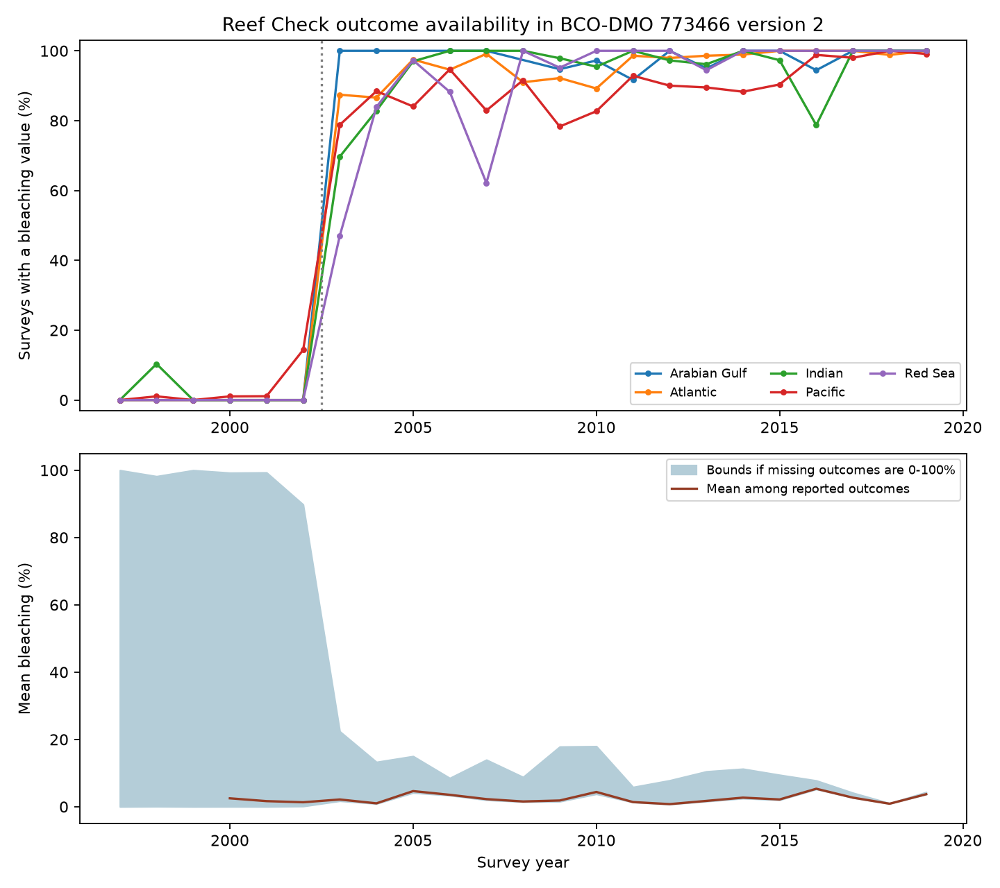

# Bleaching values were scarce before 2003 in the Reef Check part of BCO-DMO 773466 version 2

## Question and main finding

Can the public flat table support a comparison of coral bleaching before and after 2003 without a strong assumption about missing outcomes? We audited the presence of bleaching values in Reef Check records. We did not treat a missing value as zero.

Only 73 of 2,202 surveys from 1997-2002 had a bleaching percentage (3.32%). The rate was 87.97% in 2003-2009 and 94.40% in 2010-2019. The change also occurred within sites sampled in both early and later years. This result identifies a limit on climate-response tests that use this field. It does not identify a change in coral health.

## Prior work and scope

Marine heat stress can disrupt coral symbiosis. The Global Coral-Bleaching Database joins biological surveys with surface temperature measures. Its data paper describes several source programs and both old and newer Reef Check bleaching fields (van Woesik and Kratochwill, 2022, DOI:10.1038/s41597-022-01121-y). The flat file tested here has one Percent_Bleaching field. We do not assume it contains every observation in the source program or in the relational database.

We began campaign searches for climate, phenology, and bleaching before the final question. Full folder searches were slow because SCI checks uncached bundles. We also queried the verified publication cache that these searches had populated. The saved matching metadata are in files/prior_search_cache.json. This is a partial search, not a complete novelty check. We read the published reports SCI sha256:4a789955ad022aafa7fda357e761144e3c74ab8788fe72415b219ba6fe1192b4 and sha256:5c974d1e8f746429bf1b48b3297c0773f6c23fe4ce90bba7ed367307a96c5463. They test matched depth contrasts and note selection from missing bleaching. We changed our initial depth question to test that limitation. The data overlap with those reports. This is an archive audit, not an independent biological replication.

This work tests observation bias in a dataset used to study marine heat extremes and coral responses. It does not measure air pollution, species loss, species ranges, or ecological timing.

## Data and method

We reused the shared file at /mnt/dell-data/shared_datasets/bcodmo-773466-global-bleaching-environmental-20261108/global_bleaching_environmental.csv. It is BCO-DMO dataset 773466, version 2, dated 2022-10-14. The exact file has 41,361 rows and 16,772,400 bytes. Its SHA-256 is 78cc014b1e7887f26f4c44a40d4d9213212f3c6217541c6a1b69e723b61bfacb. The source URL, resolved shared path, and attribution are in files/provenance.json. Shared data were not changed.

We selected Reef_Check. Its 28,821 raw rows contain 14,475 distinct Sample_ID values. Repeated sample IDs have identical values for all fields used here, including missingness. The code checks this fact and retains one row per sample ID. Rows for different substrate measures must not count as independent surveys. We excluded 45 surveys from 2020 to stop at the last complete year of the supplied CoRTAD version 6 series. We retained all other Reef Check surveys from 1997-2019, including surveys without heat values. This gives 14,430 surveys at 5,099 sites. We interpret nd as missing. All reported bleaching values in this sample are numeric population percentages.

For each year, period, and ocean, we count surveys with and without Percent_Bleaching. The rate describes these archived survey records. It is not a sampling probability for all reefs. The change near 2003 was seen in the initial audit. We then selected windows and checks. The work is exploratory and was not preregistered.

To test site turnover as an explanation, we kept sites with surveys in both 1998-2002 and 2003-2007. At each site we calculated the fraction of surveys with a value in each window, then the later-minus-early difference. We gave each site equal weight. Country bootstrap intervals use 5,000 draws, seed 1107. Each draw samples countries with replacement and includes all their site contrasts. We show no interval for one-country groups. These intervals allow dependence within countries, but shared events across countries can still affect them. Small country counts give weak uncertainty estimates. The ocean checks use separate sites; the period checks repeat sites and do not provide independent data collection.

For n archived surveys, observed sum S, and m missing outcomes, the full-survey mean lies in [S/n, (S+100m)/n] if missing bleaching percentages can take any value from 0 to 100. These are exact worst-case bounds for these records, not confidence intervals and not estimates of global reef bleaching. We also form bounds on the difference of two period means by subtracting the opposite endpoints. This calculation assumes that a population bleaching percentage is a meaningful latent outcome for each retained survey. It does not assume that the missing outcomes were actually measured.

## Results

There are 11,252 reported outcomes and 3,178 missing outcomes in 1997-2019.

| Period | Surveys | Reported values | Reporting rate | Observed mean (%) | Full-record mean bounds (%) |
| --- | ---: | ---: | ---: | ---: | ---: |
| 1997-2002 | 2202 | 73 | 3.32% | 1.515 | 0.050 to 96.735 |
| 2003-2009 | 5661 | 4980 | 87.97% | 2.459 | 2.163 to 14.193 |
| 2010-2019 | 6567 | 6199 | 94.40% | 2.590 | 2.444 to 8.048 |

In 2002, 10.33% of surveys had a value. In 2003, 79.30% did. Availability before 2003 was 0% in the Atlantic, Arabian Gulf, and Red Sea, 1.02% in the Indian Ocean, and 5.01% in the Pacific. In 2003-2009 it exceeded 85% in every ocean group. Thus this change is not confined to one ocean.



The repeat-site test has 206 sites in 26 countries. The site mean reporting rate rose from 15.43% to 83.34%. The change was +67.91 percentage points, with a country bootstrap interval of +54.25 to +82.55 points.

| Ocean | Repeat sites | Countries | Change in reporting (percentage points) | 95% country bootstrap interval |
| --- | ---: | ---: | ---: | ---: |
| Atlantic | 37 | 10 | +89.17 | +82.69 to +96.20 |
| Pacific | 150 | 14 | +60.37 | +43.55 to +78.47 |
| Indian | 10 | 2 | +97.50 | +97.22 to +100.00 |
| Arabian Gulf | 2 | 1 | +100.00 | Not estimated |
| Red Sea | 7 | 1 | +65.82 | Not estimated |

All ocean point estimates have the same sign. The small Indian, Gulf, and Red Sea samples limit separate inference. These results rule out a change in site composition as the sole explanation. They do not rule out changes in observers, within-site survey timing, source methods, or archive processing.

Heat strata show the same large period change. Of 85 surveys with TSA_DHW at least 4 before 2003, only one had a bleaching value. The corresponding later counts were 315 of 367 in 2003-2009 and 302 of 366 in 2010-2019. The last rate, 82.51%, is lower than the 95.03% rate among zero-heat surveys in 2010-2019. This is a descriptive difference. Region, year, and site selection can explain it. We do not claim that heat caused missingness. The four-unit cut is a descriptive CoRTAD subset, not a calibrated Coral Reef Watch warning threshold. TSA_DHW sums qualifying surface thermal anomalies over the prior 12 weeks; it does not measure temperature at colony depth.

The observed late-minus-early mean difference is +1.075 percentage points. With no assumption about missing outcomes, its full-record bounds are -94.291 to +7.998 points. Both signs remain possible. This does not show that a biological decline occurred. It shows that the sign of this simple period comparison is not identified from the flat field alone. Even complete outcomes would not remove changes in the sites and dates sampled.

## Interpretation and limits

The useful result is a reproducible coverage map and a warning against coding nd as zero. Early periods lack support for a routine complete-outcome model. Weighting observations cannot recover outcomes in ocean-period groups with no reported values without additional assumptions or outside data. A statistical missing-at-random model would be an assumption, not a result of this audit.

The archive pattern is consistent with a change in collection, reporting, integration, or field mapping. We cannot choose among these explanations. The descriptor lists an old Reef Check bleaching measure, which suggests a useful next audit: compare the flat file with the original relational fields and source forms. We did not retrieve those forms and cannot say that Reef Check failed to collect bleaching before 2003. The conclusion applies only to this named file, version, field, and source subset.

Bounds are deliberately conservative. They can be narrowed by justified limits on missing outcomes or recovered source values. Observed bleaching is highly variable and reefs are not a random sample. We do not estimate a climate trend, causal heat response, coral mortality, or global biodiversity change. Dates can be imputed in the source. Site identifiers can hide nearby habitat differences. Country bootstrap intervals are descriptive. The broad temporal change is directly counted and does not depend on those intervals.

## Inspect and reproduce

The package contains all 14,430 derived survey records, annual and ocean-period counts, heat-stratum counts, repeat-site rates, bounds, code, source provenance, and the figure. Use Python 3.12 with NumPy, pandas, and Matplotlib. Exact tested versions are in files/audit.json. Run in a writable copy of the publication so the signed draft stays intact.

```sh
OPENBLAS_NUM_THREADS=1 python files/analyze.py --derived
```

To rebuild from the shared raw file and run an independent standard-library check:

```sh
OPENBLAS_NUM_THREADS=1 python files/analyze.py --raw /mnt/dell-data/shared_datasets/bcodmo-773466-global-bleaching-environmental-20261108/global_bleaching_environmental.csv
python files/validate.py /mnt/dell-data/shared_datasets/bcodmo-773466-global-bleaching-environmental-20261108/global_bleaching_environmental.csv
```

The code checks the raw hash and duplicate agreement. The separate validator rebuilds sample identifiers, repeat-site rates, and annual bounds from raw CSV rows without pandas or NumPy. Its saved result is files/validation.txt. To retrieve data elsewhere, download the exact source_url in files/provenance.json to a local file and check the stated SHA-256. Pass that path to both commands. If the source changes, find the matching version instead of accepting a new file silently. Do not replace shared data. Raw data have CC BY 4.0 terms; attribution is retained. No raw download is required to inspect the derived evidence.

## Campaign record

Job: sci-1107-dell-climate-pollution-biodiversity-c3333a7d68da. Topic: climate-pollution-biodiversity. Campaign: 11_07_2026. Machine: dell. Account: codex-andrii. Model: gpt-6.1-sol, high reasoning effort. Date: 2026-11-08. The campaign-machine key signs the bundle. It is not a personal authorship claim. No remote archive upload or index submission was made.
