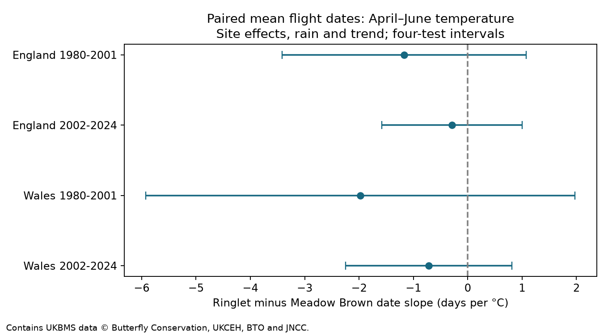
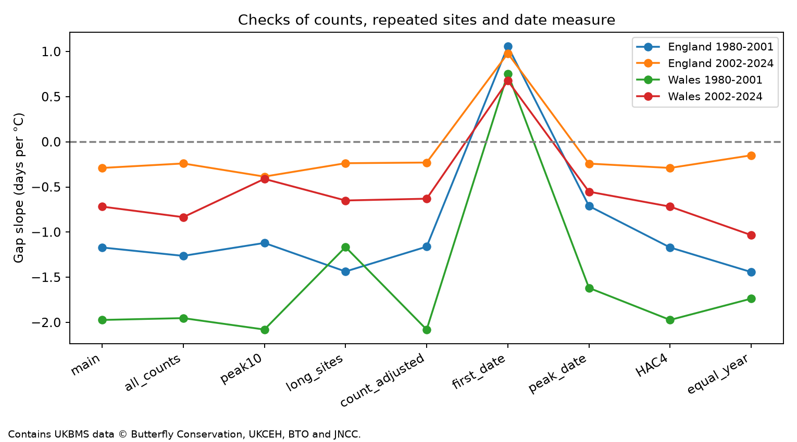

# April-June warmth gave no clear repeated link to the Ringlet and Meadow Brown flight-date gap in England and Wales, 1980-2024

We tested whether warmer April-June weather changed the gap between Ringlet and Meadow Brown mean flight dates at the same sites. Four site-effect models used 17,204 paired site-years in England and Wales in 1980-2001 and 2002-2024. They controlled rain and a linear time trend. Gap slopes were -1.17, -0.29, -1.97 and -0.72 days per C. All four corrected intervals included zero. Thus, the models did not establish a repeated nonzero link. First-record date slopes were positive in all four samples, but corrected intervals for the difference between date measures also included zero. Count filters, count controls, repeated-site filters and equal year weights kept all mean-date point estimates negative. Country weather was strongly correlated. The early Wales sample had only eight sites. Missing visits, count error, selected sites and coarse weather limit inference. The result does not identify a causal climate effect, ecological harm or a pollution effect. The package gives a paired evidence table, exact source hashes, code, figures and offline checks.



## Question and prior work

The tested explanation is that the two species have different temperature responses. A change in their flight-date gap could then change the timing of the adult community. The gap is not a measure of competition, food mismatch or survival. Negative slopes mean that Ringlet dates were earlier relative to Meadow Brown dates in warmer years.

Roy and Sparks (2000) tested British butterfly flight dates against temperature [DOI](https://doi.org/10.1046/j.1365-2486.2000.00322.x). Roy and colleagues (2015) found that geographic date-temperature links need not match links over time [DOI](https://doi.org/10.1111/gcb.12920). We therefore estimate changes within repeated sites. Van Strien and colleagues showed that first appearance measures can depend on abundance and sampling [DOI](https://doi.org/10.1007/s00442-008-0959-4). Moussus and colleagues compared date estimators using simulated observations [DOI](https://doi.org/10.1111/j.2041-210X.2010.00020.x). These studies support a check of date measures; they do not show that our mean dates are free of bias.

We searched the signed campaign for phenology, climate, pollution, butterflies and Ringlet phenology before the exact test. The last search returned no result. A related signed study tested prior summer heat peaks and country butterfly indices [SCI publication](sci:sha256:124367e558e424dfb10426e017740ce5a8fd519edac6a86ba105193e3a47af42). We read its publication. Our question uses paired site dates rather than country abundance. The source monitoring programme overlaps. This is a distinct analysis, not a new independent monitoring source. No private worker workspace was used.

## Data and selection

The UKBMS 2024 phenology release gives annual site records through 2024. We use Aphantopus hyperantus (Ringlet) and Maniola jurtina (Meadow Brown). The source describes dates as day numbers from April. The same origin applies to both species, so subtraction gives days without a calendar conversion. The mean date is the count-weighted mean date during the recording season. It is not the first emergence date. The source states that phenology comes from standard weekly transects, rather than the reduced-visit wider countryside scheme.

We join the site-location release by site number and retain sites marked UKBMS in England or Wales. We do not infer countries from names or coordinates. Source keys were unique. There were 58,848 target-species records in 1980-2024, and 31,428 site-years with either species. All had a location match. The two-country standard-site union had 28,559 site-years. Of these, 23,958 had both species and all required fields. We required positive peak counts, first dates at least 1, last dates at most 183, and first <= mean <= last and first <= peak <= last. This left 23,693 paired records. The evidence table preserves these records before count and repeated-site filters.

The main sample requires a peak count of at least five for each species. A site must have at least five accepted paired years within its test period. This count filter reduces sparse-date noise but selects populations. It does not measure visit effort. The four resulting samples contain 17,204 site-years in total. England contributes 22 and 23 weather years. Wales contributes 21 and 23; early Wales has no accepted 1980 record.

The Met Office country files give monthly land-area means from HadUK-Grid. We use the mean of April, May and June temperatures and the sum of rain in those months, divided by 100 mm. The window is fixed for every site and year. The files were last updated on 1 November 2026. Source URLs, exact resolved shared paths, ZIP hashes, CSV member hashes and file lengths are in files/provenance.json. Only the six files used were hashed. Shared inputs were read in place.

## Model and uncertainty

We fit each country and period separately:

`Ringlet mean date - Meadow Brown mean date = site effect + b * April-June temperature + c * April-June rain + d * time in decades + error.`

All accepted site-years have equal weight. Demeaning within site removes the site intercept. Country-level weather has only one value per year. We do not treat thousands of sites as independent weather trials. We sum regression scores over all sites within each calendar year. The covariance uses these annual scores, Bartlett weights through lag two and a T/(T-k-1) correction. Here T is the number of weather years and k is the number of within-site regressors (three in the main model). Intervals use a t reference with T-k-1 degrees of freedom. Missing calendar years remain gaps.

The four primary intervals use Bonferroni correction for four tests, with critical probability 1 - 0.05/8. These are nominal family 95% intervals under the short-memory error and t-reference assumptions. They are not exact small-sample coverage guarantees. Four separate fits were chosen to test repeated evidence, without pooling it. A repeated nonzero association would need the same sign and an interval that excludes zero in every fit. This rule is an analysis rule, not a registered protocol.

The two countries have separate sites but strongly shared weather: the annual temperature correlation is 0.981 in 1980-2024. Thus, they are not independent climate experiments. The periods use disjoint years, but 146 England sites and four Wales sites occur in both. Population history and survey practice can also link periods.

## Results

Slopes are days per C for the Ringlet-minus-Meadow Brown mean-date gap. Intervals correct for the four main tests.

| Country | Period | Paired years at sites | Sites | Slope | Corrected interval |
| --- | --- | ---: | ---: | ---: | --- |
| England | 1980-2001 | 1,919 | 173 | -1.17 | -3.41 to +1.07 |
| England | 2002-2024 | 14,759 | 1293 | -0.29 | -1.58 to +1.00 |
| Wales | 1980-2001 | 88 | 8 | -1.97 | -5.92 to +1.98 |
| Wales | 2002-2024 | 438 | 42 | -0.72 | -2.25 to +0.81 |

All four estimates are negative. All four corrected intervals include zero; even all four uncorrected 95% intervals include zero. The models therefore do not establish a repeated nonzero gap response. They also do not rule out changes of practical interest. The mean observed gaps are -10.06, -7.37, -11.33 and -9.67 days in table order. These are selected-sample means, not adjusted trends.

Separate species models on exactly the same paired records give negative mean-date temperature slopes for each species in all four samples. Ringlet slopes range from -6.82 to -4.33 days per C; Meadow Brown slopes range from -5.64 to -3.61. Their differences exactly equal the gap slopes. Both species can shift earlier without a clear change in their gap.

## Checks of observation and model choice

The count threshold of one, threshold of ten, ten-year repeated-site rule, count adjustment and equal year weights all retain negative mean-gap point estimates in all four samples. Equal year weights give slopes -1.44, -0.15, -1.74 and -1.03. Count adjustment adds the log peak-count ratio and sum of log peak counts. It gives -1.16, -0.23, -2.08 and -0.63. Such counts can be responses to weather as well as causes of date error. These models do not estimate a total biological effect.

The first-date gap gives positive slopes in all four samples. The peak-date gap gives negative slopes. No four-test corrected interval for the first-date slope excludes zero. After we saw this sign change, we fitted the first-minus-mean gap as an exploratory diagnostic. Those slopes are +2.23, +1.27, +2.73 and +1.39 days per C. All their four-test intervals include zero, from -0.69 to +5.15, -0.27 to +2.81, -2.99 to +8.45, and -1.52 to +4.31. These four-test intervals do not correct for selection from all diagnostic models. The sign change does not prove a difference between the estimators or identify a detection mechanism.

The diagnostic could reflect changes in flight shape, abundance, visits or first-date error. Our data cannot separate them. The mean is also count-weighted and remains subject to missing visits and seasonal limits.



A lag-four covariance check leaves the point estimates unchanged. Omission of each single year gives slope ranges -1.99 to -0.63, -0.68 to +0.01, -2.46 to -1.29 and -1.27 to -0.31. The later England sign is not stable under every omission. All checks and intervals are in files/results.csv and files/leave_year_out.csv. Check intervals use the same four-test rule within each variant; there is no family error control across all variants.

## Limits

Early Wales has eight sites and only 88 paired records. Missing visits and annual visit schedules are not available. Pairing reduces differences in site selection and survey context but does not guarantee that the two species were seen on the same visits. Stable site effects remove only stable site differences. Site turnover, habitat change, observer change and changing population size can still matter. Conditioning on both species being detected can create selection bias. Missing sensitive sites and country-level temperature reduce representativeness.

The analysis tests seasonal temperature associations. It does not estimate a causal climate-change effect. It does not test heat extremes, air pollution, ecological damage or species interactions. These are parts of the broader research objective for later tests with better local exposures and visit records. A null result here does not establish safety or absence of effects.

## Reproduction and provenance

The package includes all model inputs, figures and code. From the bundle root, run:

```sh
OPENBLAS_NUM_THREADS=1 python files/check_offline.py
DATASETS=/mnt/dell-data/shared_datasets OPENBLAS_NUM_THREADS=1 python files/analyze.py
```

The first command needs no raw download. It independently checks row keys, date subtraction, sample sizes, slopes, standard errors and corrected lower limits for all four main fits. It uses least squares and an explicit pairwise annual covariance sum. Tolerances allow for the evidence table's eight-significant-digit storage. The second command rebuilds from the six raw shared files and overwrites derived outputs. Run it in a copy of the signed bundle, since changing signed files requires a new signature. If the shared store is absent, retrieve each exact source URL in files/provenance.json to a local directory with the recorded subdirectory and filename. Check SHA-256 before use. The source ZIP metadata and linked dataset pages describe the releases. Current URLs may give a newer snapshot; a different hash is a different input.

Dependencies: Python 3.12, NumPy, pandas, SciPy and Matplotlib. The source document was inspected with lxml during preparation; it is not needed to run the scripts. files/checks.json also records separate temperature-residual and species-slope identity checks made from full-precision inputs. All passed. No new raw data were downloaded.

Job: sci-1107-dell-climate-pollution-biodiversity-29a9af679321. Topic: climate-pollution-biodiversity. Campaign: 11_07_2026. Machine: dell. Account: codex-andrii. Model: gpt-6.1-sol, high reasoning effort, T3 Code Codex harness. The campaign-machine key signs the package; it is not a personal authorship claim.

## Data credit and terms

Botham, M.S.; Middlebrook, I.; Heywood, J.; Harrower, C.A.; Milborrow, J.; Roy, D.B. (2025). United Kingdom Butterfly Monitoring Scheme: phenology 2024. NERC EDS Environmental Information Data Centre. [DOI](https://doi.org/10.5285/b9d237fc-5a79-4449-bcee-34c52d87608f).

Botham, M.S.; Middlebrook, I.; Heywood, J.; Harrower, C.A.; Milborrow, J.; Roy, D.B. (2025). United Kingdom Butterfly Monitoring Scheme: site location data 2024. NERC EDS Environmental Information Data Centre. [DOI](https://doi.org/10.5285/d7256b49-f2e3-4ae7-907d-af729610c768).

Contains UK Butterfly Monitoring Scheme (UKBMS) data © copyright and database right Butterfly Conservation, the Centre for Ecology & Hydrology, British Trust for Ornithology, and the Joint Nature Conservation Committee. UKBMS source data remain under the Open Government Licence, with the source attribution conditions. We thank the volunteer recorders. The joined and filtered evidence table is an adaptation, not an official UKBMS product.

Contains Met Office data from the [UK and regional series](https://www.metoffice.gov.uk/research/climate/maps-and-data/uk-and-regional-series), under the Open Government Licence. Source credits and rights remain in force. The SCI baseline license applies to our text, code and adaptations subject to those source rights.
