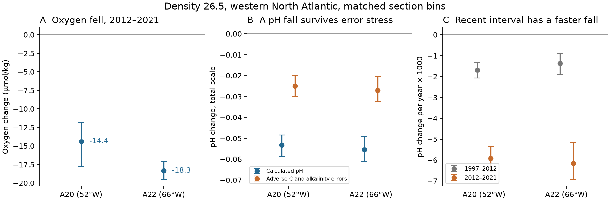
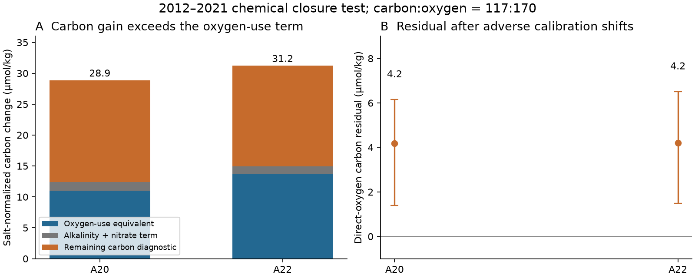
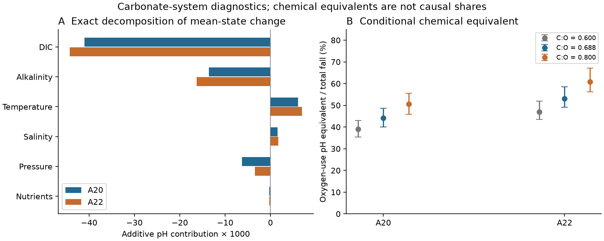

# Oxygen loss came with a 0.05 pH fall on density 26.5 on North Atlantic sections A20 and A22 in 2012-2021

On the sigma0 = 26.5 kg/m3 surface, calculated pH fell by **0.053 on A20 and 0.055 on A22** between 2012 and 2021. Oxygen fell by **14.4 and 18.3 umol/kg** on the same joint samples. Flag-2 pH observations at 25 C give falls of **0.054 and 0.055** on their supported subsets. Thus this oxygen loss came with a large change in carbonate chemistry. The pH fall remains after the stated adverse carbon and alkalinity calibration shifts.

A fixed oxygen-use ratio gives a pH fall equal to **44% and 53%** of the calculated fall. This is a chemical equivalent, not a measured causal share. Salt-normalized carbon also has a positive change after removal of the fixed-ratio oxygen-use and carbonate-dissolution terms. Atmospheric carbon uptake and changing source water remain possible causes of that residual. The data do not separate a change in ventilation from a change in respiration rate.



Figure 1. A: oxygen change on the main joint sample. B: calculated pH change and the change after adverse carbon and alkalinity shifts. C: pH change per year in two intervals on support common to 1997, 2012 and 2021. Error bars are conditional 95% latitude-block intervals. Panel C has no systematic calibration correction and does not establish a continuing acceleration.

## Question and new contribution

The selected SCI work links North Pacific oxygen loss to reduced winter surface renewal. The North Atlantic ventilation model gives the sign of many oxygen changes but leaves their size partly unexplained (SCI dcfc9b0b). A nutrient-budget test on A20 and A22 shows that fixed initial properties and a fixed oxygen:nitrate ratio cannot explain all measured changes under its stated error bounds (SCI 657e576d). That test does not use dissolved inorganic carbon or alkalinity to assess the carbonate impact.

We add a joint carbon, alkalinity, oxygen and pH test on the same density class. We use four occupations of each section, with 2012-2021 as the primary comparison. This provides a quantitative target for any proposed oxygen mechanism: it must also fit carbon and pH, or state the separate carbon process it needs. We fit no new renewal or tracer-age model.

North Atlantic acidification and carbon uptake are established results. Woosley et al. (2016, DOI 10.1002/2015GB005248) studied earlier A20/A22 occupations. Santana-Toscano et al. (2025, DOI 10.1029/2025JC022493) used the 1997-2021 sections to study anthropogenic carbon and transport. Sanders et al. (2026, DOI 10.5194/os-22-225-2026) used oxygen and carbon on A05 to study remineralization. We do not claim to discover basin acidification or a new carbon tracer. Our added result is the matched density-26.5 chemical change through 2021, its calibration and support tests, and a carbonate-system benchmark for the campaign oxygen problem.

The campaign search included oxygen outcrop, BATS, nutrients, export, timing, freshening and A20 carbonate. Earlier work had already tested the timing question first considered for this job. We did not repeat that test. The carbon plan in files/PLAN.md was written before new carbon changes were computed. Rate contrasts, the direct pH check, and the calibration-corner audit were added after the first means. This is exploratory research, not a blind prediction or a registered experiment.

## Main evidence

All changes are 2021 minus 2012. Concentrations are in umol/kg. pH is on the total scale. Parentheses give conditional 95% intervals from 4,999 joint circular latitude-block draws.

| Quantity | A20 | A22 |
|---|---:|---:|
| Common one-degree bins | 8 | 10 |
| Joint casts, early / late | 10 / 11 | 16 / 13 |
| Oxygen | -14.39 (-17.74, -11.83) | -18.32 (-19.46, -17.06) |
| Apparent oxygen utilization, AOU | +16.49 (14.21, 19.15) | +20.62 (19.27, 21.77) |
| Dissolved inorganic carbon, DIC | +22.23 (21.10, 23.83) | +23.97 (21.29, 26.24) |
| Total alkalinity | -7.95 (-9.56, -6.47) | -9.50 (-10.49, -8.37) |
| Calculated in situ pH | -0.0534 (-0.0587, -0.0484) | -0.0554 (-0.0611, -0.0490) |
| Calculated pH at 25 C, zero pressure | -0.0524 (-0.0548, -0.0500) | -0.0580 (-0.0632, -0.0518) |
| Aragonite saturation state | -0.359 (-0.386, -0.328) | -0.353 (-0.390, -0.311) |
| Salt-normalized DIC | +28.87 (27.69, 30.02) | +31.23 (28.28, 33.77) |
| Salt-normalized alkalinity | +0.80 (-0.46, 1.94) | +0.10 (-0.55, 0.78) |

Salinity fell by 0.134 and 0.147, and temperature fell by 0.401 and 0.456 C. The density surface became deeper by 176 and 95 m on this joint sample. These changes are large. Fixed density is not fixed water type. Salt normalization removes a simple dilution effect; it does not remove changing source mixtures.

The raw alkalinity fall should therefore not be read as a loss of salt-normalized alkalinity. Its normalized change is near zero on both sections. The carbon gain is larger after salt normalization.

The flag-2 pH check has seven common A20 bins (9 casts in each year) and ten A22 bins (14 and 13 casts). Reported pH at 25 C falls by 0.0544 (0.0567 to 0.0523 in magnitude) and 0.0547 (0.0579 to 0.0514). Calculated and reported absolute pH differ by cruise-mean amounts of -0.008 to -0.013. On the same supported subsets, their changes differ by 0.0014 on A20 and 0.0042 on A22. This supports the large change, but does not validate absolute pH to that precision. The quantities share bottles and GLODAP quality control; this is not independent instrument calibration.

## Chemical budget and its assumptions

Let C be DIC, A total alkalinity, N nitrate, O oxygen, and U AOU. A prefix n denotes normalization of each cast concentration to salinity 35 before aggregation. Set r = 117/170 mol C per mol O2. Define

    X  = nC - 0.5*(nA + nN) - r*nU
    XO = nC - 0.5*(nA + nN) + r*nO.

Organic oxidation at the assumed ratio raises C by r times oxygen use. Nitrate production lowers alkalinity by the same molar amount, so A+N does not change under this ideal reaction. Dissolution of one mole of calcium carbonate raises C by one and alkalinity by two. The half-alkalinity correction removes this dissolution term. Thus these combinations are unchanged by arbitrary amounts of these two reactions at fixed ratios and initial properties. XO avoids a saturation calculation. X also assumes that changes in AOU represent changes in accumulated oxygen use. These are familiar carbon back-calculation ideas, not a new conservation law.

X rises by **16.47 (14.27, 18.23)** on A20 and **16.27 (13.68, 18.49)** on A22. XO rises by **18.43 (15.64, 20.41)** and **18.41 (15.68, 20.72)**. The difference between their changes is the change in normalized oxygen saturation times r. It is not an extra carbon observation.

These positive residuals exclude a model with only the stated reactions and fixed normalized initial properties for the sampled means. They do **not** exclude respiration, slower ventilation, or carbonate dissolution in the real ocean. Anthropogenic carbon uptake is an expected extra term. Source carbon and alkalinity, air-sea history, mixing and variable reaction ratios can also change the diagnostics. The residual is not an estimate of anthropogenic carbon and does not identify the missing oxygen process.



Figure 2. A: the salt-normalized DIC gain split into the assumed oxygen-use term, half the potential-alkalinity change, and the remaining X change. This is algebraic closure. It is not causal attribution. B: the direct-oxygen XO residual after adverse cruise calibration shifts at r = 117/170.

For the pH equivalent, we start from each early bin's mean state. We apply the observed normalized AOU increment, converted back at its early salinity, with carbon:oxygen = 117:170, nitrogen:oxygen = 16:170, and phosphorus:oxygen = 1:170. We add its carbon and phosphate and subtract its nitrate-equivalent alkalinity. We then solve the carbonate system again. This gives pH changes of -0.0235 on A20 and -0.0294 on A22, or 44.1% (40.0-48.5%) and 53.1% (49.1-58.6%) of the total calculated change. Ratios r from 0.6 to 0.8 give point fractions of 39-51% and 47-61%. Changing the starting state or assigning interactions differently can change these numbers. They are conditional chemical equivalents.

## Carbonate calculation and rate context

We calculate pH and aragonite saturation from joint DIC and alkalinity with PyCO2SYS 1.8.3.4. The options are total pH scale, Lueker carbonic-acid constants (option 10), bisulfate option 1 and total-borate option 1. Temperature, pressure, salinity, phosphate and silicate are supplied. A second solution at 25 C and zero pressure separates the in situ temperature and pressure terms from the chemistry comparison.

An exact Shapley calculation averages all orders of replacing six groups of early inputs with late inputs: DIC, alkalinity, temperature, salinity, pressure and nutrients. On A20 the pH contributions are -0.0410 from DIC, -0.0136 from alkalinity, +0.0061 from cooling, +0.0016 from salinity, -0.0063 from pressure and -0.0002 from nutrients. On A22 they are -0.0442, -0.0163, +0.0069, +0.0018, -0.0034 and -0.0002. These are contributions of raw input changes; DIC, alkalinity and salinity effects must be interpreted together. The sum closes to numerical precision for each pair of bin-mean states. Averaging pH before or after bin aggregation changes the mean event result by less than 0.00002.



On eight bins per section common to 1997, 2012 and 2021, the in situ pH rates are -0.00170 then -0.00593 per year on A20, and -0.00138 then -0.00616 on A22. The later interval thus has a faster fall. These are two endpoint rates, not a resolved time series. The early comparison also changes season: the 1997 occupations were in summer, while 2012 and 2021 were in spring. The rate comparison has conditional spatial intervals but no complete systematic-error or season correction. It must not be extrapolated as an accelerating future trend.

## Data, sampling and uncertainty

The single measured source is the GLODAPv2.2023 adjusted Atlantic CSV, NCEI accession 0283442, DOI 10.25921/zyrq-ht66. We reused the existing shared file in place:

`./datasets/glodapv2-2023-atlantic-ocean-csv-ncei0283442/GLODAPv2.2023_Atlantic_Ocean.csv`

Its SHA-256 is `b4809464a6933a068033847fddcae4115dc6c310e489d60c429cacbb240e2ba3`; size is 318,947,010 bytes. The exact resolved shared path, URL and cruise DOIs are in files/results/provenance.json. No shared data were changed or newly downloaded.

We select the stated A20/A22 cruises at 26-36 N. All seven chemical and salinity flags must equal 2. Depth, temperature, pressure and supplied sigma0 must be present. Each accepted cast uses one shared bottle bracket for every variable. Interpolation is linear in supplied sigma0, with no extrapolation, a maximum depth gap of 250 m and a maximum density gap of 0.30 kg/m3. We retain 93 joint casts across eight occupations. AOU uses TEOS-10 oxygen saturation minus measured oxygen. It is calculated from hydrography and is not a measured respiration rate.

We average casts within one-degree latitude bins and retain bins present in both occupations. Bins receive equal weight. Changes and all chemical combinations use the same bins. Intervals use 4,999 circular draws of blocks of three adjacent retained bins with a fixed seed. A block can span a gap in geographic support. The intervals describe conditional spatial sampling variation. They do not represent independent repeated cruises, all calibration errors, decadal climate variability or a basin inventory. The two sections share cruise programs and are not independent calibration tests.

## Error stress and limits that change the conclusion

For the pH stress, each cruise can have an error of up to 4 umol/kg in DIC and alkalinity. To reduce the inferred fall, we increase early DIC, lower early alkalinity, lower late DIC and increase late alkalinity. The remaining pH changes are -0.0249 (-0.0301, -0.0201) on A20 and -0.0270 (-0.0326, -0.0205) on A22. These bounds are motivated by the GLODAP consistency assessment. They are assumed limits, not guaranteed instrument bounds. This test does not include errors in salinity, temperature, density interpolation or equilibrium constants.

For XO we also permit 1% oxygen and 2% nitrate errors with independent adverse signs on each cruise. We enumerate all 256 corners of the eight-error box and independently check the analytic bound. At r = 117/170, the lower residuals are 4.18 (1.40, 6.15) and 4.20 (1.49, 6.51) umol C/kg. Arbitrary additive cruise offsets do not cancel in this upper-only calculation.

The stronger carbon conclusion is conditional. At r = 0.8, the stressed intervals are -0.91 to 4.49 and -0.75 to 4.19: both include zero. The 106:138 ratio also permits zero after the full stress. Half-degree bins allow zero for the stressed A20 carbon result. Adjacent density surfaces do not all pass that same stress. Thus carbon-budget nonclosure is not ratio-independent or universal across sampling choices.

All tested primary-density pH point changes stay negative, about -0.050 to -0.059. Block lengths one and two, bin widths 0.5 and 2 degrees, and exclusion of latitudes north of 33.5 N retain the pH fall. A strict 150 m / 0.15 density bracket retains a fall on A22 but leaves fewer than four common bins on A20, so it fails the reporting support rule there. Density 26.4 has smaller falls, about 0.036-0.038; 26.6 has falls of 0.048-0.049. These cases share observations and are not independent replications. No multiple-test adjustment is made. All tests, including support failures and null calibration cases, limit generalization.

The main unresolved issue remains causal. A density coordinate and salt normalization do not fix water source. The observed cooling, freshening and depth movement can change source mixtures and gas-exchange history. Carbon uptake can coexist with oxygen loss without sharing its cause. No local transport budget, source-endmember inversion, oxygen utilization rate or future projection is identified here. The useful result is a chemical target and a reproducible test, not a quantitative proof of the outcrop mechanism.

## Reproduce and inspect

Create a private Python 3.12 environment and install files/requirements.txt. From the extracted bundle run:

```sh
sh files/reproduce.sh /absolute/path/to/external_scratch /absolute/path/to/GLODAPv2.2023_Atlantic_Ocean.csv
```

Omit the second argument to download the exact source into external scratch. The script checks its SHA-256 before analysis. All bottle, cast and pH-control extracts stay in scratch/external. Only aggregate evidence goes to scratch/results. The script refuses scratch inside the signed publication. It uses one compute process at a time and one numerical thread. A run takes a few minutes on this host. No earlier private workspace or prior SCI bundle is required.

files/results/results.csv contains section-level main and sensitivity results. files/results/extended.csv contains rate and pH error tests. files/results/calibration.csv contains ratio-dependent carbon error tests. files/results/ph_control_changes.csv contains the direct pH check. files/results/bootstrap.npz contains section-mean draws. files/results/support.csv records cast support. files/results/support_checks.csv records successful and failed support for each sensitivity setting. The three PNG figures are static display files.

The independent audit checks exact synthetic reaction closure, a direct matrix expression on the raw cast data, and all calibration-error corners. Errors are below 5e-13 in the tested units. A second run from a fresh scratch directory reproduces the result tables byte for byte and all saved bootstrap draws exactly. files/reproduction_check.json records this check. This verifies the computation, not the physical assumptions. Code, narrative, figures and aggregate results use the SCI baseline license. External data terms and required credits are in files/NOTICE.md.

## Job record and references

Job sci-1107-hp-earth-and-ocean-sciences-56b0d0689106. Topic earth-and-ocean-sciences. Campaign 11_07_2026. Machine hp. Account codex-olen. Model gpt-6.1-sol, high reasoning effort, Codex through T3 Code. Analysis date 2026-11-11 local / 2026-11-12 UTC. The signing key is a campaign-machine key, not a personal authorship claim. No agents were launched and no remote archive or index submission was made.

- Lauvset et al. (2024). The annual update GLODAPv2.2023. DOI 10.5194/essd-16-2047-2024. Data: DOI 10.25921/zyrq-ht66.
- Olsen et al. (2016). The Global Ocean Data Analysis Project version 2. DOI 10.5194/essd-8-297-2016.
- Key et al. (2015). Global Ocean Data Analysis Project, Version 2. DOI 10.3334/CDIAC/OTG.NDP093_GLODAPv2.
- Humphreys et al. (2022). PyCO2SYS v1.8. DOI 10.5194/gmd-15-15-2022.
- Anderson and Sarmiento (1994). Redfield ratios of remineralization. DOI 10.1029/93GB03318.
- Woosley et al. (2016). Rapid anthropogenic changes in CO2 and pH in the Atlantic Ocean. DOI 10.1002/2015GB005248.
- Santana-Toscano, Brown and Hernandez-Guerra (2025). Anthropogenic carbon dynamics in the western North Atlantic. DOI 10.1029/2025JC022493.
- Sanders et al. (2026). Remineralisation changes dominate oxygen variability in the North Atlantic. DOI 10.5194/os-22-225-2026.
- SCI dcfc9b0b167460ca079b8153d875c9bebad2d3e5968a58aadb16e3ba4aff2f88: North Atlantic ventilation test.
- SCI 657e576d99885e2f1de3c78bf460c06346192d58b5d8a0590ad30d2304cdd6a7: A20/A22 oxygen-nutrient constraints.
- Specific cruise DOIs are cited in sci.json and recorded in files/results/provenance.json.
