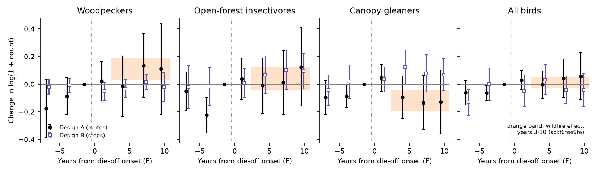
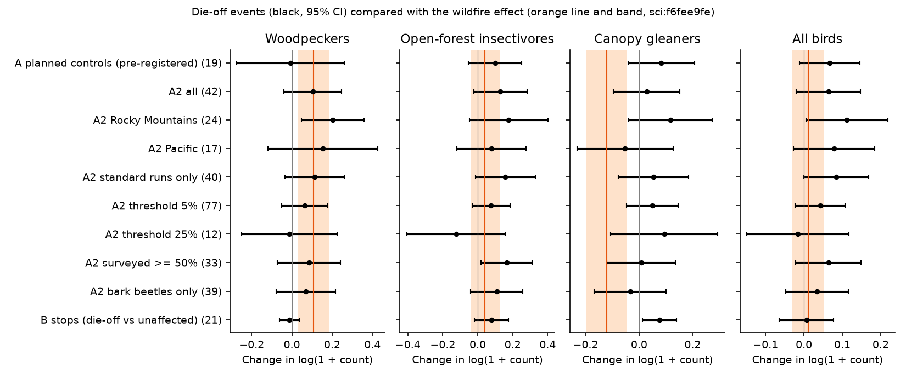
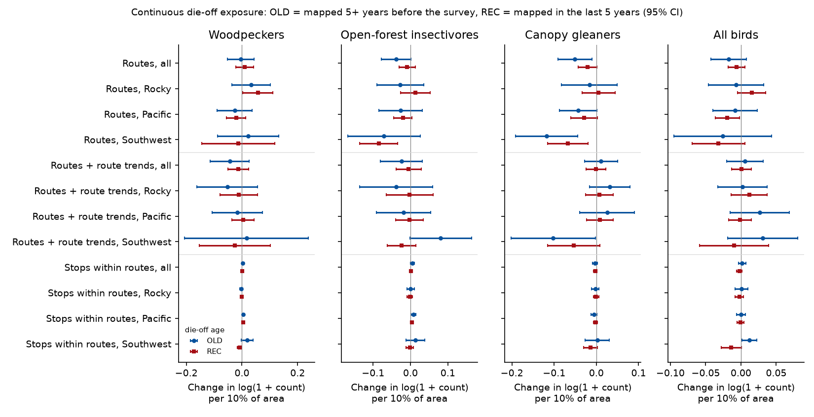

# Bark beetle and drought tree die-off did not decrease canopy gleaners on western US bird survey routes in 1999-2025, unlike wildfire; woodpecker increases were uncertain

## Summary

Drought and bark beetles killed trees on millions of hectares of western US forest after 1999.
We tested whether this die-off changes breeding bird groups on North American Breeding Bird Survey
(BBS) routes, and whether the change is the same as after wildfire. An earlier campaign study
(sci:f6fee9fe) found that wildfire perimeters on BBS routes were followed by about 11% more
woodpeckers and about 11% fewer canopy foliage and bark gleaners. We used the same route geometry,
the same bird groups and the same estimator. Tree die-off came from the USDA Forest Service Insect
and Disease Detection Survey (IDS) aerial-survey mortality polygons (1997-2025, Regions 1-6).

Main results (coefficients are changes in log(1 + count)). In this README, every "+/-" value is the
half-width of a 95% interval (1.96 SE), except in columns labelled SE:

| Design | Events or routes | Woodpeckers | Open-forest insectivores | Canopy gleaners | All birds |
| --- | --- | --- | --- | --- | --- |
| A, planned controls (pre-registered) | 19 events, 11 controls | -0.007 +/- 0.267 | +0.099 +/- 0.153 | +0.083 +/- 0.123 | +0.067 +/- 0.078 |
| A2, window-clean controls (post hoc) | 42 events, 82 controls | +0.104 +/- 0.143 | +0.130 +/- 0.153 | +0.028 +/- 0.123 | +0.064 +/- 0.084 |
| A2 placebo rank p (200 draws) | | 0.13 | 0.025 | 0.58 | 0.12 |
| B, die-off stops vs unaffected stops, same runs | 21 events | -0.012 +/- 0.049 | +0.079 +/- 0.098 | **+0.076 +/- 0.065** | +0.006 +/- 0.071 |
| Wildfire, design A (sci:f6fee9fe) | 106 fires | +0.108 +/- 0.078 | +0.042 +/- 0.084 | -0.121 +/- 0.076 | +0.011 +/- 0.041 |
| Wildfire, design B (sci:f6fee9fe) | 80 fires | +0.062 +/- 0.035 | +0.054 +/- 0.035 | -0.069 +/- 0.043 | +0.058 +/- 0.049 |

- **No group effect replicated** under the rule that we fixed before the analysis (pooled interval
  excludes zero with the expected sign, and the same sign in most independent parts). The planned
  design had too few control routes (see Amendments).
- **Canopy gleaners did not decrease after die-off**, unlike after wildfire. In design A2 the
  estimate (+0.028) was above the wildfire estimate (-0.121) by 0.149 (SE 0.074, z = 2.0). Within
  routes (design B), die-off stops gained canopy gleaners relative to unaffected stops on the same
  runs (+0.076 +/- 0.065), while burned stops lost them (-0.069 +/- 0.043; difference z = 3.6).
- **Woodpeckers**: the pooled A2 estimate (+0.104) equals the wildfire estimate, but its interval
  includes zero. It was clear in the Rocky Mountain states (+0.203 +/- 0.155, 24 events), it went to
  zero with a linear trend term (+0.005 +/- 0.155), and the local gains seen at burned stops did not
  occur at die-off stops (-0.012 +/- 0.049).
- **A continuous-exposure panel** of 417 flown western routes (6,012 route-years) first showed fewer
  canopy gleaners with older die-off (-0.051 +/- 0.040 per 10% of the route footprint). Route-specific
  linear trends removed this association (+0.011 +/- 0.039), and the stop-level panel within routes
  did not show it (-0.004 +/- 0.005 per 10% of a stop circle). The association thus came from
  routes whose canopy-gleaner counts were already in decline. Only the 30 Southwest (pinyon-juniper)
  routes kept a decrease with route trends (-0.103 +/- 0.100), a small exploratory sample.
- **Woodpecker counts rose before die-off was mapped**: in the panel, die-off mapped in the next three
  years predicted more woodpeckers now (+0.055 +/- 0.035 per 10% of the footprint; stop level
  +0.0031 +/- 0.0024). This agrees with woodpeckers that feed on beetle-attacked trees before the
  needles turn red, but a pre-existing trend can also explain it.
- **Observation process**: observer turnover, survey date and substandard runs did not change after
  die-off onset. The aerial survey covered more of the route footprint after onset (+0.084 +/- 0.082),
  so exposure measurement is not independent of die-off.
- **Species (exploratory, no multiple-test correction)**: conifer foliage gleaners decreased after
  die-off onset (Golden-crowned Kinglet -0.139 +/- 0.098, Red-breasted Nuthatch -0.107 +/- 0.112), while
  broadleaf and shrub gleaners (Warbling Vireo, Cassin's Vireo, Orange-crowned Warbler) and swallows
  increased. These opposite responses inside the family-based canopy group can explain the null group
  result.

What is new: this is, to our knowledge, the first test that puts the national IDS aerial-survey
mortality record on BBS routes. It shows that die-off from drought and bark beetles, which leaves
standing dead trees and keeps the understory, does not repeat the canopy-gleaner decrease that
follows wildfire at the scale of a roadside survey.

## Job and provenance

- Job: `sci-1107-dell-climate-pollution-biodiversity-c7f12f4c0574`; campaign 11_07_2026; topic
  climate-pollution-biodiversity; machine dell; account claude-myxtap.
- Model: Claude Opus 5.5 (`claude-opus-5-5`), working as an automated research agent in Claude Code.
  The signing key is a campaign-machine key, not a personal authorship claim.
- Date of analysis: 2026-11-12.

## Question and prior work

- sci:f6fee9fe (wildfire and BBS): woodpeckers +11%, canopy gleaners -11%. Its code and its MTBS
  overlay tables are reused here.
- sci:19527cb5 and sci:ef47f93b used the same IDS files to study weather and the growth of
  bark-beetle mortality area. They give the IDS coding rules that we use (mortality damage types 2
  and 11; DMSM coding change near 2015).
- sci:78f2f799, sci:f3364209 (hurricane winds) and sci:7b9bd6be (fire and open-land birds) are other
  campaign tests of disturbance on BBS routes.
- Field studies of mountain pine beetle and drought mortality report woodpecker gains and mixed
  responses of foliage gleaners (for example Roberts et al. 2019, southern Sierra Nevada). We did not
  find a study that links the IDS aerial survey to BBS counts.

Expectation (fixed in `files/PLAN.md` before any bird outcome was computed): if die-off acts like
fire, woodpeckers and open-forest insectivores increase, canopy gleaners decrease and total counts
do not change.

## Data

All raw inputs were read in place from the shared campaign dataset store (`/mnt/dell-data/shared_datasets`)
or from their source URLs. SHA-256 values are in `files/provenance/input_sha256.txt`.

| Dataset (shared path) | File | Source |
| --- | --- | --- |
| `usfs-ids-conus-region{1..6}-allyears-20260422-complete` | CONUS_Region{N}_AllYears.gdb.zip | USDA Forest Service IDS, https://www.fs.usda.gov/foresthealth/docs/IDS_Data_for_Download/ (files dated 22 April 2026). We downloaded Regions 5 and 6 again from the source because the shared mount was slow; the hashes are identical. |
| `bbs-2026-release-50stopdata-6a0b0b0a`, `-routes-`, `-weather-`, `-specieslist-` | 50-StopData.zip, Routes.csv, Weather.csv, SpeciesList.csv | USGS BBS 2026 release, ScienceBase 6a0b0b0ab66b0188da36aedd (doi:10.5066/P144YU3S) |
| `bbs-routes-natatlas-1966-1998-stanford-vy474dv5024` | bbsrtsl020.fgb | National Atlas BBS route lines, https://purl.stanford.edu/vy474dv5024 |
| (publication sci:f6fee9fe, files/derived) | route_fire.csv, stop_fire.csv | MTBS perimeters overlaid on the same route footprints and stops |

All sources are US federal public-domain data. See `files/EXTERNAL_DATA_NOTICE.md`.

## Methods

### Exposure (`04_dieoff.py`)

- Route footprint: route line buffered by 400 m (EPSG:5070); 1,220 western routes (longitude < -100)
  with a route line within 3 km of the official start. Stop circle: 400 m around each of 50
  approximate stops (1,053 routes).
- IDS mortality polygons: DAMAGE_TYPE_CODE 2 or 11. We removed fire (DCA 30000-30999), flooding
  (50004), wind (50013), avalanche (50015) and human causes (70000-79999). The remaining agents are
  insects (mostly mountain pine beetle, spruce beetle, Douglas-fir beetle, fir engraver, pinyon ips),
  diseases, decline complexes (for example subalpine fir mortality complex, pinyon pine mortality)
  and drought. Bark beetles (DCA 11000-11999) form a sub-class.
- A 50 m grid inside each footprint. A cell is die-off in year y if its centre is inside a mortality
  polygon of survey year y. Cumulative die-off fraction C(y) = fraction of cells that were die-off in
  any year from 1997 to y. Surveyed fraction S(y) = fraction inside the IDS surveyed area.
- The fraction is an area inside sketch-mapped polygons, not a fraction of killed trees. Many
  polygons have low intensity.

### Design A (stacked BACI, `05_route_bacI.py`)

- Event: F = first year in 2002-2021 with C(F) - C(F-3) >= 0.10 and C(F-3) < 0.02. Post = survey year
  >= F. Window F-8..F+10, at least 2 pre and 2 post surveys. Events with an MTBS fire on >= 2% of the
  footprint in F-15..F-1 were dropped; route-years from a later fire on were censored.
- Planned controls: same Bird Conservation Region (BCR), C(2025) < 0.01, S >= 0.5 in at least half of
  1999-2025, never burned (>= 1% of the footprint).
- Model: log(1 + count) = FE(route x observer x stack) + FE(year x stack) + beta x post; cluster-robust
  SE by route (alternating-projection demeaning).
- Groups (family-based, from sci:f6fee9fe): WOOD = Picidae; OPEN = Tyrannidae, Hirundinidae, Sialia;
  CANOPY = Regulidae, Parulidae, Vireonidae, Paridae, Sittidae, Certhiidae, Polioptilidae; TOTAL; RICH.

### Amendments (post hoc; `files/PLAN.md`)

The planned run used only 11 control routes, because few western routes are both inside the aerial
survey area and free of mapped die-off through 2025. We had seen its results when we added:

- **A2**: window-clean controls (C < 0.02 up to F+10, S >= 0.25 in at least one third of the years,
  never burned). Robustness: thresholds 5% and 25%, events with S >= 0.5 before and after onset,
  bark-beetle polygons only, standard runs only, linear event-time trend, event-time bins, 200
  placebo assignments of F to control routes.
- **A3** (`05b_panel.py`, `05c_panel_trends.py`): all flown western routes (mean S >= 0.25), 1999-2025.
  REC = C(y) - C(y-5), OLD = C(y-5), LEAD = C(y+3) - C(y), per 0.10 of the footprint.
  FE(route x observer) + FE(BCR x year); robustness with route-specific linear trends.
- **B3** (`06b_stop_panel.py`): the same terms at stop level with FE(stop) + FE(survey run).
- **Design B** (`06_stop_within.py`): die-off stops (>= 50% of the circle in cumulative die-off by
  F+2) versus never-affected stops on the same runs; FE(stop x event) + FE(run x event).

## Results

**Figure 1.** The 42 design A2 die-off routes (24 Rocky Mountain, 17 Pacific, 1 Southwest) and 82
window-clean control routes. Onset years were 2002-2010; 28 of 42 events started in 2002-2004, after
the 2002 drought.

**Figure 2.** Event-time profiles (A2 routes, filled circles; design B stops, open squares), with the
wildfire effect band (sci:f6fee9fe). The reference is the two surveys before onset. Bins 3-5 years
before onset are below zero for open-forest insectivores (-0.224 +/- 0.128), canopy gleaners
(-0.086 +/- 0.081) and all birds (-0.064 +/- 0.055). Thus the pre-period is not flat, and part of the
positive "post" estimates can come from counts that already increased before onset. The stop-level
profiles are flat before onset.

**Figure 3.** Design A and B estimates by variant and region, with the wildfire estimate (orange line
and band). Numbers are events.

| A2 subset | Events | Woodpeckers | Open | Canopy | All birds |
| --- | --- | --- | --- | --- | --- |
| Rocky Mountains | 24 | +0.203 +/- 0.155 | +0.177 +/- 0.223 | +0.117 +/- 0.155 | +0.112 +/- 0.106 |
| Pacific | 17 | +0.154 +/- 0.272 | +0.078 +/- 0.198 | -0.053 +/- 0.180 | +0.079 +/- 0.106 |
| Threshold 5% | 77 | +0.063 +/- 0.114 | +0.077 +/- 0.108 | +0.049 +/- 0.096 | +0.042 +/- 0.065 |
| Threshold 25% | 12 | -0.012 +/- 0.239 | -0.124 +/- 0.282 | +0.094 +/- 0.200 | -0.016 +/- 0.133 |
| Surveyed >= 50% | 33 | +0.085 +/- 0.157 | +0.166 +/- 0.147 | +0.008 +/- 0.129 | +0.064 +/- 0.084 |
| Bark beetles only | 39 | +0.070 +/- 0.147 | +0.110 +/- 0.149 | -0.034 +/- 0.135 | +0.035 +/- 0.082 |
| Linear trend term | 42 | +0.005 +/- 0.155 | +0.093 +/- 0.153 | +0.116 +/- 0.110 | +0.023 +/- 0.084 |

The Southwest had only one A2 event, so the
regional replication rule could use two parts only. The onset-period part was not available.

**Figure 4.** Continuous exposure: OLD (blue) and REC (red) terms per 10% of the area for routes (A3),
routes with route-specific trends, and stops within routes (B3). The A3 canopy decrease disappears
with route trends and is absent within routes, except in the small Southwest sample.

| Panel term (per 10% of area) | Woodpeckers | Open | Canopy | All birds |
| --- | --- | --- | --- | --- |
| A3 routes, OLD | -0.004 +/- 0.048 | -0.038 +/- 0.039 | -0.051 +/- 0.040 | -0.017 +/- 0.025 |
| A3 routes, REC | +0.010 +/- 0.032 | -0.009 +/- 0.022 | -0.021 +/- 0.022 | -0.006 +/- 0.012 |
| A3 lead model, LEAD | +0.055 +/- 0.035 | +0.006 +/- 0.023 | -0.017 +/- 0.022 | +0.005 +/- 0.013 |
| A3 + route trends, OLD | -0.044 +/- 0.070 | -0.024 +/- 0.056 | +0.011 +/- 0.039 | +0.006 +/- 0.026 |
| A3 + route trends, REC | -0.013 +/- 0.038 | -0.005 +/- 0.034 | -0.001 +/- 0.023 | +0.001 +/- 0.014 |
| B3 stops, OLD | +0.0030 +/- 0.0043 | +0.0053 +/- 0.0059 | -0.0036 +/- 0.0055 | +0.0015 +/- 0.0053 |
| B3 stops, REC | +0.0011 +/- 0.0025 | +0.0015 +/- 0.0037 | -0.0027 +/- 0.0039 | -0.0024 +/- 0.0037 |
| B3 lead model, LEAD | +0.0031 +/- 0.0024 | +0.0012 +/- 0.0045 | -0.0012 +/- 0.0041 | +0.0006 +/- 0.0037 |

A3 Rocky Mountain woodpeckers: REC +0.058 +/- 0.054; with route trends -0.011 +/- 0.068.
A3 Southwest canopy gleaners: OLD -0.118 +/- 0.074; with route trends -0.103 +/- 0.100 (30 routes).

**Figure 5.** A2 pooled estimates (red) against 200 placebo assignments of the onset year to control
routes. The placebo SDs (woodpeckers 0.065, open 0.050, canopy 0.051, all 0.037) are smaller than the
cluster-robust SEs for open and all birds. Only open-forest insectivores had placebo p < 0.05; their
pre-period bin was also the most negative (Figure 2).

**Figure 6.** Per-species A2 estimates for the three groups (species on >= 10 treated routes before
onset; exploratory).

### Observation process (A2 stacks, `08_bias_checks.py`)

| Outcome | Coefficient | SE | Mean |
| --- | --- | --- | --- |
| Observer change from previous survey | +0.013 | 0.030 | 0.095 |
| Survey day of year | -1.07 days | 1.16 | 167.3 |
| Substandard run (RunType 0) | -0.001 | 0.035 | 0.098 |
| IDS surveyed fraction of footprint | +0.084 | 0.042 | 0.468 |

## Interpretation

At the scale of a roadside BBS route, tree die-off from drought and bark beetles did not repeat the
wildfire result for canopy gleaners. This agrees with the different structure that the two
disturbances leave: die-off kills mostly the canopy trees of the host species over several years and
keeps the understory, other tree species and broadleaf shrubs; stand-replacing fire removes all
layers at once. The species estimates suggest that conifer foliage specialists lose and broadleaf
gleaners and aerial insectivores gain, so a family-based canopy group hides opposite responses.
The woodpecker result is uncertain: route-level gains in the Rocky Mountains agree with the
literature, but they depended on trend terms and did not appear at the affected stops.

## Limitations

- **Small and non-random event set.** Clean events need a route that the aerial survey flew before
  onset and that had no earlier die-off. Most events are 2002-2004 Rocky Mountain and Pacific
  Northwest onsets; the Southwest pinyon die-off has almost no clean event. The planned design had
  too few controls, and the designs that we report as main evidence (A2, A3, B3) are post hoc.
- **Exposure error.** IDS polygons are sketch maps; their position error can be hundreds of metres,
  which weakens stop-level tests. Polygon area is not tree mortality; the "percent affected" codes
  changed with the DMSM method near 2015 and we did not use them. The survey flew more after onset.
- **Drought confounding.** The drought that causes die-off can also change bird counts directly.
  BCR-by-year effects remove shared regional weather, but not local differences inside a BCR.
- **Pre-trends.** Route-level event-time bins 3-5 years before onset were negative, and route trends
  removed the A3 associations. The positive route-level post estimates can partly be trends.
- **Roadside survey, detection.** BBS routes follow roads; dead canopies can change how far birds are
  heard or seen. Approximate route lines (1966-1998) and approximate stop positions, as in sci:f6fee9fe.
- **Groups.** Family-based groups mix conifer and broadleaf specialists. Per-species results have no
  multiple-test correction.

## What remains open

- A trait-based split of foliage gleaners (conifer versus broadleaf) with a pre-registered list.
- The Southwest pinyon-juniper die-off (2002-2004) with a design that does not need clean controls,
  for example pinyon-specialist species (Pinyon Jay, Juniper Titmouse) on routes in pinyon habitat.
- Remote-sensing mortality (for example Landsat-based canopy mortality) instead of sketch maps.
- A local drought index as a covariate, to separate drought from die-off.

## Reproduction

1. Use a campaign worktree where `files/code/../../../../datasets` is the shared dataset store, or run
   `files/code/get_inputs.sh SCRATCH` to download the inputs into a separate folder with the same
   sub-folder names (BBS files must be downloaded from ScienceBase by hand; see the script).
2. Unzip the six IDS geodatabases into a scratch folder (IDS_DIR).
3. Copy `files/derived/route_fire.csv` and `stop_fire.csv` of sci:f6fee9fe into `$DER`
   (or run `02_burn.py` on the MTBS perimeters).
4. Python 3.12 with numpy, pandas, geopandas 1.x, shapely 2.x, pyogrio, rasterio, pyarrow, matplotlib.
5. `cd files/code && IDS_DIR=/path/to/ids ./run_all.sh` (about 30 minutes on 2 CPUs; placebo seeds
   1000-1199).

## Files

- `files/PLAN.md`: pre-analysis plan and amendments. `files/EXTERNAL_DATA_NOTICE.md`: source terms.
- `files/code/`: all code (`run_all.sh` gives the order; `get_inputs.sh` retrieval recipe).
- `files/derived/route_dieoff.parquet`: annual, cumulative, bark-beetle cumulative die-off fraction and
  surveyed fraction for 1,220 western routes, 1997-2025. `stop_dieoff.npz`: cumulative die-off per stop.
- `files/derived/stack_*.parquet`, `stoppanel_*.parquet`, `panel_A3.parquet`: analysis rows.
- `files/derived/bacI_*.csv`, `event_study_*.csv`, `trend_adjusted_*.csv`, `stopwithin_*.csv`,
  `panel_A3*.csv`, `stoppanel_B3.csv`, `placebo_*.csv`, `bias_checks_w_main.csv`, `species_w_main.csv`,
  `events_*.csv`, `summary_designA_B.csv`: results.
- `files/provenance/`: input hashes and console logs.

## References

- Roberts, L. J., Burnett, R., Tietz, J. and Veloz, S. (2019). Recent drought and tree mortality
  effects on the avian community in southern Sierra Nevada. Ecological Applications.
  https://data.pointblue.org/apps/snamin/uploads/Roberts_et_al-2019-Ecological_Applications.pdf
- USDA Forest Service, Forest Health Protection. Insect and Disease Detection Survey data.
- Ziolkowski, D. J. Jr. et al. North American Breeding Bird Survey Dataset 1966-2025 (2026 release).
  doi:10.5066/P144YU3S
