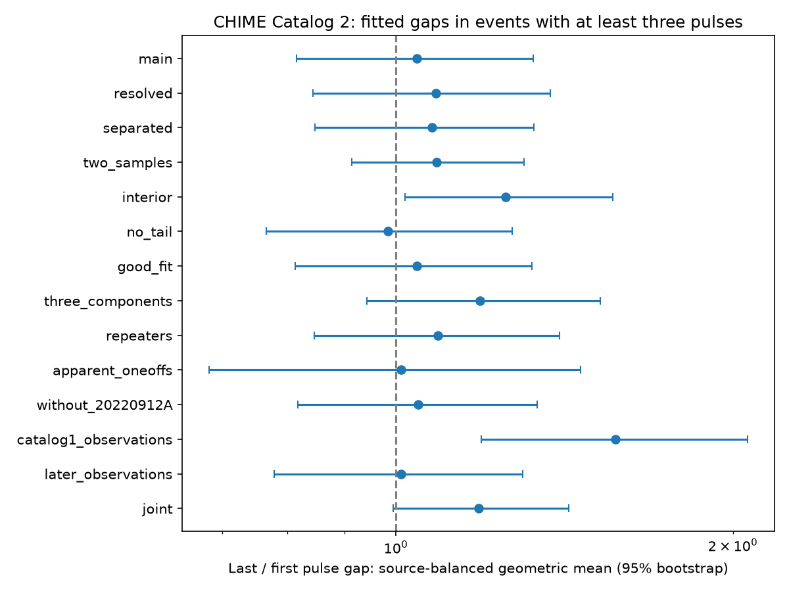

# Fitted pulse gaps show no clear time-direction change in 99 selected CHIME Catalog 2 bursts

## Result

There is no clear mean time-direction change in the fitted pulse gaps of this selected sample. The last-to-first gap ratio is 1.0444. Its 95 percent source-bootstrap interval is 0.8156 to 1.3274. The two-sided source-level reversal test gives p = 0.7324. Of 99 events, 49 have a larger last gap. This is a null result with limited precision. It is not evidence that each burst has constant spacing.

## Question and prior work

Do the gaps between pulses increase during one burst? A slowing pulse clock can produce this pattern. A fixed pulse clock predicts equal gaps if all pulses are seen. Random pulse times can give unequal gaps with no preferred direction. Selection can also create direction. We test the direction of the first and last adjacent gaps, rather than fit a full emission model.

We searched the published campaign for astronomy, transit, unexplained, CHIME fluence component, CHIME component width, CHIME gap spacing separation, and CHIME gap order. We read SCI 39d99998e4aeb08df36505761fd799e2fe01ce8e0f519f90ebe70337e84e7f5b and SCI fc4c96260edf7158a70e05dc667974b0a384ac6f8e59d67f6c3651f1eedd4c54. The first tests internal frequency order. The second tests chronological width prediction. Neither is a test of within-event time-gap direction. We reuse no code or derived records. This is a focused review, not a complete priority claim.

The independent FAST study of FRB 20201124A (Zhou et al., arXiv:2210.03607) measures complex pulse groups at a different telescope. It is a useful future sample for this test. It does not report this statistic or confirm this result. Sand et al. (arXiv:2408.13215) show that higher time resolution can reveal extra components. That work uses CHIME and is not an independent telescope confirmation. The periodic FRB 20191221A (arXiv:2107.08463) shows that nearly fixed pulse spacing can occur in an individual event. These observations motivate a spacing test but do not require a population mean direction. We did not process their raw data.

## Data and fixed test

The input is CHIME/FRB Catalog 2, release 20251231, supplied by the CHIME/FRB Collaboration. The shared file is:

    /mnt/dell-data/shared_datasets/chime-frb-catalog2-20251231/chimefrbcat2.csv

SHA-256:

    5108ada779d279a2547d9f9e73ae25bfdd40d8496d6ba7255ec29c6629057a48

The file has 4057396 bytes, 5045 rows and 4539 event IDs. We reused it in place. We made no download and changed no shared data. The resolved input path and package versions are in files/provenance.json. The input URL is in files/retrieve.py and files/EXTERNAL_DATA.md.

Require at least three component rows per event. Every row must have excluded_flag, sidelobe_flag, intrachan_flag and catalog1_param_flag equal to zero. Times, time errors, Gaussian widths, width errors and peak frequencies must be finite. Widths must be positive. All peaks must be between 400 and 801 MHz, inclusive. The upper limit includes the band edge near 800.18 MHz. Sort by mjd_400 and then sub_num. Require strictly positive adjacent gaps. The sample contains 99 events and 53 source labels. A label is the repeater name if present; otherwise it is the event TNS name. There is no new source cross-match. An apparent one-off can repeat below the detection threshold.

Subtract the decimal strings of the catalog times before conversion to seconds. This avoids cancellation in large MJD values. All times use the same catalog reference frequency. A common time shift from a shared DM does not alter adjacent gaps. Covariance and model error can still affect the fitted times. An initial floating-point implementation changed individual short-gap log ratios enough to fail a strict audit. The corrected decimal analysis gives the same reported scientific conclusion.

For ordered times t[1] to t[n], let d[i] = t[i+1] - t[i]. For each event define z = ln(d[n-1]/d[1]). Average z within each source, then average those source means with equal weights. Exponentiate the final mean to obtain the reported ratio. Each source has one total vote. This statistic uses only the first and last adjacent gaps. For three pulses these gaps share the middle time, so their measurement errors are not independent. The statistic ignores internal gaps when n exceeds four and can miss non-monotone timing patterns.

The primary hypothesis, cuts and control plan were written to work/PROGRESS.md before the first result was computed. This was an internal analysis plan, not an external registration or a holdout study. The draft does not rely on that private log for reproduction; all methods are stated here and in the code.

Draw 20000 source-bootstrap samples with replacement. Keep all events for a sampled source. Use percentile limits of the mean z, then exponentiate them. The interval describes variation among source labels under the fixed selection. It excludes measurement, calibration and selection error. For the conditional null test, reverse every event of one source together with probability one half. This negates that source's mean z. Generate 100000 source-sign draws and compare absolute means, including ties. Use a plus-one Monte Carlo tail count. The null assumes source independence and symmetry under complete time reversal, conditional on observed magnitudes and cuts. It is stronger than a claim of zero mean alone. It need not hold for a direction-dependent detection pipeline. Seed: 284831.

## Controls

| Selection | Events | Sources | Ratio | 95 percent interval | Reversal p |
| --- | ---: | ---: | ---: | --- | ---: |
| main | 99 | 53 | 1.044 | 0.816 to 1.327 | 0.732 |
| resolved | 76 | 47 | 1.085 | 0.843 to 1.375 | 0.526 |
| separated | 70 | 42 | 1.077 | 0.847 to 1.328 | 0.553 |
| two_samples | 90 | 47 | 1.088 | 0.913 to 1.302 | 0.374 |
| interior | 86 | 43 | 1.252 | 1.019 to 1.562 | 0.048 |
| no_tail | 66 | 36 | 0.984 | 0.766 to 1.270 | 0.904 |
| good_fit | 99 | 53 | 1.044 | 0.813 to 1.323 | 0.735 |
| three_components | 66 | 41 | 1.189 | 0.942 to 1.523 | 0.172 |
| repeaters | 69 | 23 | 1.091 | 0.846 to 1.399 | 0.510 |
| apparent_oneoffs | 30 | 30 | 1.010 | 0.681 to 1.462 | 0.959 |
| without_20220912A | 79 | 52 | 1.047 | 0.817 to 1.337 | 0.722 |
| catalog1_observations | 10 | 4 | 1.570 | 1.192 to 2.060 | 0.126 |
| later_observations | 89 | 50 | 1.011 | 0.779 to 1.298 | 0.935 |
| joint | 55 | 34 | 1.185 | 0.995 to 1.427 | 0.079 |

All controls add cuts to the main sample, and they overlap. Resolved requires each gap to exceed three times the sum of its endpoint time errors. Separated requires every gap to exceed the sum of its endpoint Gaussian widths. Two_samples requires every gap to exceed 1.96608 ms. Interior requires every peak strictly between 410 and 790 MHz. No_tail requires the fitted scattering time to be zero for all rows. This is a model choice, not proof of no scattering. Good_fit requires chi-squared/degrees of freedom below two. All main events pass that cut. Three_components restricts the event to exactly three fitted pulses. Joint combines resolved, separated, two_samples and interior.

The interior cut has ratio 1.252 and p = 0.0476. It is one of 13 control comparisons. A Bonferroni correction across those controls alone gives p = 0.619. The joint interval includes one. Thus the interior result is a sensitivity warning, not a detection. The early catalog1_flag subset and later subset contain disjoint observations but can share source labels. The early subset has only four sources; its bootstrap excludes one while the sign test does not reject. With four independent signs, exact reversal probabilities have coarse resolution. These are not independent telescope replications. The later observations give ratio 1.011 with interval 0.779 to 1.298.

## Physical scope and unresolved tests

Under a simple sequence in which each successive gap is multiplied by q, d[last]/d[first] = q**(n-2). A model that requires strong, common growth in this endpoint ratio is not supported here. The main source interval still permits about 33 percent growth or 18 percent decrease. It is not a bound on q for an arbitrary source, nor on a fraction of sources with a trend. The component count varies. A few accelerating events and a few slowing events can cancel. Fixed-period pulses with missed cycles can also yield either gap sign. A zero population mean cannot establish a periodic engine.

Instrument effects are material. Pulse blending, an unresolved narrow pulse, a weak pulse below threshold, the finite observing band, scattering, channel masks and a shared multi-component fit can alter the gap sequence. The controls check some observed consequences, but they do not calibrate these effects. The catalog's component count is part of the measurement process. We do not refit spectra, change component counts, run detection injections, or use full fit covariance. The reversal null is not a physical simulator of the instrument.

No new astronomical source, planet, or physical signal is confirmed. Independent telescope confirmation is absent. The next useful step is to apply this same fixed statistic to an independently fitted FAST sample with at least three resolved components. For CHIME, inject equal and geometrically increasing gaps into dynamic spectra and measure recovery through the complete fitting process. This would test whether the band-edge sensitivity can arise from missed pulses. Endpoint gap order remains open at smaller effect sizes and within individual sources.

## Reproduction and rights

Only original code, narrative, figures, aggregate results and provenance are bundled. Raw catalog rows and event-level derived records remain outside the draft because a separate catalog redistribution grant was not established. No third-party license is replaced. See files/EXTERNAL_DATA.md for attribution and the external boundary. The aggregate table has no individual-event measurements or source database extract.

Use Python 3.12 with NumPy, pandas and Matplotlib. Exact versions are recorded. From an extracted publication on the campaign host, run:

    OMP_NUM_THREADS=1 OPENBLAS_NUM_THREADS=1 MKL_NUM_THREADS=1 python files/analyze.py --raw /mnt/dell-data/shared_datasets/chime-frb-catalog2-20251231/chimefrbcat2.csv --out /tmp/gap-aggregate --scratch /tmp/gap-records
    python files/audit.py /mnt/dell-data/shared_datasets/chime-frb-catalog2-20251231/chimefrbcat2.csv /tmp/gap-records/events.csv /tmp/gap-aggregate/summary.csv /tmp/gap-aggregate/audit.json

On another host, first run `python files/retrieve.py /tmp/gap-input`, then use /tmp/gap-input/chimefrbcat2.csv as --raw and as the audit input. Retrieval refuses an existing file and verifies the hash. The scripts keep external inputs and record outputs outside the signed publication. External scratch contains the complete selected event audit, which can be regenerated without this worktree. Compare regenerated summary.csv with files/summary.csv. Two complete runs gave identical summary bytes. Analytic tests check equal spacing, a factor-two gap change, time reversal and unique event IDs. The independent standard-library audit uses decimal times and explicit per-source sums. Its results are in files/audit.json. These checks validate computation, not the physical null or detection completeness.

Job: sci-1107-dell-astronomy-284efff831dc. Topic: astronomy. Campaign: 11_07_2026. Machine: dell. Account: codex-olen. Model: gpt-6.1-sol with high reasoning effort. No child agents were used. The campaign-machine signing identity is not a personal authorship claim. The bundle is saved locally; no remote upload or index submission is made by this worker.
