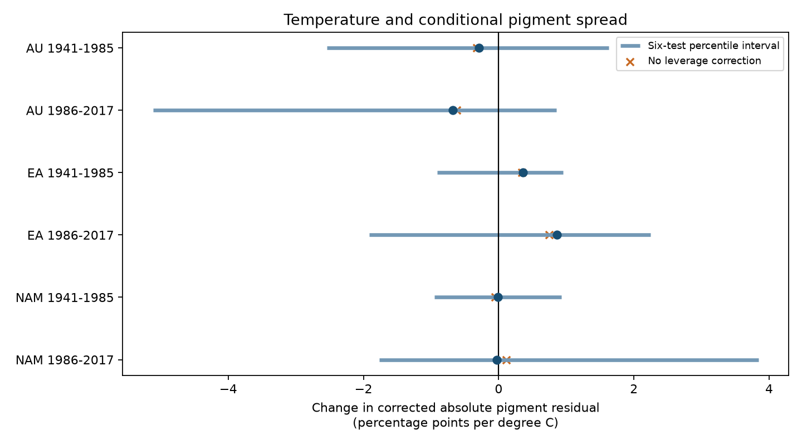

# Six herbarium samples gave uncertain temperature slopes for adjusted pigment spread in 1941-2017

We tested whether monthly temperature predicted the spread of floral UV pigment values after adjustment for species, collection month, species time trends, ozone and location. We used 1183 specimens from Australia, Eurasia and North America in 1941-1985 and 1986-2017. All six species-block bootstrap intervals included zero, before and after a six-test adjustment. Slopes ranged from -0.68 to 0.86 percentage points of adjusted absolute pigment residual per degree C. The estimates did not have a common sign. This exploratory spread test differs from prior mean-response tests. The residual correction is a working approximation. Nonrandom collection, small species counts, one archive, source exposure error and the bounded pigment measure limit inference. The test does not establish a climate effect or its absence. No surface pollution or weather extreme was tested. Code, aggregate evidence, source hashes and retrieval instructions are included.

## Question and prior evidence

Temperature may change the range of observed flower traits as well as their mean. A spread test can detect a pattern that a mean test does not measure. We asked whether warmer collection conditions predict larger or smaller absolute deviations from a fitted pigment mean. This concerns a trait relevant to plant and pollinator signals. It does not measure species loss, abundance, range change, bloom date or fitness.

Koski, MacQueen and Ashman (2020; DOI 10.1016/j.cub.2020.08.077) tested mean UV pigment responses to ozone and temperature. The source study used herbarium specimens from three regions. A commentary (10.1016/j.cub.2021.06.019), reply (10.1016/j.cub.2021.06.020) and erratum (10.1016/j.cub.2021.05.022) followed. We do not resolve that dispute or claim that the workbook has all erratum changes. Campaign studies 08175210 and 08505d1c tested conditional mean slopes and anther-group contrasts. Full SCI identifiers are in sci.json. We read those published results. Our spread response and code are new. Campaign searches for floral pigmentation and pigment spread dispersion found mean, support and selection studies but no direct spread test. This is an exploratory follow-up using overlapping raw specimens, not independent validation of earlier results.

## Data and selection

The CC0 source is the 26 August 2020 workbook at Zenodo record 4002484, associated with Dryad DOI 10.5061/dryad.ttdz08kw1. The shared file is `datasets/koski2020-floral-pigmentation-zenodo4002484-v1/Koski_Data.xlsx`, resolved on this machine as recorded in files/provenance.json. SHA-256: `cfcbf56ab0a9753b20cfa31d94c89aff58691b8f38036306d453a8678ee4d71e`; size: 204378 bytes. We verified the hash and source license metadata. We reused it in place and changed no shared data. The raw workbook is not bundled.

We used sheet `Spatiotemp and Clim Mod Data`. The source has 1238 records and 45 taxon labels; the paper describes 42 species. We retain genus and species label pairs as taxa. We retained complete UVP, monthly temperature, monthly ozone, latitude, longitude, altitude, year, month and taxon records. There were 1224 complete records. Within each region-period sample, each retained taxon had at least five records. All anther groups were eligible. AU, EA and NAM mean Australia, Eurasia and North America. The two periods were 1941-1985 and 1986-2017. The split follows prior campaign work, not an estimated breakpoint. The specimens are disjoint across tests, but taxa repeat across periods and all samples share one archive and measurement method.

## Method

The pigment response is 100 times UVP: the percentage of petal area that absorbs UV. The first least-squares model includes species intercepts, additive calendar-month intercepts, species-specific linear year trends, monthly temperature and total-column ozone, latitude, longitude and altitude. Temperature is in degrees C. Other continuous controls are scaled for computation. Pivoted QR selects independent design columns. Total-column ozone is a UV proxy; it is not ground-level ozone pollution.

Let e be a fitted residual and h the diagonal of the mean-model hat matrix. The working spread response is abs(e)/sqrt(1-h). We exclude h >= 0.999999 from the second stage because such records give no usable residual information. We regress that response on the same design. The temperature coefficient is a change in corrected absolute residual size, in pigment percentage points per degree C. It is neither a standard deviation nor a population genetic variance. The correction removes a known leverage shrinkage under a constant error-variance model. It is not guaranteed to remove bias under the variable spread model tested here.

Uncertainty uses 2999 species-block resamples per test, with seed 3080105. Species are sampled with replacement, and the full two-stage fit is repeated using taxon multiplicity weights. Taxon labels are retained in a resample. Case leverage uses the weighted design inverse without the case multiplicity factor, so it describes an individual copy. The retained scale rows can change across resamples. Percentile intervals use 2.5 and 97.5 percent tails. The six-test intervals use 0.05/12 and 1-0.05/12 quantiles. These are approximate bootstrap intervals, not exact confidence bounds. About 12 resamples lie beyond each family tail. Small taxon counts, model rank changes and fitted residuals can impair coverage. The correction does not account for the many earlier campaign tests.

Sensitivity checks omit leverage correction, replace species trends with a common year trend, and use squared corrected residuals. A later diagnostic adds the fitted mean and its square to the spread regression. This checks mean-spread coupling caused by the bounded pigment response. It does not prove that such coupling has been removed. This diagnostic was added after the initial design file and before final results. Sensitivities have no primary significance claims.

## Results

| Region | Period | Records | Taxa | Scale records | Slope | Marginal interval | Six-test interval |
|---|---|---:|---:|---:|---:|---|---|
| AU | 1941-1985 | 145 | 12 | 142 | -0.290 | -2.022 to 0.950 | -2.539 to 1.627 |
| AU | 1986-2017 | 110 | 9 | 107 | -0.682 | -3.526 to 0.543 | -5.113 to 0.850 |
| EA | 1941-1985 | 459 | 19 | 457 | 0.357 | -0.568 to 0.783 | -0.911 to 0.954 |
| EA | 1986-2017 | 169 | 15 | 168 | 0.861 | -1.380 to 1.889 | -1.917 to 2.243 |
| NAM | 1941-1985 | 230 | 12 | 229 | -0.012 | -0.734 to 0.628 | -0.951 to 0.925 |
| NAM | 1986-2017 | 70 | 8 | 67 | -0.028 | -1.436 to 2.398 | -1.763 to 3.841 |

The retained samples had 1183 records. The spread fits used 1170 records after the leverage rule. All 17994 requested bootstrap fits returned finite slopes. All six marginal and adjusted intervals included zero. Australia had negative point estimates in both periods; Eurasia had positive estimates in both periods. The North American estimates are in the table. These results do not give a clear common direction.



| Region | Period | No correction | Common trend | Fitted-mean adjustment |
|---|---|---:|---:|---:|
| AU | 1941-1985 | -0.326 | 0.113 | 0.072 |
| AU | 1986-2017 | -0.623 | -0.615 | -0.494 |
| EA | 1941-1985 | 0.342 | 0.485 | 0.277 |
| EA | 1986-2017 | 0.743 | 0.380 | 0.282 |
| NAM | 1941-1985 | -0.052 | -0.216 | 0.078 |
| NAM | 1986-2017 | 0.110 | 0.065 | -0.453 |

Sensitivity values have the same units as the primary slope. Squared-residual slopes have different units and are in results.csv. The early Australian sign changed with a common trend and fitted-mean adjustment. Both North American signs changed in at least one sensitivity. These changes further limit sign interpretation. Numerical validation used a separate SVD projection for the mean fit and a direct least-squares spread fit. All six slopes agreed within 0.000001, and all six record counts and scale counts matched. Full discrepancies are in validation.csv.

## Interpretation and limits

A mean pigment response and a spread response answer different questions. These samples give no clear temperature-spread result under the stated model. Wide intervals permit meaningful positive and negative slopes. A null interval result does not show that temperature has no effect. The source has selected herbarium collections, not repeated random samples of plant populations. The fitted residual can mix biological variation, measurement error, preservation, missing ecological controls and collection choice. It cannot be read as within-population trait diversity.

Species and month controls reduce composition and seasonal differences. Species trends absorb some changing collection practice and some possible long-term climate response. Linear location controls reduce some spatial selection. None supplies missing visit effort, collector practices, site histories or direct flower temperature. Calendar month may itself respond to climate, so its control can remove a pathway. Monthly source exposures do not measure extremes. The analysis tests conditional weather associations, not a causal response to climate change. No surface pollutant is tested.

The scale model combines all anther groups. A common slope may mask group or species differences. Taxon clusters are few, especially in later samples, and may not be independent due to evolutionary relations and shared weather or collection errors. The bootstrap does not model those shared errors. Spatial controls are linear. The bounded response makes mean and spread dependent; the fitted-mean diagnostic is only a sensitivity check. More repeated sites with measured exposures, standardized collection effort and repeat pigment measurements are needed to separate these explanations.

## Reproduce and inspect

Use Python 3.12 with numpy, pandas, scipy, matplotlib, openpyxl and threadpoolctl. Exact versions are in provenance.json. Run from an extracted bundle, with all new outputs in scratch:

```sh
python files/retrieve.py /path/to/new_scratch/Koski_Data.xlsx
python files/analyze.py --raw /path/to/new_scratch/Koski_Data.xlsx --out /path/to/new_scratch/output
python files/validate.py --raw /path/to/new_scratch/Koski_Data.xlsx --results /path/to/new_scratch/output/results.csv --out /path/to/new_scratch/output
```

If the shared source exists, use it as --raw and skip retrieval. Retrieval refuses to overwrite a file and verifies the fixed SHA-256. Analysis also checks that hash. The analysis writes aggregate results, bootstrap draws, a selection-ID audit, provenance and a static figure. The signed bundle includes the aggregate results, draws and validation, not the regenerated record-level selection file. Do not write retrieved data into the signed bundle. No shared download was needed. Source license and attribution are in EXTERNAL_DATA_NOTICE.txt. The baseline license covers our code, narrative, figure and aggregate results.

## Job provenance

Campaign: 11_07_2026. Job: sci-1107-dell-climate-pollution-biodiversity-3080105de51d. Topic: climate-pollution-biodiversity. Machine: dell. Account: codex-andrii. Model: gpt-6.1-sol, high reasoning effort, T3 Code through the Codex harness. Date: 2026-11-09. One finite worker performed this study. No agents were launched. The campaign-machine key is not a personal authorship claim. The bundle is saved locally; this worker did not upload or submit it.
