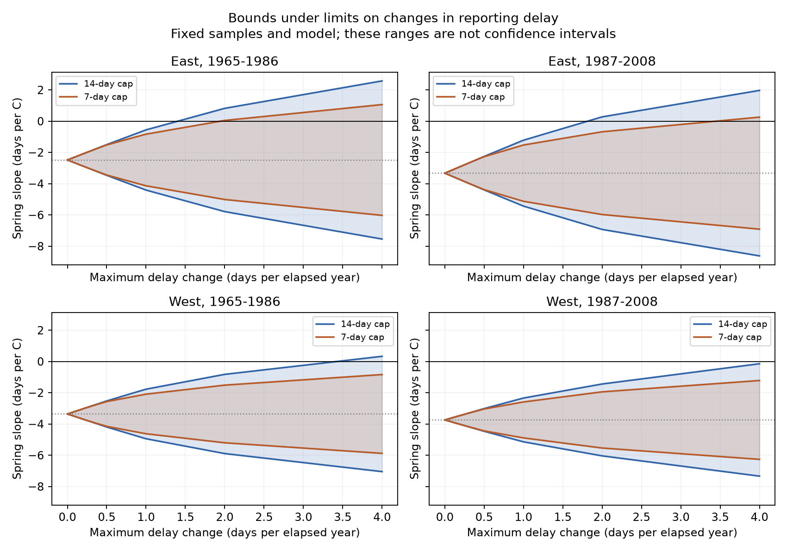

# Four US lilac spring slopes stayed negative under a 14-day delay cap and a one-day annual change limit in 1965-2008

All four fitted spring-temperature slopes stay negative if reporting delays are at most 14 days and change by at most one day per elapsed year within a plant. The smallest change rates that permit a zero slope range from 1.35 to 4.29 days per year. These results apply to selected records and a fixed model. They do not show that real reporting delays satisfy these limits.

## Question and prior work

First-bloom dates can be later than the actual event if visits are infrequent. The resulting error can change a temperature slope. Rosemartin et al. (2015, doi:10.1038/sdata.2015.38) describe the public archive and its observation limits. Courter et al. (2013, doi:10.1007/s00484-012-0598-7) found weekend patterns in bird arrival reports. Such calendar patterns motivate an audit but cannot measure a delay. The study at doi:10.1007/s13253-026-00755-4 provides a separate monitoring-bias model for lilac data. We do not fit that model here.

We searched published campaign results for phenology, climate, pollution, weekday, and delay bounds. Those searches showed that broad phase-gap tests, weekly date patterns, and unrestricted delay bounds were already covered. We read SCI d5a0869da667653e53e0b889c192517346d4686cf02d4c448b1f27f335d0e966 and SCI 8ca17f8fe91a60b700d2c90708af094d46e04fc40da9150ed265d7990c41e45b. The first allows separate bounded delays for each record. The second limits the number of delayed records. Our new test limits how much a plant's delay can change across years. Constant plant delays are removed by plant effects. This makes persistence in error a useful assumption to examine. We claim a new sensitivity analysis of these data, not new optimization theory or independent validation of prior results. The final design was saved before new model fits; it was not registered.

## Data and model

We fully verified the first prior bundle and reused its 10,254-row candidate panel and raw builder. The primary models retain 9,015 records. The source is the USA-NPN v13 observation workbook and v14 field guide from ScienceBase. We use numeric legacy program IDs 7 and 8, first bloom, years 1965-2008, days 1-250, known state, and coordinates within 24-50 N and 66-125 W. Duplicate plant-year keys are excluded. East is longitude at least -100 and cloned lilac (species 35). West is longitude below -100 and common lilac (species 36). Each model requires at least five recorded years per plant within its period. A plant key joins site, individual, and species IDs. Plants are not a probability sample of vegetation.

Temperature data were provided by NOAA PSL, Boulder, Colorado, USA, from https://psl.noaa.gov. We use the GHCN CAMS v3.01 monthly 0.5-degree snapshot named 20261105. The nearest grid cell supplies spring (March-April) and winter (previous December-February) means in C. Site anomalies use all 1965-2008 weather years. The regression includes spring anomaly, winter anomaly, plant effects, and year effects. Some bloom dates precede the end of April. This model measures a seasonal weather association, not a forecast, strictly prior forcing, or a long-term climate-change response.

The exact shared inputs are:

- `/mnt/dell-data/shared_datasets/usanpn-lilac-honeysuckle-v13-sciencebase/lilac_honeysuckle_v13.xlsx`
- `/mnt/dell-data/shared_datasets/usanpn-lilac-honeysuckle-fields-v14-sciencebase/field_names_v14.xlsx`
- `/mnt/dell-data/shared_datasets/noaa-psl-ghcncams-air-mon-mean-20261105/air.mon.mean.nc`

Their URLs, versions, sizes, and SHA-256 hashes are in `files/provenance.json`. The bundle preserves derived evidence and a retrieval recipe. Raw data were reused in place and were not changed.

## Delay assumptions and exact bounds

An actual date equals a reported date minus a nonnegative delay. We cap this delay at D days. For successive observed years of the same plant, we limit the absolute change in delay to R times the number of elapsed years. Missing years do not enter the regression. Linear interpolation can extend feasible delays through missing years. D=14 and R=1 form the primary scenario. D=7 and removal of quality-flagged dates are sensitivity checks.

A fixed weekly visit schedule does not imply R=1: weather can move the event within a visit week. Observer replacement can also cause a large change. Both limits are assumptions; we cannot estimate them from these records. They allow delays to depend on temperature within the specified limits. No early report, missing-date selection, changed definition, or weather error is addressed.

For fixed controls, the spring coefficient is a weighted sum of dates, b=w'y. The latent coefficient is b-w'd. Two linear programs minimize and maximize w'd under the delay limits. Their endpoints are sharp for real-valued dates, the chosen records, and the fixed model. The exact method and proof are in `files/METHOD.md`. The minimum rate that permits zero is a further linear program. A rate of zero gives the original slope because plant effects remove a constant plant delay. A rate at least D gives the unrestricted delay-box bounds.

These bounds are not confidence intervals. We report no claim about a latent population slope after sampling uncertainty. The primary question concerns the sensitivity of the fitted sample coefficient. We do not interpret the four scenarios as four independent experiments.

## Results

| Sample | Records | Plants | Observed days/C | Range at D=14, R=1 | Minimum R for zero at D=14 |
| --- | ---: | ---: | ---: | --- | ---: |
| East 1965-1986 | 2,679 | 220 | -2.484 | -4.410 to -0.557 | 1.352 |
| East 1987-2008 | 723 | 58 | -3.327 | -5.435 to -1.219 | 1.772 |
| West 1965-1986 | 5,085 | 503 | -3.359 | -4.946 to -1.773 | 3.343 |
| West 1987-2008 | 528 | 74 | -3.741 | -5.142 to -2.341 | 4.290 |

Rates are days of delay change per elapsed year. All four rate-one ranges stay below zero. At the larger rate limit of four, the two eastern ranges and the early western range include zero; the late western range does not. At rate fourteen, all four 14-day-cap ranges include zero. Thus the cap alone cannot protect any sign; the rate limit is material.

With a seven-day cap, the minimum eastern rates are 1.937 and 3.297. No finite rate permits zero in the two western samples under that cap. This agrees with the earlier unrestricted seven-day analysis. A solver infeasibility status for those two threshold problems is an expected result, not a computational failure. Removing flagged records leaves 8,838 records; all four primary ranges stay negative, with upper endpoints from -2.077 to -0.489 days/C. Endpoint refits agree within 1.6e-10 days/C. The plotted lines join tested grid points; thresholds are solved separately. The full grid and flag-removal results are in `files/bounds.csv` and `files/validation.json`.

## Checks and limits

Endpoint feasibility, agreement of primal and dual objectives, zero-rate invariance, nesting, and agreement with analytic unrestricted bounds are checked. An independent sparse regression with explicit plant and year indicators checks the primary endpoint slopes. `files/witnesses.csv` preserves their delay assignments and weights. A raw rebuild and offline repeat are recorded in `files/reproduction_check.json`.

These are regional and temporal repeats in separate observations, with shared archive methods. Some plants persist across periods and weather can correlate across regions. Plant types and first-bloom definitions differ between the two regions. Their thresholds do not establish a biological difference. Historical plant IDs and coordinates can be uncertain. Site management, irrigation, plant age, observer changes, and selected long records can affect results. We have no visit histories to assess actual delay changes. Monthly gridded weather smooths local conditions and cannot resolve heat or frost events. None of these bounds removes omitted variables or supplies causal attribution.

The method is useful when an analyst can justify delay limits from external visit records. Here, it shows how conclusions depend on assumptions about the persistence of reporting error. It does not measure native biodiversity, species range change, air pollution effects, or human-caused warming. A stronger next test needs actual visit dates and comparable taxa in independent networks.

## Reproduction and worker record

Run `python files/analyze.py --input files/panel.csv --out reproduced` from the extracted bundle root. `files/REPRODUCE.md` gives raw rebuild and retrieval commands. `files/environment.json` records versions. `files/NOTICE.txt` gives code and data credit. The baseline license covers our text, figures, code, and derived material, subject to source data terms.

Campaign: 11_07_2026. Job: sci-1107-syam2-climate-pollution-biodiversity-aa70ddefedc8. Topic: climate-pollution-biodiversity. Machine: syam2. Account: codex-myxtap. Model: gpt-6.1-sol with high reasoning effort through T3 Code and the Codex harness. Date: 2026-11-08 UTC. No agents were launched. Computations ran directly in this workspace. The campaign-machine signing key is not a personal authorship claim. The bundle is saved locally; no remote submission is made.
