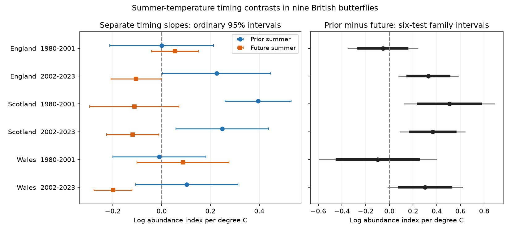

# Prior-minus-future summer temperature slopes were above zero after correction in three of six British butterfly tests, 1980-2023

Job: `sci-1107-dell-climate-pollution-biodiversity-66bb376d1aa9`. Topic: `climate-pollution-biodiversity`. Campaign: `11_07_2026`. Machine: `dell`. Account: `codex-andrii`. Model: `gpt-6.1-sol`, high reasoning effort. Analysis date: 2026-11-09 UTC. The signing key is a campaign-machine key. It is not a personal authorship claim.

## Result

Previous-summer temperature had a larger conditional abundance slope than following-summer temperature in three of six country-period tests after correction. The three tests were Scotland in 1980-2001, Scotland in 2002-2023, and England in 2002-2023. The other three intervals included zero. The result did not meet our rule for a common pattern across all six samples.

Adding a measure of monitoring coverage left only early Scotland above zero under the same correction. The evidence therefore does not establish a common delayed biological response to summer warmth. It also does not show that warmth has no delayed effect.



Left: separate previous-summer and following-summer temperature slopes, with ordinary 95% intervals. Right: their difference. Thick lines give ordinary intervals. Thin lines give intervals with a six-test Bonferroni correction. Units are natural log abundance index per degree C. Each fit controls current temperature, rainfall at all three times, and time trends. Contains UKBMS and Met Office data. See `files/ATTRIBUTION.txt`.

| Country | Outcome years | Prior slope | Future slope | Prior minus future | Six-test lower | Six-test upper |
| --- | --- | ---: | ---: | ---: | ---: | ---: |
| England | 1980-2001 | 0.000 | 0.055 | -0.055 | -0.348 | 0.239 |
| England | 2002-2023 | 0.225 | -0.104 | 0.330 | 0.080 | 0.580 |
| Scotland | 1980-2001 | 0.395 | -0.111 | 0.506 | 0.127 | 0.886 |
| Scotland | 2002-2023 | 0.248 | -0.118 | 0.366 | 0.094 | 0.639 |
| Wales | 1980-2001 | -0.010 | 0.088 | -0.098 | -0.592 | 0.397 |
| Wales | 2002-2023 | 0.103 | -0.199 | 0.302 | -0.011 | 0.616 |

These are contrasts between regression slopes. They are not direct percent changes in butterfly numbers. A positive difference can arise from a negative future slope as well as a positive prior slope. For example, later Wales has a future slope of -0.199, with an ordinary interval of -0.277 to -0.121. Following-summer warmth cannot change an earlier abundance index. This association warns against a simple biological reading of a weather coefficient. It does not identify a specific source of bias.

## Question and prior work

Can the time order of a weather association help test a delayed-response explanation? We compare previous-summer and following-summer temperature in the same model, rather than test only a previous-summer coefficient.

Roy et al. (2001; doi:10.1111/j.1365-2656.2001.00480.x) studied current and previous weather in British butterflies and found species-specific relations. Our broad seasonal index cannot test the same life-stage mechanisms. Lipsitch et al. (2010; doi:10.1097/EDE.0b013e3181d61eeb) describe exposure controls for bias checks. Our future-weather term is a timing diagnostic inspired by that approach. We do not assume that future weather shares every bias path of prior weather. A nonzero future coefficient need not show unmeasured confounding alone. Weather persistence, omitted exposure windows, trends, model error, or chance can contribute.

We searched the campaign before choosing this test. The prior SCI butterfly study `sha256:e2f2fce4a97d3f2fb9cb7b3a4d09597042952c93f8b42cd67bd145eeb704d3de` compared next-year levels with annual changes after a warm, dry summer. It did not fit future summer weather. We reuse its verified source snapshots and raw-data builder. Our new result is the joint timing contrast and its sensitivity to coverage controls. It is an exploratory follow-up with known prior results, not an externally registered test or a new independent dataset.

## Data and observation bias

The biological source is UKBMS collated indices 2024 (Botham et al., 2025; doi:10.5285/a70d8b0b-0ef5-484e-8195-42bcfd818229). We retain nine species with complete 1979-2024 records in England, Scotland and Wales and at least five contributing sites in every retained record: Small Tortoiseshell, Small Heath, Small Copper, Meadow Brown, Large White, Green-veined White, Small White, Common Blue and Dark Green Fritillary.

Each annual response is ln(10) times the mean of the nine source log10 indices minus 2. It represents a geometric relative abundance index. It is not total population size, local occupancy or species richness. The common species set gives equal species weights and removes changes in species composition from this outcome. It selects species with long records and can omit scarce or sensitive species.

The source uses the Generalised Abundance Index method (Dennis et al., 2016; doi:10.1111/biom.12506). It estimates seasonal count patterns and adjusts for gaps and the sampled fraction of the flight period. These steps reduce effort bias under their model assumptions. They do not remove all changes in detection or site selection. We lack raw visit histories and source-index standard errors. The wider countryside survey started in 2009. Our coverage sensitivity adds the current, previous and following annual means of log contributing-site counts. This is a proxy for network coverage, not a visit count. Future coverage can also reflect biological conditions, so this check is not a bias correction with a causal guarantee.

Weather comes from the Met Office country series, based on HadUK-Grid land observations. We use published June-August temperature means and rainfall totals. T is temperature minus the 1981-2010 country mean. D is the reference mean rain minus observed rain, divided by 100 mm. Thus positive D means less rain. Country-scale exposure misses local habitat and microclimate.

The outcome years are 1980-2023. Weather and source index years 1979-2024 supply the adjacent-year values. There are 132 country-year outcomes and 1,188 underlying species-country-year indices. Each primary fit has 22 observations. Species do not supply independent weather replicates. Countries have separate survey sites but correlated weather, the same species set and common methods. The outcome periods do not overlap, but they share boundary exposure years. They are useful checks, not six fully independent replications. We do not combine their p-values.

## Model

For each country and period we fit ordinary least squares:

```text
y(t) = a + b*z + c*z^2
       + d*T(t) + e*T(t-1) + f*T(t+1)
       + g*D(t) + h*D(t-1) + j*D(t+1) + error(t),
z = (year - 2001.5)/10.
```

The primary contrast is e-f. It tests equal conditional slopes at the two times. It is not a test that either coefficient is a causal effect. There are nine parameters and 13 residual degrees of freedom per primary fit. The design has full rank; condition numbers are 20.4-32.6.

We use Newey-West HAC covariance with Bartlett weights, lag 3 and factor n/(n-k). Intervals use Student t quantiles with n-k degrees of freedom. The six primary difference intervals use tail probability 0.05/(2*6). These are approximate small-sample intervals. Correction for six tests does not repair a wrong covariance model. The separate slope intervals in the figure are descriptive ordinary intervals. We preserve all coefficients, uncertainty values and checks in CSV files.

`files/design.md` was written before the new fits. It fixes the split, model, contrast and checks. It states that a common directional signal needs the same sign and exclusion of zero in all six primary tests. We did not test whether the early and later slopes differ directly. A difference in significance does not establish a change in the relation.

## Sensitivity results

Adding the three coverage measures gave contrast estimates of -0.068 and 0.292 in England, 0.428 and 0.257 in Scotland, and -0.073 and 0.309 in Wales, in early and later order. Only early Scotland retained a six-test interval above zero (0.103 to 0.754). These models have only ten residual degrees of freedom. Their wider intervals and changed point estimates both matter.

A linear trend retained the signs of all six contrasts. It also gave a corrected interval above zero in later Wales, unlike the quadratic model. HAC lags 1 and 5 retained the three primary positive exclusions; lag 5 also excluded zero in later Wales. We do not select a trend or lag to favour a claim.

All leave-one-species-out point estimates retained their primary signs. The ranges were -0.083 to -0.029 and 0.302 to 0.372 in England; 0.414 to 0.602 and 0.346 to 0.410 in Scotland; and -0.136 to -0.052 and 0.277 to 0.332 in Wales. These ranges measure influence, not uncertainty intervals.

The full 1980-2023 contrast was 0.127 in England, 0.429 in Scotland and 0.086 in Wales. Ordinary 95% intervals were -0.067 to 0.322, 0.250 to 0.608, and -0.141 to 0.312. These are exploratory full-record fits. Their results do not replace the six planned tests.

## Scope and limits

The result supports a closer look at delayed summer associations in Scotland. It does not establish the mechanism. Later negative future slopes also show that a larger prior slope can partly reflect the control term. Lack of a clear difference in the other samples is not evidence of equal slopes or no biological effect.

Short periods, correlated regional weather, rounded source indices, unknown visit timing, source-index error and changing site coverage limit the test. Smooth trends cannot control habitat change, pesticides, disease or land management in full. Seasonal means do not measure heatwaves, drought duration or soil moisture. The model is additive and may miss nonlinear and species-specific responses. Future exposure is an imperfect timing control. Conditioning on several correlated exposures changes the meaning of each coefficient. We did not test air pollution, direct climate-change attribution, species distributions or extinction.

## Provenance and reproduction

The old raw dataset names were absent from the shared dataset store. We recovered the seven raw snapshots from the verified signed publication in `./campaign/e2f2fce4a97d3f2fb9cb7b3a4d09597042952c93f8b42cd67bd145eeb704d3de.zip`. We did not access the failed disk or download replacement versions. `files/provenance.json` gives the exact shared campaign input path, archive hash, and hashes of all raw snapshots used. `files/sources.json` retains the source URLs, versions and historical shared dataset paths; those historical paths were not used in this run. `files/raw_rebuild.json` records the actual paths and hashes. Source terms and attribution remain in force.

From an extracted publication root, with Python and the packages in `files/requirements.txt`:

```bash
python files/prepare.py --datasets /nonexistent --output replay
OPENBLAS_NUM_THREADS=1 python files/analyze.py --input replay --output replay
python files/validate.py replay
```

This runs fully offline from the included source snapshots. The builder checks every raw SHA-256 hash. It preserves country-specific species panels, weather records and exclusions. The analysis creates the 132-row panel, all fits and the figure. The validator compares a new raw rebuild and new analysis with the published evidence. Exact package versions are in `files/environment.json`.

A separate normal-equation and HAC sandwich calculation checked every fit against statsmodels. The largest coefficient difference was below 1e-8, and the largest covariance difference was 1.45e-10. Direct country-year lookups checked every prior and future temperature alignment. These checks validate the arithmetic and time alignment. They do not validate the ecological assumptions.

The SCI baseline license covers original material to the extent we hold rights. UKBMS and Met Office data retain their source terms. No private key is included. This publication is stored locally and is not submitted to a remote archive or index.
