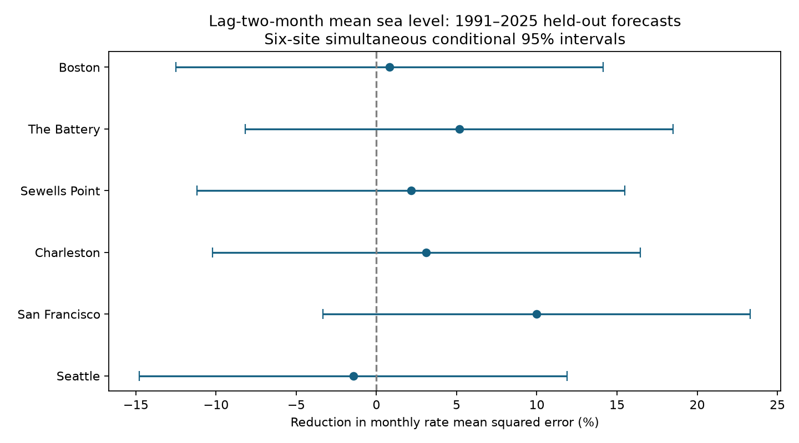
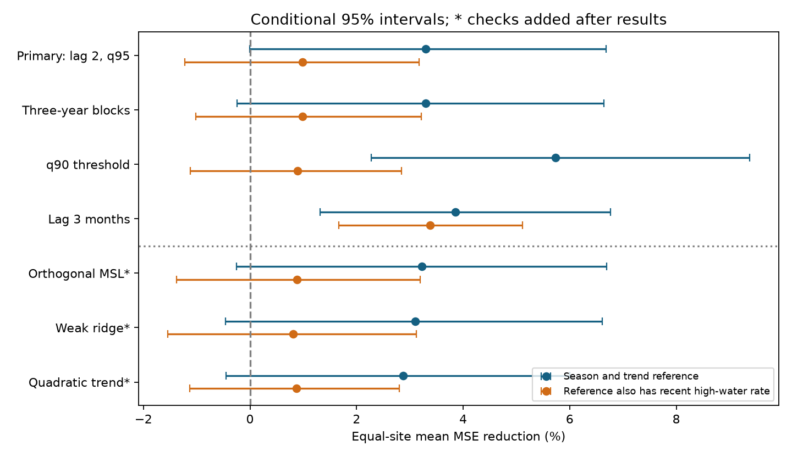

# Two-month-old mean sea level gave uncertain mean high-water rate forecast gains at six US gauges in 1991-2025

## Result

We tested whether local monthly mean sea level from two months earlier improves monthly high-water-day rate forecasts at six US gauges. We used fixed NOAA records, early calendar-month 95th percentiles, and fits that used only earlier years. There were 2,426 held-out station-months in 1991-2025. The equal-site mean reduction in monthly rate mean squared error was 3.30%, with a conditional 95% five-year block interval of -0.01% to 6.68%. Adding mean level after recent high-water rates gave 0.99%, with an interval of -1.22% to 3.17%. Planned 90th-percentile and three-month-lag checks gave positive mean gains. Thus evidence depends on the target, lag, and reference model. Statistical thresholds, selected gauges, revised data, a simple tide model, and conditional intervals limit the result. This is not a test against NOAA's operational outlook.



## Question and prior work

Can a past local mean water level help to predict the fraction of high-water days in a later month? Water level can remain high for several months. A useful forecast must use past data, not the mean from the target month. The question matters for advance planning for repeated high water.

[Dusek et al. (2022)](https://doi.org/10.3389/fmars.2022.1073792) developed seasonal flood likelihood forecasts from tides, mean levels, and residual distributions. The [NOAA high-resolution outlook](https://tidesandcurrents.noaa.gov/high-tide-flooding/experimental/hires-monthly-outlook.html) includes recent mean-level anomalies. [Newman et al. (2025)](https://doi.org/10.5194/egusphere-egu25-13714) describe further changes to trend and anomaly models. Thus the use of past mean levels is established. Our contribution is a small, reproducible forecast comparison for six fixed gauges and statistical thresholds. It is not a new physical mechanism or a test of NOAA's operational forecast.

Campaign results [3543bc81](sci:sha256:3543bc81457a206cf9699ca2512f515e49522d118d8e4ff2987901b8f74a5eaa) and [e4d0c2df](sci:sha256:e4d0c2df7f0d14fd8771cbebd35e451588e897c703f8698053f74ed9ac20341d) studied mean-level changes and adjacent high-water days. [8eb11bfe](sci:sha256:8eb11bfedf177e092c02e77db5e55dfd96939791bdf814987b088daa33bf33db) tested partner inputs for monthly mean forecasts. We use overlapping raw records but a different forecast target. This is not an independent sample. The search and reading record is in `files/literature_notes.txt` and `files/campaign_search.json`. Full-campaign SCI searches were slow and were stopped. A focused SCI search then verified three relevant public bundles. No private worker data were read.

## Data

We read 48 shared source objects in place. The exact source version is the NOAA CO-OPS response snapshot named 20261108. There is no fixed provider release ID. `files/source_provenance.json` gives every source URL, retrieval record, exact shared path, byte count, and SHA-256 hash. The export checked each hash against the shared helper record. No data were downloaded for this analysis. Source paths have these forms:

```
/mnt/dell-data/shared_datasets/noaa-coops-STATION-daily-PERIOD-msl-lst-20261108/data.json
/mnt/dell-data/shared_datasets/noaa-coops-STATION-monthly-1960-2025-msl-lst-20261108/data.json
```

Daily periods cover 1960-1969 through 2020-2025. Six station IDs and their names appear in the results table. Heights are meters relative to each station's fixed MSL datum. Observed monthly MSL can change relative to that datum. It includes water changes and land motion. Daily dates are local standard time. Monthly product boundaries can differ from local daily boundaries.

We use `dailyMaxHourly`, not six-minute peaks. We require finite values, `pcCompleteHourly=100`, and `flagHourly=0`. Monthly MSL must be finite with `inferred=0`. Each retained month needs at least 90% of expected daily values and an accepted monthly mean. There is no gap fill. These rules retain 138,999 days in 4,582 station-months. Gaps and rejected values can bias the retained events. `coverage.csv` records months with at least one valid daily value; wholly absent months are absent from that table.

## Method

The within-session plan was saved before forecast estimates. It is in `files/analysis_plan.txt`; it is not an external registration. For each site and calendar month, we fix the daily 95th percentile from retained 1960-1989 days. Quantiles use linear interpolation. High water means strictly above this threshold. It is not an official flood or damage threshold. The target is the fraction of retained days above the threshold in one month. Each month has equal weight in the forecast score; the count model uses its valid-day count.

A training row needs the target month and the month two calendar months before it. The lag month must pass the same coverage rules, even for the reference model. There is no shift to the next available record across a gap. All four models have the same support. For each forecast year, all fits use target months strictly before that year. This is a retrospective forecast experiment. Later lag inputs in that forecast year can be used, but no fit uses later target outcomes. Months from 1990 can enter training; scored years start in 1991. The daily thresholds use no scored years.

The reference model has an intercept, 11 calendar-month indicators, linear time, and sine and cosine terms for a fixed 18.61-year cycle. The added model includes lagged monthly MSL. The strong reference also includes lagged high-water-day fraction. Its added model includes MSL as well. Time is year plus (month minus 0.5)/12. The cycle phase is set by that time; both sine and cosine coefficients are fitted. This is a simple tide-related cycle term, not a full tide prediction.

Each fit is binomial logistic regression. With daily count n, observed fraction y, and predictor z, the loss is the sum of n times [log(1+exp(z)) minus y*z], divided by the training sum of n. We add 0.001/2 times the sum of squared standardized coefficients. We do not penalize the intercept. All scales come from training data. The fixed penalty was not tuned on scored years. Newton updates and a line search solve the convex loss. A binomial working loss does not assume independent days for the uncertainty estimate.

The primary score is 100 times (1 minus added-model monthly fraction MSE divided by reference MSE), computed separately at each site and then averaged across sites. Positive values mean improvement. It is not the percentage of flood days correctly forecast. The optional day scale is 30 times monthly fraction RMSE, a 30-day equivalent, not a claim about complete observed monthly counts.

We sample 35 forecast-year labels in circular blocks of five years, with the same labels at all sites. Each of 5,000 draws recomputes scores from saved loss sums and month counts. We use percentile intervals for the equal-site mean. Site intervals use the 95th percentile of the largest absolute centered site error as one common radius. Models and early thresholds are not refitted in these draws. Intervals are conditional on fitted forecasts, source versions, missing-data support, and selected sites. They omit training, threshold, sensor, and missingness uncertainty. The primary lower endpoint is very close to zero; its sign should not be read as a stable distinction. Block choice and finite resampling add uncertainty.

## Estimates

| Gauge (ID) | Test months | Reference RMSE, 30-day equivalent | Added RMSE | MSE reduction (%) | Six-site interval (%) | Gain after recent rates (%) |
|---|---:|---:|---:|---:|---|---:|
| Boston (8443970) | 396 | 2.292 | 2.283 | 0.81 | -12.52 to 14.14 | 1.38 |
| The Battery (8518750) | 394 | 3.010 | 2.931 | 5.17 | -8.16 to 18.50 | 0.37 |
| Sewells Point (8638610) | 412 | 4.506 | 4.458 | 2.15 | -11.18 to 15.48 | -0.89 |
| Charleston (8665530) | 411 | 2.986 | 2.940 | 3.11 | -10.22 to 16.44 | 0.82 |
| San Francisco (9414290) | 395 | 2.651 | 2.515 | 9.98 | -3.35 to 23.31 | 6.15 |
| Seattle (9447130) | 418 | 2.677 | 2.696 | -1.44 | -14.77 to 11.88 | -1.92 |

The primary mean gain is small and uncertain under the stated interval method. No individual site has a positive six-site interval. This does not prove absence of useful information. The largest point gain occurs at San Francisco. Selecting that result alone would overstate the evidence.

## Checks

The first three rows below were planned. The last three checks were added after the primary and planned results were seen. They test duplicate predictors under ridge, penalty size, and trend shape. In the orthogonal check, each training fit projects the added MSL on all reference predictors, then uses its residual in training and test data. Thus the added term cannot simply duplicate a trend already in the reference. The weak-ridge check uses 0.00001. The quadratic check adds squared time to the reference. These results do not replace the primary test.

| Check | Mean gain (%) | Conditional 95% interval | Gain after recent rate (%) | Conditional 95% interval |
|---|---:|---|---:|---|
| blocks3 | 3.30 | -0.25 to 6.64 | 0.99 | -1.02 to 3.22 |
| q90 | 5.73 | 2.28 to 9.38 | 0.89 | -1.12 to 2.85 |
| lag3 | 3.85 | 1.32 to 6.77 | 3.38 | 1.66 to 5.12 |
| orthogonal | 3.22 | -0.26 to 6.69 | 0.89 | -1.38 to 3.19 |
| weak_ridge | 3.10 | -0.46 to 6.61 | 0.80 | -1.54 to 3.12 |
| quadratic | 2.88 | -0.45 to 6.00 | 0.87 | -1.13 to 2.80 |



The planned q90 and lag3 intervals are positive. The q90 gain after recent rates remains uncertain. The lag3 test changes both lag and retained support, so it is not a controlled comparison of lead times. A positive check is evidence within that definition, not a confirmation of the primary definition or a general best forecast horizon. `deviance.csv` gives the planned secondary binomial deviance score by site. It is descriptive and is not given a separate significance test.

## Limits and meaning

A useful gain can depend on the threshold, lead time, reference model, ridge penalty, trend shape, and available months. A higher mean level can affect future crossings through persistence in ocean conditions. These regressions do not identify that process. Tide cycles, winds, pressure, circulation, river flow, harbor change, and land motion remain possible contributors. We did not test their causes. The reference lacks full astronomical tide predictions and nonlinear local trends except in one check. No result measures added skill over the NOAA outlook.

Six harbor gauges are not a random sample of coasts. Thirty-five scored years provide limited evidence about variation across decades. The early 30-year threshold period does not give an exact full number of nodal cycles. Hourly samples miss short peaks. Recent sea level can include local weather rather than a persistent large-scale ocean state. Monthly verified products have variable release dates; a lag of two months reduces target leakage but does not prove operational availability on a fixed issue date. These are revised historical data, not archived real-time vintages. Missing daily extremes cannot be recovered by a coverage rule.

The target is a statistical high-water fraction, not flood damage, continuous inundation duration, recovery time, event count, or safety. The study gives a transparent, limited forecast comparison and a null or uncertain primary result. It does not show that oceans lack predictability.

## Reproduce

Verify and extract the signed ZIP. From its root, with Python and the versions in `files/requirements.txt`, run:

```sh
OPENBLAS_NUM_THREADS=1 sh files/reproduce.sh /new/local/output
OPENBLAS_NUM_THREADS=1 python files/audit.py
```

The first command recomputes every forecast, planned check, post-plan check, bootstrap, and main site figure from bundled field extracts. Use an output directory outside the signed package. `files/audit.py` checks saved evidence and writes its audit and deviance table; run it in an extracted working copy because it writes files. The audit checks exact lag dates, earlier-year training, scores, bootstrap draws, and an independent BFGS fit for Boston in 1991. It is a same-worker audit, not peer review. `files/audit.json` gives the result. `files/make_checks.py` makes the second figure from the summary.

`daily.csv` and `monthly.csv` preserve input fields before filtering. `build_inputs.py` reads only the 48 named shared raw objects, verifies their hashes, and recreates these extracts; run it in a working copy with the shared mount available. `retrieve.py /new/private/raw` gives a source retrieval recipe and rejects revised bytes. Live NOAA responses can change. The field extracts allow a numerical repeat without shared storage or network access. Raw NOAA JSON is not duplicated in this package.

Results include thresholds, coverage, month rates and lag inputs, every scored forecast, year loss sums, bootstrap indices and scores, site scores, and summary JSON. In prediction files, `base`, `msl`, `recent`, and `both` are predicted fractions; `msl` is the added-model prediction and is not the target-month observed level. Observed monthly MSL is in the month input files. All computations use source code in this bundle.

## Campaign record and license

Job: sci-1107-dell-earth-and-ocean-sciences-c1198d365c2b. Topic: earth-and-ocean-sciences. Campaign: 11_07_2026. Machine: dell. Account: codex-andrii. Model: gpt-6.1-sol, high reasoning effort, through the Codex harness in T3 Code. No agents were launched. See `files/investigation.json`. The campaign-machine signing key is not a personal authorship claim. No private key is included. The bundle is saved locally and is not uploaded.

The SCI baseline license covers original text, figures, derived data, and code as specified in LICENSE. NOAA data remain attributed to NOAA. Cited works retain their own terms.
