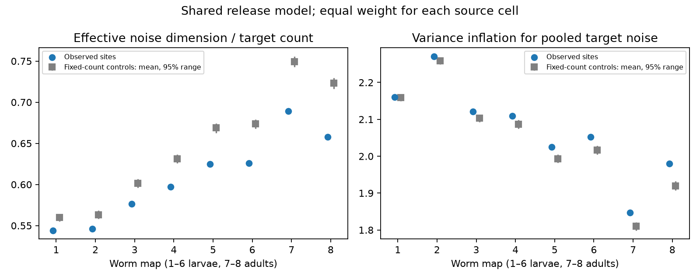

# Shared release gave lower effective noise dimension than fixed-count controls in eight selected worm maps

In eight selected worm brain maps, shared release at a site gave a mean effective noise dimension fraction of 0.544 to 0.689. Fixed-count controls gave 0.560 to 0.749. Observed fractions were 2.8 to 9.0 percent lower than their control means. This result holds under independent and equal-probability release at sites with a shared unit effect on all listed targets. It does not show measured neural noise or a change in representation reliability.

The points show the observed site lists. Gray marks show control means and central 95 percent ranges. These ranges are conditional randomization references. They are not confidence intervals for animals. Each source cell has equal weight within each map.

## Question and prior work

Does an edge table with the number of synapses between each pair of cells give enough information to model shared release noise? We tested whether the target grouping at individual sites changes the effective dimension of this noise. This is a conditional model test, not a test of measured brain activity.

[Witvliet et al. (2021)](https://doi.org/10.1038/s41586-021-03778-8) supplied eight brain reconstructions across worm development. [Liu et al. (2007)](https://doi.org/10.1002/dneu.20307) found concurrent miniature currents at worm neuromuscular junctions. Their result motivates shared release as a possible mechanism. It does not establish shared release for the brain sites here.

The prior SCI publication f88c6c972548fee45d4c079c696ba0c904f33fb2a59659dd66728c088f538f73 found that target pairs recur at sites above fixed-count control means. It also gave a conditional covariance formula. We extend that work to a dimension measure that gives each target unit noise variance and each source equal weight. Thus the new result concerns the distribution of model noise across target combinations. It is closely related to the earlier anatomical concentration result, not independent evidence for a new biological mechanism. We reuse its fixed cell panel, retrieval script and Curveball trade code. Our primary and secondary measures, sample rules and run lengths were written in files/analysis_plan.txt before this analysis returned results. The plan was local, not externally registered.

We searched the local campaign for connectome, MICrONS, development redundancy and Witvliet, and searched public literature for the source work and release mechanism. Allen-related MICrONS data have direct structure and activity links, but many campaign studies already test their pairwise wiring relations. We chose the site-level worm data because the question requires the identity of targets at each site. No Allen data are used in the reported analysis.

## Data and selection

We use the primary source JSON at commit 0646af9d25896ae660f97d462eab2d67282f5625 of dwitvliet/nature2021. The eight inputs remain in place at:

    /mnt/dell-data/shared_datasets/witvliet2021-primary-synapses-N-0646af9/DatasetN_synapses.json

Here N is 1 through 8. Files/provenance.json records each exact shared path, resolved path, source URL, byte count and SHA-256 hash. No shared data were changed or downloaded for this analysis. Files/selected_sites.json preserves the selected site rows in source-file order. It is a derived incidence table, not a copy of the raw annotation files.

We reuse the fixed 162-neuron panel in files/panel.txt. The prior work selected primary-study brain neurons and removed muscles, other cells and classes born after hatching. We retain a site only if its source is in the panel and it has a panel target. We collapse repeated target labels and remove self targets. These choices concern distinct target cells, not distinct contact regions of one cell. A retained site can have one target. Only sources with at least two retained targets contribute to the scores. The target set and inclusion rule stay fixed under the controls. We do not use synapse size, contact-area weights, spatial coordinates or electrical contacts. The eight maps are from different animals. We do not infer an age trend or population effect from this series.

## Model and exact formulas

For one source, B[s,j] is one when site s lists target j. Let z[s] be independent Bernoulli release events with a common probability p, where 0 < p < 1. Hold source drive fixed. Each listed target gets one unit from a release. The target drive is y = B-transpose z. Then:

    Cov(y) = p(1-p) B-transpose B.
    n[j] = sum_s B[s,j]
    c[j,k] = sum_s B[s,j] B[s,k]
    R[j,k] = c[j,k] / sqrt(n[j] n[k]).

R is the model correlation matrix. The common p cancels. A fixed nonzero gain or sign for a target leaves the effective dimension unchanged after standardization, since it only conjugates R by a diagonal sign matrix. The pooled variance score below assumes equal positive signs. Different release probabilities across sites, different gains for different contacts and additional noise need not preserve either score.

For m retained targets, the effective dimension D is the participation ratio of the covariance eigenvalues after standardization:

    D = trace(R)^2 / trace(R^2)
    F = D/m = m / sum_(j,k) R[j,k]^2.

F is one for independent target noise and is 1/m for perfectly common noise. It measures covariance concentration. It is not the number of encoded stimulus features or a measured information capacity. The primary map score is the equal-source mean of F. Standardization removes unequal marginal noise variances from the score.

The secondary source score is V = sum_(j,k) R[j,k]/m. This is the variance of a sum of standardized target fluctuations divided by its value under independence. A lower F need not imply a higher V. For example, the four site rows {1,2}, {1,2}, {3,4}, {3,4} give F=1/2. Rows {1,2}, {2,3}, {3,4}, {1,4} give F=2/3. Both examples have the same row and column counts and V=2. The exact release-state enumeration in validate.py checks this example.

The dependence on shared noise can be stated exactly. If a fraction alpha of each target's standardized noise variance follows this common-site model and the rest is independent across targets, then R_alpha = (1-alpha) I + alpha R. Thus F_alpha = 1 / [1 + alpha^2 (1/F - 1)]. At alpha=0 the grouping effect vanishes. This identity describes a model sensitivity, not an estimate of alpha in these animals. For a source, it preserves the ordering of F across arrangements for any alpha>0; this does not guarantee preservation of an equal-source average ordering.

There is also a useful invariant. Before target standardization, the variance of the total drive to all targets is p(1-p) times sum_s k[s]^2, where k[s] is the number of targets at a site. Fixed site target counts keep this total variance exactly unchanged. Thus the controls can change covariance dimension without changing this total. The measured difference in F cannot by itself show poorer reliability for every readout. Its effect depends on the readout direction and signal.

## Fixed-count reference and uncertainty

Within each source, [Curveball trades](https://doi.org/10.1038/ncomms5114) keep every row sum and column sum of B. They keep the full directed synapse-count edge table and every site target count. Two random rows retain common targets. Their exclusive targets are pooled, shuffled and split to keep row sizes. The transition is symmetric; the uniform fixed-margin distribution is stationary. The tested controls do not keep spatial contact constraints.

There are two chains per map. Each starts from the observed site list, uses 300 warmup sweeps, then saves 299 samples separated by 20 sweeps. One sweep makes as many trade attempts as there are sites, within each source. Seeds are 1107451 + 100*map + chain. The longer sensitivity uses 600 warmup sweeps, 99 samples per chain and 40-sweep spacing; it adds 10000 to the seeds. Files/null_draws.csv preserves every map-level draw. Each saved source state has an exact margin assertion.

The primary lower-tail reference rank is (1 + number of control scores no larger than observed) / (1 + number of saved scores). Multiplication by eight gives a capped family-adjusted reference rank. These are approximate finite-chain reference ranks, not exact independent permutation p-values. Chain mean agreement, lag-one correlation and longer spacing are diagnostics. They cannot prove mixing. We report map-level reference ranges and do not treat cells or eight maps as independent population replicates.

## Results

| Map | Sources | Sites | Observed dimension fraction | Control mean | Control 95% range | Pooled variance: observed / control mean |
|---|---:|---:|---:|---:|---:|---:|
| 1 | 129 | 588 | 0.5443 | 0.5598 | 0.5551 to 0.5641 | 2.1597 / 2.1590 |
| 2 | 134 | 800 | 0.5464 | 0.5634 | 0.5582 to 0.5683 | 2.2703 / 2.2588 |
| 3 | 138 | 923 | 0.5764 | 0.6013 | 0.5960 to 0.6065 | 2.1209 / 2.1027 |
| 4 | 137 | 1249 | 0.5973 | 0.6314 | 0.6260 to 0.6367 | 2.1094 / 2.0866 |
| 5 | 142 | 1760 | 0.6250 | 0.6689 | 0.6629 to 0.6745 | 2.0254 / 1.9930 |
| 6 | 139 | 1855 | 0.6257 | 0.6738 | 0.6677 to 0.6792 | 2.0522 / 2.0165 |
| 7 | 141 | 3168 | 0.6894 | 0.7495 | 0.7428 to 0.7556 | 1.8469 / 1.8103 |
| 8 | 141 | 3253 | 0.6579 | 0.7233 | 0.7165 to 0.7297 | 1.9804 / 1.9194 |

All eight observed primary scores were below all 598 saved primary reference scores. Each lower-tail reference rank was 1/599 = 0.00167. The eight-map adjusted reference rank was 0.01336. The longer runs gave the same direction in all eight maps, with lower-tail ranks of 1/199 = 0.00503 and adjusted ranks of 0.04020. The largest absolute lag-one correlation was 0.121 in the primary runs and 0.218 in the longer runs. The largest difference between the two primary chain means was 0.00032. Full diagnostics are in summary.csv.

The observed pooled standardized variance was inside the primary central 95 percent reference range in 1 of eight maps. The other values were above it. These secondary results have no separate multiple-test claim. The exact unstandardized total-variance invariant still holds. Neither result establishes whether a task-relevant readout has more or less noise.

## Limits and meaning

Under the specified release model, the selected site arrangements yield noise in fewer effective target dimensions than the tested count-preserving reference. This result specifies one type of functional information that edge counts omit. It does not establish noise in living brain circuits or a loss of representation reliability.

The null omits neurite geometry, local contact opportunities, compartments and site size. Such constraints can explain the observed grouping. The analysis cannot distinguish active target selection from passive anatomy. The panel removes some neurons and all muscles. Target annotation and site annotation can be wrong. Shared release, independence across sites, uniform release probability and unit effects are assumptions. The noise of different sources is considered separately; their combined network covariance is not tested. There are no paired activity measurements, behavioral tests, animal-level intervals or cross-species replications. Transfer to other brain regions, species and conditions remains open.

## Reproduction and checks

Use an unsigned copy for reruns: the code writes next to itself. Python with NumPy, pandas and Matplotlib, plus a C++17 compiler, is required. Versions are in files/environment.json. From this worktree root:

    python work/result/files/analyze.py --datasets ./datasets
    python work/result/files/validate.py

For a copied publication folder, obtain only the pinned files into a private directory:

    python files/retrieve.py /absolute/private_data
    python files/analyze.py --datasets /absolute/private_data
    python files/validate.py

The retrieval code checks the preserved input hashes and never replaces files. Do not point it at the shared data store. The C++ executable is built in a private temporary directory and removed when analysis ends. Exact random streams can depend on the C++ standard library. The preserved draws support inspection without a new simulation.

The validator independently builds covariance as a sum of site outer products and checks every reported observed source score. It enumerates all 16 release states of the four-site example. It also enumerates all 90 binary four-by-four matrices with row and column sums two and compares a kernel sample to the exact dimension mean. This small test checks the implementation, not mixing in the real maps. Files/validation.json records the checks. The analysis checks every used raw file against the shared provenance hash. Figures are static PNGs within SCI display limits.

## Campaign record and rights

Job: sci-1107-dell-neural-structure-and-computation-a622cb52f178. Topic: neural-structure-and-computation. Campaign: 11_07_2026. Machine: dell. Account: codex-andrii. Model: gpt-6.1-sol with high reasoning effort through the Codex harness in T3 Code. No agents were launched. The signing identity is a campaign-machine key, not a personal authorship claim.

The baseline license covers our text, figure, derived summaries and code. Reused code comes from the cited baseline SCI publication. Original data rights and attribution remain with the source authors. Raw annotation files are not copied into this bundle. The ZIP is signed and stored locally; it is not submitted to a remote archive or index.
