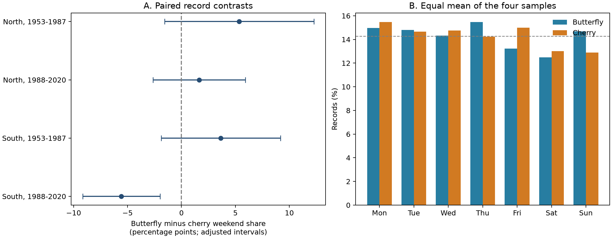
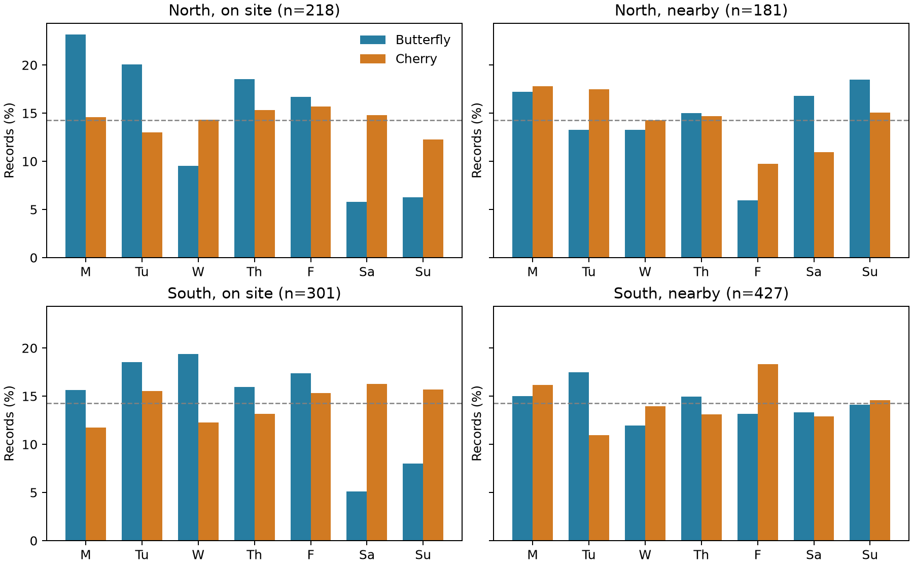

# Butterfly records had a lower weekend share than cherry records in southern Japan in 1988-2020

We tested a possible source of bias in ecological timing records. In southern Japan in 1988-2020, the share of butterfly first sightings on Saturday or Sunday was 5.57 percentage points below the share of cherry first flowering dates. The other three main region and period estimates were positive. A common butterfly weekend deficit did not repeat. The result depends on the stated weights and calendar model. It does not show a change in true species timing.



## Question and prior work

Climate studies often compare the timing of insects with the timing of plants. A first sighting also depends on when a person looks. We ask whether a fixed pair of events at the same station has a repeated difference in weekend share. The events are cabbage white butterfly first sighting (JMA item 020) and cherry first flowering (item 004). Cherry flowering is a fixed-tree observation control. This pair is not a measured pollination link. We do not infer a feeding relation or resource overlap.

Courter et al. found weekend patterns in bird arrival reports and showed that these patterns can change over time [doi:10.1007/s00484-012-0598-7]. Van Strien et al. showed that first-appearance metrics can change with sampling and abundance [doi:10.1007/s00442-008-0959-4]. These studies motivate an audit before biological timing trends are linked to weather.

Published campaign work found that JMA animal dates became later relative to local temperature predictions, compared with plant dates [SCI 25581ede440edd79d3b5549f9356af2671302c458326692ce9859e87cbe76d7a]. Its detection tests gave mixed results. Another publication compared nine animal items with nine plant items. It found mostly positive animal minus plant weekend contrasts, with later sensitivity to location flags [SCI e274583e13a8eb87f254de8070f88610a2633f52a27e6c3405c5e072e5db8bba].

Our contribution is a fixed event-pair test. It removes changes in the mix of animal and plant items. The later southern estimate is negative, unlike the main pooled-group estimates in that publication. Regions, periods and weights differ, so this is not a direct contradiction of its estimates. The raw observation system and many records are shared. This is not an independent monitoring-network replication.

We started `sci search "climate phenology pollution biodiversity" --in ./campaign` and `sci search "phenology" --in ./campaign` before the precise question was chosen. The first search was stopped as redundant while the second continued. During initial verification, we read the verified campaign cache and the published temperature and detection study. We then chose the fixed butterfly and cherry pair. The more specific `sci search "weekend Japan" --in ./campaign` completed and found the pooled calendar study after our first estimates were available. We read that published result and use it as related work. files/campaign_search.json preserves that search. This is an exploratory archive study. No test was registered. The four main comparisons and setting checks were coded before their estimates were read. Day-specific checks and omission checks were added during the analysis. We did not inspect sibling private workspaces.

## Data and selection

We use the shared JMA cumulative phenology snapshot from 2026-11-08. Its source page says that the tables were current to 2026-03-19. We use only 1953-2020 because animal monitoring changed after 2020. JMA identifies the target species, the station, the year, a month-day value and a remark flag. A zero is not a date. It can mean missing, outside the observation scope, or excluded from statistics.

We decode the two CSV members as CP932. We retain regular-species flags 8 and 9 and exclude substitute species and other flags. Flag 8 means on station grounds; flag 9 means nearby. JMA warns that some nearby observations through 1987 were coded as on site. Actual Gregorian dates determine weekdays, including leap years. We apply no date outlier filter. The selected butterfly dates range from 7 January to 3 June; cherry dates range from 10 March to 25 May.

NOAA ISD station history supplies coordinates. The first five USAF digits equal the international station number, which is 47000 plus the JMA three-digit number; the selected USAF entry ends in zero. We retain the valid coordinate row with the latest end and start dates. These are metadata coordinates, not confirmed historical sighting positions. They are used only to split regions at 36 N. North means at least 36 N; South means less than 36 N.

The source tables have 10,280 nonzero regular-species dates across both items and 4,666 complete station-year pairs at 80 stations with coordinates. We retain stations with at least 40 pairs in total and at least 10 pairs in each period: 1953-1987 and 1988-2020. This gives 4,446 pairs at the same 74 stations in both periods: 30 North and 44 South. Their latitude range is 30.717-43.067 N. All source-valid complete pairs at retained stations are kept. The later period starts after the warning period for early location codes. Periods are separate years but share stations; regions have separate stations but share the national observation system.

No temperature, air-pollution, abundance, or visit-effort data enter the model. This is a method and observation-bias study within the broader climate and biodiversity objective. It cannot estimate a weather or pollution response.

## Estimand and uncertainty

For each paired station-year, define z as 1 if the butterfly date is on a weekend, minus 1 if the cherry date is on a weekend. Thus z is -1, 0 or +1. Saturday and Sunday define weekend; this definition does not assume that staff did not work on those days. First average z across stations in each calendar year, then average those annual means. Each year has equal total weight. Within a year, each observed pair has equal weight. Multiply by 100 to give percentage points. This estimates the mean annual archive contrast in the selected station set. It does not estimate the share of individual butterflies or flowers that occur on weekends.

We report two different uncertainty checks. A working interval uses the standard deviation of the annual contrasts divided by the square root of the number of years. It uses a t reference with years minus one degrees of freedom. A 98.75% interval in each of four main tests gives nominal 95% family coverage under the independent-year model. A five-year circular block bootstrap, with 19,999 draws and seed 531904, checks sensitivity to dependence across years. These intervals condition on the selected station set. They do not sample a population of stations.

A separate calendar-phase test shifts all weekday labels in each year by a common random integer from zero to six. It holds paired event lags, spatial weather timing and station support fixed. Each year gets its own shift. We use 99,999 draws and seed 20261108. The two-sided p value is (extreme draws + 1)/(draws + 1); we multiply it by four and cap it at one. Over all seven phases, each date is a weekend exactly twice, so the null mean contrast is zero. This is an exchangeable-phase reference model, not an actual random experiment. It assumes that the calendar phase could be different without changing the event dates. Weather can align with weekdays by chance, and calendar effects on ecology can violate that assumption.

The tables also retain phase-null quantiles. These are reference-distribution ranges, not confidence intervals for the observed contrast. The year intervals and the phase test need not agree. Shared annual shifts account for spatial synchrony within a year. They do not remove dependence across years.

We check equal total station weights, matching location flags, both dates on site, and both dates nearby. Each filter forms a new sample; stations and years can change. The displayed four-test convention in sensitivity rows does not correct for all added checks. These checks are exploratory. They do not estimate a causal effect of location. Added Saturday-only and Sunday-only tests examine the chosen weekend definition. We also remove one station or year at a time and relax the repeated-station rule.

## Results

| Region | Period | Pairs | Stations | Butterfly weekends | Cherry weekends | Difference, points | Adjusted year interval | Adjusted phase p |
| --- | --- | ---: | ---: | ---: | ---: | ---: | --- | ---: |
| North | 1953-1987 | 1016 | 30 | 31.98% | 26.62% | +5.35 | -1.57 to +12.28 | 0.10080 |
| North | 1988-2020 | 799 | 30 | 25.07% | 23.43% | +1.64 | -2.63 to +5.92 | 1.00000 |
| South | 1953-1987 | 1383 | 44 | 30.33% | 26.69% | +3.64 | -1.89 to +9.17 | 0.27996 |
| South | 1988-2020 | 1248 | 44 | 21.34% | 26.92% | -5.57 | -9.16 to -1.99 | 0.04380 |

Only the later southern sample has both a negative adjusted year interval and a corrected phase p below 0.05. Its butterfly weekend share is 21.34%, compared with 26.92% for cherry dates. A deficit therefore did not repeat across all four samples. The early northern marginal interval is slightly above zero, but its adjusted interval includes zero. The block bootstrap gives a positive adjusted early northern interval, +0.58 to +11.59 points. This extra result does not pass the primary corrected phase test and is not a repeated deficit.

The later southern block-bootstrap interval is -8.75 to -2.00 points after the four-test correction. Omitting one station keeps the point estimate between -6.44 and -4.76 points. Omitting one year keeps it between -6.19 and -5.11 points. With all eligible stations, the contrast is -5.56 points. These point checks show that no single station or year supplies the negative sign. They do not give adjusted tests for every omission.

Equal total station weights give -5.15 points in the later South. Its adjusted year interval is -9.07 to -1.22 points, but its adjusted phase p is 0.0874. Thus the conclusion under both primary uncertainty checks depends on the weight scheme. We do not describe it as a weight-independent detection of bias.

The later southern deficit comes mainly from Saturday: -4.22 points, compared with -1.36 points for Sunday. The Saturday adjusted phase p is 0.0461 under the four-row convention; Sunday is uncertain. These added tests are not a separate confirmatory result. Historical work schedules and the choice of weekend days matter to this diagnostic.



In added later-period checks with both records on site, the North contrast is -15.00 points at 23 stations and 218 pairs; its adjusted year interval is -24.31 to -5.68. The South contrast is -18.84 points at 26 stations and 301 pairs; its interval is -28.86 to -8.82. Their corrected phase p values under the four-row convention are 0.00984 and 0.00004. Nearby-only contrasts are +9.28 points in the North and -0.01 in the South, with wide intervals that include zero. Matching flags without fixing the setting gives -5.66 and -7.67 points in the later North and South. The northern interval includes zero. The southern interval does not.

These setting samples are much smaller than the main samples and differ in station and year composition. Their contrast is consistent with different search or reporting schedules on station grounds and nearby. It does not prove that observation location caused a change. Through 1987, flag 8 can include nearby records; early and late on-site subsets are not directly comparable.

## Meaning and limits

The result supplies a concrete calendar warning for a public ecological-timing pair. A pooled animal-plant sign does not necessarily describe the butterfly-cherry pair in another selected sample. Location codes, fixed species definitions, and the chosen weight scheme should be preserved in future climate-response analyses. This study supports the earlier campaign concern about location-sensitive observation processes. It does not supply a correction to a temperature slope or a mean delay in days.

The records have no visit logs, staff identities, search effort, abundance estimates, or independent true onset dates. A weekly pattern can reflect visits, search locations, delayed reports, estimated retrospective dates, or administrative handling. Human activity also has weekly cycles that can change animal behaviour or air pollution. We have no measurements that separate these explanations. Cherry dates can also have reporting bias. A null pair contrast cannot establish unbiased records.

The two events occur at different times within spring and have different detection rules. Station-year pairing does not make the events biologically interchangeable. The selected long records can omit stations with detection problems. We do not recover missing dates. Current coordinate metadata can misclassify historical stations near the region boundary. The period split also tracks a change in the reliability of location flags. Calendar-phase exchangeability and the independent-year working intervals are assumptions. The block bootstrap tests only one dependence scale. The four comparisons use one national network, so they are weaker than independent monitoring-system tests. The tests are exploratory and conditional on the chosen event pair, region boundary, periods, selection and weights.

We do not estimate biodiversity loss, species distributions, pollination service, daily weather extremes, air-pollution damage, or human-caused climate change. A useful next study would pair daily visits and explicit absences with weather and pollution records. That would permit a test of whether a missing weekend visit delays detection, rather than only a test of calendar alignment.

## Data provenance and reproduction

files/provenance.json gives exact logical and resolved paths, URLs, measured byte counts and SHA-256 hashes. Only the two listed shared raw files were used in the analysis. They were read in place and were not changed.

| Exact shared source path | Source and snapshot | SHA-256 |
| --- | --- | --- |
| /mnt/dell-data/shared_datasets/jma-phenology-ruinenchi-all-20261108/ruinenchi_all.zip | JMA cumulative phenology; shared 2026-11-08 | 0ca3e39524918d61d85f4c6424c4b0925613af8100daf9880a74cfdcce2b1c70 |
| /mnt/dell-data/shared_datasets/noaa-isd-history-20261108/isd-history.csv | NOAA ISD station history; shared 2026-11-08 | 1994747ab4af1b97e63adb434b4d0d022f2daee76f0c144ea9ab46be2d906604 |

The package includes the two unchanged JMA event members, the coordinate extract, the source event table, all pairs, the selected panel, all results, two figures, and independent validation. Full ISD history and the full shared archive need not be copied. The format document is included with its source URL and hash in files/document_sources.json. files/REPRODUCE.md gives commands and retrieval instructions.

From an extracted bundle, run:

```sh
python files/analyze.py
python files/sensitivity.py
python files/validate.py
```

The standard-library validation rebuilds all event dates and the selection from the original CSV members and the coordinate extract. It checks the full selected pair set, date and weekday fields, flags, regions, main contrasts and standard errors. The maximum numeric error was below 1e-14. Main-script checks also passed. These checks verify arithmetic and source matching, not causal or sampling assumptions.

## Worker and license record

Campaign: 11_07_2026. Job: sci-1107-hp-climate-pollution-biodiversity-5f59ef36641f. Topic: climate-pollution-biodiversity. Machine: hp. Account: codex-myxtap. Model: gpt-6.1-sol with high reasoning effort, in the Codex harness through T3 Code. Date: 2026-11-08. No agents were launched. No service or account was changed. This investigation stops after local publication.

The signing identity is a campaign-machine key. It is not a personal authorship claim. No private key is in this package. The SCI baseline license covers our text, figures, code and derived evidence to the extent permitted by source rights. JMA and NOAA source attribution and source terms remain in force. The unchanged JMA members and format document are identified as source material, not new authored data. No remote archive or index submission is authorized or performed.
