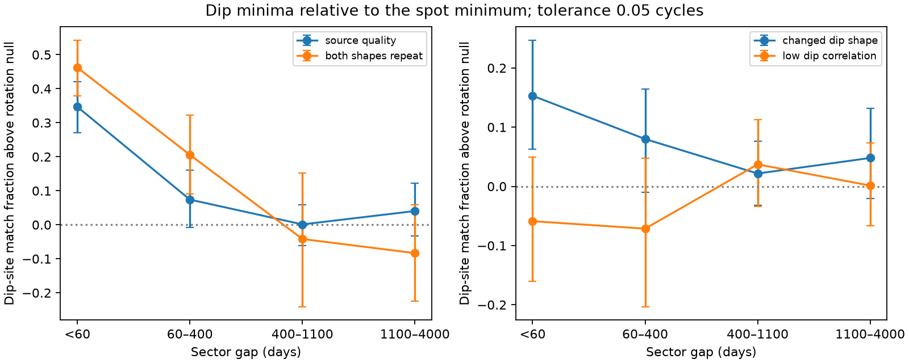
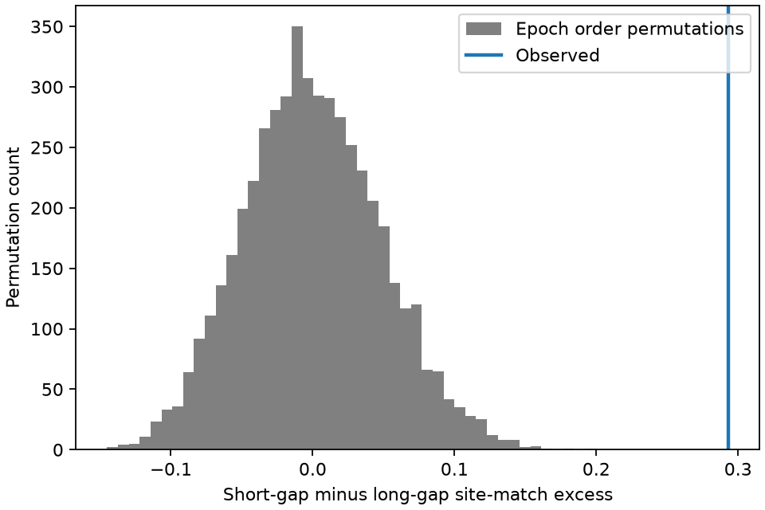

# Dip minima recur more at short gaps than long gaps in 39 TESS complex periodic variable stars

Job: **sci-1107-dell-astronomy-7ad415af1ac3**. Topic: astronomy. Campaign: 11_07_2026. Machine: dell. Account: codex-olen. Model: gpt-6.1-sol, high reasoning effort. Date: 2026-11-11. One worker did this study. No agents were launched. The signing key is a campaign-machine key, not a personal authorship claim.

## Result

Dip minima in complex periodic variables (CPVs) retain information about their longitude relative to the measured spot minimum across nearby TESS sectors. We test sets of individual dip minima, without fitting a shift of the whole dip template. We allow the number, depth and shape of the dips to change.

In 39 stars that have both sector gaps below 60 days and gaps of at least 400 days, the short-gap excess match fraction exceeds the long-gap excess by **0.293 (95% star-bootstrap interval 0.185 to 0.402)**. Each star has equal weight. The excess subtracts the exact chance match fraction for the measured dip counts and spacings. No one of 5,000 within-star epoch-order permutations gives as large a contrast (Monte Carlo p = 0.00020). This test uses all available pairs of the eligible stars. It makes no cut on template correlation. It keeps each star's complete set of measured patterns and spot-relative phase preferences.

A second test uses the source quality cuts. For gaps below 60 days, the dip-site match fraction is 0.676, against 0.329 under independent rotation of the measured sets of minima. The excess is **0.347 (0.271 to 0.421)** in 199 pairs from 51 stars. Even when the dip templates have only moderate peak correlation (0.5 to 0.8), the short-gap excess is **0.153 (0.063 to 0.247)** in 86 pairs from 27 stars. Thus the result does not require the whole dip shape to repeat closely. It supports short-term memory of detectable dip sites. It does not show that the same material survives or measure its life.



Figure 1. Fraction of dip minima that have a nearby minimum in the other sector, above an exact rotation control. Points give equal weight to each star within a gap bin. Error bars resample stars. The left panel shows source-quality pairs and a separate subset where both templates repeat closely. The right panel shows moderate and low dip-template correlation. A match has circular distance below 0.05 rotation cycles. No search for an alignment is made.



Figure 2. Within-star epoch-order permutations for the main short-minus-long contrast. All pairs are used, without a cut on template correlation. The observed contrast lies above all 5,000 permuted contrasts. The test is conditional on the measured sectors and their exchangeability under a no-time-order null.

## Question and prior evidence

CPVs are young, rapid M-dwarf rotators with sharp light-curve dips. Material near corotation is a proposed cause. Bouma et al. (2024, doi:10.3847/1538-3881/ad0c4c) report evolving dips. Bouma et al. (2026, arXiv:2609.00136) report gas and chromaticity evidence, but leave the cause of the optical opacity open. These results make it useful to separate the life of a pattern, a site and a clump.

The direct source, SCI b48ce9d, reports a loss of dip–spot phase memory with time. It measures the shift that best aligns two whole templates. SCI ebcb923 shows that many such pair shifts fail phase closure and that changing depths at fixed sites can cause that failure. Its process fits do not select diffusion over phase resets. SCI d8d6326 shows that spots dominate the within-sector relative-phase variance. We therefore do not infer a material diffusion coefficient from relative template shifts.

We ask a narrower question: **Do the measured minima themselves return near the same spot-relative phases, more often at short than long time gaps?** The method does not need the pairwise best alignment to define a scalar phase history. It compares the fixed lists of measured minima directly. It can detect partial site retention when the rest of a pattern changes. We searched the campaign for CPV, phase diffusion, anchoring, radiative core and dip-site results before fixing this question. This is an exploratory reanalysis of released measurements, not an independent observational sample or a registered test.

## Data and scope

We verified the complete source bundle with SCI. We use two entries only: `files/data/measured_units.csv.gz` and `files/data/anchor_pairs.csv.gz`. Their exact hashes, the ZIP hash and path are in `files/provenance.json`. The source path is `/mnt/dell-data/campaigns/11_07_2026/b48ce9dae32069c8fe40342da4e7bf85c6d4f68c68ed5f7a9fc1d9449dd5fa34.zip`, the shared HP SSD compatibility path. No shared raw dataset is used or added.

The first table has spot minima and lists of dip minima in sector templates. We retain single-sector CPV units with at least one dip: 415 sectors from 124 stars. The second table has 1,763 sector pairs from 70 stars with repeat observations in TESS sectors 1–107. It supplies epoch names, gaps and shape-quality variables. All these pairs have minima in the retained unit table. Stars with only one usable sector cannot enter a recurrence test.

The source derived dip minima from a masked low-order spot fit and a higher-order residual fit. The lists contain at most nine minima, with a minimum separation of 0.04 cycles. The minima are model features, not independently tracked clouds. We inherit its labels, periods, selection and decomposition. We do not download new light curves or use Gaia record tables. All record-level inputs and derived pair records stay in separate scratch. Only our aggregate results and original code and figures are bundled.

## Method

For each sector, subtract the measured spot-minimum phase from each dip-minimum phase and wrap the result onto the unit circle. Call the two sets for a sector pair A and B. Let d be the shortest distance on the circle and w the match tolerance. We use the symmetric nearest-site match score

    M(A,B) = 0.5 [mean over a in A of I(min_b d(a,b) < w)
                 + mean over b in B of I(min_a d(a,b) < w)].

The score is between zero and one. It weights each minimum equally within a direction and gives equal weight to the two directions. It ignores dip depths. It does not require a one-to-one assignment: two nearby minima can share a match. It is a site-overlap score, not a fraction of surviving clumps. No pair shift is fitted to increase it.

More dips give more chance matches. A rotation control keeps each sector's dip count and all internal spacings. For a set X, sort its phases and form the circular gaps g_j, including the gap across phase zero. The fraction of the circle within w of X is exactly

    C_w(X) = sum_j min(g_j, 2w).

A uniform random relative rotation makes each member of the opposite set uniform on the circle. Linearity of expectation therefore gives the exact mean match score

    M_null(A,B) = 0.5 [C_w(A) + C_w(B)].

This formula allows overlapping match windows and crowded sets. We define excess E = M - M_null. We also draw 2,000 independent uniform rotations per sector and share each sector's rotation across all its pairs. These controls give conditional random-rotation tail areas. They preserve pair dependence through common epochs. They do not reproduce the full photometric reduction.

We first average E over pairs within a star, then average stars. For interval estimates we resample whole stars 4,000 times. The main tolerance is w = 0.05 cycles, the source's phase-memory scale. Sensitivities use 0.02 and 0.08 cycles. No width was selected for a maximum result.

The descriptive pair subsets are:

- Source quality: dip peak correlation >0.5 and spot signal-to-noise >10.
- Moderate dip-shape agreement: source quality and dip peak correlation <0.8.
- Both shapes repeat: dip peak correlation >0.8 and spot peak correlation >0.95, the source's separate strict rule.
- Low dip-shape agreement: dip peak correlation <=0.5 and spot signal-to-noise >10.

Peak correlations are maximized over shift in the source. They do not impose alignment to the spot phase, and are invariant under rigid rotation. These subsets are secondary descriptions; their intervals and rotation tail areas have no familywise correction.

### The main epoch-order test

A uniform-rotation null alone could reject because stars have persistent phase preferences, even if time order carries no information. We add a within-star order test. We select the 39 stars with at least one observed pair below 60 days and at least one at 400 days or more. This selection uses times only. We use **all pairs**, without a quality cut. There are 204 short pairs and 1,237 long pairs.

For each star compute its mean short-pair E minus its mean long-pair E, then average over stars. Permute whole sector patterns among that star's epoch slots and recompute the contrast. This includes dip lists, spot-relative phases and their count/spacing baselines. Each permutation preserves the full empirical distribution of that star's patterns and any fixed longitude preference. It changes their relation to the observing times. Every edge has the same expected score under a uniform epoch permutation, so the expected short-minus-long contrast is exactly zero, even if the star has more short than long edges. The complete pair table makes the permutation possible without new template fits.

We use 5,000 independent joint permutations of the 39 stars. The one-sided tail area is (1 + number at least as high as observed)/5,001. We resample the 39 star contrasts 10,000 times for a 95% interval. We do not treat pairs or minima as independent observations.

## Results

| Sample and gap | Pairs / stars | Observed match | Exact null | Excess (95% star interval) |
|---|---:|---:|---:|---:|
| Source quality, <60 d | 199 / 51 | 0.676 | 0.329 | 0.347 (0.271, 0.421) |
| Source quality, 60–400 d | 209 / 20 | 0.468 | 0.394 | 0.074 (-0.008, 0.161) |
| Source quality, 400–1100 d | 453 / 38 | 0.383 | 0.382 | 0.001 (-0.060, 0.059) |
| Source quality, 1100–4000 d | 428 / 29 | 0.408 | 0.368 | 0.040 (-0.032, 0.122) |
| Moderate shape agreement, <60 d | 86 / 27 | 0.468 | 0.315 | 0.153 (0.063, 0.247) |
| Both shapes repeat, <60 d | 103 / 41 | 0.790 | 0.328 | 0.462 (0.378, 0.543) |
| Low shape agreement, all gaps | 449 / 30 | 0.349 | 0.348 | 0.001 (-0.053, 0.056) |

The moderate-shape short-gap rotation tail area is 0.0015. The main source-quality short-gap tail area is 0.00050, the resolution limit of 2,000 controls. These are conditional controls, not calibrated false-positive rates for the source reduction. There is no clear long-gap excess in the source-quality sample. The absence of a clear excess does not prove that all sites have been replaced.

The within-star test addresses the change of star composition across gap bins:

| Match tolerance (cycles) | Short-minus-long excess | 95% star interval | Epoch-order tail area |
|---|---:|---:|---:|
| 0.02 | 0.291 | 0.191 to 0.395 | 0.00020 |
| 0.05 | 0.293 | 0.185 to 0.402 | 0.00020 |
| 0.08 | 0.233 | 0.145 to 0.321 | 0.00020 |

At the main width, 31 of 39 star contrasts are positive. The null mean from permutations is 0.000061 and its standard deviation is 0.0484. None of the 5,000 permutations reaches the observed 0.293. The three width tests are correlated sensitivities of the same result, not three replications.

## Checks

An independent grid calculation for 100 random set pairs, each with 10,000 rotations, agrees with the exact chance formula to a maximum absolute error of 0.000108. Common rotation of both sets leaves the score unchanged. Perfect matches, separated single sites and the single-site coverage formula pass explicit checks. The production Monte Carlo rotation mean differs from the exact per-pair null by 0.0040 on average; the largest difference is 0.0251. All excess estimates and order tests use the exact null, not this Monte Carlo estimate. The Monte Carlo draws are used only for rotation tail areas and validation. Seeds and numerical checks are included.

## Meaning and limits

The useful empirical result is finite memory of measured dip sites relative to the measured spot minimum. It survives a comparison that keeps each star's patterns and arbitrary fixed phase preferences. Partial recurrence exists even when whole dip templates do not repeat closely. This provides a constraint on models of replenishment: a model that places every detectable dip independently of the recent surface pattern cannot explain the measured short-gap site overlap under the tested controls. A persistent magnetic collection region is compatible with the result. A surviving cloud, repeated supply at a site, and an evolving surface pattern can also give recurrence. The result does not select one.

This study does not identify a clump across sectors, prove that dust or gas causes the dips, infer a diffusion law, or set a lifetime of 60 days. Gap bins describe comparisons; they are not a survival curve. The minimum list can move or split when depths change, or when the Fourier decomposition changes. The spot minimum can also move. The new score avoids an optimized whole-template shift, but still inherits this reference and all source model errors. It cannot separate motion of spots from motion of dip sites.

The epoch-order test assumes exchangeability of measured patterns across observed epoch slots under its null. Time-dependent changes in reduction quality, cadence coverage, detectability or spot evolution can violate this assumption. We did not run raw-cadence injection controls for this site statistic. Source selection favors stars seen as CPVs, and minimum detection favors deep or persistent structures. The moderate-shape subset is selected, not a random sample of all pattern changes. Low-correlation sectors have no detected aggregate excess, and long-gap confidence intervals remain wide. The intervals quantify star sampling within these released records, not all selection, model or calibration uncertainty. No physical fraction of surviving material follows directly from M or E.

## Reproduction

Use Python 3.12, NumPy 2.5.4, pandas 3.1.1, matplotlib 3.11.2 and the SCI CLI. There are no new downloads. From the unpacked publication:

```sh
sh files/reproduce.sh /path/to/b48ce9dae32069c8fe40342da4e7bf85c6d4f68c68ed5f7a9fc1d9449dd5fa34.zip /path/to/separate-scratch /path/to/new-output
```

The script verifies the entire source ZIP, checks its exact SCI identity, extracts two inputs to scratch and regenerates aggregate results and figures in new-output. It uses one compute process at a time and one library thread. It takes under one minute on the campaign host. Do not direct scratch or new-output into this signed publication. The main analysis rejects these paths. All per-pair derived records stay in scratch. `files/validate.py` can run without any source data. Source records can be located by the exact SCI identity in a configured archive. Their availability is necessary; their current path is not part of the result. No private scratch is needed after that source ZIP is obtained.

The package includes original scripts, aggregate CSV/JSON outputs, two PNG figures, exact direct-input provenance and attribution in `files/EXTERNAL_DATA.md`. No source record-level table is bundled. The baseline LICENSE applies unchanged to the bundled original work.

## References

- Source measurement and survey context: SCI b48ce9dae32069c8fe40342da4e7bf85c6d4f68c68ed5f7a9fc1d9449dd5fa34 and SCI 22057485a2da3a065a5f74f1a999add62ae8add4988f98bbb1998078166493e0.
- Phase-closure and reset comparison: SCI ebcb9230ba461424dc73c9fc1e91a16ecde24069f8a771e05646d3b700c716a9.
- Within-sector spot contribution: SCI d8d6326eecf3af6c7f543bfda00fc0b941962916697138b71ce5fc73a3d20994.
- Bouma et al. (2024), [AJ 167, 38](https://doi.org/10.3847/1538-3881/ad0c4c).
- Bouma et al. (2026), [Conspicuous Gas, Cryptic Dust](https://arxiv.org/abs/2609.00136).
