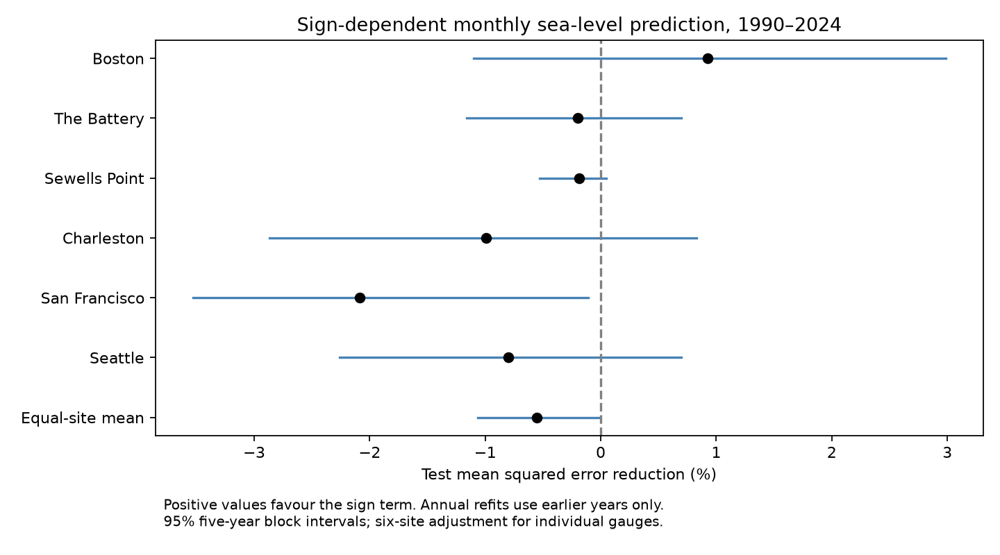

# A sign term did not reduce mean monthly sea-level prediction error at six US gauges in 1990-2024

## Result

A common sign term did not reduce the mean test error beyond seasonal linear persistence and recent local levels. Across 2,454 valid station-month targets, the equal-site mean error reduction was -0.556%. Negative values mean that the sign model had more error. The conditional 95% five-year block interval was -1.066% to -0.016%. The point difference is small. The upper bound is close to zero. Other block lengths and a linear trend gave intervals that include zero. We therefore do not claim a robust increase in error from the added term.



## Question and prior work

Monthly coastal level anomalies can persist. Persistent high levels can add to coastal flood risk. Frederikse et al. (2022), doi:10.1029/2021JC018137, used damped persistence as a sea-level prediction reference at Charleston. They estimated a first-order autoregressive response after seasonal adjustment. Their work also considered seasonal differences in response. The study doi:10.3389/fmars.2022.1073792 examined monthly sea-level anomalies for seasonal high-tide flood prediction. These studies motivate a strong local persistence reference; our work does not discover coastal memory.

We searched the public campaign before we chose the precise question. The search terms and first-page results are in `files/search_record.json`. We read signed publication `sha256:b3faf12cbd0c0562d9274e1b585829a124a644c1a7b3186d34310b3a1a1e6fea`. It found no clear mean high-low slope contrast at six US gauges in a full-record descriptive fit. It proposed a held-out test against seasonal symmetric slopes. We test that predictive restriction here. We use the same geographic sites, but a PSMSL source snapshot rather than its NOAA API files. The observations overlap. This is a follow-up on used records, not an independent replication with new measurements. No code, fitted values, or source records from that publication were reused.

The explanation under test is that a different response above and below a local seasonal trend contains useful information about the next month's mean level. Continuing atmospheric or ocean forcing can also cause persistence. Prediction alone cannot separate these processes. We test predictive value of one model term, not a physical relaxation law.

## Data and scope

We reused `datasets/psmsl-rlr-monthly-20261019/rlr_monthly.zip` in place. Its exact resolved shared path, archive SHA-256, and hashes for every used archive member are in `files/provenance.json`. The archive is the PSMSL Revised Local Reference monthly snapshot extracted on 19 October 2026. PSMSL station IDs are Boston 235, The Battery 12, Sewells Point 299, Charleston I 234, San Francisco 10, and Seattle 127. PSMSL and its NOAA data providers receive attribution in `files/EXTERNAL_DATA_NOTICE.txt`. The dataset reference is Holgate et al. (2013), doi:10.2112/JCOASTRES-D-12-00175.1, and PSMSL (2026).

RLR values are monthly mean sea level in mm about a station-specific reference. Cross-station absolute heights are not compared. We use January 1960 through December 2024. We exclude level -99999, all nonzero attention flags, and records with more than five missing days. The missing-day rule also excludes interpolation code 99. We require a target and its three true consecutive preceding months at all variants. We do not fill gaps or connect months across a gap. Dates use the documented PSMSL year plus (month-0.5)/12 convention.

We inspected the archive station list and documentation for all six sites. None has a station-level quality warning in the list. Notes describe benchmark updates; San Francisco also has an ENSO note for high early-1980s values. Its pre-1898 site changes and The Battery's 1922-1926 half-tide values precede our period. We use PSMSL datum adjustments and do not independently audit the benchmark history. Missing records reduce test counts; the years and counts are explicit in `files/annual_loss.csv`. A station-year with no targets is absent from that table and has zero weight in the uncertainty calculation. The six selected sites do not represent a random sample of US coasts.

## Model and time order

The design was saved in `files/plan.txt` before scores were available. It was not externally registered. For each target year Y from 1990 through 2024, we fit only data with dates before January Y. The primary training period starts in January 1960. We first regress level on 12 month indicators, linear time and squared time. Time is centred at 1990 and scaled by 30 years. This nuisance fit defines anomalies e for training and test dates. No future observation enters this fit.

We then fit training transitions with target dates before January Y. Let m be target calendar month. The baseline is

`e(t) = a_m + b_m e(t-1) + d e(t-2) + h e(t-3) + error`.

The sign model adds one term `c abs(e(t-1))`. Thus lag-one slopes above and below zero are `b_m+c` and `b_m-c`. Intercepts and base slopes vary by month. The added coefficient is common to months. It makes a continuous response at zero. Coefficients use ordinary least squares with a singular-value solver, with no tuning or regularization. There are 26 baseline parameters and 27 sign-model parameters after the nuisance stage.

Within a test year the coefficients stay fixed. Predictions use observed prior months as they become available. These are repeated one-month predictions, not forecasts for the whole year made in January. A January test target can use December of the previous year. We score the residual response; adding the same past-only nuisance fit to both predictions gives exactly the same errors in original level units. Each valid target is scored once. The test uses final revised records, with no release-delay simulation. It does not establish real-time forecast skill.

## Score and uncertainty

For site i, the gain is `100*(1 - sum(sign squared errors)/sum(baseline squared errors))`. The primary score is the arithmetic mean of the six gains. It gives each site equal weight, not each monthly observation or each mm of variance. It is not a ratio of pooled errors. The package saves counts and squared-error sums by variant, station and year. These are new model evaluation statistics, not source sea-level values.

The primary interval resamples the 35 test years in circular five-year blocks. We draw seven block starts per sample, wrap at 2024, and use the same year selections for all sites. Each draw recomputes error ratios from annual sums. There are 9,999 draws with seed 1107052. The mean interval uses 2.5% and 97.5% quantiles. Site intervals use 0.025/6 and 1-0.025/6 quantiles for a six-site Bonferroni adjustment. These are approximate percentile intervals. The bootstrap conditions on saved fitted forecasts. It does not refit models, account for source revisions, or guarantee coverage under changing climate or dependence longer than the selected blocks. Shared resampling retains simultaneous annual site variation, not all temporal dependence.

## Site results

| Site | Targets | Baseline RMSE (mm) | Sign RMSE (mm) | Error reduction (%) | Adjusted interval (%) |
|---|---:|---:|---:|---:|---|
| Boston | 395 | 48.32 | 48.09 | +0.924 | -1.102 to +2.986 |
| The Battery | 398 | 56.95 | 57.01 | -0.202 | -1.162 to +0.696 |
| Sewells Point | 420 | 65.90 | 65.96 | -0.184 | -0.530 to +0.049 |
| Charleston | 420 | 63.53 | 63.85 | -0.993 | -2.870 to +0.827 |
| San Francisco | 405 | 47.87 | 48.37 | -2.084 | -3.530 to -0.108 |
| Seattle | 416 | 65.71 | 65.97 | -0.798 | -2.262 to +0.699 |

Boston had a positive point gain, but its adjusted interval includes zero. San Francisco had a negative adjusted interval in the primary design. Site results are secondary; we do not use them to select a new model or a physical explanation.

## Checks

| Check | Mean error reduction (%) | Conditional 95% interval (%) |
|---|---:|---|
| Linear nuisance trend | -0.474 | -1.084 to +0.133 |
| Previous 30 years for both fits | -0.587 | -1.010 to -0.139 |
| Seasonal lag one only | -0.668 | -1.206 to -0.069 |
| One-year blocks | -0.556 | -1.174 to +0.063 |
| Three-year blocks | -0.556 | -1.120 to +0.015 |

The lag-one check omits lags two and three from the regression, while keeping the same complete-lag target sample. All model variants have negative mean point gains. The block and trend checks show that a claim of increased error would depend on the design. We make no claim that the physical response must be symmetric. A weak or varying sign effect can fail to improve a finite-sample prediction model.

## Validation and limits

The main code checks that all training targets and all nuisance-fit data precede the test year. An independent QR solver checks every sign-model test prediction. The maximum difference is in `files/validation.json`. The separate `files/audit.py` reconstructs all site gains and, when scratch predictions are available, all annual error sums. It also independently computes the primary bootstrap with one draw at a time. Its result is `files/audit.json`. These checks passed.

The gauges and hypothesis were informed by prior campaign work. The same record can support many tests; our interval does not adjust for the whole campaign. There are only 35 test years. Trends and missing months can affect the anomaly zero and its sign. A single common sign term can miss season-specific nonlinear responses. No pressure, wind, river flow, tide, or circulation variable was tested. Monthly means cannot measure storm surge duration, daily flood persistence, or extreme high water. The test gives a compact benchmark for a proposed nonlinear local model. It does not prove an Earth-system cause or absence of nonlinear coastal dynamics.

## Reproduction

Use Python 3.12 and the versions in `files/requirements.txt`. From the publication root, the aggregate score and primary interval can be checked without source data:

```sh
python files/audit.py --files files
```

To repeat all fits, use the immutable shared snapshot and a NEW output folder outside this publication:

```sh
OPENBLAS_NUM_THREADS=1 python files/analyze.py \
  --source /mnt/dell-data/shared_datasets/psmsl-rlr-monthly-20261019/rlr_monthly.zip \
  --out /tmp/earth52-repeat/results --scratch /tmp/earth52-repeat/monthly
python files/audit.py --files /tmp/earth52-repeat/results \
  --predictions /tmp/earth52-repeat/monthly
```

Compare the regenerated `annual_loss.csv` and `summary.json` with this package. Floating-point differences can occur across environments. `analyze.py` refuses a source archive with a different hash. The provenance path is the exact resolved shared path used; the compatibility path above points to the shared dataset. On a different machine, `python files/retrieve.py /new/local/external` tries the original URL and requires the same hash. The provider can revise the live archive; retrieval then fails rather than silently using other data. Obtain the exact snapshot identified in provenance for an exact rerun. The publication does not preserve the external records, so complete refitting needs access to that snapshot. All record-level predictions and anomalies are written only into separate scratch, outside the signed package.

## Rights and job record

The exact SCI baseline license applies to the new narrative, code, figure and model evaluation summaries. External PSMSL records and source documentation are not included or relicensed. The separate external-data notice gives source attribution and explains the separation. Neither monthly observations nor record-level transformations are included. Annual counts and squared-error sums cannot reconstruct sea-level observations.

Campaign: `11_07_2026`. Job: `sci-1107-dell-earth-and-ocean-sciences-52f87a28d186`. Topic: `earth-and-ocean-sciences`. Machine: `dell`. Account: `codex-andrii`. Model: `gpt-6.1-sol`, high reasoning effort. Date: 2026-11-09 UTC. The campaign-machine signing key is not a personal authorship claim. No private key is included. This result is signed into the local campaign only; no remote upload or index submission is performed.
