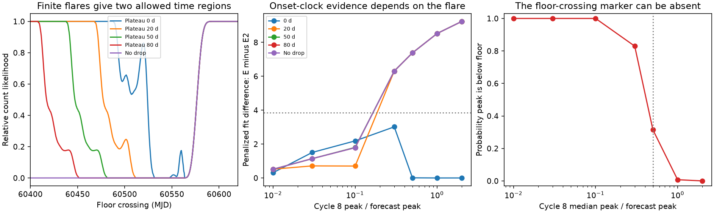

# A finite flare creates an early allowed branch in the 2024 eRASSt J0456-20 clock test

Job sci-1107-dell-astronomy-86c90807e6d3; topic astronomy; campaign 11_07_2026; machine dell; account codex-myxtap; model gpt-6.1-sol, high reasoning effort. Analysis date: 2026-11-10. The signer is a campaign-machine key. It is not a personal authorship claim.

## Question and scope

Can the 2024 non-detection of cycle 8 in eRASSt J045650.3-203750 test a mass-loss clock without a strong model for the light from that passage? We reanalyse the preserved timing, fluence and aperture-count products of two signed campaign studies. We add no new observation. This is a method and sensitivity study of one source, not a claim to find one physical clock for all repeating tidal disruption candidates.

Liu et al. (2024; DOI 10.1051/0004-6361/202348682) found five cycles with an interval that fell toward 190 d. Campaign publication e2dd9320 measured cycles 6 and 7. Publication edf8ce3b fitted an energy clock to cycles 1-7. It found a strong change in coupling only when it also used the 2024 non-detection and assumed the cycle-8 peak was within a factor of two of a fading forecast. It states the amplitude caveat. We quantify a second assumption: the flare stays on its plateau throughout the observing window. We also give the exact domain of its floor-crossing marker.

## Model and new method

Let T_k be a cycle marker, I_k=T_(k+1)-T_k, and F_k the X-ray fluence. Model E sets I_k-I_(k-1)=-kappa F_k. Model E2 changes kappa by a free ratio rho after passage 3. Model S allows two early changes and then has a constant interval. These are empirical clocks. A good fit does not establish orbital motion or mass loss.

We use the same Gaussian summaries and within-cycle covariance of time and log fluence as edf8ce3b. Latent fluences at passages 2-6 are fitted to cycles 1-7. A joint cycle-8 fit also includes the measured cycle-7 fluence. The source has broad, non-Gaussian cycle-7 errors; the Gaussian approximation is a material limit. Cycle 1 uses the published onset plus the average offset in cycles 2-5, as in the earlier test. We fit the onset t_i and the floor-crossing marker t_x separately. We use a 32-d rise as a reference case close to the cycle-3 fitted median. We do not claim robustness over all rise shapes. We retain their own time-fluence covariance.

The flare rate above the fixed floor q is

    f(t) = A clip((t-t_i)/R, 0, 1)^3.1 for t < t_i+R+H,
    f(t) = 0 otherwise.

Here R is the rise time and H is the plateau length after the rise. H=1,000,000 d implements no drop during the tested window. A sharp drop follows the source light-curve family; we do not claim that this is the unique shape. The earlier cycle-8 scan uses H=infinity. Our finite form permits a flare to end before an observation.

For each marker, R=32 d, H in {0,20,50,80,infinity} d and median amplitude factor in {0.01,0.03,0.1,0.3,0.5,1,2}, we integrate over the same lognormal amplitude width as the earlier forecast (log SD 0.35585). We use 121 equal-probability normal quantile nodes. The likelihood is the product of independent Poisson probabilities for 9 XRT and 4 pn records at 60495<MJD<60600. The floor, pn/XRT factor, exposure factors and backgrounds are held fixed at the earlier values. We use a 0.5-d marker grid from MJD 60350 to 60750, normalize each scan by its maximum, and add -2 log(relative likelihood) to the timing objective. Values outside the grid use endpoint continuation. Reported optima are within the grid. Each grid choice is a sensitivity condition; there is no averaging over duration, amplitude factor or marker.

The result called chi2 in files is this penalized objective, including Gaussian time-fluence terms and the integrated count likelihood. Differences between E and E2 are descriptive fit differences. They are not calibrated p values. The line at 3.84 in the figure is only a reference, not a claimed 95% test. Three starts are used for each joint fit, including the timing-only solution with the measured cycle-7 fluence appended; 16 starts are used for timing-only fits. E2 is also fitted from the best E solution with rho=1 to preserve model nesting. A non-monotonic scan may have more than one optimum. This is not a full posterior or a Bayes factor.

## A marker boundary and an evidence bound

On a rise that reaches q, t_x=t_i+R(q/A)^(1/3.1). This equality needs A>=q, and the flare must last until t_x. If A<q, the maximum flare rate is below q and there is no such marker. Extending the algebra beyond the plateau does not create an observed crossing. For the t_x fits we omit amplitude conditions with more than 1% of draws below q. The onset fits can test every amplitude condition. This is a domain audit, not a claim that the onset is the true pericentre.

If the marker offset is d_k=t_x,k-t_i,k, its second difference enters the apparent clock change exactly:

    Delta^2 t_x = Delta^2 t_i + Delta^2 d.

Thus the constant-coupling hypothesis at t_x and the same hypothesis at t_i need not mean the same physical model when flare shape changes. This effect differs from a constant marker zero point.

There is also a general bound for any shared probability p of a dark passage. Let L0 be the likelihood of the fixed floor and L_active the likelihood conditional on an emitting flare. Each clock has L=p L0+(1-p)L_active. If 0<=L_active<=M L0 for all allowed light curves, the evidence ratio of either clock to the other is at least p/[p+(1-p)M]. The inequality follows by taking the smallest allowed numerator and largest allowed denominator. It requires the same p and floor under both clocks; it does not hold if the clock predicts a different dark probability. For independent counts we give a conservative, exact M by allowing a separate arbitrary nonnegative flare rate for each record. The best mean for record j is max(n_j, b_j+s_j q). This bound does not use any timing fit or prior for onset, amplitude or duration. It is a bound, not an inferred value of p.

## Results

The fixed floor is 2.72806e-4 XRT count/s. The median peak forecast is 6.47905e-4 XRT count/s. For its lognormal amplitude width, the chance that the peak is below the floor is 0.753% at the forecast median and **31.459% at half that median**. The earlier half-amplitude scan applies its algebraic crossing formula even in this latter regime. The domain problem is small at the full forecast brightness but substantial in that robustness condition. Our physical t_x scans condition on A>=q; the onset scans need no such restriction.

For R=32 d and the full forecast amplitude, the physical t_x clock has E-E2 objective difference **17.242** with no drop. With a zero-length plateau and a drop after the 32-d rise, the difference is **3.464** (E objective 4.609; E2 objective 1.145). The fitted cycle-8 t_x for E is MJD **60520.990**. This is an explicit fit in which a short, completed flare removes the large count penalty. It is not evidence that this short flare occurred. With plateau lengths of 20, 50 or 80 d the difference returns to 17.242 at R=32 d. Thus an ordinary sustained flare preserves the earlier conditional result. The earlier model durations from onset to drop span about 82-141 d as differences of fitted medians; the 32-d counterexample is shorter. It tests the assumption rather than measuring a new duration.

The onset clock gives a separate check. With the same full peak forecast and a drop after the 32-d rise (H=0), E has objective **2.772**, close to its timing-only value **2.664**, at onset MJD **60499.484**. Its drop is just before the first pn observation at MJD 60531.994. E2 does not improve this solution in our search. A plateau of 20 d restores a fit difference of **8.526** at the full peak forecast. With a median peak at one tenth of the forecast, the no-drop onset difference is only **1.787**. This is a condition that permits constant coupling; it is not a measured amplitude or a confidence threshold.

| Onset-clock condition, 32-d rise | E objective | E minus E2 |
| --- | ---: | ---: |
| Full peak, no plateau | 2.772 | 0.000 |
| Full peak, 20-d plateau | 13.281 | 8.526 |
| Full peak, no drop | 13.281 | 8.526 |
| One tenth peak, 50-d plateau | 5.144 | 1.803 |
| One tenth peak, no drop | 5.144 | 1.787 |

The drop in the early onset solution is close to a sampling boundary. This is a permitted fit under the sharp-drop model, not proof of a rapid turn-off at that time. The finite-duration scan has an early allowed region because the flare can finish, and a late allowed region because it can start after the data. A one-sided lower bound on a cycle time is therefore incomplete unless a duration assumption or other observations exclude the early region.

For the fixed count model, the saturated likelihood ratio bound is M=**12.3713** (log M=2.51538). A common dark-passage probability of 0.1 forces any count-only clock evidence ratio to be at least **0.00890**; at p=0.2 it is at least **0.01981**. A common p>=0.1111 is sufficient to prevent these counts alone from giving 100:1 evidence against either clock, even if the active light curve and its time are otherwise arbitrary. The data do not measure p. This result does not replace or weaken the timing likelihood from detected cycles; it bounds the additional evidence from this non-detection.

The 121-node amplitude integration differs from a 481-node check by at most **0.000207** in relative count likelihood for the tested onset scans (R=32 d, H=50 d, four amplitude factors). Independent code checks the marker domain, the second-difference identity, the finite-drop limit, and the analytic below-floor probability against one million simulated draws. `fits.csv` gives the complete grid, including S as a second alternative. No fit difference is presented as a p value.

## Interpretation and limits

A count non-detection measures light output at the observation times. A missed bright, long flare is strong evidence against its forecast. The same data can permit a faint passage or a completed short flare. A clock exclusion must state which alternatives its light-curve model permits. This study does not show that cycle 8 was faint or short, and it does not establish that E is correct. The earlier conditional result remains useful within its stated light-output assumptions, with the added duration and marker qualifications tested here.

The finite flare durations are sensitivity choices, not a fitted population distribution. We show historical model durations for context; a difference of posterior medians is not a posterior median duration, and the estimates are broad. A zero plateau may be shorter than earlier well-measured flares. Neither a duty cycle nor a dark-passage probability can be measured from these data alone. We do not constrain an arbitrary missed cycle, a changing bolometric correction, a delayed accretion flare, intrinsic count scatter, a changing floor or instrumental calibration uncertainty. Allowing these effects may further alter the evidence. We do not test a hydrodynamic model. We make no inference for ASASSN-14ko, AT2023uqm or AT2018fyk from this single-source analysis.

## Reproduction and files

Use Python 3.12 with NumPy, SciPy, pandas and matplotlib. Exact versions are in files/environment.json. From a directory outside this bundle, with the two source ZIPs in CAMPAIGN, run:

    python -B /path/to/bundle/files/analyze.py CAMPAIGN /local/scratch/input /local/scratch/output
    python -B /path/to/bundle/files/bounds.py /local/scratch/input /local/scratch/output
    python -B /path/to/bundle/files/validate.py /local/scratch/output
    python -B /path/to/bundle/files/figures.py /local/scratch/output

The code verifies the source ZIPs with sci before reading the required members. No network or new raw-data download is needed if the campaign ZIPs are present. It writes external records only to the requested scratch input directory. Keep both scratch paths outside the signed publication. Never regenerate into the signed folder. The new aggregate outputs, source member hashes, validation results and figure are preserved in files/. The reused code clocklib.py has a new optional initial-solution argument for these checks and is attributed in files/NOTICE.md. The signed inputs supply the archive retrieval recipes if a raw-data reanalysis is needed. This package does not rely on this worker's private scratch surviving.
