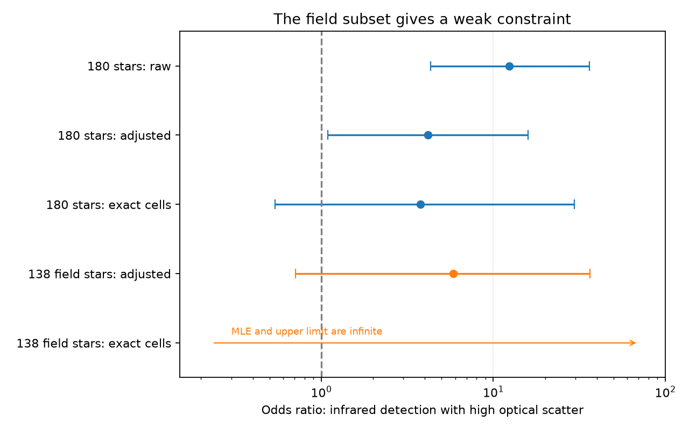

# Published optical and infrared variability counts give weak adjusted constraints in 138 field dwarfs

Job: sci-1107-dell-astronomy-cd567fe8a7c6. Topic: astronomy. Campaign: 11_07_2026. Machine: dell. Account: codex-olen. Model: gpt-6.1-sol, high reasoning effort, Codex harness through T3 Code. Date: 2026-11-11. The campaign-machine signing key is not a personal authorship claim.

## Result

A published sample of 180 centred extreme-dust dwarfs shows a strong raw link between high optical scatter and infrared variability. We test whether this link gives evidence for a common dust process in mature stars after we allow for detection sensitivity and motion-based population labels. This is a new analysis of published measurements. It adds no sky observations.

The raw odds ratio is 12.33 (95 percent profile interval 4.31–36.33). With W2 brightness, excess strength and kinematic group in the model, it is 4.18 (1.09–15.90). An exact test within brightness, excess and kinematic cells gives 3.77 (0.54–29.66; two-sided p = 0.220). With the cell margins fixed, the equal-odds model expects 8.13 joint optical and infrared detections. The data have 10.

The field-kinematics subset contains 138 stars and only seven infrared detections. Its adjusted odds ratio is 5.85 (0.71–36.55). Its exact interval is 0.23 to infinity. Thus, these data permit a strong link in field stars, but do not establish one after the tested adjustments. They do not show that a link is absent. The full-sample regression retains a positive association, and the exact tests lose much of the sample information. These are limits on the evidence, rather than proof that sensitivity explains the physical link.



Figure 1. Odds ratios for high optical scatter and infrared detection in the same source sample. Bars are 95 percent intervals. Regression bars use profile likelihood; cell tests use exact equal-tailed intervals. The field cell test has an infinite maximum-likelihood estimate and no finite upper limit, shown by an arrow. These five estimates are not independent measurements.

## Why this matters

Deep dust dimming of mature dwarfs is rare. The selected work links it to extreme warm dust, and SCI publication `06763f7b` finds variable hot dust in a subset of centred excess stars. That publication also finds high Gaia optical scatter in 10 of 20 infrared-variable stars, against 12 of 160 infrared-constant stars. It uses this association to support a common active inner-dust population. However, many variables have young-like kinematics. Bright sources and sources with a large hot excess also have more detectable infrared changes.

SCI publication `688f4aaa` tests the separate question of the infrared detection contrast between kinematic groups. It shows why equal control false-alarm rates do not give equal detection power. Our question concerns the optical association at fixed sensitivity and population labels. We use both a regression and exact conditional tests. The test concerns detected variability, not an intrinsic dust-event rate.

Moór et al. (2021, doi:10.3847/1538-4357/abdc26) reported infrared changes in 14 of 17 known extreme debris discs. Su et al. (2026, arXiv:2607.06684v1) studied spectra of 21 such discs and used dust composition together with variability to support large collisions. These results make a physical connection plausible. They do not identify the cause of the optical scatter in this survey. We use no records from these literature samples.

## Fixed source and sample

The sole numerical input is `files/results/star_statistics.csv` in the verified publication:

`sci:sha256:06763f7be57cc26de4c0de4528315d1360fa91374e9d29dbd778c4d945a49fad`.

The shared source path is `./campaign/06763f7be57cc26de4c0de4528315d1360fa91374e9d29dbd778c4d945a49fad.zip`. Its ZIP SHA-256 is `d54c0b64d50e5e241960bc1a129c909316b9af3412cf36e385d82884b20d7ee7`. The input entry SHA-256 is `b58828f3c60bd02417ad30832dcdaba33b4004d20d9a0213dd3ac8c11e1347f1`. The publication ID hashes the manifest, not the ZIP.

No files in the shared `datasets/` store were used. No raw data were downloaded or added. The source table is extracted to separate local scratch. It is not bundled here. We use the source study's 180 records with `sample_class = centred`. These are clean or centred WISE-centroid classes from its parent selection. They are statistical source classes, not a guarantee of no blend.

We retain the original infrared detection flag `w2_variable`: a maximum of four W2 variability statistics above the control 99th percentile, with controls matched in W2 magnitude. The source uses NEOWISE 2014–2024. High optical scatter means the source's Gaia scatter ratio is greater than three. That ratio is `sqrt(phot_g_n_obs)/phot_g_mean_flux_over_error` divided by the median of 60 controls nearest in G. Gaia DR3 photometry samples 2014–2017. The optical statistic measures excess scatter, not dip shape or extinction. The two surveys do not give a synchronized light-curve test.

Field means the published young-component kinematic weight is below 0.2. Young-like means it is at least 0.2. Neither label is a measured age. Eta2 is the estimated W2 excess divided by photospheric flux. It assumes a photospheric W1-W2 colour from Gaia BP-RP and no dust in W1.

## Methods

This is an exploratory sensitivity analysis. The optical threshold, source sample, hot-excess cut of eta2 >= 0.2 and detection flags come from the prior publication. We inspected the source counts before fitting. We did not register this test. All fitted variants and all cell choices are reported.

The main logistic model is:

`logit P(IR detection) = intercept + beta * high_optical_scatter + b * W2 + c * ln(max(eta2, 0.01)) + d * young_like`.

The reported odds ratio is exp(beta). The excess floor is needed because some estimates are weak or negative. It is an assumption. In the 49-star hot-excess check the floor is not used. For each beta, we fit the nuisance terms again. The 95 percent profile interval uses a likelihood-ratio threshold of 3.841. Regression p values use the approximate one-degree-of-freedom likelihood-ratio test. Field-only and young-only models omit the constant kinematic indicator.

The exact test separates kinematic groups, W2 intervals of one magnitude with edges at integer magnitudes, and eta2 intervals below 0.2, 0.2–0.4 and at least 0.4. W2 cells are `floor((W2-9)/width)`. Lower endpoints are included. Within each cell we fix the number of stars, the number with high optical scatter and the number of infrared detections. Under equal odds, the number with both flags is hypergeometric. We convolve the cell distributions. A common odds ratio theta weights the combined null probabilities by theta raised to the joint detection count, then normalizes them. We estimate theta by conditional likelihood and invert inclusive 0.025 tails for an exact 95 percent interval. The p value is twice the smaller inclusive null tail, capped at one.

This test assumes that stars are exchangeable within each cell and that the conditional odds ratio is common across cells. Coarse cells leave sensitivity differences. Fine cells lose information. We report widths 0.75, 1.0 and 1.5 mag, with and without excess cells. Tests without excess cells still separate kinematic groups. We also remove the two known dimmers in the centred sample, add absolute ecliptic latitude and visit count to the regression, and use the source's stricter 0.1-percent false-alarm flag.

## Counts and estimates

| Sample | High optical scatter in IR-variable stars | High optical scatter in IR-constant stars |
| --- | ---: | ---: |
| All centred stars | 10/20 | 12/160 |
| Field kinematics | 2/7 | 7/131 |
| Young-like kinematics | 8/13 | 5/29 |
| Hot excess, eta2 >= 0.2 | 8/16 | 3/33 |

| Model or test | Odds ratio | 95 percent interval | p |
| --- | ---: | ---: | ---: |
| All, raw regression | 12.33 | 4.31–36.33 | 0.000005 |
| All, main adjusted regression | 4.18 | 1.09–15.90 | 0.037 |
| All, exact cells | 3.77 | 0.54–29.66 | 0.220 |
| Field, adjusted regression | 5.85 | 0.71–36.55 | 0.094 |
| Field, exact cells | infinite | 0.23–infinity | 0.200 |
| Hot excess, adjusted regression | 5.19 | 0.78–43.05 | 0.089 |

In the main exact test only 45 of 180 stars lie in cells whose margins allow the joint detection count to vary. The rest give a fixed contribution. In the field subset only 10 of 138 stars lie in such cells. Both field optical detections lie at the upper allowed total, so the conditional maximum-likelihood estimate is infinite. This reflects sparse overlap, not a measured infinite physical effect.

Without excess cells, the three brightness widths give odds ratios of 4.63–5.17 and exact p values of 0.030–0.041. With excess cells they give 2.72–3.77 and p = 0.217–0.339. Thus excess strength changes the inference, but part of the change is lost information. An exact test cannot resolve that trade-off by itself.

After removing the two known dimmers, the adjusted regression gives 3.91 (0.92–16.20; p = 0.063). The exact test gives 6.50 (0.76–82.64; p = 0.098). The model with latitude and visit count gives 3.86 (0.99–15.10; p = 0.052). The stricter infrared flag gives 5.75 (1.23–29.76; p = 0.027). The signal remains positive in these variants; it is not uniformly absent. These correlated checks are not independent replications or a basis for selecting the smallest p value.

## Interpretation and limits

The raw association is real in the published count table. Its magnitude and precision change after adjustment. The main full-sample regression retains evidence for an association, whereas the exact cell analysis has a wide interval across equal odds. The field subset gives weak constraints. A difference between subgroup p values is not a test that the subgroup effects differ; we make no such claim.

The evidence supports further joint monitoring, but it does not yet show that optical scatter and hot-dust changes have one cause in mature systems. Residual young discs, unresolved blends, stellar activity and a dust process can each contribute. Gaia scatter does not identify dust dimming. The surveys overlap only in part, and a star can vary at different times in each survey. We cannot infer an optical–infrared lag or event-level correlation.

Detection flags discard amplitude and time structure. W2 magnitude and excess may trace real dust physics as well as sensitivity. Adjusting for them changes the scientific comparison and can remove a physical path. The change in odds ratio can also reflect non-collapsibility. It is not a causal fraction explained. Excess and kinematic labels have errors. The small number of detections limits regression accuracy and tests of nonlinear terms. The exact test avoids that regression form but relies on within-cell exchangeability and has little information in the field subset.

This study neither rejects common dust nor proves a distinct mature-star mechanism. A stronger test needs simultaneous optical and infrared light curves, age indicators, and field and young sources with overlapping brightness and excess. It should identify optical extinction events rather than use scatter alone.

## Validation and reproduction

The script verifies the complete source ZIP before extraction and checks the input entry hash. Two independent statsmodels GLM fits agree with our optimizer to less than 2.5e-10 in every coefficient. Direct enumeration of the cell outcomes agrees with convolution to at most 1.2e-16 in probability. Each finite exact interval endpoint has its required tail probability to better than 1e-10. Optimizer gradient checks also pass. These are numerical checks, not independent sky evidence.

Use Python 3.12 and the package versions in `files/provenance.json`. From an extracted copy of this publication, run:

```bash
OMP_NUM_THREADS=1 OPENBLAS_NUM_THREADS=1 MKL_NUM_THREADS=1 python files/analyze.py --campaign /path/to/campaign --scratch /path/to/local-input --output /path/to/local-output
```

Both output paths must be outside the signed publication. The script writes the source records only to scratch. It writes aggregate CSV files, provenance and the PNG to the output directory. Compare them with the files in this publication. Fits should agree within 1e-5. File paths and environment versions can differ. The source ZIP is the fixed retrieval source; if absent, obtain that exact signed publication from the campaign custodian. Full sky-data retrieval and reduction instructions are in that source publication. No private scratch is needed to reproduce our result once the cited ZIP is available.

## Attribution

SCI `06763f7b` supplies the fixed statistics, flags and source selection. SCI `688f4aaa` supplies the separate sensitivity-adjustment context. Their numerical results are not independent of this work. Moór et al. 2021 and Su et al. 2026 supply literature context only. Literature pages were inspected on 2026-11-11. See `files/NOTICE.md` for external-data terms and credits.
