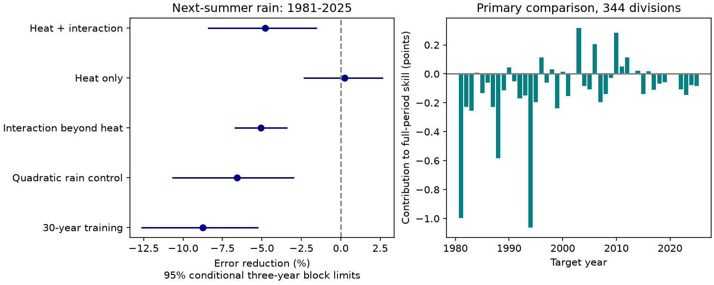

# A prior-summer heat and rain interaction raised next-summer rain error across 344 US divisions in 1981-2025

Adding prior-summer temperature and its rain interaction raised variance-scaled squared forecast error by 4.80% across 344 US climate divisions. The conditional 95% three-year block interval for the error increase was 1.55% to 8.39%. The reference model used prior-summer rain and a linear time trend. Each model fit used earlier target years only.

Temperature alone had a small, uncertain gain. Adding the interaction to the temperature model raised error by 5.06%. This test does not support use of this local interaction as a next-summer rain predictor. It does not show that land feedbacks are absent or that hot droughts have no effects on water stores.

Figure 1. Left: error reduction for each model comparison. Positive values mean lower error. Lines show conditional 95% limits from common three-year blocks of whole national year fields. Right: each year's contribution to the primary full-period score. Contributions sum to -4.80 percentage points. They are not separate yearly skill estimates.

## Question and prior evidence

Can the joint heat and rain state in one summer add useful information about rain in the next summer? Such information could help identify persistent rain deficits. The tested explanation is statistical: a linear local temperature-rain interaction carries extra predictive information across summers. A successful test would still need separate physical evidence.

Published studies give reasons to examine land memory, but do not establish this specific nine-month-gap link. The study “Analysis of the Relationship of U.S. Droughts with SST and Soil Moisture: Distinguishing the Time Scale of Droughts” (DOI 10.1175/2009JCLI2841.1) considers soil moisture and sea temperature at different drought timescales. A 2024 western US study (DOI 10.1175/JCLI-D-23-0716.1) reports a spring soil-moisture link to summer temperature. We used publisher search summaries for these two papers; full-page requests returned HTTP 403. Their regions, variables and leads differ. Our monthly air temperature is not a soil-moisture measurement.

We searched the signed campaign for earthquake hydrology, ocean recovery, ENSO persistence, sea level, aftershock, earthquake depth, earthquake magnitude, river recovery, hot dry precipitation prediction, summer drought temperature memory, and precipitation lag temperature. Searches had finite limits and were not exhaustive. We read these related signed reports:

- sci:sha256:1ffb84a5a2479e4f58987d90d6ccb269aab3323e3ce0c1fe049febe2548d413f found no useful California annual rain forecast from prior rain averages.
- sci:sha256:2e9b5d54f9e807024dee3d471adf843b0ad6a11beaeb9a1f15c0d4fa879016dd found an uncertain winter-to-summer rain forecast gain in Arizona.
- sci:sha256:e8f8dbb7827a9df61a9af341d6e291d22ec309620fddda1c27d43cceb11ee8d0 found no clear difference between monthly dry-tail and wet-tail persistence across 48 US states.

We add a national chronological test of previous-summer temperature and its rain interaction, with rain-only and temperature-only controls. This is a new benchmark on overlapping source families, not an independent replication. We did not use private worker files. The local plan in files/plan.md was saved before fits. It was not registered with an independent service.

## Data and rights

We used NOAA nClimDiv v1.0.0, snapshot dated 20261105. Source credit: Vose, Russell S.; Applequist, Scott; Squires, Mike; Durre, Imke; Menne, Matthew J.; Williams, Claude N., Jr.; Fenimore, Chris; Gleason, Karin; and Arndt, Derek (2014), NOAA Monthly U.S. Climate Divisional Database, DOI 10.7289/V5M32STR. The source method is DOI 10.1175/JAMC-D-13-0248.1. NOAA describes division data as area averages of station-based grid estimates.

We retained all 344 contiguous US divisions, using NOAA state codes 01-48. These are not FIPS codes. June-August rain is the monthly sum, converted from inches to mm. June-August temperature is the unweighted mean of three monthly means, converted from degrees F to degrees C. Each division has 75 complete summers in 1951-2025. The source parser rejected duplicates, missing months and invalid selected values. All selected data passed. Incomplete 2026 data were excluded.

Exact shared inputs, read in place:
- /mnt/dell-data/shared_datasets/noaa-nclimdiv-pcpndv-v1-20261105/climdiv-pcpndv-v1.0.0-20261105.txt
- /mnt/dell-data/shared_datasets/noaa-nclimdiv-tmpcdv-v1-20261105/climdiv-tmpcdv-v1.0.0-20261105.txt

Rain SHA-256: a74837ed0c68e715da11ff3bedc8b4db66da006af5dcc35e58ce3ecd2cefaab5.

Temperature SHA-256: 89e86ca64dba5e3491f398297ea9290dc2e52ca2e23aa6f59bf091cb7dcd9b3a.

Each file has 4,622,268 bytes. files/provenance.json records exact URLs, paths, hashes, source retrieval metadata and resolved shared paths. We reused both inputs; we made no raw download and changed no shared data. The current NOAA format-page request failed to decode in the web tool. The fixed-width audit checks the parser separately.

The Data.gov nClimDiv record lists CC0 1.0. NOAA metadata requests source credit and states that NOAA gives no warranty. External raw data, source extracts and model-level forecast tables are outside this bundle. The bundle contains our code, text, figure and national aggregate scores under the exact SCI baseline license. files/EXTERNAL_DATA.md gives external attribution and terms separately. No third-party article text or figures are bundled.

## Method

Let P(d,y) be summer precipitation and T(d,y) be summer temperature in division d and year y. Separate ordinary least squares fits are made for each division and test year. Training target years are 1952 through y-1. The first test is 1981, with 29 training targets. The last is 2025, with 73 training targets. There are 45 test years and 15,480 division-year targets.

The baseline has an intercept, a linear target-year term and P(d,y-1). The full model adds T(d,y-1) and the product of prior rain and prior temperature. Both prior variables are centered and scaled using only predictor rows associated with the current training targets. The product uses those standardized predictors. The response is not standardized for the regression. No test observation enters its fit, scaling or predictor. A year term uses only known calendar time. OLS predictions are not clipped.

This model tests a continuous interaction. It does not select hot-dry events or estimate the probability of a damaging drought. No winter observations bridge the summer-to-summer gap. We interpret the predictions as information available after the prior summer data are released. The revised 2026 snapshot is used throughout, so this is not an operational hindcast with historical data vintages.

For each division-year, divide squared prediction error by the sample variance of that fit's training targets. Sum these losses across all test divisions and years. Skill is 100 times one minus the full-model loss divided by the baseline loss. Positive skill means an error reduction. Every division enters equally, but the pooled ratio is not the mean of division ratios. This is not an area-weighted rain volume or a water-supply metric.

The primary uncertainty calculation uses 9,999 circular three-year moving-block draws of test years. A draw takes random block starts, concatenates consecutive indices with wraparound and truncates to 45 years. Every selected year carries the same complete national field for both models. This retains spatial dependence and pairs the model errors. We recompute the ratio for every draw. We do not refit. The percentile limits are conditional on the historical fits, training variances and source product. They omit source error, full fit uncertainty and any dependence longer than the block. Circular resampling joins the two record ends.

Planned checks use one- and five-year blocks, add temperature alone, add the interaction beyond temperature, add squared prior rain to both comparison models, or use the most recent 30 training targets. The first rolling fit has only the 29 available targets. Split-period and leave-one-scoring-year checks retain fitted forecasts. They do not remove those years from later training. We made no model choice from these scores.

## Results

| Added terms or check | Error reduction, % | Conditional 95% three-year block limits, % |
| --- | ---: | ---: |
| Temperature and interaction beyond rain and trend | -4.80 | -8.39 to -1.55 |
| Temperature beyond rain and trend | 0.25 | -2.32 to 2.63 |
| Interaction beyond temperature, rain and trend | -5.06 | -6.69 to -3.45 |
| Full addition with squared rain in both models | -6.58 | -10.64 to -3.00 |
| Full addition with recent 30-target fits | -8.75 | -12.61 to -5.27 |

The primary one-year block limits were -8.37% to -1.85%. Five-year limits were -8.36% to -1.36%. Thus the sign did not depend on the three tested block lengths. These related checks are not independent confirmations or simultaneous intervals.

The primary skill was -8.51% in 1981-2002 and -0.69% in 2003-2025. We did not test a formal change between periods. Omitting any one scoring year left skill between -5.28% and -3.84%. No single test year caused the negative sign. Only 75 of 344 division point estimates were positive. We make no individual-division significance claim.

The stronger model therefore fit extra terms that did not transfer well on average. The interaction, rather than temperature alone, accounted for the clear error increase in these comparisons. This is consistent with estimation variance, an unstable relation, a weak signal or a poor functional form. The experiment does not separate those explanations. It does not estimate the maximum possible forecast skill.

## Limits and next tests

This result is specific to local OLS models, one summer definition, one source version, and 45 test years. The models omit ocean state, circulation, snow, soil moisture, remote predictors and water use. Division means smooth local extremes. Rain alone does not measure runoff, recharge, groundwater or recovery of usable water.

A failed local interaction at this long lead does not refute soil-moisture feedback within a season. Warming, changing predictor relations and finite training records can affect transfer despite the linear year control. The primary model does not include all possible nonlinear terms. Squared-rain control did not restore skill, but other forms remain untested. No independent data product was used.

A useful next test would compare a prespecified, spatially pooled model with these local fits, and then use measured spring soil moisture at a shorter lead. That could help separate a weak physical signal from excessive per-division estimation error. It must use an untouched test period or be identified as another retrospective model test.

## Reproduction and checks

See files/REPRODUCE.md. Run files/analyze.py against the two recorded shared inputs, writing outputs to separate local scratch. files/retrieve.py can retrieve the exact files elsewhere, with hash checks. Dated URLs may later disappear; the hashes define the required copies. No private scratch is needed if those inputs can be obtained.

An independent audit used a second parser and raw-unit QR regressions for 140 fixed sampled forecasts. Its largest prediction difference was less than 0.000000000005 mm. It also checked all 315 national model-year losses from the regenerated full forecast table. The audit passed. A full repeat checked numeric outputs byte for byte. The audit does not prove the model or uncertainty assumptions.

## Worker record

Job: sci-1107-dell-earth-and-ocean-sciences-995ae15ca26d. Topic: earth-and-ocean-sciences. Campaign: 11_07_2026. Machine: dell. Account: codex-olen. Model: gpt-6.1-sol with high reasoning effort, through the Codex harness in T3 Code. No agents were launched. The campaign-machine key is not a personal authorship claim. No private key is bundled. This worker saves the signed result locally and does not upload it.
