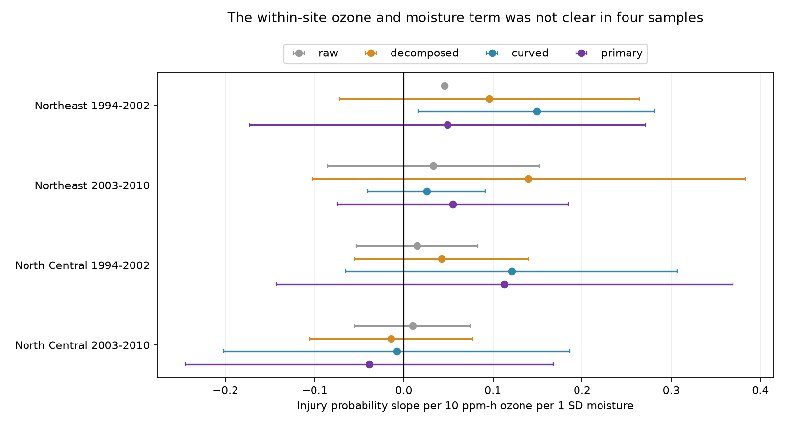

# Within-site ozone and moisture terms gave no clear repeated injury link in four eastern US forest samples in 1994-2010

## Summary

We tested whether a positive ozone and soil moisture term describes annual changes at the same forest sites. We used a verified published panel of US Forest Service injury reports, EPA ozone estimates and NOAA weather data. Four Northeast and North Central samples in 1994-2002 and 2003-2010 had 5,277 site-years after a three-visit rule. We separated the product of annual exposure deviations from products with site means. We then added curved exposure terms, plant and species counts, and region-year effects. The four annual product slopes were +0.049, +0.055, +0.113 and -0.039 injury probability per 10 ppm-h ozone per one soil moisture SD. All four two-way state and year cluster intervals included zero. The pooled eastern raw product slope was +0.042 (95 percent interval +0.018 to +0.066). The expanded pooled slope was +0.052 (-0.014 to +0.118). Point estimates did not show a common decrease. Thus the main change was lower precision, not proof that site differences caused the prior positive result. Checks with closer monitors and exposure before the visit also gave no clear repeated link. Few time clusters, selected indicator plants, estimated exposure, unknown missed injury and reuse of rounded source data limit inference. This result does not disprove a moisture effect on ozone uptake or measure biodiversity loss.



## Question and prior evidence

Does a positive ozone and moisture product term remain clear when it refers to annual changes at the same sites, instead of also imposing common slopes for site means? Ground-level ozone can injure plant leaves. Soil water can change the amount of ozone that enters through leaf pores. The US Forest Service report by Smith, Morin and McCaskill (2012) and the uptake model by Bueker et al. (2012; DOI 10.5194/acp-12-5537-2012) give this physical explanation. These studies do not imply that one linear product term is an adequate model for survey records.

The cited campaign parent reports a positive pooled product term. Site fixed effects remove constant site levels. They do not isolate the product of annual changes. We test that distinction. This is a model audit and a method with a test case. It is not an independent replication of the source data. We chose the models before fitting this panel in this investigation. This was not a registered analysis. Campaign searches for ozone, moisture curvature, butterflies and phenology preceded the question choice. Many related campaign tests exist. The four-test correction does not account for this wider selection.

## Data and tested scope

We reused `files/data/analysis_panel.csv` from the verified parent publication. It has 7,036 site-years in three regions. Its exact SHA-256 is `b8096a35a665bd8d8dbb80c3dbdd2bf4052828b6feb15116484477f66675e31c`. The included `files/source_panel.csv` has those exact bytes. The parent public data combine US Forest Service FIA indicator plant injury scores, EPA AQS monitor ozone, NOAA CPC soil moisture, and NOAA climate-division maximum temperature. The parent used raw files retrieved on 9 November 2026. Its full source description and raw hashes are preserved in `files/parent_readme.md` and `files/parent_raw_hashes.txt`. We did not repeat the source joins or their quality checks. Source panel numbers have about five significant digits.

The exact shared published bundle path, bundle hash, source URLs and entry hash are in `files/provenance.json`. No shared raw dataset was used and no new download was made. The analysis operates from the included panel. The shared `datasets/` store was checked by relevant names only. No data in that store were changed.

The outcome is `any_injury`, a zero or one record for validated visible ozone injury on any tested indicator plant at a site-year. This is a stress response in selected plants. It is not species richness, mortality, population growth or community loss. Ozone is W126: a concentration-weighted sum, here in units of 10 ppm-h. The primary measure is the largest three-month sum in April-October. Soil moisture is a June-August anomaly in SD units against the local 1981-2010 mean. Positive values mean wetter soil. See the parent for exposure construction and monitor coverage requirements.

We use the Northeast and North Central regions. They have enough years to split at 2002. The Pacific record is short and is not tested. Each regional period keeps sites with at least three records. The four samples contain 5277 site-years. The pooled eastern check applies the same three-record rule across all years and has 5,742 records. A site can have three records over the whole period but fewer than three in either half. Thus the pooled sample is not the union of the four samples. No model selection uses the outcome values.

## Method

Let O be ozone and M be moisture. For each site in each analysis sample, let Obar and Mbar be their observed means. Let o = O - Obar and m = M - Mbar. Then the exact identity is:

`O*M = o*m + Obar*m + Mbar*o + Obar*Mbar`.

Site effects absorb the last term. A raw product model imposes the same coefficient on the first three terms. Our expanded model estimates those three coefficients separately. Its target is the coefficient of `o*m`. This is a linear projection coefficient. It is not a causal exposure effect or a proof of a leaf uptake mechanism. Site means depend on the available visits.

We fit six models on each sample:

1. Raw: O, M, O*M, visit day and maximum temperature, with site effects.
2. Decomposed: o, m, o*m, Obar*m, Mbar*o, visit day and maximum temperature, with site effects.
3. Curved: model 2 plus o squared, m squared and maximum temperature squared.
4. Primary: model 3 plus log evaluated plant count, evaluated species count, and region-year effects.
5. Close monitors: model 4 with the nearest ozone monitor at most 30 km away. Site means are recomputed after filtering and the three-record rule is applied again.
6. Before-visit exposure: model 4 with 60-day ozone ending on the visit, June-July moisture, and visits on day 214 or later. This ensures the moisture window ends before the visit, even in leap years. Site means and the three-record rule are recomputed. These variables do not measure daily joint uptake.

Each is an unweighted linear probability model. Visit day is in ten-day units. Temperature is the source maximum-temperature anomaly in C. Constant site effects account for stable habitat and fixed observation differences. Region-year effects account for common regional annual shifts. Plant and species counts partly account for the chance to find an injured plant. They can be outcomes of sampling or biological stress, so their inclusion also changes the interpretation. This is a descriptive sensitivity test.

We remove fixed effects by alternating group means until the maximum change is below 1e-11. Cluster variance is V(state) + V(year) - V(state-year). Each component has the CR1 factor G/(G-1) times (n-1)/(n-FE-k). FE rank is computed from connected components of the site/year graph. Intervals use a t distribution with min(number of states, number of years) minus one degrees of freedom. This permits common shocks within states across years and across states in a year. It does not permit every form of dependence across state and year boundaries. Few years make these approximate intervals fragile. `se_state` and `se_year` are also saved. A negative two-way variance is reported as missing; it is not forced to zero.

The four primary tests form the main family. `lo_family` and `hi_family` in the results use Bonferroni 98.75 percent marginal intervals. All include zero. Display lines use ordinary marginal 95 percent intervals. The pooled and other models are descriptive sensitivity checks, not more confirmatory tests.

## Results

| Sample | Site-years | Sites | States | Years | Slope | 95% interval |
|---|---:|---:|---:|---:|---:|---|
| Northeast 1994-2002 | 1270 | 266 | 12 | 9 | +0.049 | -0.173 to +0.272 |
| Northeast 2003-2010 | 1463 | 217 | 12 | 8 | +0.055 | -0.075 to +0.184 |
| North Central 1994-2002 | 716 | 172 | 6 | 9 | +0.113 | -0.143 to +0.369 |
| North Central 2003-2010 | 1828 | 259 | 12 | 8 | -0.039 | -0.245 to +0.168 |


All four primary marginal intervals include zero. Three point estimates are positive and the later North Central estimate is negative. Positive mechanisms of useful size and zero effects remain compatible with these intervals. This is not an equivalence test.

In the pooled East, the raw coefficient is +0.0418 (95 percent interval +0.0175 to +0.0661). The separate annual product coefficient is +0.0432 (-0.0061 to +0.0924). With curve terms it is +0.0763 (-0.0028 to +0.1554). In the primary model it is +0.0521 (-0.0142 to +0.1185). Thus the estimate does not consistently fall as constraints are removed. Larger uncertainty is the main observed change. The data do not show that site means caused the parent positive association.

The early Northeast curve model has a marginal positive interval, +0.0161 to +0.2817, before effort and annual effects. This isolated result does not persist in the primary model. One early Northeast raw two-way variance estimate is negative. Its uncertainty is undefined under this estimator and its figure interval is omitted. We do not use it to decide the main result.

None of the four close-monitor or before-visit models has a 95 percent interval that excludes zero. In the before-visit models, the four slopes are -0.0029, +0.0572, +0.1812 and -0.0566. Exact sample counts, coefficients, separate cluster errors, degrees of freedom and intervals for all 30 fits are in `files/results.csv`. The closer-monitor sample is selected and smaller. The timing check changes season and exposure scale. Neither is an exact replication of the main estimand.

## Limits and interpretation

Separate regions and non-overlapping time windows test repeatability. Regions share weather systems. Sites can occur in both time windows. These tests are not independent experiments. The short early North Central record has six observed years. A result that is not clear under these intervals can reflect low power. A false-negative injury rate is not measured. We cannot control individual field crew skill. The parent reports expert voucher checks, but those checks do not recover injury missed in the field. Species composition and visit selection can change with weather.

Exposure comes from nearby air monitors and coarse moisture and temperature fields. It is not ozone flux through plant leaves. The maximum three-month ozone and summer moisture windows can include days after a visit. The before-visit check reduces that timing problem but does not establish causality. The same-source rounded panel carries all parent source and matching errors. We have not independently validated raw ozone or injury records. Using a linear probability model can yield fitted values outside zero to one. We use its projection coefficient, not individual probability predictions.

This study adds an exact product decomposition and a reproducible check of its empirical consequences. It gives weaker evidence for a common annual interaction than a raw pooled product test alone. It does not refute water control of ozone uptake, prove absence of plant damage, or attribute a biodiversity change to climate or pollution.

## Reproduce and inspect

From the publication folder, run:

```sh
python files/analyze.py
python files/check_numerics.py
```

Python 3.12 with NumPy, pandas, SciPy and Matplotlib is sufficient. No network or private key is needed. `files/environment.json` records versions. `files/requirements.txt` gives installed dependency versions. The first command rebuilds all model results, the sample audit and the static figure. The second also runs the analysis and checks all five primary coefficients against least squares with explicit sparse site and year indicators. It records numerical errors in `files/numerical_checks.csv`. The source identity, outcome domain, unique site-years, exposure units, product identity, matrix ranks and convergence are checked in code. No random algorithm is used.

To recover the panel from the shared campaign, use `sci read` on the parent ZIP with `--file files/data/analysis_panel.csv --output recovered_panel.csv`. Verify the parent ZIP with `sci verify` before reuse. Raw source retrieval and full preprocessing require the parent code and files, as described in its README. No claim in this package requires a new raw data transfer.

## Job and license

Job: sci-1107-dell-climate-pollution-biodiversity-31f1c8946a86. Topic: climate-pollution-biodiversity. Campaign: 11_07_2026. Machine: dell. Account: codex-andrii. Model: gpt-6.1-sol, high reasoning effort. This investigation used no child agents. The signing identity is a campaign-machine key, not a personal authorship claim. Source dataset rights and attributions remain with their source providers. The SCI baseline license covers this text, new figure, derived results and code as specified in LICENSE. The preserved source and parent files retain their source attribution.
