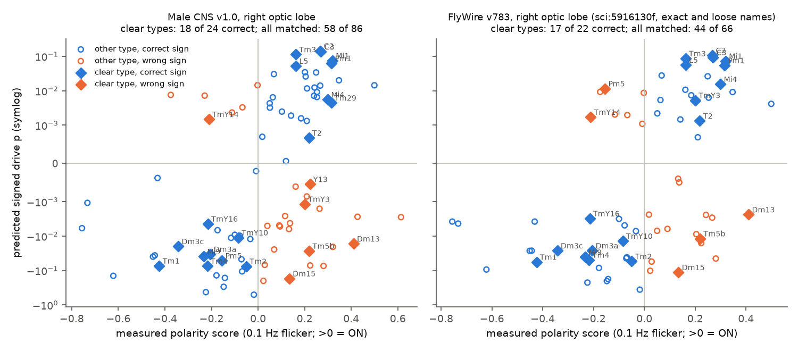
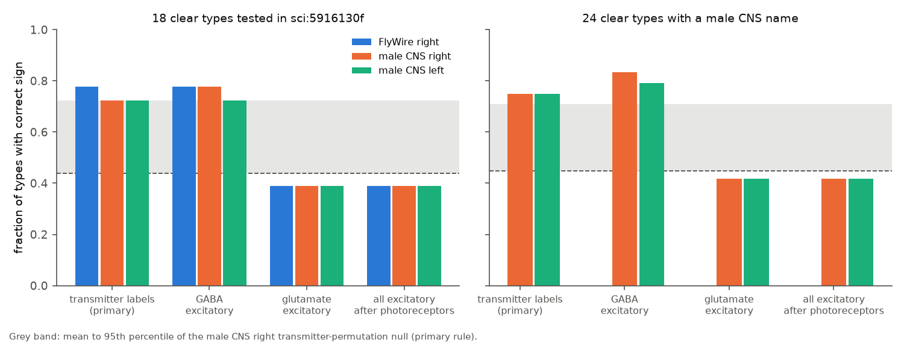
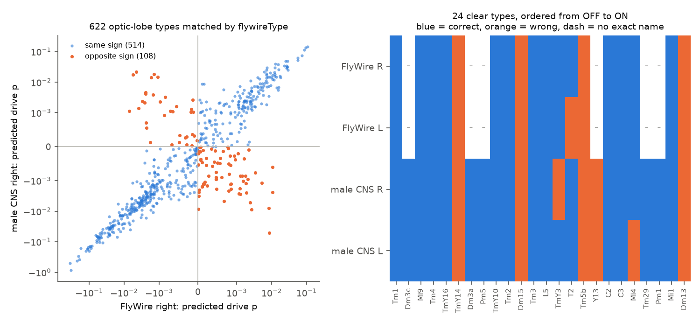

# In a second fly connectome (male CNS v1.0), signed wiring from photoreceptors predicted the measured ON or OFF sign of 18 of 24 visual cell types; the same four types were wrong in both animals

Job: sci-1107-hp-neural-structure-and-computation-17b68e4d708d
Topic: neural-structure-and-computation. Campaign: 11_07_2026. Machine: hp. Account: claude-sci.
Model: Claude Opus 5.5 (claude-opus-5-5) in Claude Code through T3 Code. Date: 2026-11-12.
The signing identity is a campaign-machine key. It makes no personal authorship claim.

## Result

A campaign study [1] tested a simple rule in the fly optic lobe. The rule uses only the connectome and transmitter labels and has no fitted parameters. Photoreceptors are ON. Each cell type gets the sign of its summed signed input, weighted by input synapse fraction. Acetylcholine is excitatory. GABA, glutamate and histamine are inhibitory. In the female FlyWire connectome, the rule gave the correct ON or OFF sign for 14 of 18 cell types with a clear measured sign. The measured signs come from 0.1 Hz full-field flicker calcium responses (Currier and Clandinin 2025 [2, 3]).

We applied the same rule, without changes, to a second animal: the male CNS v1.0 connectome (FIB-SEM, Janelia FlyEM [4]). We wrote the test plan before we computed any male CNS prediction (`files/analysis_plan.md`). The male CNS uses the optic-lobe names of Nern et al. [5]. The activity data use the same names. Thus all 24 clear types have an exact name match, and six of them could not be tested in FlyWire.

- **Primary test (pre-specified; right optic lobe, 24 clear types).** The rule gave 18 of 24 correct signs (0.75). A transmitter-label permutation among optic-lobe types (1,000 draws) gave mean accuracy 0.45 and one-sided p = 0.029. For balanced accuracy, p = 0.021. A permutation of the measured signs gave p = 0.010. The predicted drive and the measured polarity score had Spearman rho 0.62 (p = 0.0013).
- **Direct comparison with FlyWire (same 18 types as [1]).** The male CNS gave 13 of 18 correct (0.72) on both sides (permutation p = 0.063 right, 0.060 left). FlyWire gave 14 of 18 (right) and 13 of 18 (left) [1]. Thus the second animal gives about the same accuracy and about the same moderate p value on this set.
- **The left optic lobe gave the same 18 of 24 (0.75, p = 0.028).** It has about half as many R1-R6 photoreceptors as the right side (1,112 against 2,265), so it was a secondary test.
- **Glutamate must be inhibitory.** If glutamate was excitatory, accuracy fell to 10 of 24 (0.42) in both optic lobes. This is below the permutation mean. If GABA was excitatory, accuracy did not fall (0.83 right, 0.79 left). If the photoreceptors were excitatory, nearly all signs inverted (0.25). These results repeat the FlyWire pattern [1].
- **The same types are wrong in both animals.** TmY14, Dm15, Tm5b and Dm13 had the wrong sign in all four optic lobes (two animals, two sides). The other errors (TmY3 right, Mi4 left, Y13) had small predicted drive (|p| < 0.01). The male CNS gave the correct sign for five of the six types that FlyWire could not test by exact name (Dm3a, Dm3c, Pm1, Pm5, Tm29), and the wrong sign for Y13 (|p| = 0.0005).
- **Strong predictions are more accurate.** Over 86 measured types with a name match, the strongest third of predicted drive had 83% correct signs (right) and 72% (left). The weakest third had 48% and 38%.
- **The two connectomes predict the same signs.** Over 622 optic-lobe types that the male CNS matches one-to-one to a FlyWire type, the two right optic lobes gave the same predicted sign for 83% of types. The chance level from the ON and OFF proportions was 52%. For types with strong drive in both animals, agreement was 95% (262 types). The Spearman correlation of the predicted drive was 0.84. Only 9 of the 108 disagreements came from a different or missing transmitter label. In all 108, the drive was weak (|p| < 0.01) in at least one animal.

Thus, the signed-wiring sign rule transfers from a female TEM connectome to a male FIB-SEM connectome with no change in accuracy. The repeat in a second animal shows that the result of [1] is not specific to one connectome. The errors repeat in the same cell types. This shows that they come from the rule or from the measurement, not from connectome reconstruction noise. The evidence against chance is moderate (p about 0.03 for 24 types), not strong.

Figure 1. Measured polarity score (0.1 Hz flicker, x) against predicted signed drive (y, symmetric log scale) for each measured cell type with a name match. Left: male CNS v1.0, right optic lobe (this study). Right: FlyWire v783, right optic lobe, from [1] (exact and loose names). Diamonds are the clear types. Blue: correct sign. Orange: wrong sign.

Figure 2. Fraction of clear types with a correct sign for four transmitter sign rules. Left: the 18 types of [1], for FlyWire (right lobe) and the male CNS (both lobes). Right: all 24 clear types (male CNS only). The grey band and dashed line show the 95th percentile and the mean of the male CNS right transmitter-permutation null for the primary rule.

Figure 3. Left: predicted drive in the male CNS against FlyWire for 622 matched optic-lobe types (right lobes). Right: correct (blue) or wrong (orange) sign of the 24 clear types in four optic lobes. A dash shows a type with no exact FlyWire name.

## Question and prior work

Can the sign of a fly visual neuron's light response be read from the wiring diagram and transmitter identity alone, and does this hold in more than one animal? Study [1] answered the first part in one female brain (FlyWire). Its limitations included one connectome, uncertain name matches, and p values near 0.05. Another campaign study [6] used the same flicker data with input-profile distances from both connectomes. It did not test sign. Other campaign studies compared fly connectomes for synapse-count variability [7] and head-direction ring wiring [8]. We found no campaign study that tested a structure-to-function rule for visual response sign in the male CNS.

What is new here: (1) an independent second animal of the other sex, imaged with a different EM method and reconstructed by a different team; (2) exact name matches for all 24 clear types, which removes the loose-name uncertainty of [1] and adds six types; (3) a type-by-type comparison of errors across two animals and four optic lobes; (4) a direct comparison of predicted signs for 622 optic-lobe types across the two connectomes.

## Data

**Measured polarity.** We used the type-level polarity table of [1] unchanged (`files/data/type_polarity_sci5916130f.csv`, SHA-256 b4ef064a...). It comes from the CC0 flicker extract of Currier and Clandinin (Dryad doi:10.5061/dryad.pg4f4qs1j, version 7). A clear type has at least three flies and a fly-bootstrap 95% interval for the polarity score that excludes zero. There are 24 clear non-photoreceptor types.

**Male CNS v1.0** (Janelia FlyEM, CC BY [4]). We used three files from `gs://flyem-male-cns/v1.0/connectome-data/flat-connectome/`: body annotations (minconf 0.5), body neurotransmitters, and connectome weights (minconf 0.5; 151,856,684 body pairs). We added the transmitter file to the campaign dataset store (`male-cns-v1.0-body-neurotransmitters-20261112`). The other two files were already in the store. Hashes are in `files/data/provenance.json`.

**FlyWire v783.** For the cross-animal comparison we rebuilt the FlyWire type graph with the code of [1] from the FlyWire connections (Zenodo 10676866, CC BY 4.0) and the annotation table of Schlegel et al. (commit a83b277). The FlyWire predictions on measured types and the FlyWire accuracy grid come from the bundle of [1].

## Methods

**Type-level graph.** For each side, w(S,T) is the number of synapses from all neurons of type S onto neurons of type T on that side, divided by all input synapses of T on that side from traced bodies (status Traced or Anchor). Self-type input is removed. The side of a neuron is its soma side, or its root side if it has no soma in the volume (the photoreceptors). The right and left graphs have about 11,700 types each, including the central brain and the ventral nerve cord.

**Transmitters.** Each type gets the majority `consensus_nt` of its neurons (classifier predictions combined with ground-truth labels in the male CNS release). Labels "unclear" are ignored. A type with no label gets sign 0. The male CNS classifier has a histamine class. All photoreceptor types (R1-R6, R7*, R8*) have consensus histamine. The predicted-only labels (`predicted_nt`) gave the same accuracy in every setting.

**Prediction.** Photoreceptor types are seeds with p = +1. For every other type, p(T) = 0.9 x sum over S of w(S,T) sign(S) p(S). We solved this by Neumann-series iteration to a change below 1e-12. The predicted sign is the sign of p. T4 is the mean of T4a-d. This is the model of [1] with no change, except the transmitter source and the photoreceptor names.

**Nulls.** (1) Transmitter permutation: we permuted the sign labels among the non-photoreceptor optic-lobe types (super classes ol_intrinsic, visual_projection, visual_centrifugal) and solved again, 1,000 times per side (500 for the top-3 pruned model). For speed, the null solves used a tolerance of 1e-10. At this tolerance, the observed model had no sign change in any of the 11,747 types (`null_tolerance_check.csv`). (2) Measured-sign permutation: fixed predictions and shuffled measured signs, 10,000 times. P values are one-sided, (1 + count of null >= observed) / (1 + draws).

**Cross-animal comparison.** We matched male CNS optic-lobe types to FlyWire types by the male CNS `flywireType` label (majority per type, one-to-one matches only), and as a check by identical names. Chance agreement is f_m f_f + (1 - f_m)(1 - f_f), where f is the fraction of ON predictions.

**Diagnostics.** For selected types, we listed the input types with the largest signed contributions c(S,T) = 0.9 w(S,T) sign(S) p(S) (`files/results/diagnostics/diag_mcns.csv`).

## Further results

| Setting (gamma 0.9, all inputs) | Right, 24 clear | Left, 24 clear | Right, 18 of [1] | Left, 18 of [1] | Right, 35 (>= 3 flies) |
|---|---|---|---|---|---|
| Consensus transmitters (primary) | 0.75 | 0.75 | 0.72 | 0.72 | 0.71 |
| Predicted-only transmitters | 0.75 | 0.75 | 0.72 | 0.72 | 0.71 |
| GABA excitatory | 0.83 | 0.79 | 0.78 | 0.72 | 0.74 |
| Glutamate excitatory | 0.42 | 0.42 | 0.39 | 0.39 | 0.49 |
| All excitatory after photoreceptors | 0.42 | 0.42 | 0.39 | 0.39 | 0.49 |
| Photoreceptors excitatory | 0.25 | 0.25 | 0.28 | 0.28 | 0.29 |
| Top 1 input per type | 0.62 | 0.62 | 0.61 | 0.61 | 0.63 |
| Top 3 inputs per type | 0.79 | 0.83 | 0.72 | 0.78 | 0.74 |
| Top 5 inputs per type | 0.83 | 0.83 | 0.83 | 0.83 | 0.80 |
| Denominator includes untraced fragments | 0.67 | 0.75 | 0.61 | 0.72 | - |

- Gamma 0.5, 0.8, 0.9 and 0.99 gave 0.62, 0.71, 0.75 and 0.75 (right, 24 clear types).
- Top-3 pruning gave p = 0.034 (right) and 0.024 (left) for the 24 clear types. In FlyWire, top-3 pruning gave the best right-side result but did not repeat on the left [1]. Here it does not give a clear gain over all inputs. We do not claim a best k.
- If the input denominator includes synapses from untraced fragments, right-side accuracy falls to 16 of 24. This choice changes the relative weight of inputs that pass through incompletely traced neurons. We fixed the traced-only denominator before the test because it is closest to the proofread-only denominator of [1].
- Within one animal, the two optic lobes gave the same predicted sign for 91% of 696 optic-lobe types in the male CNS and 83% of 678 types in FlyWire.

**Why the four repeated errors occur.** In both animals, the diagnostics show the same input structure:

- Dm15 (measured ON, predicted OFF): 62% (male CNS) and 58% (FlyWire) of its input is from L2. L2 is cholinergic and OFF. Thus, the rule must give OFF, unless the L2 to Dm15 synapse is functionally sign-inverting or Dm15's measured ON response comes from a source outside the rule (for example, the surround of a full-field stimulus).
- Tm5b (measured ON, predicted OFF): the largest contribution is histaminergic R7 input (about 3 to 4% of input synapses, but with full seed drive). An inhibitory histamine synapse from an ON photoreceptor gives OFF.
- Dm13 (measured ON, predicted weak OFF) and TmY14 (measured OFF, predicted weak ON): two large inputs of opposite predicted sign nearly cancel (Dm13: Tm2 against L5; TmY14: Tm3 against Tm4). Small weight changes can flip these predictions. TmY14 has no consensus transmitter in the male CNS.

These are hypotheses for future tests. They are not results.

## Limitations

- **Small sample and moderate p values.** Only 24 types have a clear measured sign. The p values are near 0.03 for 24 types and near 0.06 for the 18 types of [1]. The repeat in a second animal increases confidence that the rule works for these types. It does not add new measured types, because both studies use the same activity data. The two tests are therefore not independent on the activity side.
- **Measurement.** The activity data are trial-mean calcium signals to full-field flicker in 60 other flies. Full-field stimuli drive centre and surround together. Calcium in axon terminals can differ from membrane voltage. We reused the polarity table of [1] and did not re-examine its 45 degree axis choice.
- **Anatomy and activity come from different animals.** The male CNS is one male fly. The activity flies are of other genotypes. Sex differences in the optic lobe are not tested here.
- **Left optic lobe.** The left male CNS optic lobe has about half the R1-R6 count of the right. We treated it as secondary. It gave the same accuracy.
- **Sign model.** The rule is linear and steady-state. It ignores rectification, timing, electrical synapses, receptor diversity and neuromodulators. Transmitter labels are type majorities from a classifier with some ground truth.
- **Sensitivity.** A different input denominator (with untraced fragments) gave 16 of 24 on the right side. We report this and did not choose between denominators after the test.
- **Generality.** Only the fly optic lobe and one stimulus were tested. The result does not show a rule for other brain regions, species or behavioural states.

## What remains open

- Test the rule with a second activity data set (for example, small-spot or moving-bar responses) to separate centre polarity from full-field effects.
- Test whether the L2 to Dm15 and R7 to Tm5b synapses are sign-inverting (receptor expression data, for example single-cell RNA-seq of Dm15 and Tm5b for nicotinic, muscarinic and histamine receptor subunits).
- Apply the rule to the BANC connectome (a third adult brain with optic lobes) to see whether the same four types fail.

## Reproduction

1. `bash files/code/run_all.sh <SCRATCH_DIR> [CAMPAIGN_DIR]` downloads the three male CNS files and the two FlyWire files into the scratch folder, checks their SHA-256 hashes, extracts four files from the bundle of [1] with `sci read`, and runs all steps. In this campaign the source files are already in the shared dataset store (paths in `files/data/provenance.json`). You can link them into the scratch folder to skip the downloads.
2. Steps: `build_typegraph_mcns.py` (male CNS type graph, about 10 min, several GB of RAM), `build_typegraph.py` of [1] (FlyWire type graph), `predict_mcns.py` (model grid and nulls, about 15 min), `compare_animals.py`, `diagnose_errors.py`, `figures.py`.
3. Seeds are fixed (20261112). Python 3.12.15, numpy 2.5.4, scipy 1.18.1, pandas 3.1.1, pyarrow 26.0.1, matplotlib 3.11.2.

Files:
- `files/analysis_plan.md`: the plan written before the male CNS predictions.
- `files/data/`: the measured polarity table of [1] and provenance with hashes.
- `files/results/model/`: accuracy grid, per-type predictions, null draws and summaries, rank correlations, accuracy by drive strength.
- `files/results/compare/`: cross-animal agreement, hemisphere agreement, matched-type predicted drive (622 types).
- `files/results/diagnostics/diag_mcns.csv`: largest input contributions for 12 types (male CNS).
- `files/NOTICE_EXTERNAL_DATA.md`: third-party sources, licences and attribution.

## References

1. sci:sha256:5916130f235f7a5167ffcb6e8f782ac869da21f1c4931d0f83adeef2ca37aa48. Signed FlyWire wiring from photoreceptors predicted the measured ON or OFF sign of 14 of 18 fly visual cell types only when glutamate was inhibitory.
2. Currier, T. A. and Clandinin, T. R. (2025). Infrequent strong connections constrain connectomic predictions of neuronal function. Cell. doi:10.1016/j.cell.2025.05.007.
3. Currier and Clandinin, Dryad doi:10.5061/dryad.pg4f4qs1j, version 7 (CC0).
4. Male CNS v1.0 connectome, Janelia FlyEM and collaborators (2025). Data and citation guidance: https://male-cns.janelia.org (licensed CC BY).
5. Nern, A. et al. (2025). Connectome-driven neural inventory of a complete visual system. Nature. doi:10.1038/s41586-025-08746-0.
6. sci:sha256:6aa586be678042493c483e5611bb22e040349f193d620474ae7a75fa4f00de3b. Similar input profiles reduced flicker response prediction error in 32 selected fly visual cell types.
7. sci:sha256:f072f2432d85d67865fec00cbd6bf070ea2b51d400a8bbb3a77520aede786bdb. Homologous synapse-count variability in three adult fly connectomes.
8. sci:sha256:80c308d5d7e373bd1978c16bfd9d9578c37b8250cd55756cc7e2e3f39c91978e. Head-direction ring wiring in the male CNS v1.0.
9. Dorkenwald, S. et al. (2024) Nature doi:10.1038/s41586-024-07558-y; Schlegel, P. et al. (2024) Nature doi:10.1038/s41586-024-07686-5; Matsliah, A. et al. (2024) Nature doi:10.1038/s41586-024-07981-1; Eckstein, N. et al. (2024) Cell doi:10.1016/j.cell.2024.03.016.
