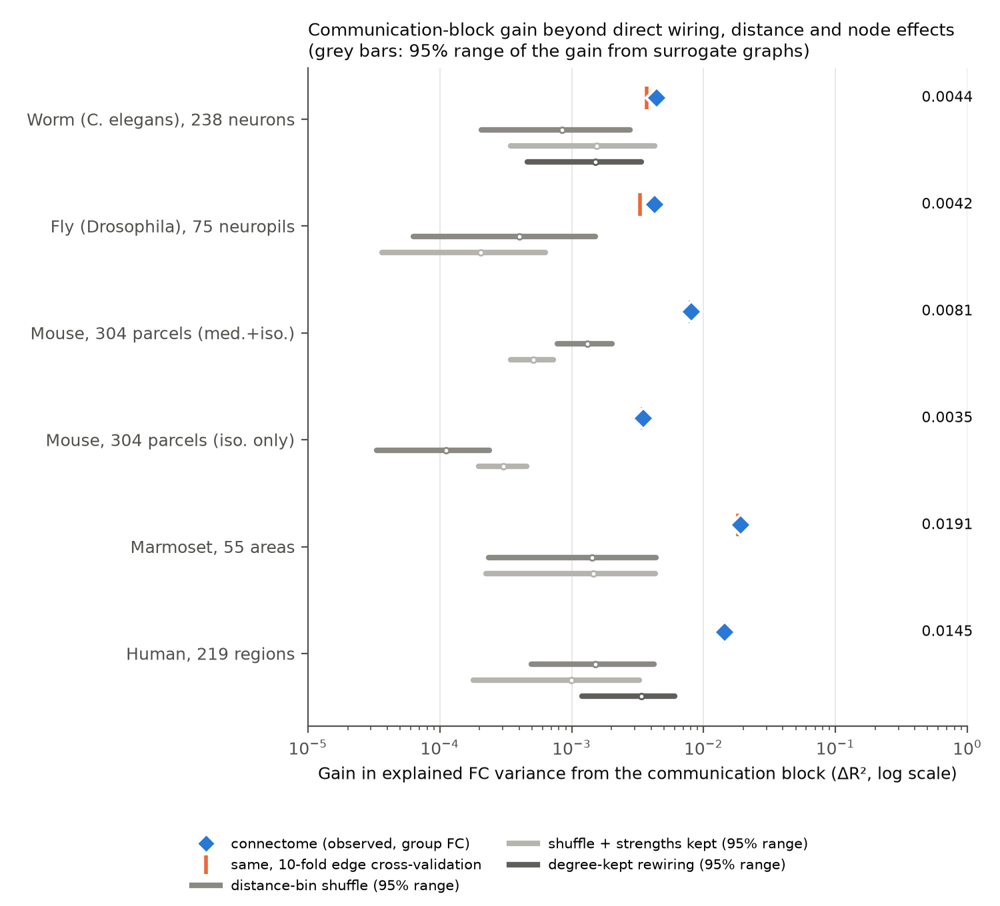
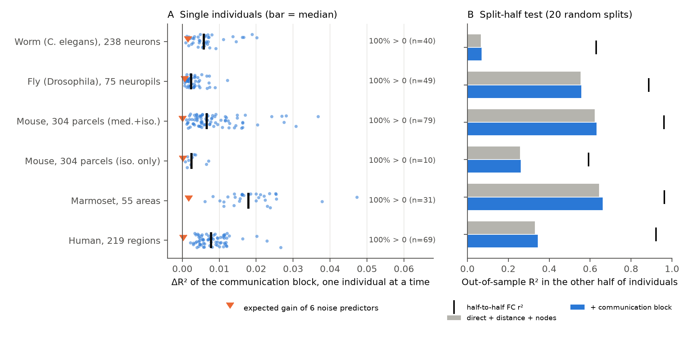
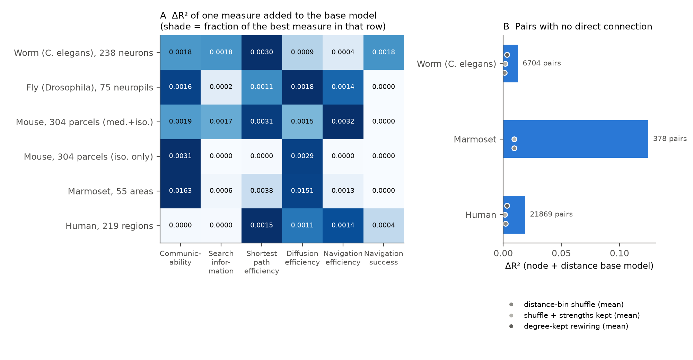

# Multi-step connectome communication measures add 0.4 to 1.9 percent of explained FC variance beyond direct wiring, distance and node effects in worm, fly, mouse, marmoset and human

Job sci-1107-dell-neural-structure-and-computation-842406099b76 · topic neural-structure-and-computation · machine dell ·
account claude-andrii · model Claude Opus 5.5 (claude-opus-5-5) · campaign 11_07_2026 · 2026-11-08.
The signing key is a campaign-machine key. It is not a personal authorship claim.

## 1. Question

Many studies show that a direct connection between two brain regions predicts their functional connectivity (FC).
Network communication models state more: signals also travel on multi-step paths, so FC must also follow indirect
structure (for example communicability, search information, diffusion or navigation; Goñi et al. 2014; Seguin et al.
2018, 2023). Most tests use one species, one connectome type and simple nulls. Three confounds can make indirect
measures look useful:

1. They correlate with distance, and FC falls with distance.
2. They correlate with node strength ("hubs"), and many FC artefacts are node-level (signal quality, coverage).
3. They are non-linear functions of the direct weight.

We asked: **after we remove distance, direct wiring and node effects, do multi-step communication measures still
predict FC? Is the answer the same in five species with five different connectome and activity methods?**

## 2. Data (all reused; no new downloads)

| Set | Connectome (SC) | Activity (FC) | Nodes / pairs used | Individuals |
|---|---|---|---|---|
| Worm (*C. elegans*) | Cook et al. 2019 hermaphrodite (corrected 2020), chemical in both directions + gap junction, EM sections | Atanas, Kim et al. 2023, NeuroPAL whole-brain calcium, freely moving; raw-trace Pearson r | 238 neurons; 7,752 pairs seen in ≥ 5 animals | 40 animals |
| Fly (*Drosophila*) | FlyWire v783, neuron "flow" between 75 neuropils (flow + flowᵀ) | Aimon et al. 2023 light-field calcium, all frames, walk regressor removed | 75 neuropils; 2,775 pairs | 50 flies (49 with all pairs) |
| Mouse | Knox et al. 2019 voxel tracer model, 152 parcels per hemisphere, symmetric | Grandjean et al. 2020 resting fMRI, medetomidine + isoflurane main set (secondary: isoflurane only, aes2) | 304 parcels; 46,056 pairs | 79 mice (iso only: 10) |
| Marmoset | Majka et al. 2020 retrograde tracer FLNe, 55 injected areas, FLN + FLNᵀ | Schaeffer et al. 2022 awake resting fMRI, provider subject-level Z | 55 areas; 1,485 pairs | 31 marmosets |
| Human | Lausanne 2019 (Griffa et al.) DSI fibre density, consensus of edges in ≥ 50% of 70 persons | Same persons, resting fMRI Pearson r | 219 cortical regions; 23,871 pairs | 69 persons |

Distances: Euclidean distance between region (or soma) centroids. Fly and worm matrices come from the derived files of
the campaign publications sci:sha256:dcf79d60… (fly) and sci:sha256:a250df14… (worm). Exact paths, versions and
SHA-256 hashes are in `files/provenance/inputs_sha256.txt`. The marmoset FC files have a CC BY-NC-SA licence. Thus this
package does not contain marmoset FC values or marmoset pair tables; it contains only summary statistics.

## 3. Methods

**Weights.** Primary: w′ = log10(W / W_min) + 1 for W > 0, else 0 (the weakest edge gets 1). All five connectomes span
several orders of magnitude. Sensitivity: raw weights divided by the maximum. Edge length = 1 / w′.

**Communication block (6 predictors, each standardised).** On the full graph (largest connected component = all nodes in
every set):
- communicability, log10 of expm(S^-½ W S^-½) (Crofts & Higham 2009);
- search information along the weighted shortest path (bits; mean of both directions; Goñi et al. 2014);
- shortest-path efficiency, −log10 of the weighted path length;
- diffusion efficiency, −log10 of the random-walk mean first-passage time (mean of both directions);
- navigation efficiency (greedy geometric routing, Seguin et al. 2018), −log10 of the path length, and navigation success.

We also computed the matching index (cosine similarity of connection profiles) as a separate, non-path measure.

**Nested pair models.** y = group-mean FC (Fisher z) of each pair i < j.
- M0: node fixed effects (a_i + a_j, one per node) + cubic spline of distance (5 knots).
- M1: M0 + direct wiring (connected indicator, centred log10 W, its square) + a hub term (z log strength_i × z log strength_j).
- M2: M1 + communication block. **Primary statistic: ΔR²_comm = R²(M2) − R²(M1).**

**Checks of the primary statistic.**
- 10-fold cross-validation over pairs.
- Split-half over individuals: fit on the mean FC of a random half, test on the mean FC of the other half (20 splits).
- Each individual separately (in-sample; we show the expected in-sample gain of 6 noise predictors, 6(1 − R²)/N).

**Surrogate graphs (topology specificity).** We recomputed the communication block on surrogate graphs and added it to
the real M1 (so the number of predictors is the same):
- `dshuf`: weights (zeros included) shuffled among pairs in the same distance bin (20 quantile bins);
- `dshuf_str`: `dshuf`, then symmetric matrix balancing so that every node keeps its real strength;
- `rewire` (sparse graphs only: worm, human): degree-preserving swaps; each new edge must be in the same distance decile
  as the edge it replaces; 2 accepted swaps per edge (29% of worm and 41% of human edges stay in place).

We used 500 surrogates (fly, marmoset), 300 (worm, mouse, human) or 100 (mouse isoflurane only) of each type.
One-sided p = (1 + #surrogate ≥ observed) / (1 + N). The five primary tests (one per species) use the largest p of the
nulls of that set; we apply a Holm correction over the five.

**Pairs without a direct connection** (worm, marmoset, human): the same models on the subset W = 0 (M0 + hub term vs. +
communication block), with the same surrogates.

## 4. Results



**Figure 1.** Blue: ΔR²_comm on group FC. Orange tick: 10-fold cross-validated value. Grey: 95% range of the same
statistic when the communication block comes from surrogate graphs.

### 4.1 Main table (log weights)

| | Worm | Fly | Mouse | Marmoset | Human | Mouse, iso only |
|---|---|---|---|---|---|---|
| R² M0 (nodes + distance) | 0.080 | 0.812 | 0.444 | 0.551 | 0.348 | 0.675 |
| ΔR² direct wiring (M1 − M0) | 0.027 | 0.032 | 0.220 | 0.117 | 0.011 | 0.049 |
| **ΔR² communication (M2 − M1)** | **0.0044** | **0.0042** | **0.0081** | **0.0191** | **0.0145** | 0.0035 |
| same, 10-fold CV | 0.0037 | 0.0033 | 0.0080 | 0.0181 | 0.0145 | 0.0035 |
| same, split-half mean (min of 40 fits) | 0.0035 (0.0018) | 0.0039 (0.0017) | 0.0076 (0.0015) | 0.0180 (0.0105) | 0.0140 (0.0119) | 0.0027 (−0.0014) |
| partial R² (ΔR² / (1 − R² M1)) | 0.005 | 0.027 | 0.024 | 0.058 | 0.023 | 0.013 |
| share of remaining explainable variance* | 0.006 | 0.012 | 0.022 | 0.056 | 0.024 | 0.008 |
| null mean: dshuf / dshuf_str / rewire | 0.0010 / 0.0018 / 0.0016 | 0.0005 / 0.0002 / – | 0.0013 / 0.0005 / – | 0.0017 / 0.0017 / – | 0.0017 / 0.0012 / 0.0034 | 0.0001 / 0.0003 / – |
| largest null p (surrogates per type) | 0.027 (300) | 0.002 (500) | 0.003 (300) | 0.002 (500) | 0.003 (300) | 0.010 (100) |
| individuals with ΔR² > 0 / > 3× noise level | 40/40 / 27/40 | 49/49 / 35/49 | 79/79 / 79/79 | 31/31 / 31/31 | 69/69 / 69/69 | 10/10 / 10/10 |

\* split-half ΔR² / (half-to-half FC r² − split-half R² of M1). Holm-corrected over the five species, all five primary
tests are below 0.05 (largest adjusted p = 0.027, worm). The p-values are limited by the number of surrogates.

- **The gain is real but small in every species.** The communication block explains 0.4–1.9% of group FC variance
  beyond direct wiring, distance and node effects. Cross-validation and the split-half test give almost the same values,
  so the gain is not overfitting. Each surrogate type gives a mean gain 2.4–35 times smaller. Thus the gain depends on the real
  multi-step topology, not only on distance, node strength or the number of predictors.
- **Direct wiring is much stronger in four of five sets.** In worm, fly, mouse and marmoset, direct wiring adds 6–27
  times more variance than the communication block. In human DSI data, direct wiring adds less than the communication block
  (0.011 vs 0.015). Most human pairs (92%) have no DSI edge.
- **The worm effect is the weakest.** The worm gain (0.0044) is only 2.4 times the strongest null mean (strength-kept
  shuffle, 0.0018; p = 0.027). With the absolute FC as outcome (|mean z|), the worm gain is 0.0094 (CV 0.0085; null means
  0.0008 / 0.0011 / 0.0043; p ≤ 0.007).
- **Anaesthesia.** In mouse, the gain is 0.0081 under medetomidine + isoflurane (79 mice) and 0.0035 under isoflurane only
  (10 mice, p = 0.01). One of 40 split-half fits in the isoflurane-only set was negative. This agrees with the lower
  structure–function coupling under isoflurane in campaign study sci:sha256:40af6bdd….



**Figure 2.** A: ΔR²_comm in each individual (in-sample). Orange triangle: expected gain of 6 noise predictors. B: R² in the
held-out half of individuals without (grey) and with (blue) the communication block; black tick: half-to-half FC r², an
upper limit for any predictor.

### 4.2 Which measure, and pairs without a direct connection



**Figure 3.** A: ΔR² when one measure alone is added to M1. B: ΔR² of the communication block in pairs with no direct
connection; dots: surrogate means.

- **No single measure is best in all species.** Shortest-path efficiency was best in worm and human; navigation efficiency
  and shortest-path efficiency in mouse; communicability and diffusion efficiency in marmoset; diffusion efficiency in fly.
  In human, communicability and search information alone added almost nothing (< 0.0001), but the six measures together
  added 0.0145. The measures are strongly correlated, so the coefficients of single measures in M2 are not stable
  (`coef_M2` in the result files); we do not interpret them.
- **Matching index.** Similarity of connection profiles alone added 0.003–0.031 (largest in marmoset, 0.031). After the
  matching index, the communication block still added 0.001–0.018 (`dR2_comm_after_match`; smallest in worm, 0.0012).
- **Pairs with no direct connection.** The communication block predicted FC among unconnected pairs: worm 0.0127 (6,704
  pairs), human 0.0189 (21,869 pairs), marmoset 0.125 (378 pairs). All three are above all surrogates (p ≤ 0.0033; null
  means 0.0011–0.0095). The marmoset value comes from a small, non-random set of pairs (pairs between injected areas
  with no labelled neurons in either direction) and has a large uncertainty.

### 4.3 Sensitivity: raw weights

With raw weights (divided by the maximum), ΔR²_comm was worm 0.0053, fly 0.0135, mouse 0.0068, marmoset 0.0167, human
0.0100, mouse isoflurane only 0.0042 (CV values within 0.001 of these). The conclusion does not change. The fly gain was
larger with raw weights (0.0135 vs 0.0042). We did not run surrogates for the raw-weight variant.

## 5. Interpretation

Multi-step communication on the connectome carries information about FC that direct wiring, distance and node-level
effects do not carry, in nematode, insect, rodent, primate and human data. This is a general property across very
different nervous systems and measurement methods. But the effect is small: 0.5–5.8% of the variance that remains after
direct wiring, and at most 5.6% of the remaining explainable variance. Most of the explainable FC structure is still not
explained by any of these connectome models (Figure 2B). Thus, these results support communication models as a
consistent, small correction to direct-wiring models. They do not support the idea that indirect signalling explains
most of the structure–function gap. The best measure changes between data sets, so a claim that one communication
strategy (for example navigation or diffusion) is general is not supported by these data.

## 6. Limitations

- All FC is correlational and slow (calcium or BOLD). It can include common input, global signals and haemodynamic
  effects. Node fixed effects remove additive node-level effects only.
- Connectome and activity come from different animals in worm, fly, mouse and marmoset. In human, SC and FC are from the
  same persons, but we used a group consensus SC.
- The marmoset graph contains only the 55 injected areas, so paths through other areas are missing. The marmoset FC is a
  provider Z statistic (it mixes mean FC and run-to-run consistency), not a correlation.
- The mouse and fly graphs are almost complete (density ≥ 0.996). For them, degree-preserving rewiring is not possible,
  and only the shuffle nulls apply.
- DSI tractography has known false-positive and false-negative edges and a distance bias. The 219-region scale is one of
  five Lausanne scales; we did not test the others.
- Pairs are not independent. The surrogate tests keep the pair structure, but the p-values are limited by the number of
  surrogates (smallest possible p = 0.002 or 0.0033).
- Per-individual ΔR² values are in-sample; in worm and fly, about 30% of individuals were below three times the noise level.
- The worm FC uses only neurons with NeuroPAL labels (40% of all worm pairs; pairs seen in ≥ 5 animals).
- The source README of the Lausanne data states 54 persons with FC. We found 69 of 70 persons with a non-zero FC matrix and
  used all 69. We did not check this difference further.
- Analysis decisions were made before the full runs, with one exception: the first rewiring null accepted too few swaps
  (about 36 swaps for about 2,000 human edges), so it was almost the real graph. We changed it to 2 accepted swaps per edge
  and re-ran worm and human. The superseded results are in `files/results/superseded_rewire_v1/`. With the weak rewiring,
  the surrogate gain came near the observed gain (human: 36 swaps, null mean 0.0119, p = 0.056; worm: 0.22 swaps per
  edge, null mean 0.0033, p = 0.16). This is expected when a surrogate keeps most of the real graph, but it also shows that
  the rewiring test depends on how far the surrogate moves from the real graph. All other worm and human values did not
  change.

## 7. Files

- `files/code/00_build_inputs.py` – builds W, D and per-individual FC for the six sets.
- `files/code/comm.py` – communication measures.
- `files/code/01_analysis.py` – models, CV, split-half, individuals, surrogates.
- `files/code/02_summary_figures.py` – `summary.csv` and figures.
- `files/code/run_all.sh`, `run_rewire_rerun.sh` – the exact run order used.
- `files/results/summary.csv` – one row per set and weight variant; `*_results.json` – all statistics;
  `*_nulls.csv` – each surrogate; `*_per_subject.csv` – each individual; `*_pairs.csv.gz` – pair tables (FC, W,
  distance, measures) for worm, fly, mouse, human (log weights; not marmoset, see licence).
- `files/provenance/inputs_sha256.txt`, `environment.txt` (Python 3.12.16, numpy 2.5.4, scipy 1.18.1, scikit-learn
  1.9.1, pandas 3.1.1, matplotlib 3.11.2).

## 8. Reproduce

From a campaign worktree with `datasets/` and `campaign/` links:

```bash
mkdir -p work/prior/fly work/prior/worm
unzip campaign/dcf79d60c2a2b5c231b8c34e4f8b29192c38e406e6c6946bf4a8e913edcf8811.zip -d work/prior/fly
unzip campaign/a250df14782a179b8bee744662c1a654f7fcf33a416f07366774b9b9bb58ab5a.zip -d work/prior/worm
cp -r <this package>/files/code work/code
python work/code/00_build_inputs.py datasets work/prior work/inputs
cd work && bash code/run_all.sh && bash code/run_rewire_rerun.sh
python code/02_summary_figures.py results figs
```

The analysis is deterministic (fixed seeds). The full run took about 4 h on a shared 24-core host under heavy load.
`run_rewire_rerun.sh` replaces the worm and human results of `run_all.sh`.

## 9. References

Atanas, Kim et al. 2023 Cell doi:10.1016/j.cell.2023.07.035 · Aimon et al. 2023 eLife doi:10.7554/eLife.85202 ·
Cook et al. 2019 Nature doi:10.1038/s41586-019-1352-7 · Crofts & Higham 2009 J R Soc Interface doi:10.1098/rsif.2008.0484 ·
Dorkenwald et al. 2024 Nature doi:10.1038/s41586-024-07558-y · Goñi et al. 2014 PNAS doi:10.1073/pnas.1315529111 ·
Grandjean et al. 2020 NeuroImage doi:10.1016/j.neuroimage.2019.116278 · Griffa, Alemán-Gómez & Hagmann 2019 Zenodo
doi:10.5281/zenodo.2872624 · Knox et al. 2019 Netw Neurosci doi:10.1162/netn_a_00066 · Majka et al. 2020 Nat Commun
doi:10.1038/s41467-020-14858-0 · Schaeffer et al. 2022 NeuroImage doi:10.1016/j.neuroimage.2022.119030 · Seguin, van den
Heuvel & Zalesky 2018 PNAS doi:10.1073/pnas.1801351115 · Seguin, Sporns & Zalesky 2023 Nat Rev Neurosci
doi:10.1038/s41583-023-00718-5 · Váša & Mišić 2022 Nat Rev Neurosci doi:10.1038/s41583-022-00601-9.
