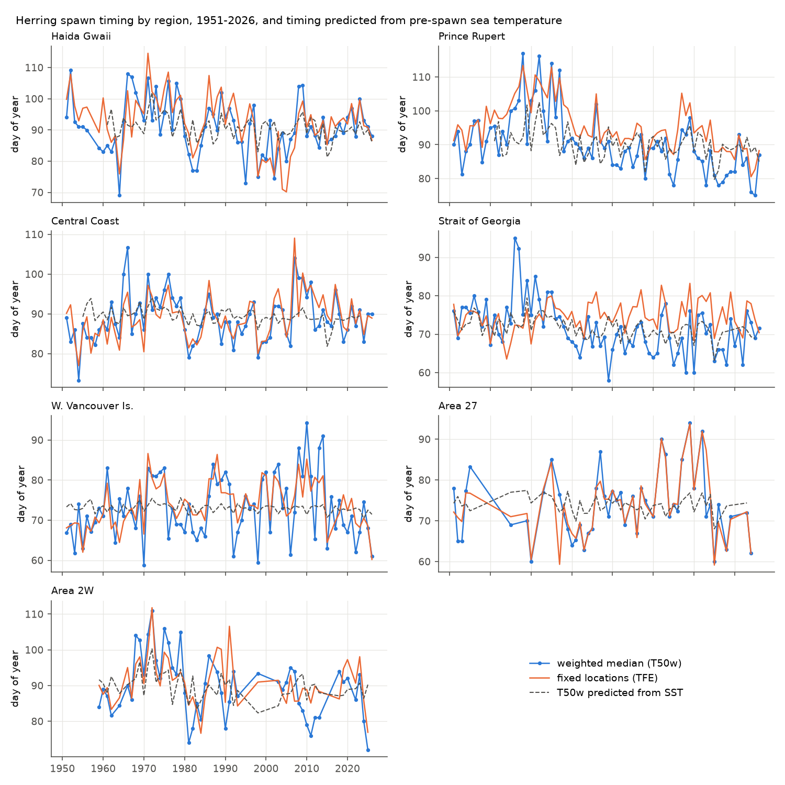
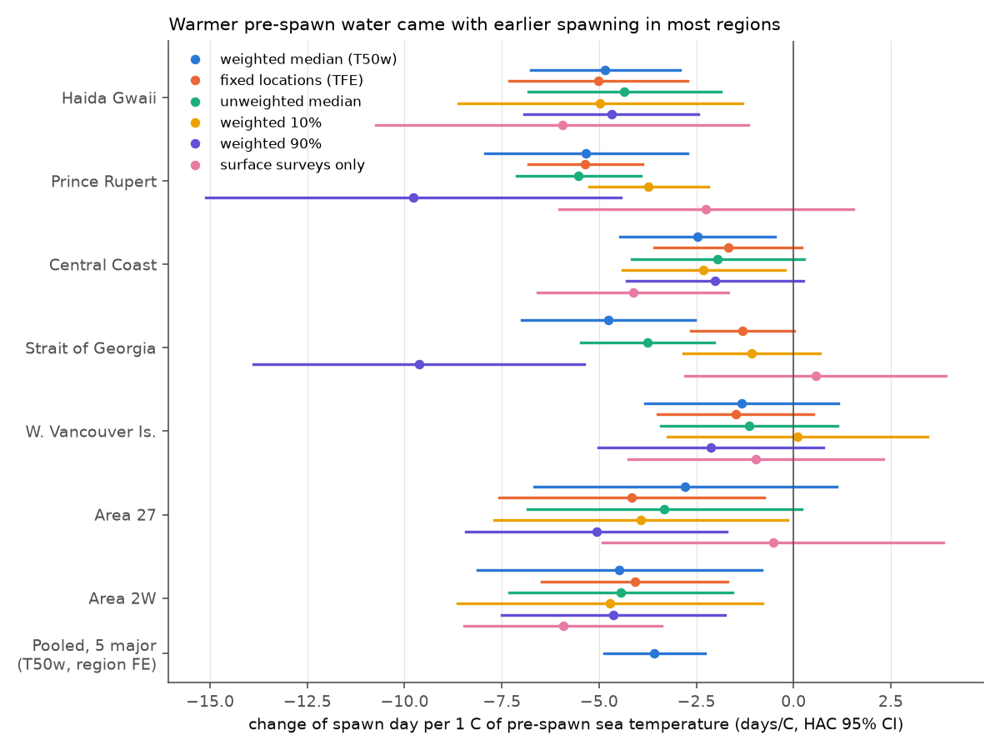
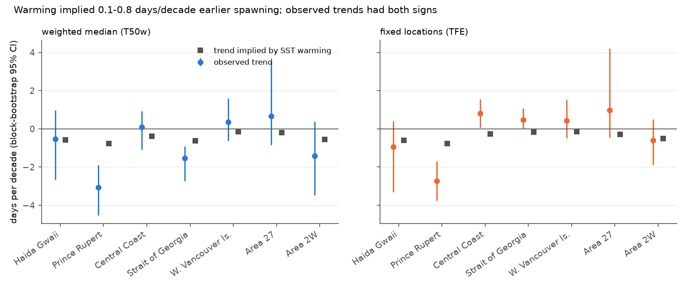

# Warm pre-spawn water came with earlier Pacific herring spawning in British Columbia, but 1951-2026 warming explains less than 1 day per decade of the timing trends

## Summary

We tested what sets the date of Pacific herring (*Clupea pallasii*) spawning in British Columbia (BC). We used
31,460 dated spawn records of the Fisheries and Oceans Canada (DFO) spawn index for 1951-2026 in seven stock
regions, daily sea-surface temperature (SST) from DFO lightstations, and the ages of herring in DFO biosamples.
We wrote the analysis plan (`files/code/PREREGISTRATION.md`) before we joined timing to temperature or age.

Rooper et al. (2024, doi:10.3354/meps14274) modelled spawn timing of five BC stocks in 1988-2018 with day length,
degree days and salinity. They predicted that warmer water will make spawning earlier. Older herring are known to
spawn earlier than young herring (Hay 1985; Ware and Tanasichuk 1989). We tested three explanations over 76 years:
pre-spawn sea temperature, long-term warming and spawner age structure. We also tested how the survey and the
choice of spawn locations change the answer.

Main results:

1. **Year to year, warm water came with earlier spawning.** The spawn-index-weighted median spawn day (T50w)
   changed by -4.8 (HG), -5.3 (PRD), -2.5 (CC) and -4.8 (SoG) days per 1 C of the mean SST in a fixed 60-day
   pre-spawn window (HAC 95% CIs exclude zero). The West Coast of Vancouver Island (WCVI) slope was -1.3 days/C
   (95% CI -3.8 to +1.1). The pooled slope for the five major regions was -3.6 days/C (95% CI -4.9 to -2.3).
   The minor region Area 2W gave -4.5 days/C; Area 27 gave -2.8 (uncertain). A second lightstation per region, a
   linear year term, the log spawn index, 30-90 day windows and 0-28 day lags all kept negative slopes; with the
   spawn index term the Central Coast slope became uncertain (-1.4, 95% CI -3.4 to +0.5).
2. **The long-term warming was too small to move spawning much.** Pre-spawn SST increased by 0.10-0.15 C per
   decade. With the fitted slopes, this predicts spawning 0.1-0.8 days per decade earlier. Observed trends had
   both signs and were often larger than this. At fixed spawn locations (location fixed effects, TFE), spawning
   became later than the SST prediction in the Central Coast (+1.07 days/decade, 95% CI +0.54 to +1.77) and the
   Strait of Georgia (+0.63, 95% CI +0.21 to +1.23), and earlier in Prince Rupert District (-1.97, 95% CI -2.75
   to -1.34). Other regions had no clear difference.
3. **Location choice changed the regional trend.** In the Strait of Georgia, the weighted median moved earlier
   (-1.55 days per decade) but the fixed-location timing moved later (+0.46). The share of the spawn index in
   Statistical Area 14 (median spawn day 70, the earliest large area) increased from 39-56% in the 1950s-1960s to
   76-89% after 1980. Regional timing indices that do not fix locations confound timing with spawn distribution.
4. **Mean spawner age did not explain timing.** We computed the mean age of 1.32 million aged herring in
   January-April DFO biosamples (62-71 years per region). Mean age increased from about 3.4-3.9 years in the 1950s
   and 1960s to 4-5 years after 1975. With SST in the model, the age slope of T50w was clear only in the Strait of
   Georgia (-4.7 days per year of mean age, 95% CI -7.6 to -1.8). That slope did not hold at fixed locations (TFE
   +1.1, 95% CI -2.9 to +5.1), so it also came from the location shift. Haida Gwaii fixed-location timing had the
   opposite sign (+4.7 days per year of age, 95% CI +1.4 to +8.1). The pooled age slope was -0.3 days per year
   (95% CI -2.1 to +1.4). Spawner age did not explain the timing trends.
5. **Forward test.** A temperature model fitted on 1951-1990 predicted 1991-2026 spawn timing better than the
   1951-1990 mean in HG, PRD and SoG (skill 0.13-0.18, 95% CIs above zero) and in the pooled major regions (skill
   0.105, 95% CI 0.067 to 0.147). The skill was small: most year-to-year variance stayed unexplained.
   Age alone gave no pooled forecast gain (skill -0.02; only SoG +0.09), and adding age to SST gave no gain over
   SST alone (pooled 0.094).

Interpretation: sea temperature has a real but modest year-to-year link to herring spawn timing in four of five
major BC regions (about 3-5 days per C). The coastal warming since 1951 (about 1 C over 76 years) is too small
to give a large advance; the regional trends of up to 3 days per decade come from other causes and from changes in
where herring spawn. A projection of warming alone would miss most of the observed change in BC spawn timing.



## Data

| Source (DFO, Open Government Licence - Canada) | Use |
| --- | --- |
| Pacific Herring Spawn Index Data, 2026 release (31,460 spawn records, 1951-2026) | Start date, location code, region, survey method, spawn index (Surface + Macrocystis + Understory) |
| BC Lightstation Sea-Surface Temperature, active sites, release 20261103 | Daily SST at Entrance Island, Departure Bay, Amphitrite Point, Nootka Point, Kains Island, Pine Island, McInnes Island, Egg Island, Bonilla Island and Langara Island |
| Herring Biosample Database (5 major regions) | Fish age, sample month, gear, representative-set flag |

The raw files are not in this bundle (see `files/NOTICE-external-data.md` for licence, attribution, record IDs and
URLs; `files/data/raw_sha256.txt` for hashes). `files/code/00_fetch_raw.sh` downloads them into local scratch.

Regions: Haida Gwaii (HG), Prince Rupert District (PRD), Central Coast (CC), Strait of Georgia (SoG), West Coast
of Vancouver Island (WCVI) are the five major stock assessment regions; Area 27 (A27) and Area 2W (A2W) are minor.

## Methods

The plan in `files/code/PREREGISTRATION.md` was written before any timing-temperature or timing-age statistic.
Analyses outside it are marked exploratory.

- **Timing.** Day of year of the spawn start date (29 Feb removed). Per region and year: spawn-index-weighted 10%,
  50% (T50w, primary) and 90% quantiles; the unweighted median (T50u); the T50w of surface surveys only; and TFE,
  the year effect of an OLS of start day on location-code and year factors (locations seen in at least two years).
  A region-year entered with at least 5 dated records at at least 3 locations (check: 10 records).
- **SST.** Mean daily SST in the 60 days that end 14 days before the region's 1951-2026 mean T50w (at least 30
  valid days). Primary stations: SoG Entrance Island, WCVI Amphitrite Point, A27 Kains Island, CC McInnes Island,
  PRD and HG Bonilla Island, A2W Langara Island. Secondary stations are in the plan. We also computed the day on
  which degree days above 5 C reached 100 (DD100).
- **Age.** Mean age (ages 2-10) of fish in January-April biosamples of the same region and calendar year, with at
  least 100 aged fish. From season 2013/14 only DFO "representative" samples. Checks: seine-only mean age and the
  share of fish aged 5 or more.
- **H1.** OLS of timing on SST per region with Newey-West (3 lags) 95% CIs; also with a year term, with log spawn
  index, in first differences, and pooled over the major regions with region fixed effects (CIs clustered by year).
- **H2.** Observed timing trend versus the trend implied by the H1 slope times the SST trend, on the same years.
  Gap CIs from 2,000 moving-block bootstrap samples (block 4 years). We also report the HAC year coefficient of
  the joint SST + year model.
- **H3.** Age added to the H1 model.
- **H4.** Models fitted on 1951-1990 predict 1991-2026: M0 training mean, M1 trend, M2 SST, M3 SST + age, M4 age.
  Skill = 1 - RMSE(model)/RMSE(M0) on the same test years; moving-block bootstrap CIs over test years.

## Results

### H1: temperature slopes of spawn timing (days per C, HAC 95% CI)

| Region | n years | T50w | T50w + year term | TFE (fixed locations) | First differences | Secondary station |
| --- | --- | --- | --- | --- | --- | --- |
| HG | 65 | -4.8 (-6.8, -2.9) | -4.9 (-7.0, -2.8) | -5.0 (-7.3, -2.7) | -3.2 (-5.6, -0.8) | -5.1 (-7.0, -3.2) |
| PRD | 66 | -5.3 (-7.9, -2.7) | -3.1 (-5.6, -0.7) | -5.4 (-6.8, -3.9) | -0.8 (-3.6, +2.1) | -4.7 (-7.1, -2.4) |
| CC | 68 | -2.5 (-4.5, -0.5) | -3.0 (-4.8, -1.2) | -1.7 (-3.6, +0.2) | -2.9 (-4.3, -1.6) | -4.4 (-6.2, -2.7) |
| SoG | 72 | -4.8 (-7.0, -2.5) | -2.5 (-5.1, -0.0) | -1.3 (-2.6, +0.0) | -0.8 (-4.2, +2.5) | -4.8 (-6.5, -3.2) |
| WCVI | 76 | -1.3 (-3.8, +1.1) | -1.8 (-4.4, +0.8) | -1.5 (-3.5, +0.5) | -0.7 (-3.3, +2.0) | -1.6 (-6.3, +3.1) |
| A27 | 47 | -2.8 (-6.7, +1.1) | -3.2 (-7.0, +0.5) | -4.2 (-7.6, -0.8) | -2.6 (-5.7, +0.4) | -2.4 (-6.5, +1.8) |
| A2W | 51 | -4.5 (-8.1, -0.8) | -3.8 (-7.3, -0.2) | -4.1 (-6.5, -1.7) | -2.5 (-4.9, -0.1) | none |
| Pooled 5 major | 347 | -3.6 (-4.9, -2.3) | | | | |

The T50w slope was clear with a negative sign in 4 of 5 major regions, so H1 "repeats" under the plan's rule.
The 10% and 90% quantiles and the unweighted median gave the same sign in all regions except the WCVI 10% date
(`files/results/h1_temperature_slopes.csv`). Surface-only timing gave uncertain slopes in PRD, SoG, WCVI and A27;
those series end in 2013-2020 because dive surveys replaced surface surveys for most large spawns from 1988.
DD100 had positive slopes (later degree-day dates, later spawning) in five regions. The exploratory window test
(`files/results/explor_window_sensitivity.csv`) gave negative slopes for every window length (30, 60, 90 days) and
lag (0, 14, 28 days) in every region.

In SoG the TFE slope (-1.3) was much smaller than the T50w slope (-4.8). Part of the SoG T50w link to temperature
came from where herring spawned in warm and cold years, not from the date at a fixed place.



### H2: observed trends versus trends implied by SST warming (days per decade)

| Region | Years | SST trend (C/decade) | Implied by SST | Observed T50w | Gap T50w (95% CI) | Observed TFE | Gap TFE (95% CI) | HAC year term, TFE |
| --- | --- | --- | --- | --- | --- | --- | --- | --- |
| HG | 1961-2026 | +0.12 | -0.6 | -0.5 | +0.1 (-1.8, +1.3) | -0.9 | -0.3 (-2.3, +0.7) | -0.4 (-1.6, +0.9) |
| PRD | 1961-2026 | +0.14 | -0.8 | -3.1 | -2.3 (-3.4, -1.6) | -2.7 | -2.0 (-2.8, -1.3) | -2.2 (-3.1, -1.4) |
| CC | 1955-2023 | +0.15 | -0.4 | +0.1 | +0.5 (-0.5, +1.2) | +0.8 | +1.1 (+0.5, +1.8) | +1.3 (+0.7, +1.9) |
| SoG | 1951-2025 | +0.13 | -0.6 | -1.6 | -0.9 (-1.9, -0.5) | +0.5 | +0.6 (+0.2, +1.2) | +0.8 (+0.3, +1.4) |
| WCVI | 1951-2026 | +0.10 | -0.1 | +0.4 | +0.5 (-0.4, +1.6) | +0.4 | +0.6 (-0.1, +1.6) | +0.6 (-0.1, +1.4) |
| A27 | 1951-2023 | +0.07 | -0.2 | +0.7 | +0.9 (-0.6, +3.5) | +1.0 | +1.3 (-0.1, +4.2) | +1.3 (-0.2, +2.9) |
| A2W | 1959-2025 | +0.12 | -0.6 | -1.4 | -0.9 (-2.5, +0.7) | -0.6 | -0.1 (-1.0, +0.9) | -0.1 (-1.1, +0.9) |

"Implied" uses the T50w slope; the TFE gap uses the TFE slope. Year ranges are the years with both timing and SST.
In PRD the trend is not steady: spawning was late in about 1965-1980 (to day 117) and early after 2010 (day 75-82).



Exploratory location check (`files/results/explor_area_composition.csv`): in SoG the share of the spawn index in
Statistical Area 14 (median start day 70) was 0.56 and 0.39 in the 1950s and 1960s and 0.76-0.89 from the 1980s;
Area 17 (day 78), Area 13 (day 92) and Area 16 (day 81) lost share. In PRD and CC the area shares changed little.

### H3: spawner age

| Region | Age-years | T50w ~ SST + AGE: AGE slope (days per year of age) | TFE ~ SST + AGE | Seine-only age |
| --- | --- | --- | --- | --- |
| HG | 57 | +1.8 (-1.3, +5.0) | +4.7 (+1.4, +8.1) | +1.9 (-1.3, +5.0) |
| PRD | 59 | -0.8 (-4.9, +3.3) | -0.4 (-4.5, +3.7) | +1.1 (-4.0, +6.2) |
| CC | 61 | -0.7 (-3.3, +2.0) | +0.1 (-2.5, +2.7) | -0.7 (-3.3, +1.9) |
| SoG | 60 | -4.7 (-7.6, -1.8) | +1.1 (-2.9, +5.1) | -4.2 (-9.1, +0.7) |
| WCVI | 67 | -0.5 (-4.4, +3.3) | +1.3 (-1.3, +3.9) | -0.7 (-4.4, +3.1) |
| Pooled | 304 | -0.3 (-2.1, +1.4) | | |

The SST slope stayed at -3.5 days/C (95% CI -4.8 to -2.1) with age in the pooled model. The age result did not
repeat (clear in 1 of 5 regions with the expected sign, and that one did not hold at fixed locations).


### H4: forward test, 1951-1990 fit, 1991-2026 prediction of T50w

| Region | M1 trend | M2 SST | M3 SST + age | M4 age | M2 mean error obs - pred (days) |
| --- | --- | --- | --- | --- | --- |
| HG | -0.00 (-0.01, -0.00) | +0.14 (+0.06, +0.26) | +0.07 (-0.04, +0.19) | -0.00 | -2.1 |
| PRD | +0.01 (+0.01, +0.02) | +0.13 (+0.09, +0.18) | +0.17 (+0.10, +0.25) | -0.09 (-0.14, -0.07) | -9.3 |
| CC | -0.19 (-0.57, +0.07) | +0.04 (-0.11, +0.18) | +0.00 (-0.18, +0.14) | -0.02 | +0.9 |
| SoG | +0.02 (-0.29, +0.35) | +0.18 (+0.11, +0.28) | +0.21 (+0.12, +0.35) | +0.09 (+0.07, +0.12) | -3.7 |
| WCVI | -0.21 (-0.62, +0.11) | +0.01 (-0.02, +0.03) | +0.00 (-0.03, +0.03) | -0.00 | +1.4 |
| A27 | +0.01 (-0.01, +0.01) | +0.02 (-0.02, +0.05) | no age data | no age data | +3.8 |
| A2W | +0.21 (-0.17, +0.27) | -0.09 (-1.05, +0.10) | no age data | no age data | -1.4 |
| Pooled major | -0.06 (-0.17, +0.07) | +0.105 (+0.067, +0.147) | +0.094 (+0.046, +0.150) | -0.02 (-0.04, -0.01) | |

Skill is relative to the 1951-1990 mean on the same test years. In PRD all models predicted dates about 9 days too
late: the post-1990 level shift was not predicted by SST. Full table: `files/results/h4_forward_skill.csv`.


## Observation bias

- **Survey method.** Before 1988 surface surveys were used; from 1988 dive surveys were used for most large spawns
  (dive-record share 0 before 1980, 0.69-0.79 per decade after 1990). Surface-only timing kept the HG, CC and A2W
  temperature slopes but its series stops in 2013-2020 in other regions. The date we use is the spawn start date
  in both methods.
- **Where spawning is recorded.** TFE removes changes in location mix. It changed the SoG result (trend sign and
  slope size). Regional means of spawn dates that do not fix locations are not safe evidence of a timing change.
- **Spawn size.** Large spawns dominate T50w. The unweighted median and the log spawn index term gave similar
  results except the CC slope with the spawn index term (uncertain).
- **Coverage.** A rule of 10 records instead of 5 gave the same slopes (`H1-min10` rows).
- **Age samples.** Biosamples come from fisheries and test fisheries, whose gear and timing changed (reduction
  seine fishery to 1967, roe gillnet and seine fisheries from 1972). Seine-only age gave the same result.

## Limitations

- The lightstation SST is one coastal point per region; spawn grounds can be warmer or colder. HG and PRD share
  Bonilla Island. We did not use model fields (for example the BCCM model of Rooper et al.).
- The spawn start date is the first date the survey recorded spawn. Survey effort and timing changed, especially
  in the 1950s-1980s. We could not correct for survey visit dates.
- The age test uses the mean age of fishery and test-fishery samples, not of the fish in each spawn. Any age effect
  smaller than about 2-3 days per year of mean age cannot be excluded.
- We did not test day length (it does not change between years), salinity, the spring bloom, predators, harvest
  rates or genetics. The PRD early shift after 1990 and the CC and SoG later fixed-location timing remain unexplained.
- Regions are neighbours and share climate modes (ENSO, PDO); the pooled CI clusters by year for this reason.
- Statistical tests are many; we report all pre-registered ones. Exploratory results (window and area tables)
  need confirmation.

## What is open

- Why PRD spawn timing moved about 2-3 days per decade earlier than SST predicts, and why CC and SoG fixed-location
  timing moved later. Candidate tests: harvest rate, body size at age, predator abundance, spawn-ground SST from
  satellite or model data.
- A within-spawn test of age effects needs age samples tied to spawn events.
- A transect-level replication of Rooper et al. (2024) with post-2018 dive-survey data.

## Reproduction

```
bash files/code/run_all.sh ./scratch    # downloads raw DFO data to ./scratch/raw, writes derived tables, results, figures
```

Python 3.12 with numpy, pandas, statsmodels and matplotlib; curl and unzip. Scripts: `00_fetch_raw.sh` (download;
`fetch_biosamples.sh` and `01_fetch_ranges.py` use two parallel byte ranges because the DFO server is slow),
`02_timing_sst.py` (timing metrics and SST windows), `03_age.py`, `04_models.py` (H1-H4), `05_figures.py`,
`06_window_sensitivity.py` and `07_composition.py` (exploratory). The bootstrap seed is fixed (20261111).
Bundled derived tables: `files/data/region_year.csv` (region-year timing, counts, SST, DD100) and
`files/data/age_region_year.csv` (region-year mean ages). All result tables and console logs: `files/results/`.
We ran `run_all.sh` on fresh copies of the raw files (same SHA-256). It gave the bundled tables to within 1e-10
(floating-point rounding of least squares).

## Provenance

- Campaign 11_07_2026, job sci-1107-dell-climate-pollution-biodiversity-0bea50b76991, topic
  climate-pollution-biodiversity, machine dell, account claude-sci.
- Analysis and text by the AI model Claude Opus 5.5 (claude-opus-5-5) working as an automated research worker.
  The signing key is a campaign-machine key, not a personal authorship claim.
- DFO data retrieved 2026-11-11 (see `files/NOTICE-external-data.md`). Contains information licensed under the
  Open Government Licence - Canada.
- We searched the campaign record for herring, spawning timing and marine fish timing before we started. We found
  no earlier publication on herring spawn timing. The design (pre-registered slopes, period forward test, check of
  long-term trend versus temperature slope) follows the Columbia River shad study in the record
  (sci:sha256:8aa8a8f194d985b46635b07223b7dcb0fcd38e752d6112fb1301c1db9cbc5bdd).

## References

- Rooper CN, Boldt JL, Cleary J, Pena MA, Thompson M, Grinnell M (2024) Evaluating factors affecting the distribution
  and timing of Pacific herring *Clupea pallasii* spawn in British Columbia. Mar Ecol Prog Ser 741:251-269.
  doi:10.3354/meps14274
- Hay DE (1985) Reproductive biology of Pacific herring (*Clupea harengus pallasi*). Can J Fish Aquat Sci 42(Suppl 1):111-126.
- Ware DM, Tanasichuk RW (1989) Biological basis of maturation and spawning waves in Pacific herring (*Clupea harengus pallasi*). Can J Fish Aquat Sci 46:1776-1784.
- Quinn TP, Adams DJ (1996) Environmental changes affecting the migratory timing of American shad and sockeye salmon. Ecology 77:1151-1162.
