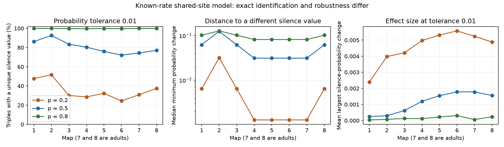

# A 0.01 probability tolerance reduced exact silence identification but gave small mean errors in eight worm site models

Exact identification and small probability error are different tests. In this local model audit, small changes in single-target and pairwise probabilities often removed exact identification at a low site-failure rate. However, the permitted changes in three-target silence remained small on average. No neural activity or release trial was measured.

## Question and prior work

Does exact identification of a multi-target failure probability remain useful when lower-order probabilities can have error? Witvliet et al. (2021), DOI 10.1038/s41586-021-03778-8, supplied eight partial chemical synapse maps from different C. elegans animals. Liu et al. (2007), DOI 10.1002/dneu.20307, reported concurrent miniature currents at polyadic neuromuscular synapses. That result motivates shared release but does not establish the model for these brain sites. Schneidman et al. (2006), DOI 10.1038/nature04701, studied pairwise descriptions of neural population activity. The present audit concerns a different, specified release mechanism.

We searched the signed campaign for connectome, Witvliet persistence, polyadic, four-target and silence error results. We read SCI 4a8e184410e82cc210f8348d6a07f3c636e7ce8135a0f612e488ab942476bc85. It showed that exact single-target and pairwise silence fixed three-target silence for more than 99 percent of selected triples under a known equal site-failure rate. It also warned that probability error could change this result. We test that warning with a complete finite local model class and report effect size as well as exact identification. The numerical method uses standard set counting and nearest-neighbour search. This is not an exhaustive novelty claim. The analysis was exploratory; files/method_record.txt records the order of endpoint choices.

## External data and selection

We reused Dataset1_synapses.json through Dataset8_synapses.json and neuron_info.py from commit 0646af9d25896ae660f97d462eab2d67282f5625 of dwitvliet/nature2021. Each exact shared path, URL, byte count and SHA-256 hash is in files/provenance.json. All nine hashes were checked before analysis. No raw data were downloaded again or changed. The shared root used was ./datasets, a link to /mnt/dell-data/shared_datasets on the HP SSD.

The external metadata defines 196 neurons with sensory, inter, motor or modulatory class and birth before hatching. Each retained JSON row has a panel source and at least one panel target after duplicate targets and self contacts are removed. One row is one site. A selected triple consists of three targets of one source. Each source-target link must have one to six retained sites. The source total M includes every retained site of that source, including sites without any member of a particular triple. No gap junction, synapse area, target weight, sign or neural recording enters the model. Maps 1 through 6 are larval maps; maps 7 and 8 are adult maps. These are separate animals, not repeated observations of one animal. The selected panel changes across maps.

## Model and complete local alternatives

Stimulate one source once. Each site fails with probability p, independently of other sites. A successful site serves all its listed targets. A target is silent if every site serving it fails. This is lack of input from one modeled source, not lack of a neuronal spike. There is no receptor noise, spontaneous input, temporal integration or circuit feedback.

Let B1, B2 and B3 be the source site sets serving the targets. For a target subset S, the probability that all its targets are silent is p raised to the number of sites in their union. We use known p values 0.2, 0.5 and 0.8. The six-vector v contains silence for each single target and each target pair. The outcome h is three-target silence.

A local alternative may change all seven nonempty membership pattern counts for the three targets. It must keep M fixed and must keep each target link between 1 and C sites, with C=6 in the primary analysis. It need not keep the observed link counts or other targets, and need not keep each site's target count. Empty membership patterns fill the unused source sites. Thus alternatives form a local relaxation of whole-map constraints. An ambiguous local alternative need not be feasible in a full map.

Enumeration is complete as follows. For each ordered n1,n2,n3 in 1 through C, enumerate pair intersections a,b,c between zero and the smaller respective link count. Let k be the triple intersection. The seven nonempty pattern counts are nonnegative exactly when

    L = max(0, a+b-n1, a+c-n2, b+c-n3)
    U = min(a,b,c)
    L <= k <= U.

The union count is u = n1+n2+n3-a-b-c+k. Retain each integer k in that interval when u<=M. The pair union counts are n1+n2-a, n1+n3-b and n2+n3-c. These give six probability entries and h=p**u. There are 9,529 distinct count-vector and outcome rows at C=6 before the M filter. We cap M at 3C without loss because no triple can use more sites.

For an observed row define the identification margin d as the minimum infinity-norm distance between its six-vector and that of any retained alternative with a different union count. Known 0<p<1 makes different union counts equivalent to different h. We build a separate exact cKDTree for each alternative union count and query all different-outcome trees. d=0 means exact ambiguity. For a closed tolerance ball of radius delta around the true v, identification holds exactly when d>delta. A numerical guard of 1e-14 handles equality at tolerance cutoffs. We also report the largest absolute difference |h_alt-h_true| over all local alternatives within that ball. This is a worst-case error relative to the true model, not an interval width.

These balls are centred on exact model probabilities. They are not confidence intervals from recorded trials. If an empirical six-vector is within e of truth and alternatives must also lie within e of that vector, then d>2e is a sufficient uniform identification certificate. The present delta=0.01 results therefore give that certificate for e=0.005. They do not say that d<=2e guarantees ambiguity for every possible estimate. For six Bernoulli silence frequencies from N independent repetitions, a union bound with Hoeffding's inequality gives N>=log(12/alpha)/(2e**2) for simultaneous error at most e with probability at least 1-alpha. At alpha=0.05 and e=0.005 this gives 109,613 repetitions. This conservative bound is illustrative, not a required sample size or an experiment performed here. Dependence of the six events within a repetition does not invalidate the union bound; dependence across repetitions can invalidate its premise.

## Primary results

All primary results below use equal triple weights. Source-weighted results, margin distributions, tolerances 0.0001 to 0.05 and maximum outcome changes are in files/results.json. Source summaries first average within each source and then across sources.

| Map | Triples | Sources | Exact fixed (%) | Fixed at 0.01, p=0.2 (%) | Fixed at 0.01, p=0.5 (%) | Fixed at 0.01, p=0.8 (%) |
|---|---:|---:|---:|---:|---:|---:|
| 1 | 3,527 | 118 | 99.915 | 47.66 | 86.25 | 99.91 |
| 2 | 8,496 | 125 | 99.894 | 51.67 | 92.62 | 99.89 |
| 3 | 7,482 | 129 | 99.800 | 30.09 | 83.47 | 99.80 |
| 4 | 9,441 | 128 | 99.629 | 28.64 | 80.37 | 99.63 |
| 5 | 17,135 | 129 | 99.813 | 32.30 | 75.96 | 99.81 |
| 6 | 17,336 | 127 | 99.700 | 24.39 | 72.07 | 99.70 |
| 7 | 33,920 | 128 | 99.926 | 30.88 | 74.43 | 99.93 |
| 8 | 32,554 | 133 | 99.902 | 37.51 | 77.05 | 99.90 |

Exact fixed shares agree with the prior study's primary shares. At tolerance 0.01, fixed shares range from 24.4 to 51.7 percent at p=0.2, from 72.1 to 92.6 percent at p=0.5, and from 99.6 to 99.9 percent at p=0.8. The median margin ranges from 0.00128 to 0.032 at p=0.2, from 0.03125 to 0.125 at p=0.5, and from 0.08192 to 0.128 at p=0.8.

The effect-size check changes the interpretation. At p=0.2 and tolerance 0.01, every alternative has a change in three-target silence below 0.008. The equal-source mean of the largest permitted change ranges from 0.00240 to 0.00557. At p=0.5 it ranges from 0.000246 to 0.001785. At p=0.8 it ranges from 0.000038 to 0.000306. Thus no map-rate combination has an equal-source mean above 0.0056. At p=0.5, 0.11 to 2.91 percent of triples permit a change above 0.01; individual changes reach 0.0625. At p=0.8, only the exactly ambiguous triples permit alternatives at this tolerance, but the largest change reaches 0.1024. A small average can conceal large local cases.

At low p, powers of p for larger unions are close to zero. An extra union site can change the outcome's exact value and yet change its absolute probability very little. High rates can have wider spacing between relevant probability values. This explains why exact identification and absolute error must be reported separately. The result does not show failure of a pairwise model for measured activity.

A descriptive sensitivity analysis raised both the selection cap and the alternative-model cap to 12. The selected samples then ranged from 3,658 to 49,453 triples. At tolerance 0.01, fixed shares ranged from 19.1 to 46.7 percent at p=0.2, from 50.7 to 83.7 percent at p=0.5, and from 93.9 to 99.6 percent at p=0.8. Thus the near-complete robustness at p=0.8 depends on the primary cap. This check changes the selected panel as well as the model class; it does not isolate those two effects. files/sensitivity_cap12.json contains margins only; it was computed before the effect-size extension. Reproduce these margins with the same analysis command plus `--cap 12` (the current script also computes effect sizes).

## Checks and limits

files/validation.json records an independent exhaustive construction from multisets of seven possible site masks for cap 2. Its 66 distinct count rows match the formula enumeration. For 240 toy queries across three rates, direct brute-force nearest distances and maximum outcome errors match the tree method. In every main map and rate, zero-margin status also agrees with the independent closed-form exact intersection bound from the prior result. There is no random simulation or Monte Carlo error in the primary calculation. Floating-point rounding remains; small-value thresholds use the stated guard.

There are no animal population intervals or significance tests. Overlapping triples share cells and sites. These maps do not support eight independent developmental replicates or a developmental slope. Release rates, site independence and all-target success are assumptions. The known source site total and a hard link cap are strong side information. Unknown or heterogeneous rates, missing sites, false target assignments or targets with more than the permitted cap can change the bounds. A large local margin certifies uniqueness in more constrained whole-map classes, but a small margin only establishes local ambiguity. No conclusion about mammals, Allen recordings, behaviour, real representation reliability or causal transmission is established. This is a reproducible method and a model-specific audit of a prior exact result.

## Reproduce

Use Python 3.12, NumPy, SciPy and matplotlib. Versions for the prepared environment are in files/environment.json. No additional packages were installed. From a workspace root with the shared inputs, run:

    python work/result/files/validate.py
    python work/result/files/analyze.py --datasets ./datasets --out work/reproduce
    python work/result/files/make_figure.py work/reproduce

On another machine, first run `python files/retrieve.py /absolute/external_data` from the extracted package. Then run `python files/analyze.py --datasets /absolute/external_data --out /absolute/reproduce` and `python files/make_figure.py /absolute/reproduce`. Keep inputs and regenerated output outside the signed package. The retrieval script verifies pinned hashes and refuses a hash mismatch. No source records or record-level transformations are bundled. Aggregate numerical evidence and the figure can be inspected without the external records.

## Rights and job record

files/NOTICE.txt identifies the external inputs and their rights status. No baseline-compatible database grant was established for the pinned repository. Its records and metadata remain external. The package includes original code, narrative, aggregate model summaries, source identifiers and an original figure. The unchanged SCI baseline LICENSE applies only to these bundled materials. It does not change external data terms.

Job: sci-1107-dell-neural-structure-and-computation-59e88f6eff61. Topic: neural-structure-and-computation. Campaign: 11_07_2026. Machine: dell. Account: codex-andrii. Model: gpt-6.1-sol with high reasoning effort through Codex in T3 Code. Date: 2026-11-09. No agents were started. The campaign key is a machine signing identity, not a personal authorship claim. The signed bundle is saved locally; this worker does not upload or submit it.
