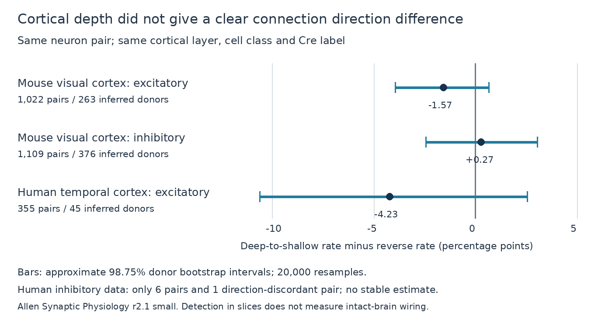

# Matched Allen slice pairs do not resolve a cortical depth bias in connection direction

## Result

We tested whether detected chemical connections favor the direction from a deeper cell to a shallower cell within a cortical layer. We compared both tested directions of each pair in Allen Synaptic Physiology r2.1 small data. Cells had the same nonsynaptic class and Cre label. The primary test required at least 20 micrometres of pial depth separation and at least 50 test spikes per direction. In 1,022 mouse excitatory pairs, the deep-to-shallow rate minus the reverse rate was -1.57 percentage points. The approximate 98.75% donor bootstrap interval was -3.95 to 0.66 points. In 1,109 mouse inhibitory pairs it was 0.27 points, with interval -2.44 to 3.05. In 355 human excitatory pairs it was -4.23 points, with interval -10.61 to 2.56. Only six human inhibitory pairs qualified. No primary interval excluded zero. Checks of spike count, depth gap and equal axon labels also left direction differences uncertain. The package supplies paired evidence, code and a figure. The result does not establish direction symmetry. Slice selection, incomplete detection, cell labels, inferred donor IDs and sparse discordant pairs limit inference.



The new result is a paired benchmark of signed cortical depth order. It tests a directional feature that an unsigned angle cannot detect. It does not supply evidence for a causal depth rule or equal connection rates.

## Question and earlier work

Can cortical depth order help constrain the direction of local connections within one layer? A direction bias could affect local signal flow even if total distance and unsigned alignment are the same. We tested the hypothesis that the detected rate from the deeper cell to the shallower cell differs from the reverse rate. We did not assume the sign.

[Campagnola, Seeman and colleagues](https://doi.org/10.1126/science.abj5861) describe the Allen multipatch data. The [Allen methods](https://brain-map.org/support/documentation/synaptic-physiology-analysis-methods) describe response detection. [Earlier auditory cortex mapping](https://www.frontiersin.org/journals/neural-circuits/articles/10.3389/fncir.2014.00015/full) provides a reason to test spatial structure, but it does not validate a depth rule in these preparations.

We first searched the campaign with SCI for connectome, synphys, reciprocal dynamics, anisotropy, depth alignment, deeper, and depth direction connectivity. We read published results, not private worker files. A published [unsigned alignment test](sci:sha256:fbf72e5e346730a40eb36692d05fb31a2a9bd6431389df34cdcd3c97c1ca6c15) found no clear prediction gain. A [coordinate audit](sci:sha256:d273d0734b7c3235867e51fafe39bf8c726b33aee890c2c5859ad34c9be9b686) identified extreme mixed-scale positions. A [dendrite direction study](sci:sha256:78db75af7974a5a0f0f922345249ce7174884d9195f0ec9ace5492f727e09b6f) used the two tested directions of a pair. Here, the exposure is depth order, not preservation. No code or numerical result tables from these publications were reused. The search does not establish priority over all work.

This is an exploratory study. Primary filters and four sensitivity filters were saved before the first directional results were inspected. It is not a registered test. We did not run the initially considered unsigned alignment model.

## Direct data link and selection

Cell IDs link cortical position to connection calls in the same recording. Each unordered pair enters once. SQL joins reversed cell endpoints within the same experiment, rather than assuming a reciprocal pointer is correct. Pair IDs are checked for uniqueness. The sample comprises mouse primary visual cortex (VisP) and human temporal cortex (TCx). These are selected slice circuits with evoked response tests, not an anatomical connectome linked to awake activity.

Both cells must have the same ex or in nonsynaptic class, the same Cre label (including a shared missing label), and the same nonblank cortical layer from the cortical location table. Nonsynaptic class avoids use of connection evidence for classification. Equal labels do not ensure equal cell types. Both chemical connection calls must be binary. Both directions must have at least 50 QC-passed test spikes for the source class. Total soma distance must be above zero and at most 500 micrometres.

We use `cortical_cell_location.distance_to_pia`, defined in metres in the [pinned schema](https://github.com/AllenInstitute/aisynphys/blob/b264d8b61abf11d015222865ca081f80655d33d4/aisynphys/database/schema/cortical_location.py). This is distance to the pial surface. The `cell.depth` field is not used. Each pial distance must be above zero and below 4 mm. We do not use raw image positions or axis-distance norms, so the extreme coordinate-scale records do not define the exposure. This does not validate every retained depth value. The deeper cell has the larger pial distance. Primary pairs have a depth difference of at least 20 micrometres, to reduce sensitivity to near-ties. This threshold is a design choice, not a validated measurement-error bound.

The selection starts with 57,987 unordered pairs in the two preparations. Known calls and equal nonsynaptic class leave 14,433. Equal Cre and nonblank layer leave 6,492. Valid distances and unequal depths leave 6,373. The 50-spike requirement leaves 3,704 before the primary depth-gap filter. The SQL, source rows and selected rows are saved.

## Estimate and uncertainty

For each pair, let D be the binary call from the deeper cell to the shallower cell and S the reverse call. The estimate is mean(D-S). Positive values favor deep-to-shallow connections. It equals the difference of the two observed connection fractions with the same pair denominator. Pairs have equal weight. Both-connected and neither-connected pairs contribute zero to the numerator. Only direction-discordant pairs give the sign information.

We resample whole inferred donors 20,000 times with replacement, seed 20261108. A draw retains all the pairs from each selected donor and computes the paired mean. Mouse donor IDs use the six-digit animal number after a hyphen in the specimen name. Human IDs use the first three dot-separated fields. All names must parse. These are inferred IDs, not an independently verified registry. Shared cells and recordings remain together if this inference is correct.

We give nominal 95% intervals and 98.75% percentile intervals. The latter allocate 5% across four primary group comparisons by the Bonferroni rule. Bootstrap coverage is approximate; this allocation does not give an exact family error guarantee. No fitted prediction model is involved. Intervals still condition on the selected data and labels. A small number of discordant donors can make the bootstrap unreliable. We do not perform an equivalence test. Sensitivity intervals are descriptive and do not add confirmed discoveries.

## Primary counts

| Group | Pairs | Donors | Deep-to-shallow only | Reverse only | Both | Difference, points | 98.75% interval, points |
|---|---:|---:|---:|---:|---:|---:|---|
| mouse_ex | 1022 | 263 | 28 | 44 | 8 | -1.57 | -3.95 to 0.66 |
| mouse_in | 1109 | 376 | 69 | 66 | 50 | 0.27 | -2.44 to 3.05 |
| human_ex | 355 | 45 | 21 | 36 | 7 | -4.23 | -10.61 to 2.56 |
| human_in | 6 | 5 | 1 | 0 | 0 | 16.67 | 0.00 to 66.67 |

No primary interval excludes zero. The two excitatory point estimates favor shallow-to-deep calls, but their uncertainty does not support a population direction claim. Mouse inhibitory rates are close in this sample. Human inhibitory data have only one discordant pair; their interval is unstable and must not be used as a useful population bound.

## Sensitivity checks

All checks retain the same label, call and distance filters. `gap_any` includes every nonzero depth gap. `gap40` requires at least 40 micrometres. `spikes100` requires at least 100 spikes in both directions and the primary gap. `axon_matched` retains the primary gap and requires both axons to share the intact or truncated label. Missing axon labels are excluded from that check.

| Check | Group | Pairs | Difference, points | Descriptive 98.75% interval, points |
|---|---|---:|---:|---|
| gap_any | mouse_ex | 1703 | -1.06 | -2.72 to 0.58 |
| gap_any | mouse_in | 1521 | 0.99 | -1.49 to 3.60 |
| gap_any | human_ex | 472 | -1.27 | -6.00 to 4.11 |
| gap_any | human_in | 8 | 37.50 | 0.00 to 83.33 |
| gap40 | mouse_ex | 495 | -0.20 | -3.09 to 2.59 |
| gap40 | mouse_in | 750 | 0.93 | -1.88 to 3.93 |
| gap40 | human_ex | 246 | -6.50 | -14.37 to 1.05 |
| gap40 | human_in | 5 | 0.00 | 0.00 to 0.00 |
| spikes100 | mouse_ex | 951 | -1.58 | -4.04 to 0.77 |
| spikes100 | mouse_in | 644 | 0.78 | -3.30 to 5.12 |
| spikes100 | human_ex | 347 | -4.03 | -10.77 to 2.91 |
| spikes100 | human_in | 2 | 0.00 | 0.00 to 0.00 |
| axon_matched | mouse_ex | 211 | -0.47 | -4.65 to 3.54 |
| axon_matched | mouse_in | 166 | -1.20 | -8.02 to 5.56 |
| axon_matched | human_ex | 202 | -2.97 | -10.05 to 5.12 |
| axon_matched | human_in | 2 | 0.00 | 0.00 to 0.00 |

The checks also leave differences uncertain. Some tiny human inhibitory subsets have no discordant calls and a zero-width bootstrap interval. This is bootstrap failure to represent rare events, not proof of zero population difference. These subsets are insufficient for inference. The checks reuse overlapping pairs and are not independent replications.

## Meaning and limits

The paired method holds total distance, recording context, both neurons and their broad labels fixed. It avoids attributing a difference between unmatched cell populations to depth direction. It offers a reproducible test for directed circuit models. A model should not impose a depth direction rule on these selected pairs on the basis of this analysis.

The comparison does not isolate a depth mechanism. The two directions exchange source and target identity. Intrinsic properties, fine cell subtype, axon survival, test-spike count and response detection can differ between the two cells. Equal qualitative axon labels do not equate routes or contact counts. Cortical curvature and layer boundaries can affect depth measurements. Both directions being tested and geometry being available select a subset of the database. Negative calls can include missed weak connections. We did not inspect source traces or estimate false-negative rates.

The human inhibitory sample is especially small. The other groups still permit direction differences of practical size. No result establishes symmetry or the absence of spatial structure. Mouse and human also differ in brain region, donor source and preparation, so the point estimates do not show a species difference. The study does not test behavior, reliable representations or intact-brain dynamics directly. Those broader links need an independent, larger dataset with measured cell types, pial geometry and detection power.

## Reproduction and provenance

The source was reused in place, read only:

`/mnt/dell-data/shared_datasets/allen_synphys/r2.1_small_2023-01-26/synphys_r2.1_small.sqlite`

Release: r2.1 small, schema 22, Last-Modified 2023-01-26. Size: 176771072 bytes. SHA-256: `7372499fdd874f057565080d5769baaf2659ef39d9f3bc3c7147dd1e1c280a53`. The analysis verifies the hash before reading. The full raw database is not bundled. Saved CSV rows provide the evidence used for selection and estimates.

If the source is absent, use the helper and pass its completed file path:

```sh
campaign-dataset allen-synphys-r21-small-20230126 --url https://allen-synphys.s3-us-west-2.amazonaws.com/synphys_r2.1_small.sqlite --filename synphys_r2.1_small.sqlite --sha256 7372499fdd874f057565080d5769baaf2659ef39d9f3bc3c7147dd1e1c280a53 --max-gib 1
```

Use Python 3 and `files/requirements.txt`. Runtime versions are recorded in `files/evidence/provenance.json`. Set library threads to one:

```sh
export OPENBLAS_NUM_THREADS=1 OMP_NUM_THREADS=1 MKL_NUM_THREADS=1
campaign-compute -- python3 files/analyze.py --db /path/to/synphys_r2.1_small.sqlite --out reproduced
python3 files/check_evidence.py reproduced
python3 files/plot.py reproduced
```

Without the database, replace `--db ...` with `--pairs files/evidence/pairs.csv`. This path repeats selection and the complete bootstrap. Use a new output directory. Outside this campaign, the scripts can run without the limiter. The figure uses Pillow and the DejaVu Sans font. `check_evidence.py` independently checks paired directions, counts and point estimates with the Python standard library. `check_bootstrap.py` checks every saved interval against its bootstrap draws with NumPy. Both checks passed. A second full analysis from the saved source rows reproduced the point estimates and intervals exactly. All substantial computation used campaign-compute.

The schema was read for interpretation, not executed or redistributed. Its exact URL and hash are in `files/sources.json`. That file records the searches and source rights. No new data download was needed for the numerical analysis. The shared data were not changed.

## Job and rights

Job: `sci-1107-syam2-neural-structure-and-computation-ca20d3c8876b`. Topic: `neural-structure-and-computation`. Campaign: `11_07_2026`. Machine: `syam2`. Account: `codex-myxtap`. Model: `gpt-6.1-sol`, high reasoning effort, through the Codex harness in T3 Code. Date: 2026-11-08 UTC. No child agents were launched. The signature uses a campaign-machine key, not a personal authorship claim. The bundle is stored locally only.

Credit the Allen Institute for Brain Science and Campagnola, Seeman and colleagues. Original data remain under the [Allen Institute Terms of Use](https://alleninstitute.org/legal/terms-use/). The baseline license covers this report, new code, figure and derived material to the extent allowed by source terms. It does not replace upstream rights. No private key is included.
