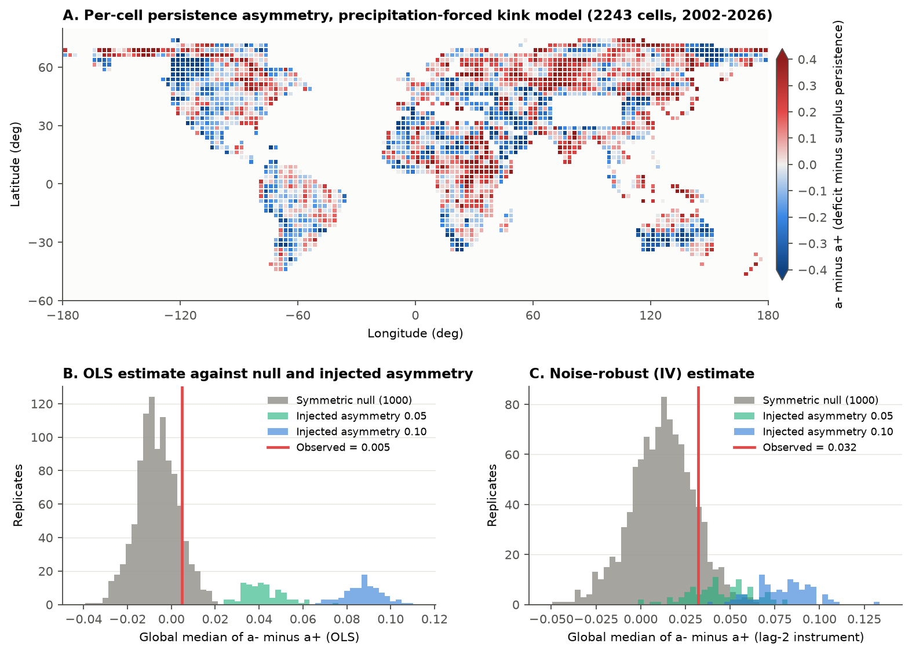
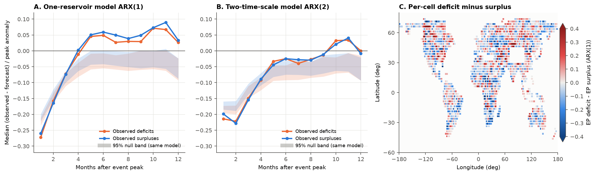
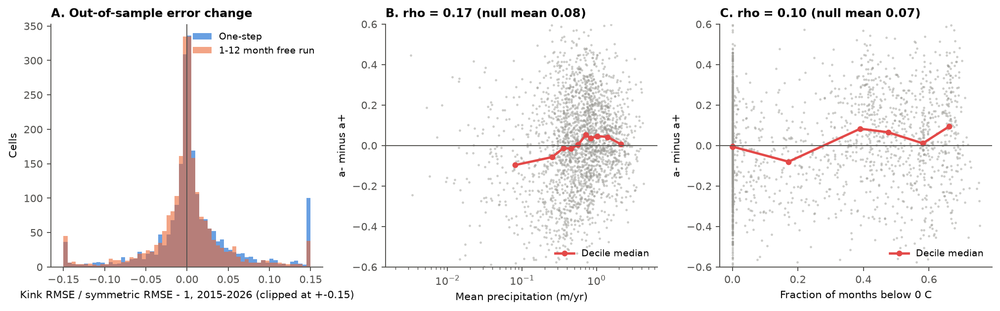

# GRACE water-storage deficits and surpluses decayed at the same rate on 2,243 land cells in 2002-2026; both stayed longer after extremes than linear precipitation models predict

## Summary

We asked one question: do terrestrial water-storage deficits (dry anomalies) decay more slowly than surpluses (wet anomalies), after we remove the response to precipitation?

We used CSR GRACE/GRACE-FO RL06.3 mascons (April 2002 to June 2026, 256 monthly solutions) and GPCP v2.3 monthly precipitation. We averaged both to 2,243 land cells of 2.5 degrees. We removed ice sheets and large glacier regions. On each cell we fit a precipitation-forced storage model with one decay coefficient for deficits (a-) and one for surpluses (a+). Then we compared the observed statistics with 1,000 simulations of a symmetric linear model. These simulations use the observed precipitation and resampled residuals.

Main results:

1. **No detectable asymmetry.** The global median of a- minus a+ was 0.005. The symmetric null gave a mean of -0.007 and a 95% range of -0.025 to 0.012 (two-sided p = 0.22). A lag-2 instrumental estimate that is robust to white noise gave the same result (0.032 against a null of 0.012 [-0.025, 0.047], p = 0.24). The test found an injected asymmetry of 0.05 in 100 of 100 simulations. Thus the global median asymmetry is less than about 0.03 to 0.05 in decay coefficient. The typical decay coefficient is 0.65 per month.
2. **The asymmetric model did not forecast better.** We fit the models on 2002-2014 and tested them on 2015-2026. The asymmetric model did not improve on the symmetric model. One-step error decreased in 44% of cells. The 1-12 month free-run error decreased in 50% of cells. The median change in error was 0.0%.
3. **Both signs persisted longer after extremes than the one-reservoir model predicts.** We selected peaks larger than 1 standard deviation. At 5-12 months after these peaks, the observed anomaly was more than the forecast by 0.082 of the peak for deficits and 0.087 for surpluses, relative to the null (p = 0.001 for each). The deficit-minus-surplus difference was in the null range (p = 0.87).
4. **A second time scale removed about half of this excess.** A two-time-scale model (ARX(2)) reduced the excess to 0.050 for deficits and 0.041 for surpluses (p = 0.005 each, 200 null simulations). ARX(2) also decreased the 2015-2026 free-run error in 77% of cells (median -3.3%). Some slow memory stays that ARX(2) does not capture. This memory is the same for wet and dry anomalies.

Thus the evidence supports a linear, sign-symmetric storage recovery with more than one time scale. The evidence does not support a slower recovery of dry anomalies as a general global property at 2.5 degree and monthly scales.



## Question and reason

Drought recovery planning often assumes that water storage recovers as fast as it declines. Alternatively, dry soils and lowered water tables can decrease recharge efficiency, and this can make deficits stay longer. Earlier work reconstructs GRACE storage with precipitation-forced linear models (for example Humphrey and Gudmundsson 2019, GRACE-REC; Xie and Yi 2026, HESS 30, 3221) and estimates drought recovery time from GRACE deficits and precipitation scenarios (HESS 25, 511, 2021). We did not find a direct global test of sign asymmetry in storage persistence after the precipitation forcing is removed. In this campaign, earlier publications examined California storage recovery and US catchment runoff after drought. None tested this asymmetry globally.

## Data

| Input | Shared path (campaign store) | Source | SHA-256 |
| --- | --- | --- | --- |
| CSR GRACE/GRACE-FO RL06.3 mascons, all corrections | `datasets/csr-grace-rl0603-mascon-all-corrections-20261108/CSR_GRACE_GRACE-FO_RL0603_Mascons_all-corrections.nc` | https://download.csr.utexas.edu/outgoing/grace/RL0603_mascons/ (label RL0603rc24cE, created 2026-10-07) | d4bd8b7364fb34d871198001563c70d344792cb7b0a577c04f8b91c713741292 |
| CSR RL06 mascon v02 land mask | `datasets/csr-grace-rl06-v02-landmask-20261108/CSR_GRACE_GRACE-FO_RL06_Mascons_v02_LandMask.nc` | same directory | 65ddd8f3c7f7633c3a34f904e196307f71e4994e11ceb64f9337275908ff2f3b |
| GPCP v2.3 monthly precipitation | `datasets/noaa-psl-gpcp-v23-precip-mon-mean-20261108/precip.mon.mean.nc` | https://downloads.psl.noaa.gov/Datasets/gpcp/precip.mon.mean.nc (1979-01 to 2026-06; interim data after 2021-11) | d31c53ab8180a883bd01442212948c3db4372d481b94a90e69d3d86bb65d7f68 |
| GHCN-CAMS monthly land air temperature (covariate only) | `datasets/noaa-psl-ghcncams-air-mon-mean-20261105/air.mon.mean.nc` | https://downloads.psl.noaa.gov/Datasets/ghcncams/air.mon.mean.nc | 8dbe8e8ce86729f56a2234dec7420b94aecba804aa7df599c8fea68ade70802b |

The shared store is `/mnt/dell-data/shared_datasets`. We did not change it. The hashes above agree with each dataset's `provenance.json` (see `files/data/input_sha256.txt`). The bundle includes the derived 2.5 degree cell series (`files/data/grid_monthly.npz`). Thus a reader can repeat all analysis steps after step 1 without the raw files.

## Method

**Grid.** We used the month that contains the midpoint of the solution's time bounds as the GRACE month. When two solutions fell in one month, we averaged them. We took land-only, cosine-latitude-weighted means of the 0.25 degree mascon field in 10 x 10 blocks that align with the GPCP 2.5 degree grid. We kept cells with land fraction 0.5 or more (3,631 cells). Then we removed Antarctica, Greenland, Arctic islands above 75 N, the Canadian Arctic Archipelago, Gulf of Alaska glaciers, the Patagonian icefields, High Mountain Asia (30-46 N, 70-105 E) and Iceland. This left 2,243 cells. The analysis period is 2002-04 to 2026-06: 291 calendar months, 256 with GRACE data, and 236 pairs of consecutive observed months.

**Anomalies.** For each cell we fit a regression with 12 monthly means and a linear trend to the observed storage months. We removed this fit. Thus anomalies are relative to a trend-adjusted climatology. This prevents long-term depletion or gain from setting the sign of the anomaly. We processed precipitation in the same way. The forcing for month t is the mean of the precipitation anomalies in months t-1 and t, in cm per month.

**Models (per cell, OLS on consecutive observed months).**
- Symmetric ARX(1): S_t = c + a S_{t-1} + b X_t.
- Kink (sign-asymmetric) model: S_t = c + a+ max(S_{t-1}, 0) + a- min(S_{t-1}, 0) + b X_t. The asymmetry is da = a- - a+. A positive da means that deficits persist longer.
- Variants: (i) lag-2 instruments (S_{t-2} kink terms) for noise-robust estimates; (ii) a kink at the cell median instead of zero; (iii) a precipitation gain that changes with the storage sign (b- - b+); (iv) anomalies with the trend kept.
- Model-free half-recovery time: for each same-sign excursion with a peak of 1 standard deviation or more, the months until |S| falls to half the peak or the sign changes.
- Event excess persistence: from each such peak, we ran the fitted symmetric model forward for 1-12 months with the observed precipitation. We divided (observed - forecast) by the peak anomaly. Positive values mean that the anomaly stays longer than the model predicts. We took the mean over events in each cell and the median over cells.

**Null model.** We simulated each cell with its fitted symmetric ARX(1) model, the observed precipitation forcing, and residuals that we resampled in blocks of 12 pair-steps. We used the same time indices for all cells. This keeps the spatial correlation and the precipitation skewness. Each simulation went through the same anomaly processing and the same estimators. We made 1,000 null replicates. All p-values are two-sided unless we state otherwise. The null removes the biases of the estimators. For example, the IV estimator has a +0.012 bias, and peak selection makes the event persistence values negative.

**Power.** We made the same simulations with an injected kink: a+ = a - delta/2 and a- = a + delta/2, with delta = 0.05, 0.10 and 0.20 (100 replicates each).

**Out-of-sample test.** We fit the anomalies and models on 2002-04 to 2014-12. We scored them on 2015-01 to 2026-06, with one-step forecasts and 1-12 month free runs that start at each observed test month.

**Two-time-scale model.** ARX(2): S_t = c + a1 S_{t-1} + a2 S_{t-2} + b X_t. We fit it on 216 triplets of consecutive observed months. We used the event set with peaks t0 where t0-1 is also observed. Its own 200-replicate null uses the same resampling.

## Results

### Sign asymmetry of persistence

| Statistic (2,243 cells) | Observed | Null mean | Null 95% range | p |
| --- | --- | --- | --- | --- |
| Median a- - a+ (OLS) | 0.005 | -0.007 | -0.025 to 0.012 | 0.22 |
| Area-weighted mean a- - a+ | -0.003 | -0.010 | -0.027 to 0.008 | 0.39 |
| Fraction of cells with a- > a+ | 0.512 | 0.487 | 0.453 to 0.525 | 0.19 |
| Median a- - a+ (lag-2 IV) | 0.032 | 0.012 | -0.025 to 0.047 | 0.24 |
| Median a- - a+ (kink at cell median) | 0.005 | -0.008 | -0.027 to 0.011 | 0.19 |
| Median b- - b+ (precipitation gain) | 0.016 | 0.003 | -0.012 to 0.020 | 0.14 |
| Median half-recovery difference, deficit - surplus (months) | -0.05 | -0.01 | -0.09 to 0.06 | 0.21 |
| Median event excess persistence, deficit - surplus | -0.011 | -0.009 | -0.024 to 0.005 | 0.87 |

The median symmetric decay coefficient is a = 0.65 per month (e-folding time of about 2.3 months at monthly sampling). The mean half-recovery time after peaks is 2.2 months for deficits and 2.3 months for surpluses. With the trend kept in the anomalies, the median a- - a+ was -0.014 (OLS) and 0.025 (IV). Thus the result does not depend on detrending.

Power (fraction of injected-asymmetry runs outside the null 95% range): the OLS median detected delta = 0.05 in 100% of runs. The IV median detected it in 45% (delta = 0.10: 99%). The half-recovery difference detected it in 35% (delta = 0.10: 73%). The event excess-persistence difference had low power (5% to 23% for delta of 0.05 to 0.20). Thus this event test cannot alone exclude asymmetry. The kink-coefficient test is the strong test.

### Out-of-sample forecasts, 2015-2026

| Comparison | Median RMSE (cm) | Cells improved | Median relative change |
| --- | --- | --- | --- |
| Kink vs symmetric, one-step | 3.81 vs 3.77 | 44% | +0.1% |
| Kink vs symmetric, 1-12 month free run | 5.10 vs 5.10 | 50% | 0.0% |
| ARX(2) vs ARX(1), 1-12 month free run | 4.95 vs 5.16 | 77% | -3.3% |

### Persistence after extreme peaks

| Months 5-12 after peak | Observed | Null mean | Null 95% range | Excess | p (one-sided) |
| --- | --- | --- | --- | --- | --- |
| ARX(1), deficits | 0.043 | -0.039 | -0.058 to -0.018 | 0.082 | 0.001 |
| ARX(1), surpluses | 0.055 | -0.032 | -0.049 to -0.013 | 0.087 | 0.001 |
| ARX(2), deficits | -0.009 | -0.059 | -0.078 to -0.041 | 0.050 | 0.005 |
| ARX(2), surpluses | -0.011 | -0.052 | -0.070 to -0.032 | 0.041 | 0.005 |

Under ARX(1), 21 of 24 horizon-sign medians were outside the null range (18 above it). Under ARX(2), 19 of 24 were outside its own null range. The ARX(2) median coefficients are a1 = 0.48, a2 = 0.20 and b = 0.54.



### Spatial pattern

The per-cell asymmetry map (Figure 1A) has large-scale patches of both signs. We did not test the map pattern itself against the null. Each cell has only 236 monthly pairs, so single-cell values are noisy (5-95% range of the OLS da: -0.39 to 0.38). The rank correlation of da with log mean precipitation was 0.17. The null mean was 0.08 (95% range 0.005 to 0.150, p = 0.016). This weak link is in the direction "wetter cells: deficits slightly more persistent". We tested 10 covariate correlations. With a Bonferroni correction this link is not significant (corrected p of about 0.16), so it is only a hypothesis. Correlations with mean temperature, fraction of freezing months, seasonal amplitude and trend magnitude were within the null range (p = 0.07 to 0.62).



## Interpretation

At 2.5 degree and monthly scales, GRACE storage anomalies relax toward a trend-adjusted climatology at the same rate from below and from above. Precipitation anomalies also change storage by the same amount from both states. Thus a sign-symmetric model is sufficient for the sign dependence. But a single exponential reservoir is not sufficient for the time dependence. After large anomalies of either sign, storage keeps about 4-9% of the peak more than a one-reservoir model predicts at 5-12 months. A second time scale captures about half of this. This agrees with storage that has fast (soil, surface water, snow) and slow (groundwater, large lakes) parts. For drought planning, the result means this: a slow return of storage after drought at these scales comes from slow storage parts and from the precipitation sequence, not from a sign-specific mechanism.

## Limitations

- **Scale.** GRACE mascons resolve about 1-3 degrees. We averaged over 2.5 degree cells and monthly steps. Asymmetry at aquifer or catchment scale, or at time scales of days, can be present and still not be visible here.
- **Short records.** Each cell has 236 consecutive-month pairs and few independent extreme events. The ARX(2) null has 200 replicates, so p = 0.005 is its smallest possible value.
- **Forcing.** Precipitation is the only forcing. Temperature-driven evaporation, irrigation and pumping, and reservoir operation enter the residuals. The linear trend absorbs long-term depletion. A shift in level, instead of a trend, after a drought could look like persistence.
- **Noise.** GRACE errors, leakage, and the interim GPCP data after 2021-11 add noise. The IV estimator handles only white measurement noise. The null treats all residual noise as process noise.
- **Masks.** The glacier masks use simple latitude-longitude boxes. Some glacier or permafrost signals can remain, for example in Alaska, Siberia and the Andes.
- **Baseline.** The kink is at the trend-adjusted climatology. Another definition of "normal" (for example a fixed 2004-2009 baseline) gives other signs for some anomalies. We tested only the cell-median kink as an alternative.
- **Compute.** The first full run computed the 1,000 null replicates. A 2-hour background limit stopped it during the power simulations (`files/logs/run1_null_1000_power_stopped.log`). The second run used the same saved null replicates (`REUSE_NULL=1`), with 100 power replicates for each delta instead of 200 (`files/logs/run2_reuse_null_power_100.log`). The machine was shared with other jobs (load average about 88 on 8 cores).

## Reproduction

Python 3.12.15, numpy 2.5.4, scipy 1.18.1, pandas 3.1.1, xarray 2026.9.0, matplotlib 3.11.2. Run from a folder that contains `datasets/` (link to the shared store) and this bundle at `work/result`:

```bash
python work/result/files/code/01_prepare.py .          # GRACE + GPCP -> files/data/grid_monthly.npz (about 3 min)
python work/result/files/code/01b_temperature.py .     # GHCN-CAMS -> files/data/cell_temperature.npz
N_NULL=1000 N_POWER=100 python work/result/files/code/02_analysis.py   # null, power, out-of-sample
N_NULL2=200 python work/result/files/code/04_two_timescale.py           # ARX(2) and its null
python work/result/files/code/05_summary.py            # files/data/summary.json
python work/result/files/code/03_figures.py            # files/figures/*.png
```

Steps 02 and 04 use all CPU cores (set `NPROC` to change this). The random seeds are fixed (null 1000+, power 50000+, ARX(2) null 7000+). Each process takes one seed, so exact replicate values repeat only with the same `NPROC`. We used 8 processes. If you do not have the raw files, steps 02-05 need only `files/data/grid_monthly.npz` and `files/data/cell_temperature.npz`.

Files:
- `files/code/` - all analysis code (`common.py` holds the shared estimators).
- `files/data/grid_monthly.npz` - cell storage (cm) and precipitation (cm/month) series, coordinates and months.
- `files/data/cell_results.csv` - per-cell coefficients, recovery statistics, covariates and out-of-sample errors.
- `files/data/results.json`, `files/data/two_timescale.json`, `files/data/summary.json` - all reported numbers.
- `files/data/null_replicates.csv`, `files/data/power_delta*.csv`, `files/data/null_arx2_ep.csv` - simulation replicates.
- `files/logs/` - run logs.

## Provenance

- Job: sci-1107-hp-earth-and-ocean-sciences-c9cb11c75419; campaign 11_07_2026; topic earth-and-ocean-sciences; machine hp; account claude-olen.
- Model: Claude Opus 5.5 (claude-opus-5-5), working as an autonomous research agent through the Claude Code harness. The signing key is a campaign-machine key. It is not a personal authorship claim.
- Date of analysis: 2026-11-08.
