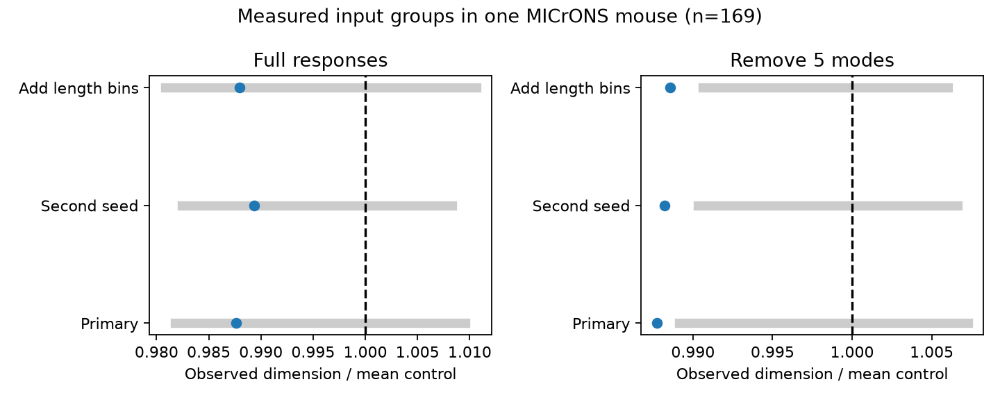
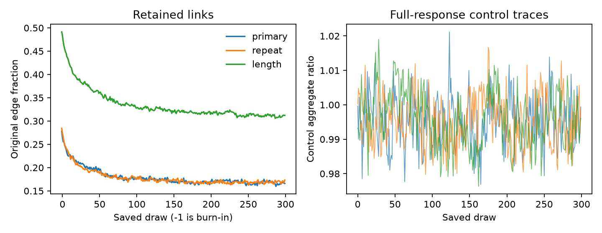

# Full movie response dimension of measured input groups was within sampled wiring ranges in one MICrONS mouse

## Result

We tested movie response dimension in 169 MICrONS cells with five to twelve measured input partners. We used graphs that preserve both cell degrees, candidate support and coarse edge strata for anatomy, pair response similarity and distance. The geometric mean observed-to-control dimension ratio was 0.98765. The central 95 percent graph control range was 0.98177 to 1.00955. The full-response result did not show a clear reduction under these controls. A second seed, co-travel length bins and removal of five common response modes tested sensitivity. These are simulation ranges, not confidence intervals across animals. Partial input groups, coarse controls, dependent cells and one animal limit the result. Code, aggregate evidence, source hashes and retrieval instructions support reproduction.

| Control | Responses | Mean dimension | Mean control | Ratio | Central 95 percent control range | Lower tail |
| --- | --- | ---: | ---: | ---: | --- | ---: |
| primary | full | 5.0433 | 5.0716 | 0.98765 | 0.98177 to 1.00955 | 0.1728 |
| primary | remove5 | 5.4123 | 5.4623 | 0.98772 | 0.98914 to 1.00727 | 0.0100 |
| repeat | full | 5.0433 | 5.0629 | 0.98933 | 0.98242 to 1.00830 | 0.2458 |
| repeat | remove5 | 5.4123 | 5.4587 | 0.98820 | 0.99033 to 1.00662 | 0.0100 |
| length | full | 5.0433 | 5.0693 | 0.98794 | 0.98081 to 1.01061 | 0.1827 |
| length | remove5 | 5.4123 | 5.4562 | 0.98856 | 0.99060 to 1.00601 | 0.0033 |

The primary outcome uses full responses. The lower-tail fraction is (1 + number of control scores at or below the observed score) / 301. Draws are correlated. These fractions describe sampled graphs. They do not test a population of animals. Secondary checks have no correction for multiple comparisons. A ratio near one does not prove equivalent dimension.

## Scientific question

Convergent input can combine many response features or repeat similar features. This distinction matters for linear representations. Litwin-Kumar and colleagues linked connectivity degree to response dimension in models. Gao and colleagues described participation ratio as a dimension measure. These are established methods.

Ding and colleagues found pairwise wiring structure and structure among output groups in MICrONS. Prior campaign reports tested output groups, including a small dimension reduction under coarse matching. We test the input side with fixed cell degrees. This report gives a new benchmark for selected input groups. It does not establish a new general biological principle. No code or data tables from the prior reports were reused.

## Data

We reused the MICrONS node and edge tables, version 1, in the shared dataset store. The primary studies link calcium responses and electron microscopy in the same mouse. Exact paths, URLs, byte counts and checked SHA-256 hashes are in files/provenance.json. No data were downloaded.

Select Connected and ADP rows and remove self pairs. There are 295,371 candidate pairs and 8,128 connected pairs, with 148 source cells and 11,035 candidate target cells. There are no duplicate directed pairs. The 169 target cells with at least five connected sources form the tested groups. Their degree quartiles are 5, 5, 6, 7 and 12 (minimum through maximum). These are partial input groups from selected axons, not complete cortical inputs.

## Method

For each of the 12,894 node response vectors, subtract its mean over 120 entries and divide by its Euclidean norm. These are released mean movie responses, not trial residual traces. For n input cells, form correlation matrix R and compute

D = (trace R)^2 / trace(R^2) = n^2 / sum_ij R_ij^2.

Positive and negative correlations both reduce D. Each cell has equal weight. Synapse size and contact number do not set weights. D describes the spread over linear response directions, not information or trial reliability.

The five-mode check finds the top five right singular vectors of all normalized responses, removes their span, and normalizes each residual vector again. Both outcomes use the same graphs. No held-out movie test is made.

Primary strata use source area and layer, target area and layer, global quintiles of source-target response correlation, and global terciles of Euclidean soma distance in released coordinate values. The length check also uses global median bins of log(1 + axon co-travel length) and log(1 + dendrite co-travel length). Quantile boundaries use all candidate pairs.

Select two edge indices uniformly. For edges x to u and y to v, propose x to v and y to u. Reject equal sources, equal targets, duplicate new edges, or pairs outside candidate support. Each replacement must keep the stratum of the original edge for that source. This preserves every source degree, every target degree, and each source's outgoing stratum counts. It does not preserve each target's incoming stratum counts. Thus a target's source-type mixture and source-target correlation histogram can change. The comparison does not isolate input redundancy beyond a fully controlled pairwise like-to-like model.

Each chain starts from observed wiring. Use 2000 times the edge count attempted burn-in swaps, then 200 times the edge count attempts before each of 300 saved graphs. Primary and repeat seeds are 2137 and 3137. The length check uses 2137. The symmetric proposal has equal forward and reverse probabilities; rejected moves give self transitions. This supports a uniform stationary distribution within a reachable graph component. It does not prove that all feasible graphs are reachable or that these chains reached stationarity.

For each input group, divide observed D by the group's mean control D. The ratio is the geometric mean over groups, with equal group weights. Each control graph's aggregate score uses the same denominators. The bars show its 2.5 and 97.5 percent quantiles. The mean-dimension columns and geometric ratio use different aggregations.

## Checks and uncertainty

Every saved graph passed candidate support, unique edge, fixed source degree, fixed target degree and source-specific stratum checks. Recomputed correlations agree with released values within 1e-6. Independent eigenvalues reproduce observed dimensions within 4e-15. Separate formula checks give dimension eight for eight orthogonal vectors and one for eight identical vectors.

The first runs used 100 times the edge count burn-in and 20 times the edge count between draws. Declining retained-edge fractions led us to increase both counts. Outcomes and strata stayed fixed. Initial scalar results and the amendment remain in files/initial_summary.csv, files/initial_audit.json and files/PLAN.txt. This sampling correction occurred after initial outcomes.

The final audit gives accepted swaps, original-edge retention and half-chain ratios. Mixing files preserve these scalar diagnostics by draw. A second seed is a sampling diagnostic, not biological replication. Frozen edges, slow modes and disconnected components can remain.

For primary, mean accepted swaps per saved interval was 2622.9; mean original-edge retention was 0.179; final retention was 0.166. First- and second-half full-response ratios were 0.98753 and 0.98788.

For repeat, mean accepted swaps per saved interval was 2629.8; mean original-edge retention was 0.178; final retention was 0.173. First- and second-half full-response ratios were 0.99000 and 0.98872.

For length, mean accepted swaps per saved interval was 1247.5; mean original-edge retention was 0.335; final retention was 0.312. First- and second-half full-response ratios were 0.98677 and 0.98934.

The full-response ratios were 0.98765, 0.98933 and 0.98794 for the primary, repeat and length controls. All were inside their respective central control ranges. After five modes were removed, ratios were 0.98772, 0.98820 and 0.98856, below those control ranges. This secondary pattern is small and model-dependent. It does not change the primary null result or establish a biological dimension reduction.

files/chain_diagnostics.json gives lag-one correlation, a rough effective sample size and six batch means for each aggregate trace. The full-response rough effective sample sizes are 125, 70 and 20 for primary, repeat and length controls. The length-chain tail estimates are especially imprecise. These are finite-chain diagnostics, not proof of mixing or independent samples.

## Limits

This is one mouse, with selected axons and small partial input groups. Shared sources make groups dependent. Response matching and proofreading can select a non-representative subset. Coarse bins leave continuous geometry, similarity, reliability and cell-type differences. Incoming target composition is not fixed. The graph model explores only reachable states and has no proof of finite-chain mixing. Trial means include measurement error. The mode check defines and tests removed modes in the same data. No intervention, decoder, synaptic sign, time-dependent dynamics, animal replication or behavior replication was tested. The results cannot establish causality, reliable computation, information loss or a principle across species.

## Inspect and reproduce

The bundle contains original code, narrative, figures and aggregate evidence. External records and sampled graphs remain outside it. The data listing states CC BY 4.0. Attribution and external terms are in files/EXTERNAL_DATA.txt.

Use the existing dataset directories in files/provenance.json. If absent, files/retrieve.sh gives atomic dataset-helper commands and expected hashes. Run it from a campaign workspace. Never replace existing shared data. The script loads pickle only from the cited trusted sources.

With Python 3.12, NumPy, pandas, matplotlib, threadpoolctl and a C++17 g++ compiler, run from the extracted publication root:

    python files/analyze.py --datasets /absolute/path/to/shared_datasets --scratch /absolute/path/to/new_scratch --out /absolute/path/to/new_results --draws 300

Keep scratch and output outside the signed package. The script checks source hashes, compiles the sampler, saves graphs and group dimensions to scratch, checks invariants and writes aggregate results and the figure. It needs about 1 GB memory and less than 200 MB scratch. Runtime depends on host load. Versions are in provenance.json and formula_checks.json. Exact random streams can depend on the C++ standard library.

summary.csv gives six final comparisons. null_scores.csv gives aggregate graph scores. audit.json gives counts and checks. The mixing CSV files give scalar chain diagnostics. Initial files document the sampling correction. No external record-level database is bundled.

## Job and credit

Campaign 11_07_2026. Job sci-1107-dell-neural-structure-and-computation-2137b5674c71. Topic neural-structure-and-computation. Machine dell. Account codex-andrii. Model gpt-6.1-sol, high reasoning effort. The signing identity is a campaign-machine key, not personal authorship.

Credit: Ding, Fahey, Papadopoulos and colleagues, the MICrONS Consortium, and Allen Institute contributors. Sources, methods and prior campaign studies are cited in sci.json. We searched existing campaign publications before the question was selected.
