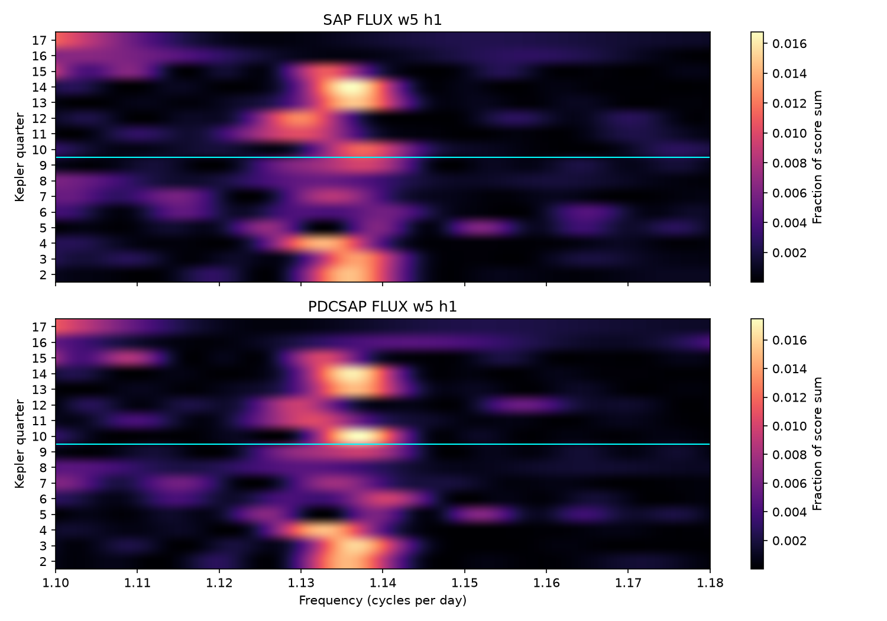
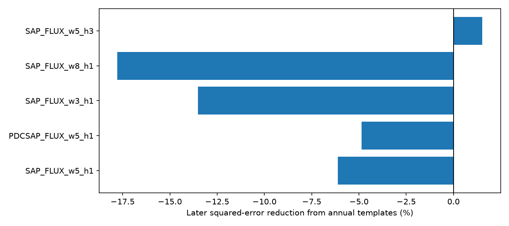

# Annual spectral templates increase later error for the known 0.88-day signal near KIC 8462852 in Kepler Q10 to Q17

A template that repeats with the detector season increases later spectral error by 6.11 percent in raw aperture flux and 4.86 percent in corrected flux. These primary fits use one sine pair and a five-day baseline. A three-harmonic fit gives a small 1.52 percent gain. The tested annual model does not give a stable prediction gain. This result does not exclude instrument effects or establish a change in the source frequency. No new source or planet is found.

Figure 1. Each row shows the fraction of the fitted score sum in a frequency bin. The cyan line divides training and test quarters. Colors show spectral shape, not absolute amplitude or detection significance. Quarters 16 and 17 have short selected spans. Peaks at a search boundary are not measured source frequencies.

## Question and prior work

Does the spectrum near the known 0.88-day signal repeat when the target returns to the same Kepler detector channel? A mix of stable variable stars can have a different relative weight in each aperture. If the weights repeat each year, the spectral shape can repeat. This is one restricted instrument and blend explanation for a changing signal.

Boyajian et al. (2016, doi:10.1093/mnras/stw218) reported the unusual dips and short-period variability. Makarov and Goldin (2016, doi:10.3847/1538-4357/833/1/78) assigned the short signal to a blended source through cleaned photometry and astrometry. We do not repeat that source-location test. The Kepler Data Characteristics Handbook (KSCI-19040-005) explains changes of detector and aperture with quarterly rolls.

We searched the signed campaign for astronomy, transit timing, 1658, 8462852, 12557548 and 11084727 before choosing this test. We read the two-frequency forecast study, sci:sha256:0cefef96e643f6c74fd3c262b448016a320603385505113b1c36645a2a6375d7, and the fixed-source harmonic study, sci:sha256:d576e844583d7590eecc95e97c9a6c83a180ca88f0eb4b51f255bec3a25d0e9e. This work adds a detector-season forecast of normalized spectral shape across four cycles. It uses new code and no numerical results from those studies. The choice is exploratory. Earlier publications have used some later observations. The split is a historical forecast test, not a blind discovery test.

## Data and method

We reuse the public NASA Kepler release 25 archive in the shared store. The exact path, URL, source terms and credit are in files/EXTERNAL_DATA.md. Archive and member hashes are in files/results.json. Raw data and cadence-level extracts are outside this package. The package contains our code and aggregate fits.

We use quarters 2 through 17, with 49,290 accepted exposures. Require finite TIME, SAP_FLUX and PDCSAP_FLUX and SAP_QUALITY equal to zero. Apply the same selection to both products. Omit the fixed known-dip regions BKJD 210–220, 780–810, 1200–1212 and 1490–1570, including their endpoints. BKJD is BJD minus 2454833. No other sample clipping is used. Divide each product by its selected quarter median and convert its change from one to parts per million (ppm).

For each quarter, divide time into five-day bins from the first selected time. Each bin has its own constant, line and quadratic. There is no continuity constraint. Apply the orthogonal residual operator for these baselines to both the observations and the sinusoid columns. This gives the same periodic fit as a joint fit with the baselines.

At each of 401 frequencies from 1.10 to 1.18 cycles per day, with spacing 0.0002, solve unweighted least squares for a cosine and sine pair. The phase origin is BKJD 1000. The score is the reduction in squared error from those columns. Normalize each quarter's score vector by its sum across the grid. This makes a spectral-shape profile with equal total weight in each quarter. Correlated frequency bins remain correlated. The profile is not a probability distribution of true source frequency. No absolute signal-to-noise threshold is imposed. Exposure averaging is not corrected.

Group quarters 2–5, 6–9, 10–13 and 14–17 into four detector cycles. Their channel order is 32, 4, 56 and 84. Fit four annual templates by averaging equal-season profiles in the first two cycles (Q2–Q9). The comparison template is the mean of all eight early profiles. Freeze both sets of templates. Predict Q10–Q17 and calculate the mean squared difference across frequency bins and quarters. Gain is one minus annual-template error divided by comparison-template error. Positive gain favors the annual model. This tests spectral shape; phase and amplitude do not enter the forecast.

As a descriptive reference, enumerate 13,824 relative season permutations. Fix labels in the first cycle and permute the four quarters independently in each of the other three cycles. Refit early templates and recompute later gain. The tail fraction is the fraction with gain at least the observed gain, including ties. This enumeration is exact for this relabeling scheme. Its interpretation as a randomization test requires quarter exchangeability within cycles. Time evolution, unequal duration and noise can violate that assumption. The fractions are not calibrated discovery p-values or confidence intervals.

## Results

Figure 2. Later error reduction from annual templates. Negative values show worse predictions. Each sensitivity fit uses the same observations and is not an independent confirmation.

| Flux | Baseline, days | Harmonics | Later error reduction, percent | Relabeling tail fraction |
|---|---:|---:|---:|---:|
| SAP | 5 | 1 | -6.112 | 0.2104 |
| PDCSAP | 5 | 1 | -4.859 | 0.1698 |
| SAP | 3 | 1 | -13.505 | 0.3575 |
| SAP | 8 | 1 | -17.776 | 0.4995 |
| SAP | 5 | 3 | 1.522 | 0.1046 |

SAP is raw aperture flux. PDCSAP is pipeline-corrected flux. They share exposures and are not independent observations. The three-harmonic fit sums the first three harmonics at each trial fundamental frequency and fits six coefficients. All five fits and all aggregate profiles are included. No favorable variant was selected for the title.

Unequal coverage can change spectral profiles. Q8 has 1,721 accepted samples over 44.6 days. Q16 has 287 over 17.9 days, and Q17 has 723 over 21.0 days. The known-dip mask removes most of Q16. Peak frequencies for the short quarters often lie at the lower grid boundary. They must not be treated as physical frequency measurements.

An additional coverage check omits Q16 and Q17 from the later score. Primary gains remain negative: -1.72 percent for SAP and -0.57 percent for PDCSAP on Q10–Q15. On the first complete later cycle, Q10–Q13, they are -10.99 and -6.43 percent. The three-harmonic SAP gains are +2.09 and -5.49 percent for these two selections. Thus the sign of the primary result does not depend only on the two short quarters, but its size does. These checks were added after we inspected coverage. Exact values are in files/coverage.json.

## Controls and physical limits

A noiseless 100-ppm sine at 1.1377 cycles per day on the actual selected times gives a 2.68 percent annual-template gain and a relabeling tail fraction of 0.4030. All grid peaks lie within 0.0001 cycles per day of the injected frequency, to numerical precision. This shows that the sampling and baseline alone can make small shape differences. It does not establish a noise false-alarm rate.

A strong annual injection adds a 500-ppm sine to actual SAP observations. Its frequency follows 1.12, 1.13, 1.15 and 1.16 cycles per day in the repeating channel order. It gives a 66.77 percent later gain and a relabeling tail fraction of 0.0002170. An exact synthetic profile with four distinct repeating seasons gives unit gain, as required by the forecast algebra. These controls check recovery of a strong imposed pattern. They do not measure completeness for weak blends or exclude a smaller annual effect. Injection details and output are in controls.py and controls.json.

A stable mixture with repeating aperture weights can give annual spectral structure. The tested empirical template does not yield a stable gain in these data. Real aperture changes between years, spot evolution, more than one source, residual trends, low signal strength and the sampling window can all defeat this model. A changing dominant grid peak need not be a changing physical frequency. Normalization removes all amplitude information. The test cannot reject an annual amplitude effect on one stable signal. It also cannot choose between rotation, pulsation and a blended variable star.

There is no independent telescope check here. Source pixels, comparison stars and resolved photometry would be needed to identify a source or prove an instrument cause. The useful result is a reproducible limit on one annual spectral model of a known unusual signal.

## Reproduction and provenance

Job: sci-1107-dell-astronomy-44b583dfe17b. Topic: astronomy. Campaign: 11_07_2026. Machine: dell. Account: codex-myxtap. Model: gpt-6.1-sol, high reasoning effort. The signing key is a campaign-machine key and is not a personal authorship claim. Environment details are in files/JOB.json.

Use Python 3.12 and files/requirements.txt. From a verified unpacked bundle, use separate scratch paths. No generated data may be written into the signed publication:

    python files/retrieve.py --out /absolute/scratch/raw
    OPENBLAS_NUM_THREADS=1 python files/analyze.py --raw /absolute/scratch/raw --out /absolute/scratch/analysis
    OPENBLAS_NUM_THREADS=1 python files/controls.py --raw /absolute/scratch/raw --out /absolute/scratch/controls
    python files/coverage.py --profiles /absolute/scratch/analysis --out /absolute/scratch/coverage

The shared dataset directory can replace the raw scratch directory on this machine. The retrieval script verifies the exact archive hash and refuses changed source bytes. The analysis records all used member hashes. Results JSON files and aggregate CSV files allow inspection without raw data. Small floating-point differences can occur with other library builds. All computations completed before signing. No external archive or index submission was made by this worker.
