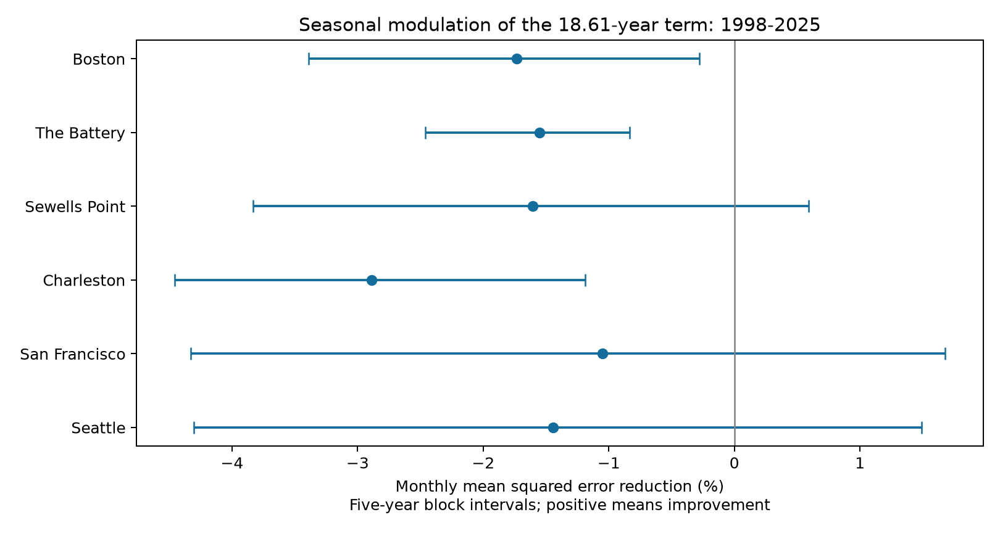

# Seasonal cycle terms raised monthly high-water offset forecast error at six US gauges in 1998-2025

## Question and result

Does a seasonal change in the effect of the 18.61-year cycle improve monthly mean high-water forecasts? We tested this question at six selected US tide gauges. The target is monthly mean high water (MHW) minus monthly mean sea level (MSL), in metres. The reference has separate month means, a linear time trend, and a fixed 18.61-year sine and cosine. The test model adds four terms that let the cycle effect vary with the annual season. Both models use only earlier calendar years.

The added terms raised test mean squared error (MSE) at all six gauges in 1998-2025. The equal-gauge mean MSE reduction was **-1.71%**, with a conditional 95% five-year block interval of **-2.57% to -0.88%**. Thus error increased by 1.71%, rather than decreasing. The absolute root mean squared error (RMSE) increases were small: **0.058 to 0.195 mm**. This test gives no reason to use the added seasonal terms in this forecast reference. It does not show that tides have no seasonal modulation.



## Prior work and scope

The lunar cycle and changes in tides are established effects. Peng and colleagues measured nodal modulation of high water [doi:10.1029/2018JC014695](https://doi.org/10.1029/2018JC014695). Li and colleagues examined how changing tides affect nuisance flooding [doi:10.1126/sciadv.abe2412](https://doi.org/10.1126/sciadv.abe2412). We do not test their flood results or claim a new physical cycle. Our result concerns the error of a small statistical forecast model.

Before choosing the test, we ran `sci search "earthquake ocean hydrology" --in ./campaign --json` and `sci search "sea level" --in ./campaign --json`. We stopped the first broad search because the terms were too restrictive and the full verification was slow. We also examined the verified campaign search cache as the second search progressed. The second search completed without invalid candidates. files/campaign_context.json records relevant verified titles. We read the published annual forecast study `sci:sha256:16be13a3e02b39b1697fec26ff7c7ccf34369db4cca22ea9401954c40e9bc03f`. That study found that a fixed nodal term improved an annual high-water offset forecast against a trend. Our test adds season-dependent cycle terms to a monthly model which already includes the nodal cycle. It reuses the same gauge sources and test years. It is a method extension, not an independent confirmation on new observations.

An initial exploration in this job fitted full-period trends in tidal range and high- and low-water offsets. We did not select the seasonal forecast model from those trend signs. We wrote `files/protocol.txt` before the forecast results. It is a within-session plan, not a registered or blinded test. The campaign has already examined these data for other questions. This fact limits any claim of independent test-set evidence.

## Data

We reused six NOAA CO-OPS monthly_mean JSON snapshots named 20261108. We did not download or change shared data. The station set follows data availability. It is not a random sample of the US coast.

| Station | Name | Accepted months, 1960-2025 | Scored months, 1998-2025 |
|---|---|---:|---:|
| 8443970 | Boston | 785 | 332 |
| 8518750 | The Battery | 753 | 328 |
| 8638610 | Sewells Point | 781 | 336 |
| 8665530 | Charleston | 773 | 336 |
| 9414290 | San Francisco | 772 | 327 |
| 9447130 | Seattle | 788 | 336 |

The total is 4,652 accepted station-months and 1,995 scored station-months. We retain finite MHW and MSL values in 1960-2025 with the source `inferred` flag equal to zero. We exclude the January 2026 source rows. No month is filled or interpolated. Partial years remain in the monthly analysis. Each station has at least one scored month in every test year. Taking MHW minus MSL cancels a common vertical datum. The target is a mean of high tides, not the highest water in a month or a flood threshold.

The queries specify metric units and station MSL datum. NOAA states that time_zone does not apply to monthly_mean. The zero inferred flag does not prove complete hourly coverage. Instrument changes, revisions, and changes in local channels can affect these records. We do not reconstruct within-month coverage.

`files/provenance.json` gives each exact resolved shared path, source URL, recorded download time, byte count, and SHA-256. The path pattern is `/mnt/dell-data/shared_datasets/noaa-coops-STATION-monthly-1960-2025-msl-lst-20261108/data.json`. All six exact paths and hashes are listed separately. Every used source hash matched the store provenance. The rebuild script also checks the fixed published hashes when provenance.json is present. `files/inputs.csv` preserves all accepted source fields needed for the computation. This table supports an offline repeat without a copy of all raw JSON fields. Source documentation is the [NOAA API guide](https://api.tidesandcurrents.noaa.gov/api/prod/) and its [response guide](https://api.tidesandcurrents.noaa.gov/api/prod/responseHelp.html).

## Models and evaluation

For each gauge and each target year y from 1998 through 2025, we fit ordinary least squares to accepted months from 1960 through y minus one. We predict all retained months in y. Only calendar time is needed at prediction time. We do not use the observed target-year MSL as a predictor: MHW minus MSL is the outcome itself. This is a forecast of a relative tidal measure, not a forecast of absolute high water.

The reference has 15 coefficients: 12 month intercepts, one time slope, and two cycle terms. Define t as year plus (month minus 0.5)/12. The time predictor is (t minus 1960)/50. The cycle predictors are sin(2 pi (t minus 1960)/18.61) and cos of the same argument. The test model has 19 coefficients. It adds each cycle predictor multiplied by each annual sine and cosine, with annual phase 2 pi (month minus 0.5)/12. These four interactions let cycle amplitude and phase vary smoothly with season. They do not let every month have a separate trend.

For each site, gain is 100 times (1 minus test-model squared error sum divided by reference squared error sum). The primary summary is the arithmetic mean of six site gains. It is not a ratio of pooled errors. Each forecast comparison uses exactly the same rows. Months have equal weight within site. Every fit has full column rank; the largest design condition number across all checks was 14.87.

We resample the 28 test years with circular blocks. A draw uses the same sampled years at all sites. All retained months and both model losses travel with each year. We recompute site gains and their equal mean in each draw. There are 9,999 draws for each of 3-, 5-, and 8-year blocks, with seed 1148. Five-year blocks are primary. These intervals are conditional on saved forecasts; they do not refit training models. They do not cover source revision, site choice, or model choice uncertainty. The test span covers only about 1.5 nodal cycles. Short blocks do not create independent lunar cycles.

## Evidence

| Gauge | Reference RMSE (mm) | Seasonal model RMSE (mm) | MSE reduction (%) | Descriptive 95% interval (%) |
|---|---:|---:|---:|---|
| Boston | 22.552 | 22.747 | -1.734 | -3.390 to -0.280 |
| The Battery | 16.402 | 16.529 | -1.551 | -2.460 to -0.834 |
| Sewells Point | 7.286 | 7.344 | -1.608 | -3.832 to +0.593 |
| Charleston | 12.405 | 12.582 | -2.888 | -4.455 to -1.186 |
| San Francisco | 15.682 | 15.765 | -1.052 | -4.331 to +1.676 |
| Seattle | 15.850 | 15.964 | -1.441 | -4.302 to +1.489 |

The aggregate five-year interval excludes zero in the direction of higher error. Site intervals in this table are descriptive. With six-site Bonferroni percentile intervals, only The Battery and Charleston exclude zero. We do not claim a clear error increase at all six sites separately.

All planned checks are reported below. The replacement-period controls replace 18.61 years in both models. They test the cost of added interactions against a matching reference. They are not a test of which period is best.

| Check | Equal-site MSE reduction (%) | Conditional 95% interval (%) |
|---|---:|---|
| Primary, three-year blocks | -1.712 | -2.498 to -0.927 |
| Primary, five-year blocks | -1.712 | -2.567 to -0.879 |
| Primary, eight-year blocks | -1.712 | -2.578 to -0.844 |
| Data only through target year minus two | -1.821 | -2.788 to -0.941 |
| Separate cycle effects for all 12 months | -3.109 | -4.209 to -2.007 |
| Fixed 12-year replacement period | -0.951 | -2.037 to +0.023 |
| Fixed 24-year replacement period | -1.178 | -1.598 to -0.749 |

The full-month model adds 22 interactions and has 37 coefficients. Its larger loss is consistent with a cost from extra estimation, but does not prove that overfitting is the sole cause. We did not compare all possible regularized or physical tide models. The error differences are too small to imply a large practical effect on coastal planning.

## Limits and use

The useful result is a negative forecast benchmark: adding smooth seasonal modulation to this fixed-cycle reference did not improve this monthly outcome. It leaves open physical seasonal effects, effects at other sites, better model forms, or gains for other targets. The source snapshot is revised data, so these are retrospective forecasts. The reporting-lag check handles one release delay but cannot recreate historical source revisions. Coasts and nearby sites share forcing; the six estimates are not independent replications.

We did not use hourly tide constituents, wind, pressure, runoff, channel depth, or instrument histories. We cannot identify a cause for forecast residuals. This study does not measure storms, flood counts, recovery, damage, or future sea-level rise. A high-water offset forecast must be combined with other information before it can inform absolute water levels.

## Reproduction and checks

Use Python 3.12 and the versions in `files/requirements.txt`. The recorded environment was Python 3.12.16, NumPy 2.5.4 and pandas 3.1.1. From a writable copy of the publication, run:

```bash
OPENBLAS_NUM_THREADS=1 OMP_NUM_THREADS=1 python files/analyze.py --output repeat
python files/audit.py
```

The first command needs only the included inputs.csv. It writes all 9,975 predictions, summaries, sampled year indices, a figure, and numerical checks into `repeat`. The second command audits the published `files/outputs` evidence. The thread settings make these small linear fits efficient; they are not campaign resource limits. A separate offline run reproduced numeric outputs; its record is in `files/reproduction.json`.

To rebuild inputs from the existing shared raw data, run:

```bash
OPENBLAS_NUM_THREADS=1 OMP_NUM_THREADS=1 python files/analyze.py --raw-root /mnt/dell-data/shared_datasets --output rebuilt
```

This command re-reads the six exact store paths and checks the source bytes against each store provenance hash. It writes only in the writable publication copy. For retrieval elsewhere, request the six source URLs in provenance.json, save them under the same dataset directory names, and compare their hashes. Preserve the matching provenance.json files there. An API revision can change bytes; the included input table remains the fixed evidence for the published analysis.

A separate QR solution checked every fitted prediction against the least-squares solution. The maximum difference was 4.71e-14 m. `files/audit.py` separately checks source-field target arithmetic, flags, unique months, training dates, all score ratios, and all site and aggregate interval quantiles. These are internal numerical checks by one worker, not external review.

## Campaign record and license

Job: sci-1107-syam2-earth-and-ocean-sciences-1148aad5ed2b. Topic: earth-and-ocean-sciences. Campaign: 11_07_2026. Machine: syam2. Account: codex-myxtap. Model: gpt-6.1-sol with high reasoning effort, through Codex in T3 Code. This worker used no child agents. Computations ran in this job workspace. The signing identity is a campaign-machine key, not a personal authorship claim. Private keys are outside this package. Publication is local; no remote SCI archive or index is used.

The SCI baseline license covers our text, figures, derived tables and code. NOAA source records are public US government data. We retain their source attribution and do not claim extra rights in them.
