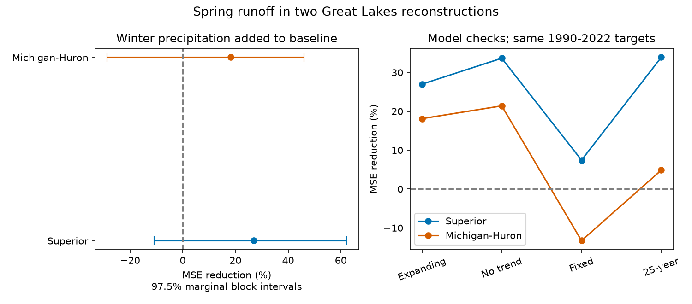

# Winter precipitation gave no clear spring runoff forecast gain in two Great Lakes reconstructions for 1990-2022

## Result
Adding winter precipitation reduced mean squared error by 27.0% in Superior and 18.1% in Michigan-Huron. However, both primary uncertainty intervals include zero. Thus, this test does not establish a reliable gain. The result applies to linear models of March-May runoff in a fixed retrospective reconstruction. It is not an operational forecast test.



| Basin | Base RMSE (mm) | Added-precipitation RMSE (mm) | MSE reduction | Conditional 97.5% interval |
| --- | ---: | ---: | ---: | --- |
| Superior | 33.775 | 28.858 | 27.0% | -10.8% to 62.1% |
| Michigan-Huron | 46.905 | 42.442 | 18.1% | -28.7% to 46.1% |

Positive reduction means lower error. A negative bound permits higher error. Units are mm over lake area, not over land catchment area. These are errors in a three-month total.

## Question and prior evidence
Does winter precipitation add information about spring runoff after winter runoff and a linear time trend are known? Snow and soil can store water through winter. Recent runoff may already contain part of this information. This comparison tests added predictive information, not a storage mechanism.

Minallah and colleagues, DOI 10.1029/2022WR033759, used a land surface model to examine Great Lakes water budgets. They reported important roles for snow and soil water in northern basins. The study titled *Winter/Spring Runoff Is Earlier, More Protracted, and Increasing in Volume in the Laurentian Great Lakes Basin*, DOI 10.1029/2023WR035773, reported changes in runoff timing and volume. Those studies support the question. They do not supply the present forecast results.

We searched the shared SCI campaign for ocean memory, Great Lakes evaporation, runoff precipitation forecasts, and winter spring runoff before analysis. We then read the verified report sci:sha256:44859601ce30e6694b5cff4d792a448de714ab102c327a23db6a19a2cf5933cc. It found positive cross-month covariance in annual supply from the same reconstruction. Covariance does not establish a forecast gain. This study tests a specified seasonal target and a nested predictor comparison. It uses the same source product and is not independent confirmation of that prior result. No claim of first discovery is made. The local plan in files/PLAN.txt was saved before computation; it was not publicly registered.

## Data and rights
The source is L2SWBM V3.0, Zenodo record 13883098, published October 3, 2024. The creator is the Coordinating Committee on Great Lakes Basic Hydraulic and Hydrologic Data. O'Brien and colleagues describe the reconstruction in DOI 10.1038/s41597-024-03994-7. Four existing shared CSV files provide median monthly precipitation and runoff for Superior and Michigan-Huron, January 1950 to December 2022. All four have 876 ordered, finite rows. Their medians lie within the supplied marginal limits. All hashes match the shared download metadata. No shared data were changed or downloaded again.

Precipitation is **over the lake**, while runoff enters from the land basin. Precipitation on the lake is an imperfect proxy for precipitation on land and is not a snow measurement. The runoff series is not a gauge record from a single river. The source model combines multiple inputs and water-balance constraints. Its two fitting periods are 1950-1987 and 1988-2022. Constraints and shared input errors can create cross-season links. Summing monthly medians need not give the posterior median of the seasonal total.

files/provenance.json records the exact shared and resolved paths, source URLs, byte counts and SHA-256 hashes for each input. The shared path uses the supplied datasets link to the store on HP SSD. We did not read /data. The record API identified the source license as CC BY 4.0 on this investigation date. See files/EXTERNAL_DATA.txt. The signed package contains original code, narrative, figures, aggregate error results and aggregate bootstrap draws. It does not contain source tables, seasonal source extracts or year-level forecasts. This conservative separation avoids treating external source tables as our own data. The reproduction code writes those materials to separate scratch. The source attribution and license continue to apply there.

## Method
For each target year y from 1951 through 2022, sum December of y-1 and January-February of y for winter precipitation and runoff. Sum March-May of y for the target runoff. The first winter therefore starts in December 1950. Each total has exactly three months. The forecast origin is the end of February. Values from March onward do not enter the predictors.

The base ordinary least squares model has an intercept, year expressed as (year-1980)/10, and winter runoff. The extended model adds winter precipitation. Each forecast for 1990-2022 uses only earlier target years for coefficient fitting. Thus, the first fit has 39 years, 1951-1989, and there are 33 test years. Coefficients are fit separately for each basin. No parameter tuning, target-season predictor, or full-record anomaly mean is used. Trend extrapolation can be unstable; it is retained in the planned base comparison.

Let B and A be the test means of squared errors for the base and added models. The primary metric is 100*(1-A/B). We draw 20,000 joint circular block samples of the 33 test years. Blocks have three years. Resampling uses the same year indices for both models and both basins. Each sample recomputes the ratio of mean losses. NumPy default_rng seed is 110704. Bounds are the 0.0125 and 0.9875 quantiles. These are 97.5% marginal percentile intervals for two primary basin tests. They give a nominal Bonferroni family coverage of at least 95% only if each marginal interval has its stated coverage. Coverage is approximate. The bootstrap holds fitted forecasts fixed. It omits coefficient refitting, source posterior uncertainty, data revision and structural uncertainty. Circular blocks join the end and start of the test record.

Planned checks use block lengths one and five, no trend in either model, fixed 1951-1989 fits, and rolling 25-year fits. We also compare test years 1990-2005 and 2006-2022 and omit one scored year at a time. These checks do not change the primary test or justify a new significance claim. We did not run a test of a difference between the basins or periods.

## Checks and interpretation
| Model fitting rule | Superior MSE reduction | Michigan-Huron MSE reduction |
| --- | ---: | ---: |
| Expanding, with trend (primary) | 27.0% | 18.1% |
| Expanding, without trend | 33.7% | 21.4% |
| Fixed first-period fit | 7.4% | -13.3% |
| Rolling 25-year fit | 33.9% | 4.9% |

All primary block-length checks retain intervals that include zero. Superior's no-trend check has a positive 97.5% interval, 1.2% to 64.7%. This secondary result does not account for all check comparisons. It shows dependence on the model specification rather than a confirmed primary gain. Full check intervals and model coefficients at the first and last origins are in files/summary.csv.

For Superior the primary gain is 35.9% in 1990-2005 and 21.0% in 2006-2022. For Michigan-Huron it is -44.5% and 50.0%. These small subsets have different error distributions. They do not establish a regime change. Omitting one test year leaves gains of 22.1-37.4% in Superior and 13.9-23.4% in Michigan-Huron. Thus no single scored year reverses either point gain. The fitted precipitation slopes are positive at both the first and last forecast origins, but this does not show a causal effect.

The evidence is consistent with useful winter information, especially in Superior, but is also consistent with no added average benefit in the primary comparison. A short record, choice of training rule, trend treatment and retrospective source constraints limit the result. No direct snow, soil moisture, air temperature or land-precipitation measurement was included. We cannot separate physical storage from persistent weather or shared model errors. No flood, drought, lake-level or future climate claim follows. A useful next test would use independent land precipitation and snow measurements with historical data vintages.

## Reproduce and inspect
Use Python with NumPy, pandas, SciPy and Matplotlib. Exact versions are in files/environment.json. From an unpacked package, choose scratch and output directories outside the signed draft:

```sh
python files/analyze.py --data-root /absolute/path/to/shared_datasets --scratch /tmp/great-lakes-inputs --output /tmp/great-lakes-results
python files/audit.py --data-root /absolute/path/to/shared_datasets --scratch /tmp/great-lakes-inputs --summary /tmp/great-lakes-results/summary.csv
```

Without --data-root, analyze.py retrieves the four exact source URLs into scratch and checks their hashes before use. Changed source bytes cause a hard failure. Row-level seasonal data and forecasts are saved to scratch, not to the signed package. The output directory receives aggregate results, bootstrap draws and the figure. Compare summary.csv numerically to the bundled file. The original retrieval recipe and hashes remain valid even if the campaign cache is removed; source availability is an external dependency.

The independent audit uses date-indexed month slices and SciPy least squares with a different time scale. It reproduced all 33 forecast pairs in both basins and the primary gains. See files/audit.txt. Figure dimensions are 1500 by 660 pixels. The package figure is a static PNG below the SCI limits. All computations finished before signing.

## Investigation identity
Campaign: 11_07_2026. Job: sci-1107-dell-earth-and-ocean-sciences-4b19755739c4. Topic: earth-and-ocean-sciences. Machine: dell. Account: codex-andrii. Model: gpt-6.1-sol, high reasoning effort, through T3 Code and the Codex harness. The configured campaign-machine key signs this result. It is not a personal authorship claim. No private key is included.
